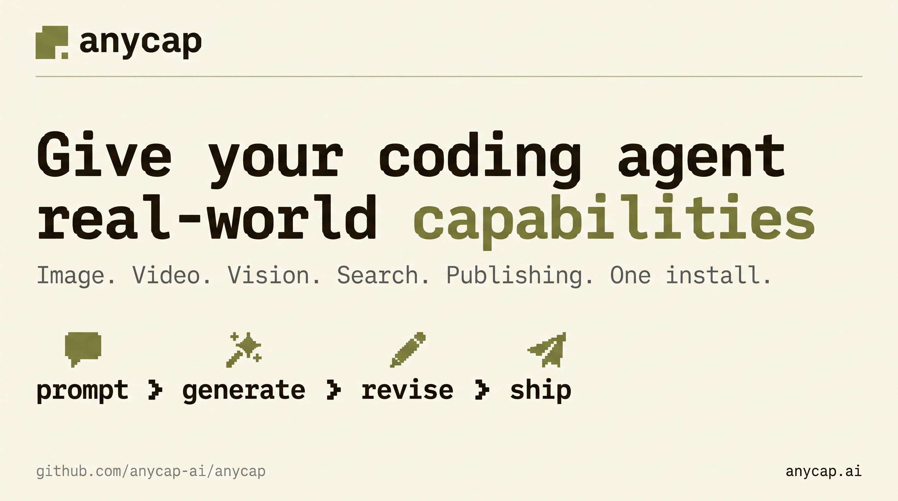

# AnyCap

<!-- Badges: replace placeholders once CI / npm org are confirmed -->
[](https://www.npmjs.com/package/@anycap/cli)
[](LICENSE)
[](https://github.com/anycap-ai/anycap/stargazers)
[](https://skills.sh/anycap-ai/anycap)

> **The execution layer for coding agents.**
> Give Claude Code, Cursor, and Codex real-world capabilities — image, video, vision, music, web search, and publishing — inside the agents you already use.
> Install in plain English. No `npm` vs `brew` vs `curl` debate.



---

## Quick start (30 seconds)

Paste this to Claude Code, Cursor, Codex, or any agent that can run a shell:

```text
Read https://raw.githubusercontent.com/anycap-ai/anycap/main/llms.txt and follow the
instructions to install the AnyCap CLI and skill. If you can't access the URL, run:
  1. curl -fsSL https://anycap.ai/install.sh | sh
  2. npx -y skills add anycap-ai/anycap -s '*' -g -y
  3. anycap login
  4. anycap status
```

That's it. The agent installs the CLI, installs the skill, logs you in, and verifies the
connection — then every capability below becomes a single sentence. Prefer to do it by
hand? Jump to [Manual install](#manual-install).

## Contents

- [What this fixes](#what-this-fixes)
- [What your agent can do](#what-your-agent-can-do)
- [Install by talking to your agent](#install-by-talking-to-your-agent)
- [Why skills over SDKs](#why-skills-over-sdks)
- [Manual install](#manual-install)
- [Capabilities](#capabilities)
- [Works with](#works-with)
- [FAQ & troubleshooting](#faq--troubleshooting)
- [Links](#links)
- [License](#license)

---

## What this fixes

Your coding agent can reason and write code. It **still can't** ship a meme, generate a
hero image, read a screenshot a user dropped in, search the live web, or publish a
landing page.

| Without AnyCap                          | With AnyCap                                   |
| --------------------------------------- | --------------------------------------------- |
| "I can't generate images."              | One command → a finished asset.               |
| "I can't see this screenshot."          | Reads images, video, and audio.               |
| "My knowledge has a cutoff."            | Live web search with citations.               |
| "You'll need to deploy that yourself."  | Ships a hosted page and returns the URL.      |

AnyCap is the missing execution layer — multimodal, web, and delivery behind **one CLI
and one auth**.

## What your agent can do

### 1. Make a meme end-to-end

Agent drafts the caption, generates the image, revises the visual, then returns a
shareable link.

<!--  -->

```bash
anycap image generate --prompt "cat in a tiny chef hat, meme caption 'ship it'" \
  --model nano-banana-2 -o meme.png
anycap image generate --prompt "make the caption bigger and yellow" \
  --model nano-banana-2 --mode image-to-image --param images=./meme.png -o meme-v2.png
anycap drive upload meme-v2.png --parent-path /memes
anycap drive share --src-path /memes/meme-v2.png
```

### 2. Turn a prompt into a hosted page

Agent writes the copy, generates hero visuals, and deploys a live URL.

<!--  -->

```bash
anycap image generate --prompt "abstract product hero, soft gradient" \
  --model nano-banana-2 -o ./dist/hero.png
anycap page deploy ./dist --name "launch-page" --publish
```

### 3. Review a screenshot with a human in the loop

Agent opens the annotation UI, the human marks issues, the agent reads the feedback and
revises.

<!--  -->

```bash
anycap annotate ./screenshot.png --no-wait
anycap annotate poll --session ann_xxxx
anycap actions image-read --file ./screenshot-annotated.png \
  --instruction "List every change requested by the annotations"
```

## Install by talking to your agent

AnyCap installs itself in plain English. No package-manager dance, no doc spelunking, no
version pinning. Hand the [Quick start](#quick-start-30-seconds) paragraph to your agent —
it reads `llms.txt`, installs the CLI, installs the skill, opens the browser to log you
in, and verifies the connection.

After that one paste, everything else is just conversation. The skill teaches the agent
the full command surface, so future actions become one sentence:

- **"Upgrade AnyCap and check my status."**
- **"Generate a hero image for the launch page and deploy it."**
- **"Search the web for the latest Cursor changelog and summarize."**

The agent picks the right capability, runs it, and hands you the result. You never touch a
flag unless you want to.

## Why skills over SDKs

Most tools ship an SDK and ask you to wire it in. AnyCap ships a **skill** — a single
file your agent reads — plus a thin CLI it can call.

- **No glue code.** The agent learns the whole command surface from one `SKILL.md`; you
  don't import a library or manage API objects.
- **Model- and agent-agnostic.** The same skill works across Claude Code, Cursor, Codex,
  and [40+ agents](https://skills.sh). Swap agents, keep your capabilities.
- **One auth, one CLI.** Image, video, vision, music, web, and publishing sit behind a
  single login instead of a dozen API keys.
- **Plain-English invocation.** Capabilities are triggered by intent, not by memorizing
  flags.

## Manual install

### 1. Install the CLI

macOS / Linux / Windows (Git Bash):

```bash
curl -fsSL https://anycap.ai/install.sh | sh
```

npm (all platforms):

```bash
npm install -g @anycap/cli
```

Or grab a binary from [GitHub Releases](https://github.com/anycap-ai/anycap/releases).

### 2. Install the skill

Works with Claude Code, Cursor, Windsurf, OpenCode, and [40+ agents](https://skills.sh):

```bash
npx -y skills add anycap-ai/anycap -s '*' -g -y
```

<details>
<summary>More ways to install the skill</summary>

```bash
# Direct download
curl -fsSL https://raw.githubusercontent.com/anycap-ai/anycap/main/skills/anycap-cli/SKILL.md \
  --create-dirs -o ~/.agents/skills/anycap-cli/SKILL.md

# Via AnyCap CLI
anycap skill install --target ~/.agents/skills/anycap-cli/

# Check if the skill is up to date
anycap skill check --target ~/.agents/skills/anycap-cli/SKILL.md
```

</details>

### 3. Verify

```bash
anycap login
anycap status
```

## Capabilities

| Capability                    | Command                                                              | What agents do with it                          |
| ----------------------------- | -------------------------------------------------------------------- | ----------------------------------------------- |
| Image generation / edit       | `anycap image generate` (`--mode image-to-image` for edits)          | Hero art, meme assets, illustration, photo edit |
| Image / video / audio reading | `anycap actions image-read` / `video-read` / `audio-read`            | Screenshot review, meeting transcripts, QA      |
| Video generation              | `anycap video generate`                                              | Demo clips, animated assets                     |
| Music generation              | `anycap music generate`                                              | Jingles, soundtracks                            |
| Web search                    | `anycap search --query` (general) / `--prompt` (grounded with cites) | Live answers, research                          |
| Web crawl                     | `anycap crawl <url>`                                                 | Any URL into clean Markdown                     |
| Annotate                      | `anycap annotate`                                                    | Human-in-the-loop visual feedback               |
| Draw                          | `anycap draw`                                                        | Live whiteboard / Mermaid diagrams              |
| Drive                         | `anycap drive upload` / `share`                                      | Shareable file links                            |
| Page                          | `anycap page deploy`                                                 | Hosted static pages                             |
| Download                      | `anycap download`                                                    | Save any remote file                            |

> **Coming soon:** TTS / voice synthesis.

## Models

AnyCap's model lineup evolves quickly, so the **authoritative, always-current list lives
in the CLI** — run `anycap <capability> models` to see exactly what your account can use:

```bash
anycap image models   # image generation / edit
anycap video models   # video generation
anycap music models   # music generation
```

Inspect a single model's modes and parameter schema before calling it:

```bash
anycap image models nano-banana-2                                # modes + operations
anycap image models nano-banana-2 schema --mode text-to-image    # parameter schema
```

The tables below reflect the models available in CLI **v0.3.6** — newer versions add and
retire models, so treat the CLI output as the source of truth.

### Image generation / edit

| Model              | Name                  | Modes                             |
| ------------------ | --------------------- | --------------------------------- |
| `nano-banana-2`    | Nano Banana 2         | text-to-image, image-to-image     |
| `nano-banana-pro`  | Nano Banana Pro       | text-to-image, image-to-image     |
| `gpt-image-2`      | GPT Image 2           | text-to-image, image-to-image     |
| `flux-kontext-max` | FLUX.1 Kontext Max    | text-to-image, image-to-image     |
| `qwen-image`       | Qwen Image            | text-to-image, image-to-image     |
| `seedream-4.5`     | Seedream 4.5          | text-to-image, image-to-image     |
| `seedream-5`       | Seedream 5            | text-to-image, image-to-image     |

### Video generation

| Model               | Name             | Modes                            |
| ------------------- | ---------------- | -------------------------------- |
| `veo-3.1`           | Veo 3.1          | text-to-video, image-to-video    |
| `veo-3.1-fast`      | Veo 3.1 Fast     | text-to-video, image-to-video    |
| `sora-2-pro`        | Sora 2 Pro       | text-to-video, image-to-video    |
| `kling-3.0`         | Kling 3.0        | text-to-video, image-to-video    |
| `kling-o1`          | Kling O1         | image-to-video                   |
| `hailuo-2.3`        | Hailuo 2.3       | text-to-video, image-to-video    |
| `seedance-1.5-pro`  | Seedance 1.5 Pro | text-to-video, image-to-video    |
| `seedance-2`        | Seedance 2.0     | text-to-video, image-to-video    |
| `seedance-2-fast`   | Seedance 2.0 Fast| text-to-video, image-to-video    |

### Music generation

| Model               | Name              | Modes          |
| ------------------- | ----------------- | -------------- |
| `suno-v5`           | Suno V5           | text-to-music  |
| `suno-v5.5`         | Suno V5.5         | text-to-music  |
| `mureka-v8`         | Mureka V8         | text-to-music  |
| `elevanlabs-music`  | ElevenLabs Music  | text-to-music  |

> **Reading / understanding** (`anycap actions image-read` / `video-read` / `audio-read`)
> automatically selects the best available model. Pass `--model` only when you need a
> specific one.

## Works with

Claude Code · Cursor · Codex · Windsurf · OpenCode · 40+ agents via [skills.sh](https://skills.sh).

## FAQ & troubleshooting

<details>
<summary><strong>Do I need an API key for each capability?</strong></summary>

No. One `anycap login` covers every capability — image, video, vision, music, web, and
publishing share a single auth.
</details>

<details>
<summary><strong>The agent says it can't reach <code>llms.txt</code>.</strong></summary>

Run the four manual commands from [Quick start](#quick-start-30-seconds), or follow
[Manual install](#manual-install).
</details>

<details>
<summary><strong>The skill isn't showing up in my agent.</strong></summary>

Confirm it installed into your agent's skills directory, then re-check:

```bash
anycap skill check --target ~/.agents/skills/anycap-cli/SKILL.md
```

Reload your agent so it re-reads the skills directory.
</details>

<details>
<summary><strong>How do I update?</strong></summary>

Tell your agent **"Upgrade AnyCap and check my status,"** or re-run the install script and
`npx -y skills add anycap-ai/anycap -s '*' -g -y`.
</details>

<details>
<summary><strong>Which platforms are supported?</strong></summary>

macOS, Linux, and Windows (via Git Bash). Install through the script, npm, or a binary
from [Releases](https://github.com/anycap-ai/anycap/releases).
</details>

## Links

- [llms.txt](llms.txt) — Give this to your agent
- [Skill file](skills/anycap-cli/SKILL.md) — Full capability documentation
- [GitHub Releases](https://github.com/anycap-ai/anycap/releases) — CLI binaries
- [skills.sh](https://skills.sh/anycap-ai/anycap) — Skills directory listing
- [Website](https://anycap.ai)

## License

[MIT](LICENSE)
