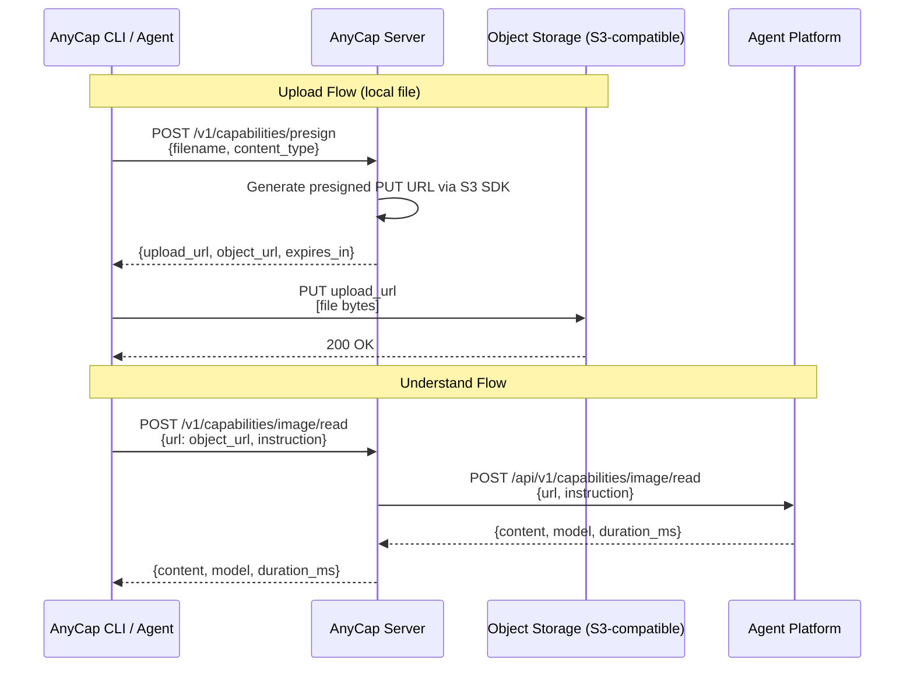
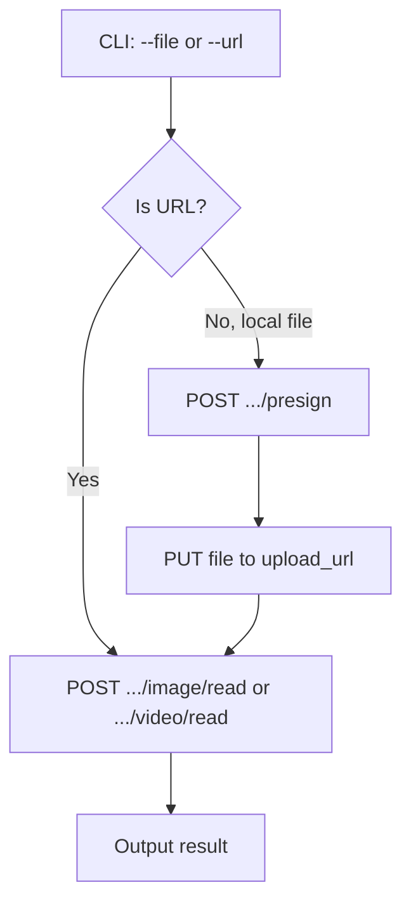

# Capabilities: Image Read and Video Read

## 1. Overview

AnyCap exposes two action-type capability endpoints for multimodal understanding:

- **Image Read** -- Analyze an image and return a text description
- **Video Read** -- Analyze a video and return a text description

These are stateless request-response operations. The upstream provider is Agent Platform's capabilities API. Media files are stored via S3-compatible object storage (Cloudflare R2, AWS S3, MinIO, etc.).

## 2. End-to-End Flow



When the caller already has a public URL, the presign step is skipped entirely.

## 3. API Contract

### 3.1 Presigned Upload

Generate a presigned PUT URL for direct-to-storage upload. The server never proxies file bytes.

```
POST /v1/capabilities/presign
```

Request:

```json
{
  "filename": "screenshot.png",
  "content_type": "image/png"
}
```

Response:

```json
{
  "upload_url": "https://storage.example.com/anycap-tmp/caps/2026-03-24/a1b2c3d4/screenshot.png?X-Amz-...",
  "object_url": "https://cdn.example.com/caps/2026-03-24/a1b2c3d4/screenshot.png",
  "expires_in": 3600
}
```

| Field | Description |
|---|---|
| `upload_url` | Presigned PUT URL (S3-compatible). CLI uploads file bytes here. |
| `object_url` | Public-readable URL after upload. Passed to understand/read endpoints. |
| `expires_in` | Seconds until the presigned URL expires (not the object lifetime). |

Validation:

- `content_type` must match `image/*` or `video/*`.
- `filename` is required and used in the object key.

Object key format: `caps/<date>/<uuid>/<filename>`.

### 3.2 Image Read

```
POST /v1/capabilities/image/read
```

Request (URL mode):

```json
{
  "url": "https://cdn.example.com/caps/2026-03-24/a1b2c3d4/screenshot.png",
  "instruction": "Describe what you see in this image",
  "model": "optional-model-override"
}
```

Request (base64 mode, for small images):

```json
{
  "data": "<base64-encoded>",
  "mime_type": "image/png",
  "instruction": "Describe what you see"
}
```

Response:

```json
{
  "content": "The image shows the Eiffel Tower at sunset...",
  "model": "gemini-3-flash",
  "usage": {
    "input_tokens": 270,
    "output_tokens": 85,
    "total_tokens": 355,
    "cache_read_tokens": 0,
    "cache_write_tokens": 0
  },
  "duration_ms": 2340
}
```

Input rules:
- Exactly one of `url` or `data` must be provided.
- If `data` is provided, `mime_type` is required.

### 3.3 Video Read

```
POST /v1/capabilities/video/read
```

Request:

```json
{
  "url": "https://cdn.example.com/caps/2026-03-24/a1b2c3d4/demo.mp4",
  "instruction": "Describe what happens in this video"
}
```

Response:

```json
{
  "content": "The video shows a person walking through a park...",
  "model": "gemini-3-flash",
  "usage": {
    "input_tokens": 1200,
    "output_tokens": 150,
    "total_tokens": 1350,
    "cache_read_tokens": 0,
    "cache_write_tokens": 0
  },
  "duration_ms": 8120
}
```

Video read only accepts URL input. For local videos, use presign + upload first.

## 4. CLI Abstraction

The CLI wraps the multi-step flow into single commands. CLI design and implementation is documented in a separate skill at `skills/anycap-cli/`.



Example commands:

```bash
# Direct URL
anycap image read --url https://example.com/photo.jpg --instruction "What is this?"

# Local file (presign + upload + understand in one step)
anycap image read --file ./screenshot.png --instruction "What is this?"

# Video
anycap video read --url https://example.com/demo.mp4
anycap video read --file ./demo.mp4 --instruction "Summarize this video"
```

## 5. Object Storage Abstraction

The server uses a standard S3-compatible SDK for presigned URL generation. The storage backend is configured entirely via environment variables and is swappable without code changes.

### 5.1 Domain Port

```go
// ObjectStorage generates presigned URLs for direct upload.
type ObjectStorage interface {
    PresignPut(ctx context.Context, req PresignRequest) (PresignResult, error)
}
```

### 5.2 Infrastructure Adapter

A single `s3store` adapter works with any S3-compatible backend:

| Backend | Endpoint | Notes |
|---|---|---|
| Cloudflare R2 | `https://<account>.r2.cloudflarestorage.com` | S3-compatible, no egress fees |
| AWS S3 | `https://s3.<region>.amazonaws.com` | Standard |
| MinIO | `http://localhost:9000` | Local development |

### 5.3 Configuration

```bash
# Object Storage (S3-compatible)
S3_ENDPOINT=https://<account>.r2.cloudflarestorage.com
S3_ACCESS_KEY_ID=...
S3_SECRET_ACCESS_KEY=...
S3_BUCKET=anycap-tmp
S3_REGION=auto
S3_PUBLIC_URL=https://tmp.anycap.ai
S3_PRESIGN_EXPIRY_SECONDS=3600
S3_FORCE_PATH_STYLE=true
```

`S3_PUBLIC_URL` is the base URL for reading uploaded objects. It may differ from the S3 endpoint (e.g. a CDN domain or R2 public bucket URL).

`S3_FORCE_PATH_STYLE` is required for R2 and MinIO.

## 6. Error Handling

| Scenario | HTTP | Error Code |
|---|---|---|
| Missing input (no url and no data) | 422 | `missing_input` |
| Ambiguous input (both url and data) | 422 | `ambiguous_input` |
| Missing mime_type for base64 | 422 | `missing_input` |
| Invalid content_type for presign | 400 | `invalid_content_type` |
| Missing filename for presign | 400 | `invalid_param` |
| Storage presign failure | 502 | `storage_error` |
| Upstream model not configured | 502 | `no_model_configured` |
| Upstream LLM error | 502 | `upstream_error` |

## 7. Implementation Layers

| Layer | Component | Path |
|---|---|---|
| Domain Model | `PresignRequest`, `PresignResult`, `ImageReadRequest`, `VideoReadRequest`, `UnderstandResult`, `Usage` | `internal/domain/model/capabilities.go` |
| Domain Port | `CapabilitiesProvider`, `ObjectStorage` | `internal/domain/port/capabilities.go` |
| Infrastructure | `agentplatform.Client` (upstream understand/read) | `internal/infrastructure/agentplatform/` |
| Infrastructure | `s3store.Client` (presigned URL generation) | `internal/infrastructure/s3store/` |
| Application | `capabilities.Service` | `internal/application/capabilities/` |
| Transport | `/v1/capabilities/*` handlers | `internal/transport/http/handlers/capabilities.go` |

## 8. Configuration Summary (.env)

```bash
# Core
ANYCAP_APP_NAME=anycap-server
ANYCAP_APP_ENV=local
ANYCAP_HTTP_ADDR=:8080

# Agent Platform (upstream capabilities provider)
AGENT_PLATFORM_BASE_URL=https://agent-platform.dev.knoffice.tech
AGENT_PLATFORM_API_KEY=<key>
AGENT_PLATFORM_TENANT_ID=anycap
AGENT_PLATFORM_TIMEOUT_SECONDS=120

# Object Storage (S3-compatible, for presigned uploads)
S3_ENDPOINT=https://<account>.r2.cloudflarestorage.com
S3_ACCESS_KEY_ID=<key>
S3_SECRET_ACCESS_KEY=<secret>
S3_BUCKET=anycap-tmp
S3_REGION=auto
S3_PUBLIC_URL=https://tmp.anycap.ai
S3_PRESIGN_EXPIRY_SECONDS=3600
S3_FORCE_PATH_STYLE=true
```
