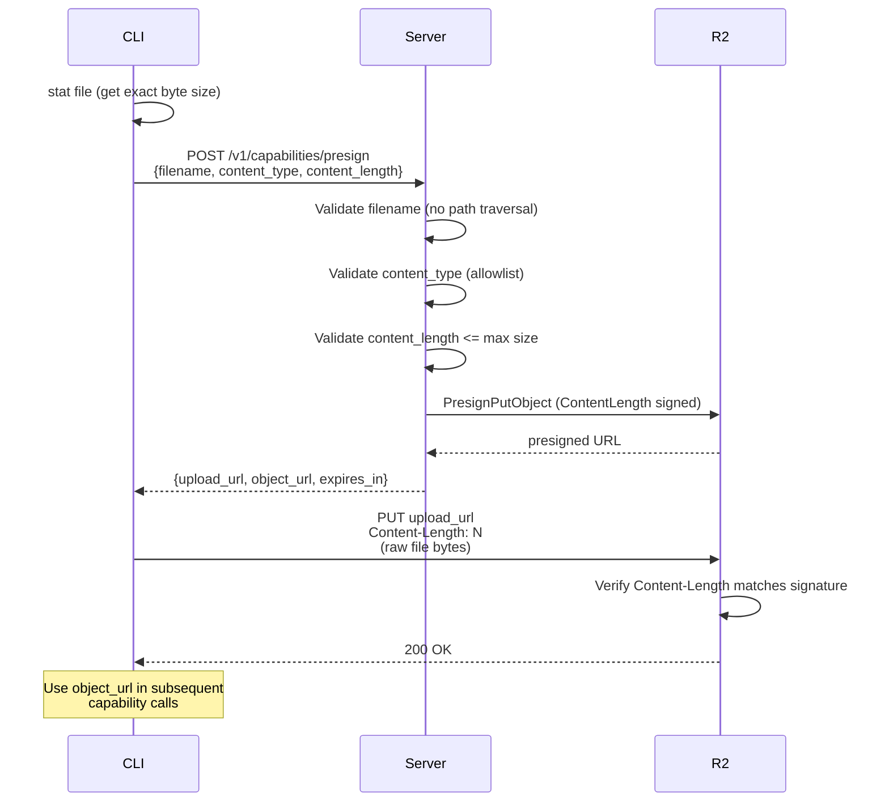
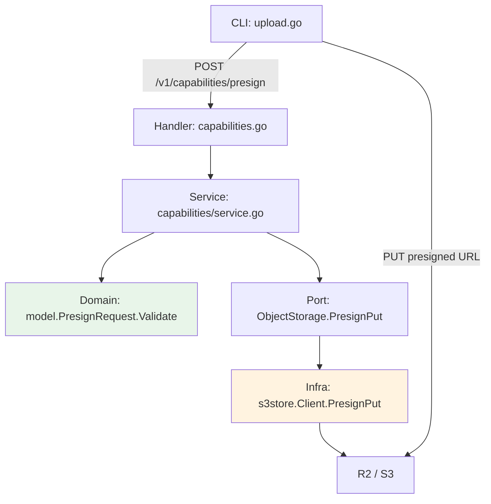

# File Upload -- Security and Implementation Spec

> High-level design for file upload via presigned URLs. Covers security model, R2 deployment, and code architecture.

## Overview

AnyCap supports file upload for capabilities that need user-provided media (image understand, video read). Files are uploaded directly from CLI to Cloudflare R2 via presigned PUT URLs, bypassing the server for data transfer.

## Upload Flow



## Security Model

### Threat Model

| Threat | Mitigation | Layer |
|--------|-----------|-------|
| Upload arbitrarily large files (cost attack) | Server-side size validation + R2 enforces exact ContentLength via signature | Server + R2 |
| Upload malicious file types (XSS via SVG) | Explicit content-type allowlist; SVG excluded | Server |
| Filename path traversal (key manipulation) | Reject `/`, `\`, `..` in filename; use UUID-based key | Server |
| Presigned URL replay/leak | Short TTL (default 600s, max 3600s) | Server |
| CLI SSRF via redirect on upload PUT | HTTP client configured to never follow redirects | CLI |
| Orphaned files accumulate (cost) | R2 lifecycle rule expires objects after 7 days | R2 |
| Bucket name leak via presigned URL | S3_PUBLIC_URL hides bucket name in object read URLs; presigned PUT URL contains bucket name but is only given to authenticated users | Config |

### Content-Type Allowlist

Only these MIME types are accepted for upload:

| MIME Type | Category |
|-----------|----------|
| `image/jpeg` | Image |
| `image/png` | Image |
| `image/gif` | Image |
| `image/webp` | Image |
| `video/mp4` | Video |
| `video/webm` | Video |
| `video/quicktime` | Video |

`image/svg+xml` is intentionally excluded because SVG can embed `<script>` tags. If the uploaded file is served from a shared domain, this creates a stored XSS vector.

### Upload Size Limits

| Category | Max Size | Rationale |
|----------|----------|-----------|
| Image (`image/*`) | 20 MB | Sufficient for high-res photos; prevents abuse |
| Video (`video/*`) | 200 MB | Reasonable for short clips used in video read |

Enforcement is two-layered:
1. **Server** validates `content_length` against category limits before generating the presigned URL.
2. **R2** validates that the actual `Content-Length` header matches the value signed into the presigned URL. Mismatch returns `403 SignatureDoesNotMatch`.

### Filename Sanitization

The filename from the client is validated in the domain layer:
- Must not be empty
- Must not contain `/` or `\` (path separators)
- Must not be `.` or `..` (traversal)
- Must not contain `..` sequences

The S3 object key is constructed as:

```
{key_prefix}/{date}/{uuid}/{filename}
```

The UUID component ensures uniqueness and prevents key collision even if two users upload the same filename.

### Presigned URL Lifetime

| Setting | Default | Max | Env Var |
|---------|---------|-----|---------|
| Presign expiry | 600s (10 min) | 3600s (1 hour) | `S3_PRESIGN_EXPIRY_SECONDS` |

If `S3_PRESIGN_EXPIRY_SECONDS` exceeds the hard cap, it is silently clamped to 3600s.

Presigned PUT URLs are reusable within their TTL (S3/R2 does not support single-use presigned URLs). The object key contains a UUID, so replay only overwrites the same object.

## Cloudflare R2 Deployment

### Bucket Configuration

| Setting | Value |
|---------|-------|
| Bucket name | `anycap` |
| Region | `auto` |
| Public access | Custom domain (`cdn.anycap.cloud`) |
| S3 API access | Path-style via `https://{account_id}.r2.cloudflarestorage.com` |

### Environment Variables

```bash
# S3-compatible API (required)
S3_ENDPOINT=https://<ACCOUNT_ID>.r2.cloudflarestorage.com
S3_ACCESS_KEY_ID=<r2-api-token-access-key>
S3_SECRET_ACCESS_KEY=<r2-api-token-secret-key>
S3_BUCKET=anycap
S3_FORCE_PATH_STYLE=true

# Public URL for read access (required -- hides bucket name)
S3_PUBLIC_URL=https://cdn.anycap.cloud

# Optional (defaults shown)
S3_REGION=auto
S3_KEY_PREFIX=user_upload
S3_PRESIGN_EXPIRY_SECONDS=600
```

### R2 API Token Permissions

Two tokens are needed:

| Token | Permissions | Used By |
|-------|------------|---------|
| Object token | Object Read & Write, scoped to bucket | Server (`S3_ACCESS_KEY_ID` / `S3_SECRET_ACCESS_KEY`) |
| Admin token | Admin Read & Write (or use Dashboard) | Lifecycle rule management only |

### Lifecycle Rules

Lifecycle rules auto-delete uploaded files to prevent unbounded storage growth. Applied to the `user_upload/` prefix only.

| Rule | Prefix | Action | Period |
|------|--------|--------|--------|
| `expire-user-uploads-7d` | `user_upload/` | Delete objects | 7 days after creation |
| `abort-incomplete-multipart-1d` | `user_upload/` | Abort incomplete multipart | 1 day after initiation |

**How to apply:**

Option A -- Cloudflare Dashboard:
1. Go to R2 > `anycap` bucket > Settings > Object Lifecycle Rules
2. Add rule: prefix `user_upload/`, expire after 7 days
3. Add rule: prefix `user_upload/`, abort incomplete multipart after 1 day

Option B -- Wrangler CLI (requires CF API token):
```bash
npx wrangler r2 bucket lifecycle set anycap --file deploy/r2-lifecycle.json
```

Option C -- Go script (requires Admin-scoped S3 token):
```bash
go run scripts/dev/apply-lifecycle.go
```

**Verification:**
```bash
npx wrangler r2 bucket lifecycle list anycap
```

### R2 Limitations Relevant to This Design

| Feature | AWS S3 | R2 | Impact |
|---------|--------|-----|--------|
| Presigned POST (content-length-range) | Supported | Not supported | Cannot set min/max size range; must use exact ContentLength |
| Lifecycle tag-based filtering | Supported | Not supported | Can only filter by prefix, not object tags |
| Sub-day lifecycle granularity | Not supported | Not supported | Minimum expiry is 1 day |
| Bucket policies | Supported | Not supported | Cannot add bucket-level access rules |

## Code Architecture

### Layer Responsibilities



| Layer | File | Responsibility |
|-------|------|---------------|
| CLI | `internal/cli/command/cap/upload.go` | Stat file, request presign with size, upload via presigned URL |
| Transport | `internal/transport/http/handlers/capabilities.go` | Parse JSON, classify errors (400/413/502) |
| Application | `internal/application/capabilities/service.go` | Orchestrate: validate then presign |
| Domain | `internal/domain/model/capabilities.go` | PresignRequest validation (filename, type, size) |
| Port | `internal/domain/port/capabilities.go` | ObjectStorage interface (PresignPut, Delete) |
| Infrastructure | `internal/infrastructure/s3store/client.go` | AWS SDK presign with ContentLength, key construction |
| Config | `internal/config/config.go` | S3Config with KeyPrefix, expiry cap |

### Key Types

```go
// Domain model -- internal/domain/model/capabilities.go
type PresignRequest struct {
    Filename      string `json:"filename"`
    ContentType   string `json:"content_type"`
    ContentLength int64  `json:"content_length"`
}

type PresignResult struct {
    UploadURL string `json:"upload_url"`
    ObjectURL string `json:"object_url"`
    ObjectKey string `json:"object_key,omitempty"` // internal, not exposed to API
    ExpiresIn int    `json:"expires_in"`
}
```

### Error Classification

| Error | HTTP Status | Error Code | Trigger |
|-------|-------------|------------|---------|
| `ErrInvalidContentType` | 400 | `invalid_content_type` | MIME type not in allowlist |
| `ErrInvalidFilename` | 400 | `invalid_filename` | Path separators or traversal in filename |
| `ErrContentLengthRequired` | 400 | `invalid_param` | Missing or non-positive content_length |
| `ErrFileTooLarge` | 413 | `file_too_large` | Exceeds 20MB (image) or 200MB (video) |
| `ErrStorageNotConfigured` | 502 | `storage_not_configured` | S3 not configured on server |

### S3 Object Key Format

```
{prefix}/{date}/{uuid}/{filename}

Example:
user_upload/2026-03-25/a1b2c3d4-e5f6-7890-abcd-ef1234567890/photo.jpg
```

| Component | Source | Purpose |
|-----------|--------|---------|
| `prefix` | `S3_KEY_PREFIX` env var (default `user_upload`) | Lifecycle rule targeting, logical grouping |
| `date` | Server UTC date | Debugging, manual inspection |
| `uuid` | Generated per request | Uniqueness, prevent collision/overwrite |
| `filename` | Client-provided (sanitized) | Human readability, content-type hint |

### API Contract

**Request:**
```http
POST /v1/capabilities/presign
Content-Type: application/json

{
  "filename": "photo.jpg",
  "content_type": "image/jpeg",
  "content_length": 2048576
}
```

**Response (success):**
```http
HTTP/1.1 200 OK

{
  "status": "success",
  "data": {
    "upload_url": "https://...r2.cloudflarestorage.com/anycap/user_upload/...?X-Amz-Signature=...",
    "object_url": "https://cdn.anycap.cloud/user_upload/2026-03-25/uuid/photo.jpg",
    "expires_in": 600
  }
}
```

**Response (file too large):**
```http
HTTP/1.1 413 Request Entity Too Large

{
  "status": "error",
  "error": {
    "code": "file_too_large",
    "message": "file exceeds maximum upload size: 25000000 bytes exceeds 20971520 byte limit for image/jpeg"
  }
}
```

## Known Limitations and Future Work

| Item | Status | Notes |
|------|--------|-------|
| Auth middleware on presign endpoint | Not implemented | MVP scope; currently unauthenticated |
| Rate limiting on presign requests | Not implemented | MVP scope |
| Post-processing cleanup (delete after use) | Interface ready, not wired | `ObjectStorage.Delete()` exists in port |
| Request-ID header sanitization | Not implemented | Low risk with structured logging |
| Per-user upload quotas | Not implemented | Requires auth + credit integration |
