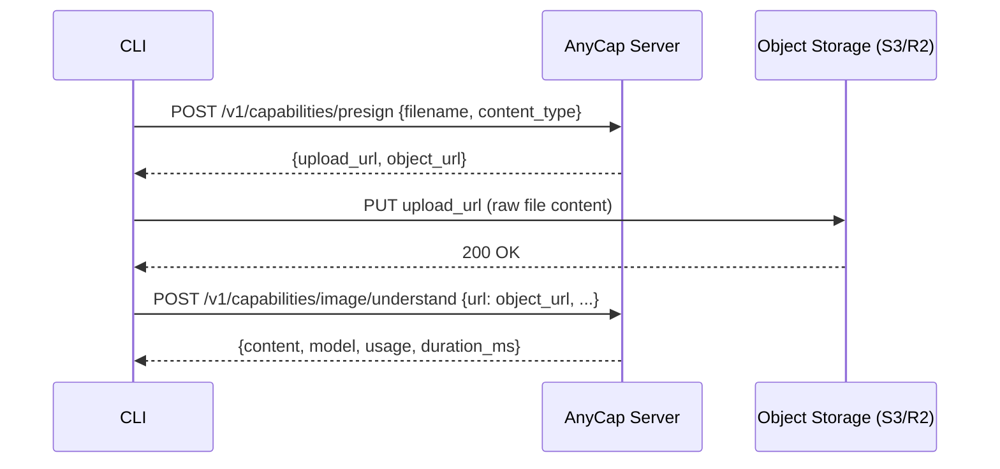

# CLI Capabilities Spec

> Date: 2026-03-24
> Status: Draft

## 1. Overview

This document specifies the CLI commands for multimodal understanding capabilities: image understanding and video reading. These commands wrap the server's `/v1/capabilities/` API endpoints.

Design goals:
- Agent-friendly: URL-based input for programmatic use, file-based input for local workflows
- Consistent command structure across capabilities (image, video, future audio)
- Transparent file upload: `--file` flag handles presign + upload + call as a single step

## 2. Commands

### 2.1 Image Understand

```
anycap image understand --url <url> [--instruction <text>] [--model <id>]
anycap image understand --file <path> [--instruction <text>] [--model <id>]
```

Analyzes an image using vision models. Returns a text description or answers a question about the image.

| Flag | Required | Description |
|------|----------|-------------|
| `--url` | one of url/file | Public image URL |
| `--file` | one of url/file | Local image file (auto-uploads via presign) |
| `--instruction` | no | What to look for, describe, or extract |
| `--model` | no | Model ID (server picks default if omitted) |

`--url` and `--file` are mutually exclusive; exactly one is required.

### 2.2 Video Read

```
anycap video read --url <url> [--instruction <text>] [--model <id>]
anycap video read --file <path> [--instruction <text>] [--model <id>]
```

Analyzes a video using vision models. Returns a text summary or answers a question about the video content.

| Flag | Required | Description |
|------|----------|-------------|
| `--url` | one of url/file | Public video URL |
| `--file` | one of url/file | Local video file (auto-uploads via presign) |
| `--instruction` | no | What to look for or summarize |
| `--model` | no | Model ID (server picks default if omitted) |

### 2.3 Command Hierarchy

```
anycap
  image
    generate       # existing
    models         # existing
    understand     # new
  video
    read           # new
```

## 3. File Upload Flow

When `--file` is provided, the CLI performs a three-step upload-then-analyze flow:



Key decisions:
- **CLI detects content type from file extension.** No magic byte sniffing needed; the server validates.
- **Upload goes directly to object storage** (S3 presigned PUT), not through the AnyCap server. This avoids server-side memory pressure for large video files.
- **Progress is written to stderr.** Agents read stdout (JSON result), humans see progress on stderr.

### 3.1 Content Type Detection

| Extension | MIME Type |
|-----------|-----------|
| `.jpg`, `.jpeg` | `image/jpeg` |
| `.png` | `image/png` |
| `.gif` | `image/gif` |
| `.webp` | `image/webp` |
| `.mp4` | `video/mp4` |
| `.webm` | `video/webm` |
| `.mov` | `video/quicktime` |
| `.avi` | `video/x-msvideo` |
| `.mkv` | `video/x-matroska` |

Unknown extensions fall back to `application/octet-stream`.

## 4. Server API Contracts

### 4.1 Presign

**POST /v1/capabilities/presign**

| Direction | Field | Type | Description |
|-----------|-------|------|-------------|
| Request | `filename` | string | Original filename |
| Request | `content_type` | string | MIME type (`image/*` or `video/*`) |
| Response | `upload_url` | string | Presigned PUT URL (direct to storage) |
| Response | `object_url` | string | Public URL after upload completes |
| Response | `expires_in` | int | Presign expiry in seconds |

### 4.2 Image Understand

**POST /v1/capabilities/image/understand**

| Direction | Field | Type | Description |
|-----------|-------|------|-------------|
| Request | `url` | string | Image URL (mutually exclusive with `data`) |
| Request | `data` | string | Base64-encoded image (mutually exclusive with `url`) |
| Request | `mime_type` | string | Required when `data` is provided |
| Request | `instruction` | string | Optional analysis instruction |
| Request | `model` | string | Optional model ID |
| Response | `content` | string | Analysis result text |
| Response | `model` | string | Model used |
| Response | `usage` | object | Token usage (`input_tokens`, `output_tokens`, `total_tokens`) |
| Response | `duration_ms` | int | Processing time |

CLI always uses the `url` path (either direct URL or uploaded object URL). The `data` (base64) path exists in the server API but is not exposed via CLI flags.

### 4.3 Video Read

**POST /v1/capabilities/video/read**

| Direction | Field | Type | Description |
|-----------|-------|------|-------------|
| Request | `url` | string | Video URL |
| Request | `instruction` | string | Optional analysis instruction |
| Request | `model` | string | Optional model ID |
| Response | `content` | string | Analysis result text |
| Response | `model` | string | Model used |
| Response | `usage` | object | Token usage |
| Response | `duration_ms` | int | Processing time |

## 5. Output

JSON to stdout (consistent with all other commands):

```json
{
  "status": "success",
  "data": {
    "content": "The image shows a paper crane on a wooden table...",
    "model": "claude-sonnet-4-20250514",
    "usage": {
      "input_tokens": 1200,
      "output_tokens": 350,
      "total_tokens": 1550
    },
    "duration_ms": 2340
  }
}
```

Progress and errors go to stderr:

```
Uploading screenshot.png (245760 bytes)...
Analyzing screenshot.png...
```

## 6. Implementation Plan

| File | Change |
|------|--------|
| `cap/upload.go` | New: shared presign + upload helper, content type detection |
| `cap/image.go` | Add `understand` subcommand; add `stderr` parameter to `NewImageCmd` |
| `cap/video.go` | New: `video` command with `read` subcommand |
| `command/root.go` | Register `video` command; pass `stderr` to `image` |
| `testutil/mockserver/server.go` | Add mock endpoints: presign, image/understand, video/read, mock upload |
| `command/cap_test.go` | Tests: understand with URL, understand with file, video read with URL, video read with file |

## 7. Testing

Tests use the mock server pattern established in the codebase:

- **URL path:** command -> mock server endpoint -> assert JSON output
- **File upload path:** command -> presign (mock) -> upload to mock endpoint -> understand/read (mock) -> assert JSON output

The mock server auto-approves uploads and returns deterministic results for assertion.
