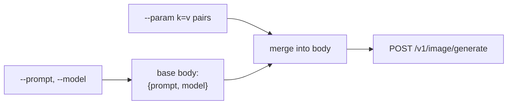
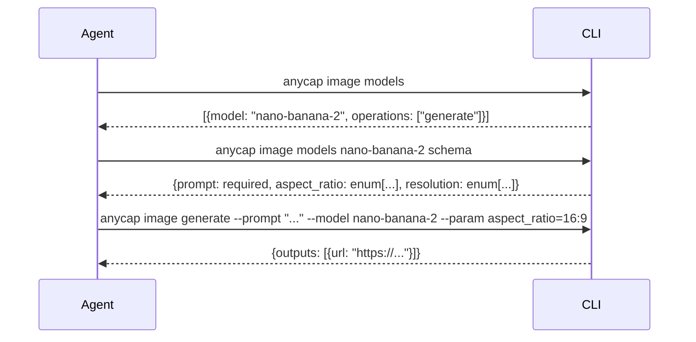

# CLI Image Capabilities Spec

> Date: 2026-03-25
> Status: Draft

## 1. Scope

This spec covers the CLI commands for image generation. It is based on verified server API responses as of 2026-03-25.

Out of scope: Image understanding and video reading (moved to the Actions product line under `anycap actions`).

## 2. Server APIs (verified)

### 2.1 List Models (public, no auth)

```http
GET /v1/image/models
```

```json
{
  "status": "success",
  "capability": "image",
  "models": [
    {
      "model": "nano-banana-2",
      "capability": "image",
      "display_name": "Nano Banana 2",
      "status": "active",
      "operations": ["edit", "generate"]
    }
  ]
}
```

### 2.2 Model Schema (public, no auth)

```http
GET /v1/image/models/:model/schema?operation=generate
```

```json
{
  "status": "success",
  "data": {
    "capability": "image",
    "model": "nano-banana-2",
    "operation": "generate",
    "schema": {
      "model_params": {
        "prompt": {"type": "string", "required": true},
        "aspect_ratio": {"type": "string", "enum": ["1:1","16:9","9:16","4:3","3:4","21:9"]},
        "resolution": {"type": "string", "enum": ["1k","2k","4k"]}
      }
    },
    "request_hints": { ... }
  }
}
```

### 2.3 Generate Image (auth required)

```http
POST /v1/image/generate
Authorization: Bearer <api_key>
```

Request:
```json
{"prompt": "a paper crane on a wooden table", "model": "nano-banana-2"}
```

Response:
```json
{
  "id": "req_xxx",
  "status": "success",
  "data": {
    "id": "img_req_xxx",
    "status": "success",
    "model": "nano-banana-2",
    "outputs": [
      {"type": "image", "url": "https://artifact.anycap.cloud/a/art_xxx", "mime_type": "image/png"}
    ],
    "usage": {"credits": 1},
    "credit_cost": 1
  }
}
```

Note: The request body currently accepts top-level `prompt` and `model`. Schema-discovered parameters (`aspect_ratio`, `resolution`) are not yet supported by the server in the generate endpoint. The CLI should be ready to pass them once the server adds support.

Output URL semantics: generate returns AnyCap short-link URLs (`artifact.anycap.*`) instead of provider origin URLs. The short link token is temporary and resolves to an internal object.

### 2.4 Feature Flags (from status)

```http
GET /v1/status
Authorization: Bearer <api_key>
```

The server reports feature flags. The CLI should sync these at startup or command execution to decide which subcommands to expose.

Current server state:
```json
{
  "features": {
    "image.generate": false,
    "image.models": false,
    "image.read": true,
    "video.read": true,
    "login": false
  }
}
```

## 3. Command Design

### 3.1 Command Tree

```
anycap image
  models                 # List available image models
  models <model>         # Show details for a specific model
  models <model> schema  # Show request schema for a model
  generate               # Generate an image
```

### 3.2 image models

List all available image models.

```bash
anycap image models
```

Output (JSON passthrough from server):
```json
{
  "status": "success",
  "capability": "image",
  "models": [
    {
      "model": "nano-banana-2",
      "display_name": "Nano Banana 2",
      "status": "active",
      "operations": ["edit", "generate"]
    }
  ]
}
```

### 3.3 image models \<model\>

Show details for a specific model (same as list but filtered to one model).

```bash
anycap image models nano-banana-2
```

Output (JSON): Single model object from the models list, filtered client-side.

### 3.4 image models \<model\> schema

Show the request schema for a model. Agents use this to discover what parameters to pass to generate.

```bash
anycap image models nano-banana-2 schema
anycap image models nano-banana-2 schema --operation edit
```

| Flag | Required | Default | Description |
|------|----------|---------|-------------|
| `--operation` | no | `generate` | Operation to get schema for |

Output (JSON): Raw schema response from server (passthrough).

### 3.5 image generate

Generate an image from a text prompt.

```bash
anycap image generate --prompt "a paper crane" --model nano-banana-2
anycap image generate --prompt "a landscape" --model nano-banana-2 --param aspect_ratio=16:9 --param resolution=2k
```

| Flag | Required | Description |
|------|----------|-------------|
| `--prompt` | yes | Text prompt for image generation |
| `--model` | yes | Model ID (from `image models`) |
| `--param` | no | Extra parameter as key=value (repeatable). Keys come from schema. |

The `--param` flag passes additional model-specific parameters. Values are sent as strings; the server is responsible for type coercion. If the server does not yet support a parameter, it will either ignore it or return an error.

Output (JSON passthrough from server):
```json
{
  "id": "req_xxx",
  "status": "success",
  "data": {
    "id": "img_req_xxx",
    "status": "success",
    "model": "nano-banana-2",
    "outputs": [
      {"type": "image", "url": "https://...", "mime_type": "image/png"}
    ],
    "usage": {"credits": 1},
    "credit_cost": 1
  }
}
```

## 4. Request Body Construction

The CLI builds the generate request body as follows:



Example: `--prompt "test" --model nano-banana-2 --param aspect_ratio=16:9`

Produces:
```json
{
  "prompt": "test",
  "model": "nano-banana-2",
  "aspect_ratio": "16:9"
}
```

`--param` values are parsed as JSON first (to support numbers and booleans), falling back to string:
- `--param count=3` sends `"count": 3` (number)
- `--param ratio=16:9` sends `"ratio": "16:9"` (string, since `16:9` is not valid JSON)
- `--param hd=true` sends `"hd": true` (boolean)

## 5. Feature Flag Strategy

Current approach: feature flags are compile-time defaults in `pkg/feature/feature.go`, overridable by env vars.

Proposed change for image commands:

```go
var defaults = map[string]bool{
    ImageGenerate: true,  // flip from false -> true
    ImageModels:   true,  // flip from false -> true
}
```

The server still reports `image.generate=false` and `image.models=false` in its own status because the NexusHub executor is stubbed. But the CLI feature flags are independent -- they control CLI command visibility, not server readiness. The CLI should expose the commands so agents can discover and call them. If the server is not ready, the server returns an error, which the CLI surfaces.

This decouples CLI releases from server deployment.

## 6. Error Handling

Server error responses follow the standard envelope:

```json
{
  "id": "req_xxx",
  "status": "error",
  "error": {"code": "INSUFFICIENT_CREDIT", "message": "insufficient credit balance"}
}
```

The CLI should:
1. Detect `status: "error"` in the response
2. Print `error.message` to stderr
3. Exit with non-zero code
4. In JSON mode, still write the full error envelope to stdout for agent parsing

Common errors:

| Code | HTTP | Meaning |
|------|------|---------|
| `AUTH_INVALID` | 401 | Missing or invalid API key |
| `INVALID_PARAM` | 400 | Bad request (missing prompt/model) |
| `INSUFFICIENT_CREDIT` | 402 | No credits remaining |
| `IMAGE_PROVIDER_NOT_CONFIGURED` | 503 | Server cannot generate images yet |
| `RATE_LIMITED` | 429 | Too many requests |

## 7. Agent Workflow

The expected agent workflow for image generation:



The agent discovers models, learns parameters, then generates. All three steps produce machine-parseable JSON on stdout.

## 8. Implementation Plan

| File | Change |
|------|--------|
| `pkg/feature/feature.go` | Flip `ImageGenerate` and `ImageModels` defaults to `true` |
| `cap/image.go` | Restructure: positional arg for model name, `schema` subcommand |
| `cap/image.go` | Add `--param` flag to generate |
| `cap/image.go` | Add `--operation` flag to schema |

| `cap_test.go` | Tests: models list, models detail, schema fetch, generate with params |
| `testutil/mockserver/` | Add mock endpoints matching verified API responses |

## 9. Future Work

- **image edit** -- `anycap image edit --model X --prompt "..." --image-url <url>` (requires server support)
- **image upscale** -- `anycap image upscale --model X --image-url <url>` (requires server support)
- **File upload** -- `--file` flag with presign+upload flow (reuse `upload.go` from actions)
- **Polling** -- Long-running generation with status polling (when server supports async)
