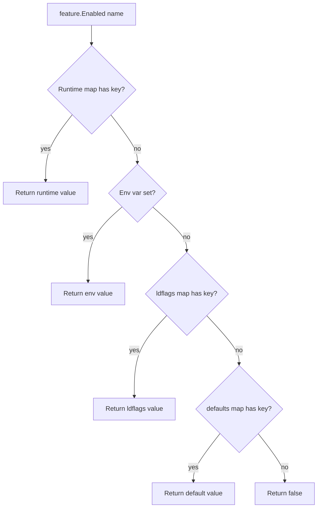
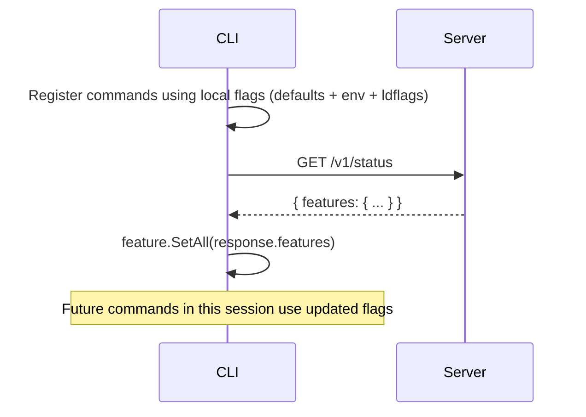

# Feature Flags Spec

> Date: 2026-03-25
> Status: Implemented (Phase 1)

## 1. Overview

Feature flags control which capabilities are visible to CLI users and reported by the server. They allow us to:

- Hide CLI commands for capabilities that lack real backend implementations.
- Enable features progressively as providers are wired up.
- Let the server advertise its actual capabilities to clients.
- Override feature state for testing without code changes.

## 2. Design Principles

- **Safe by default.** Features without real backend implementations default to off.
- **Multiple override layers.** From code defaults to runtime overrides, each layer can change the decision.
- **Shared package.** Both server and CLI import `pkg/feature`, keeping flag names consistent.
- **No network dependency at startup.** CLI uses local resolution (defaults, env, ldflags) to decide which commands to register. Server-pushed features are a future enhancement, not a blocking dependency.

## 3. Resolution Order

Four layers, highest priority wins:

```
Runtime override  >  Environment variable  >  Compile-time ldflags  >  Code default
```

| Layer | Set by | Example | Use case |
|-------|--------|---------|----------|
| Runtime | `feature.Set()` / `feature.SetAll()` | Server pushes config to CLI | Dynamic feature gating |
| Env var | `ANYCAP_FEATURE_<NAME>=1` | `ANYCAP_FEATURE_IMAGE_GENERATE=1` | Local testing, CI |
| ldflags | `-ldflags "-X .../pkg/feature.overrides=image.generate=true"` | Release build script | Bake features into a release |
| Default | `defaults` map in `feature.go` | `ImageRead: true` | Baseline behavior |

### 3.1 Environment Variable Naming

Feature name `image.generate` maps to env var `ANYCAP_FEATURE_IMAGE_GENERATE`:

1. Upper-case the name.
2. Replace `.` with `_`.
3. Prefix with `ANYCAP_FEATURE_`.

Values `"true"` and `"1"` are truthy; everything else is falsy.

### 3.2 ldflags Override Format

Comma-separated `name=value` pairs injected at compile time:

```bash
go build -ldflags "-X gitlab.knoffice.tech/engineering/anycap/pkg/feature.overrides=image.generate=true,image.models=true" ./cmd/anycap
```

## 4. Resolution Flow



## 5. Known Features

| Flag name | Default | Reason |
|-----------|---------|--------|
| `image.generate` | `false` | NexusHub image provider is stub-only |
| `image.models` | `false` | NexusHub image provider is stub-only |
| `image.read` | `true` | Agent-platform real implementation |
| `video.read` | `true` | Agent-platform real implementation |
| `login` | `true` | Auth flow expected soon |

## 6. CLI Integration

### 6.1 Command Registration

Feature flags are checked at command construction time. Subcommands are conditionally added:

```
root
  +-- image
  |     +-- read         (if image.read enabled)
  |     +-- generate     (if image.generate enabled)
  |     +-- models       (if image.models enabled)
  +-- video
  |     +-- read         (if video.read enabled)
  +-- login              (if login enabled)
  +-- logout             (always)
  +-- status             (always)
  +-- config             (always)
  +-- credentials        (always)
  +-- update             (always)
```

Parent commands (`image`, `video`) are only added to root if they have at least one enabled subcommand. This prevents empty command groups from appearing in `--help`.

### 6.2 Adding a New Feature-Gated Command

1. Add a new const in `pkg/feature/feature.go`:
   ```go
   const MusicGenerate = "music.generate"
   ```
2. Add a default in the `defaults` map:
   ```go
   MusicGenerate: false,
   ```
3. Gate the command registration:
   ```go
   if feature.Enabled(feature.MusicGenerate) {
       musicCmd.AddCommand(newMusicGenerateCmd(...))
   }
   ```

## 7. Server Integration

### 7.1 Feature Reporting via Status

The server determines features based on which providers are actually configured (real vs stub), then exposes them in the `/v1/status` response:

```json
{
  "status": "success",
  "data": {
    "service": {
      "name": "anycap-server",
      "env": "dev",
      "version": "0.1.0",
      "status": "ok",
      "features": {
        "image.read": true,
        "video.read": true,
        "image.generate": false,
        "image.models": false,
        "login": false
      }
    },
    "runtime_mode": "stub"
  }
}
```

### 7.2 Server Feature Determination

In `bootstrap.go`, features are computed from config at startup:

```
image.read = cfg.AgentPlatform.Enabled()
video.read       = cfg.AgentPlatform.Enabled()
image.generate   = false  (nexushub stub)
image.models     = false  (nexushub stub)
login            = false  (auth stub)
```

When real providers are wired, the corresponding feature flips to `true` automatically.

## 8. Future: Server-Pushed Feature Sync (Phase 2)

Not yet implemented. The planned flow:



This enables the server to dynamically control CLI behavior without requiring a CLI release. Implementation considerations:

- The initial command registration uses local flags only (no network call blocks startup).
- Feature sync happens lazily (e.g., on `status` command or as a background check).
- Synced features can be cached locally with a TTL to avoid repeated network calls.

## 9. Package API

```go
package feature

// Enabled reports whether the named feature is enabled.
func Enabled(name string) bool

// Set overrides a single feature flag at runtime.
func Set(name string, enabled bool)

// SetAll overrides multiple feature flags at runtime.
func SetAll(flags map[string]bool)

// All returns every known feature and its resolved state.
func All() map[string]bool

// Reset clears all runtime overrides (testing only).
func Reset()
```

## 10. Testing

- `pkg/feature/feature_test.go` covers all resolution layers: defaults, env override, runtime override, `SetAll`, and `All()`.
- `internal/cli/command/root_test.go` includes tests verifying that disabled features hide commands and enabled features show commands.
- Tests use `feature.Reset()` in cleanup to avoid cross-test pollution.
