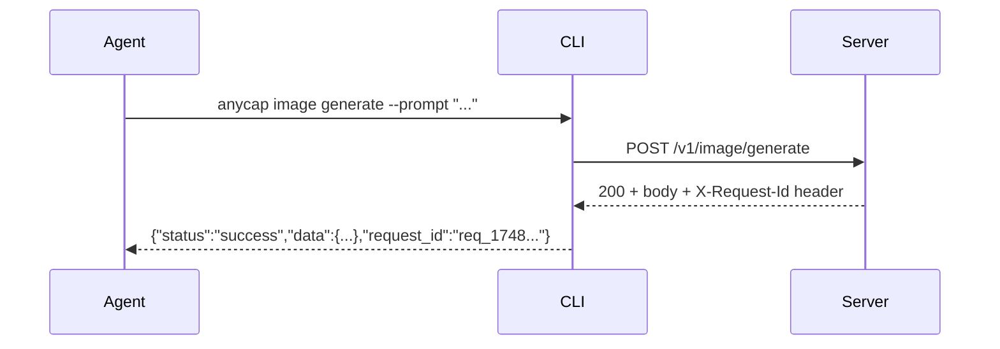

# Feedback and Request Tracing

Spec for agent feedback collection and request tracing in the AnyCap CLI.

## Overview

Two related features:

1. **Request ID surfacing** -- every CLI response from the server includes `request_id` for traceability.
2. **Feedback command** -- agents can submit bug reports, feature requests, or general feedback via `anycap feedback`.

## Request ID Surfacing

### Flow



### Design

- Server already sets `X-Request-Id` in every HTTP response header.
- CLI httpclient captures this header into `Response.RequestID`.
- Output functions (`WriteServerJSON`, `WriteServerContent`) inject `request_id` as a top-level field in the JSON output.
- Error messages from server responses include `(request_id: ...)` for traceability.
- Local commands (config, credential) do not have request_id -- they use `WriteJSON` directly.

### CLI Output Examples

Server response (with request_id injected):

```json
{"status":"success","data":{"name":"anycap-server"},"request_id":"req_1748123456789"}
```

Content extraction (image read, video read):

```json
{"content":"A paper crane on a wooden table","request_id":"req_1748123456789"}
```

Error response:

```json
{"error":"rate_limited","message":"rate limit exceeded (request_id: req_1748123456789)"}
```

## Feedback Command

### Usage

```bash
anycap feedback --type bug -m "image generate returns 500 with unicode prompts"
anycap feedback --type feature -m "need batch generation support"
anycap feedback --type bug -m "timeout on large images" --request-id req_1748123456789
anycap feedback --type other -m "documentation unclear for video read" --context '{"command":"video read"}'
```

### Flags

| Flag | Required | Description |
|------|----------|-------------|
| `--type` | yes | Feedback type. Enum: `bug`, `feature`, `other` |
| `--message` / `-m` | yes | Free-form feedback message |
| `--context` | no | Additional structured context (must be valid JSON, validated by CLI) |
| `--request-id` | no | Related server request ID from a previous command output |

### Validation (CLI-side)

- `--type` must be one of `bug`, `feature`, `other`. CLI rejects unknown types.
- `--message` is required and non-empty.
- `--context` if provided must pass `json.Valid()`. CLI rejects malformed JSON.
- `--request-id` is a free-form string (no validation, server may validate).

### Auto-collected Metadata

CLI automatically attaches system metadata (agent does not need to provide these):

- `cli_version` -- from `buildinfo.Version`
- `os` -- `runtime.GOOS/runtime.GOARCH` (e.g. `darwin/arm64`)

## Server API Contract

### `POST /v1/feedback`

Submit agent feedback. Requires authentication (API key or OAuth token).

#### Request

```json
{
  "type": "bug",
  "message": "image generate returns 500 when prompt contains unicode",
  "context": {"command": "image generate", "prompt": "..."},
  "request_id": "req_1748123456789",
  "metadata": {
    "cli_version": "0.1.0",
    "os": "darwin/arm64"
  }
}
```

| Field | Type | Required | Description |
|-------|------|----------|-------------|
| `type` | string | yes | `bug`, `feature`, or `other` |
| `message` | string | yes | Feedback content |
| `context` | object | no | Arbitrary structured context from agent |
| `request_id` | string | no | Server request ID the feedback relates to |
| `metadata` | object | yes | Auto-collected CLI metadata |
| `metadata.cli_version` | string | yes | CLI version |
| `metadata.os` | string | yes | OS and architecture |

#### Response (success)

```json
{
  "status": "success",
  "data": {
    "id": "fb_20260325_abc123"
  }
}
```

| Field | Type | Description |
|-------|------|-------------|
| `data.id` | string | Unique feedback ID for reference |

#### Response (error)

Standard server error envelope:

```json
{
  "status": "error",
  "error": {
    "code": "validation_error",
    "message": "type must be one of: bug, feature, other"
  }
}
```

### Server Implementation Notes

- **Phase 1 (stub):** Log feedback to structured log (JSON). Return a generated feedback ID. No persistence required.
- **Phase 2:** Store in database table (`feedback`). Expose via admin dashboard.
- **Phase 3 (optional):** Forward to GitHub Issues or internal ticketing. Server holds the integration tokens.

### Database Schema (Phase 2)

```sql
CREATE TABLE feedback (
    id          TEXT PRIMARY KEY,
    user_id     TEXT,
    type        TEXT NOT NULL,
    message     TEXT NOT NULL,
    context     JSONB,
    request_id  TEXT,
    metadata    JSONB NOT NULL,
    created_at  TIMESTAMPTZ NOT NULL DEFAULT NOW()
);

CREATE INDEX idx_feedback_type ON feedback(type);
CREATE INDEX idx_feedback_created_at ON feedback(created_at);
CREATE INDEX idx_feedback_request_id ON feedback(request_id) WHERE request_id IS NOT NULL;
```

## Architecture Alignment

- CLI only talks to Server (`POST /v1/feedback`). No direct GitHub/Lark/etc calls.
- Server decides how to process feedback (log, store, forward).
- Feedback is authenticated -- server can associate feedback with the user.
- `request_id` from feedback can be correlated with server access logs for debugging.
