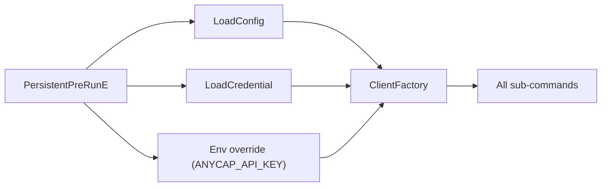
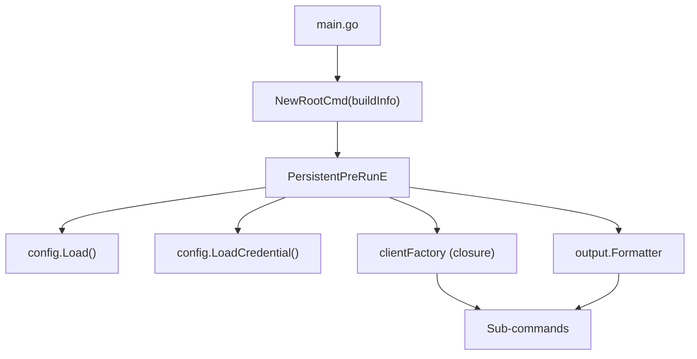

# CLI Framework Spec

> Date: 2026-03-24
> Status: Draft

## 1. Overview

This document specifies the AnyCap CLI framework: how commands are structured, how config and credentials are resolved, how output is formatted, and the patterns for extending the CLI with new commands.

The CLI is built with Go + Cobra. It is the sole interface between AI Agents and the AnyCap Server.

## 2. Current State

What exists today (`internal/cli/`):

| Component | Path | Status |
|-----------|------|--------|
| Root command | `command/root.go` | Working, no help grouping yet |
| Config | `config/config.go` | Endpoint resolution (flag > env > config file > default), `DefaultEndpoint` injectable via ldflags |
| Credentials | `config/credential.go` | Safe-first: env var > OS keychain > fallback file (0600), auto-migration from file to keychain |
| HTTP client | `httpclient/client.go` | Auth header (`Bearer`), `User-Agent`, 120s timeout |
| Output | `output/json.go` | Raw JSON passthrough via `WriteJSON()`, no TTY detection |
| Image command | `command/cap/image.go` | generate + models + understand, working |
| Video command | `command/cap/video.go` | read, working |
| Upload helper | `command/cap/upload.go` | Shared presign + upload for --file flag |
| Login command | `command/meta/login.go` | Auto-detect (localhost callback / device code), `--headless`, `--with-token` |
| Logout command | `command/meta/logout.go` | Removes credentials from keychain + fallback file |
| Status command | `command/meta/status.go` | Calls `/v1/status`, working |
| Auth flows | `auth/` | `AutoFlow`, `LocalhostFlow`, `DeviceFlow`, `HasBrowser()`, platform browser opening |
| Mock server | `testutil/mockserver/` | All auth endpoints, device code auto-approve, standalone binary (`cmd/anycap-mock`) |

What is missing:

- TTY detection and output mode switching (JSON vs pretty)
- Help text grouping (Capabilities / Infrastructure / Management)
- Structured error handling with exit codes
- `--json` / `--pretty` global flags
- Config command (`anycap config show`, `anycap config set-key`)
- 401 response auto-recovery (detect expired/revoked key, suggest `anycap login`)

## 3. Config Resolution

### 3.1 Resolution Chain

Every config value follows the same precedence (highest to lowest):

```
CLI flag  >  Environment variable  >  Config file  >  Default
```

| Value | Flag | Env | Config file key | Default |
|-------|------|-----|-----------------|---------|
| Endpoint | `--endpoint` | `ANYCAP_API_ENDPOINT` | `endpoint` | `https://api.anycap.ai` (release) / `http://127.0.0.1:18080` (dev, see 3.4) |
| API Key | (none) | `ANYCAP_API_KEY` | (from credentials file) | (none) |
| Output format | `--json` / `--pretty` | (none) | (none) | auto-detect TTY |

### 3.2 File Locations

```
~/.anycap/
  config.toml          # User preferences (endpoint, defaults) -- 0644
  credentials          # API Key (plain text, single line) -- 0600
  cache/
    models/            # Model list cache (TTL-based, per capability)
    run/               # Dynamic capability definition cache
```

### 3.3 Config File Structure

`config.json` contains user preferences:

| Field | Type | Example | Description |
|-------|------|---------|-------------|
| `endpoint` | string | `https://api.anycap.ai` | Server endpoint |
| `defaults.image-model` | string | `flux-1.1-pro` | Default model for image commands |
| `defaults.video-model` | string | `veo-3.1` | Default model for video commands |

`credentials` is a plain text file containing a single line: the API key. No JSON wrapping. Easy to debug (`cat ~/.anycap/credentials`).

### 3.4 Default Endpoint Strategy

`DefaultEndpoint` is a package-level `var` in `internal/cli/config/config.go`, defaulting to `http://127.0.0.1:18080` for local development. Release builds inject `https://api.anycap.ai` via ldflags in `scripts/release/build.sh`:

```
-X gitlab.knoffice.tech/engineering/anycap/internal/cli/config.DefaultEndpoint=https://api.anycap.ai
```

This keeps production safe-by-default while development stays convenient. `scripts/dev/run-cli.sh` passes the dev endpoint via `--endpoint` flag.

## 4. HTTP Client

### 4.1 Responsibilities

The HTTP client wraps all CLI-to-Server communication:

| Responsibility | Detail |
|----------------|--------|
| Auth header | Attach `Authorization: Bearer <api-key>` when credential is available |
| User-Agent | Send `User-Agent: anycap-cli/<version>` on every request |
| Content-Type | Set `application/json` for POST requests |
| Timeout | Default 120s (capability calls like image generation can be slow) |
| Error parsing | Parse server error JSON into structured error type with code, message, hint |

### 4.2 Client Factory Pattern



The root command's `PersistentPreRunE` loads config and credentials, then creates a `clientFactory` closure. Sub-commands receive this factory via constructor injection -- they never create clients themselves.

## 5. Output Formatting

### 5.1 Output Mode Selection

| Condition | Output mode |
|-----------|-------------|
| `--json` flag | JSON (forced) |
| `--pretty` flag | Human-readable (forced) |
| stdout is TTY | Human-readable (auto) |
| stdout is piped / non-TTY | JSON (auto) |

`--json` and `--pretty` are mutually exclusive global flags.

### 5.2 Output Routing

| Stream | Content |
|--------|---------|
| stdout | Command result (JSON or pretty-printed) |
| stderr | Progress messages, errors, hints |

Agent-facing: stdout is always parseable data. Human-facing info goes to stderr.

### 5.3 Migration from WriteJSON

The current `output.WriteJSON()` will be replaced by a `Formatter` that encapsulates TTY detection and mode switching. During migration, `WriteJSON` remains available but new commands should use `Formatter`. Once all commands are migrated, `WriteJSON` is removed.

## 6. Error Handling and Exit Codes

### 6.1 Exit Code Map

| Code | Meaning | Agent action |
|------|---------|--------------|
| 0 | Success | Continue |
| 1 | Auth required / expired | Run `anycap login` |
| 2 | Invalid parameters | Read `error.message`, fix params |
| 3 | Resource unavailable (model offline, etc.) | Try different model |
| 4 | Rate limited / quota exceeded | Wait or notify user |
| 5 | Server error | Retry or notify user |

### 6.2 Server Error Mapping

| HTTP Status | Exit Code |
|-------------|-----------|
| 200-299 | 0 (Success) |
| 401 | 1 (Auth required) |
| 400, 422 | 2 (Invalid params) |
| 404 | 3 (Resource unavailable) |
| 429 | 4 (Rate limited) |
| 500-599 | 5 (Server error) |

### 6.3 Error Response Structure

All server errors return a consistent JSON structure:

| Field | Description |
|-------|-------------|
| `error.code` | Machine-readable error code (e.g., `AUTH_REQUIRED`, `INVALID_PARAM`) |
| `error.message` | Human-readable description |
| `error.hint` | Next command the Agent should run (e.g., `anycap login`) |
| `error.suggestion` | Alternative parameter suggestion (e.g., `--size 1536x1024`) |

The `hint` field enables Agent auto-recovery: on error, Agent reads `hint` and executes it.

### 6.4 401 Auto-Recovery

When any command receives HTTP 401, CLI outputs to stderr:

```
Error: Not authenticated or API key expired. Run 'anycap login' to authenticate.
```

This is coordinated with the OAuth spec (see `oauth.md` Section 11).

## 7. Help Text Grouping

Cobra command groups (since v1.6) organize the top-level help into four sections:

| Group ID | Title | Commands |
|----------|-------|----------|
| `cap` | CAPABILITIES | image, video, music, tts, asr, search, crawl |
| `infra` | INFRASTRUCTURE | drive, browser, sandbox |
| `ext` | EXTENSIONS | run |
| `meta` | MANAGEMENT | login, logout, config, status, skill, feedback |

Expected `anycap --help` output:

```
AnyCap -- Capability runtime for AI agents.

CAPABILITIES
  image        Generate, edit, upscale images
  video        Text-to-video, image-to-video
  music        Generate stems, tracks, loops
  tts          Text to speech
  asr          Speech to text
  search       Web, news, academic search
  crawl        Structured web crawling

INFRASTRUCTURE
  drive        File storage
  browser      Browser instance
  sandbox      Isolated execution environment

EXTENSIONS
  run          Access new capabilities not yet in this CLI version

MANAGEMENT
  login        Authenticate (run once, credentials persist)
  logout       Remove stored credentials
  config       View and set configuration
  status       Service health and account info
  skill        Discover and manage skills
  feedback     Report quality or request capabilities

GLOBAL FLAGS
  --endpoint   AnyCap server endpoint (default: https://api.anycap.ai)
  --json       Force JSON output
  --pretty     Force human-readable output

Run 'anycap <command> --help' for details on any command.
```

## 8. Command Pattern

Every command follows this dependency injection pattern:



Key rules:
- `clientFactory` is injected, not created inside the command
- `output.Formatter` is injected, commands don't decide output format
- Errors propagate to root for exit code mapping
- Server response bytes are passed through to formatter as-is
- Commands declare required/optional flags; Cobra handles validation

## 9. Testing Patterns

| Test type | Location | Pattern |
|-----------|----------|---------|
| Command unit tests | alongside source (`_test.go`) | Use `httptest.NewServer` to mock server; inject `Stdout`/`Stderr` as `bytes.Buffer`; exercise through `NewRootCmd` |
| Error scenario tests | alongside source | Mock server returns specific HTTP status; verify exit code via error type assertion |
| Integration tests | `test/integration/` | Guard with `//go:build integration`; require `ANYCAP_API_ENDPOINT` and `ANYCAP_API_KEY` env vars |

Existing `root_test.go` establishes this pattern. All new command tests should follow it.

## 10. Implementation Sequence

Phase 1 (framework foundation):
1. Config file loading (`Load`, `LoadCredential`, `SaveCredential`)
2. HTTP client with auth header + User-Agent + 120s timeout
3. Output formatter with TTY detection
4. Exit code handling and error mapping
5. Help text grouping
6. `config show` and `config set-key` commands
7. Update `login` to store credentials after successful auth

Phase 2 (follow-up):
1. Cache layer for models list
2. `--pretty` human-readable formatting
3. Remaining cap commands (video, music, tts, asr, search, crawl)
4. Infra commands (drive, browser, sandbox)
5. skill and feedback commands
6. `run` dynamic extension command
config set-key` commands

Phase 3 (capabilities):
1. Cache layer for models list
2. `--pretty` human-readable formatting
3. Remaining cap commands (video, music, tts, asr, search, crawl)
4. Infra commands (drive, browser, sandbox)
5. skill and feedback commands
6. `run` dynamic extension command
