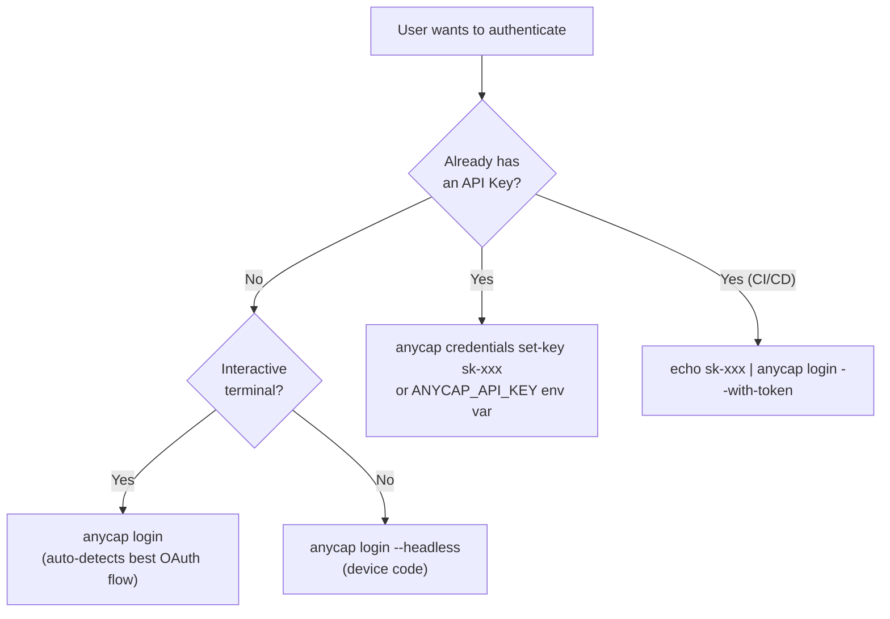
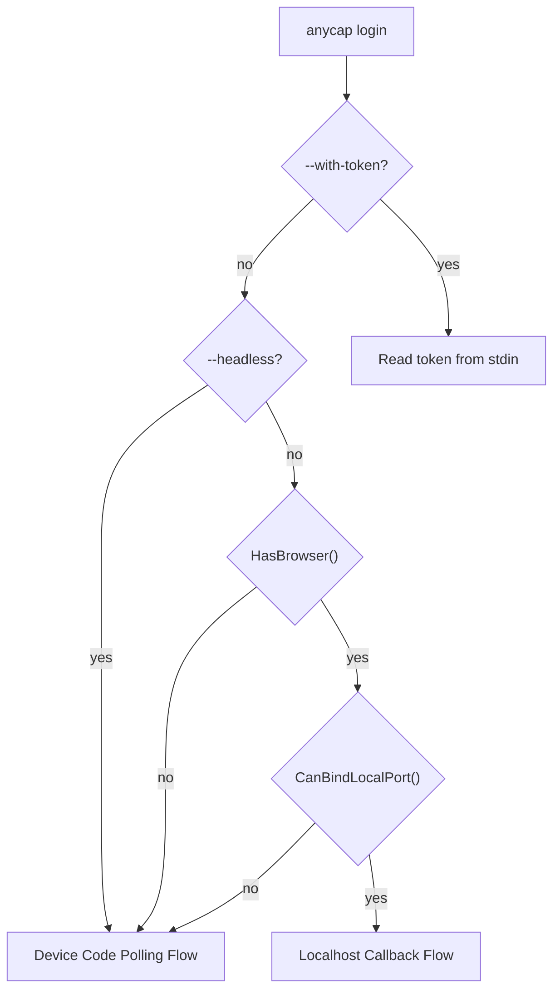
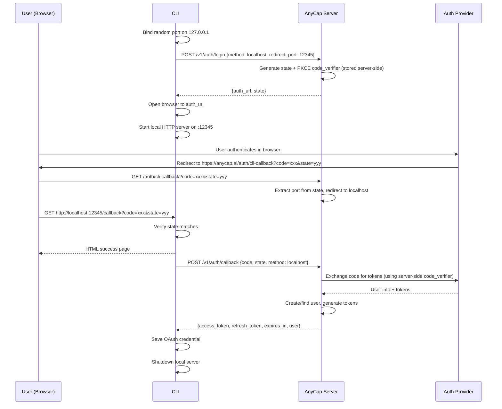
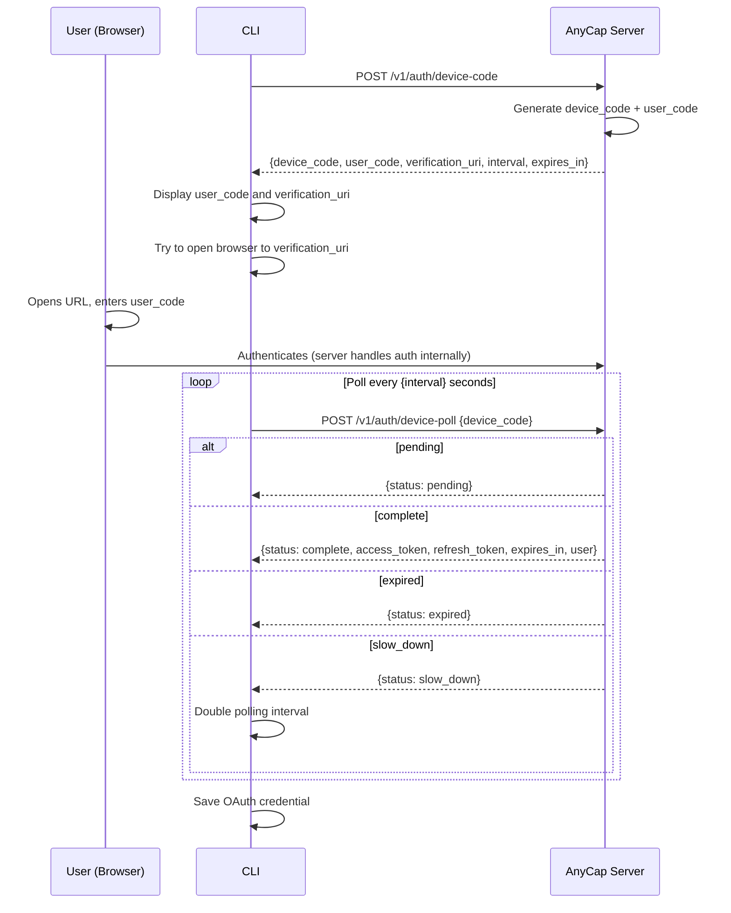
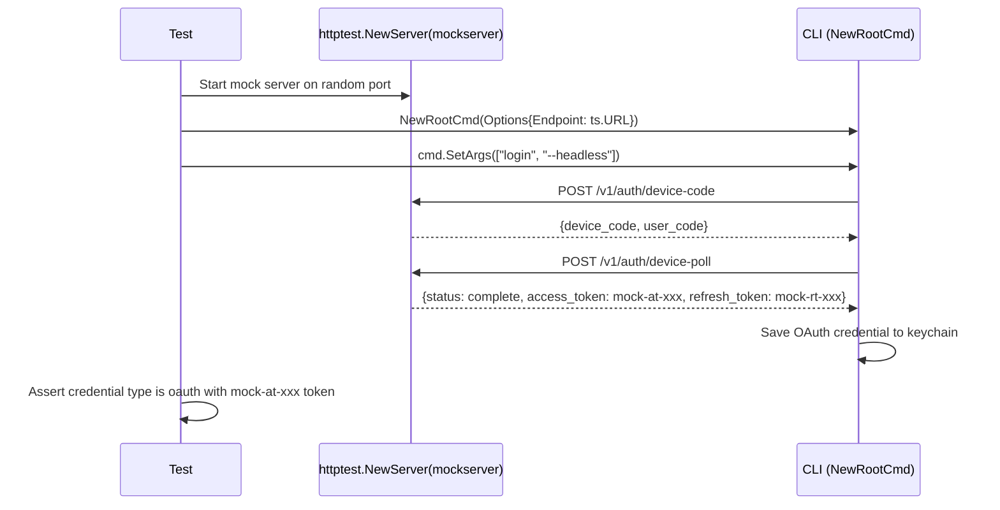

# CLI OAuth Authentication Spec

> Date: 2026-03-24 (updated 2026-03-25)
> Status: Active
>
> MVP authoritative note:
> - Current MVP login result is `api_key`, not `access_token + refresh_token`.
> - CLI never talks to Auth0 directly. CLI only talks to AnyCap Server.
> - `POST /v1/auth/refresh` is future work, not MVP.
> - `POST /v1/auth/device-poll` returns `status` and, when complete, `api_key`.
> - Sections below that still describe direct OAuth credential persistence should be treated as Phase 2 design notes until they are fully updated.

## 1. Overview

AnyCap CLI supports multiple authentication methods for `anycap login`:

| Method | Mechanism | Best for |
|--------|-----------|----------|
| **Localhost Callback** | CLI starts local HTTP server, browser redirects back to `localhost` | Interactive terminals with browser access |
| **Device Code Polling** | CLI displays a code, user enters it on a web page, CLI polls for completion | Headless / SSH / remote environments |
| **Direct Key Input** | `anycap credentials set-key sk-xxx` or `anycap login --with-token` | CI/CD, scripted provisioning |

The CLI auto-detects the best flow and falls back gracefully. Users can force a specific method via flags.

**Core principle:** CLI never talks to the auth provider directly. All auth flows go through the AnyCap Server, which internally handles authentication. The server's auth backend (Auth0, custom, etc.) is an implementation detail invisible to the CLI.

## 2. Authentication Model

AnyCap CLI supports two authentication types with distinct credential models.

### 2.1 Auth Types

| Auth Type | Description | Identity | What CLI Receives |
|-----------|-------------|----------|-------------------|
| **Interactive Login** | CLI asks Server to orchestrate Auth0 login. After browser/device verification, Server returns an AnyCap API key. | User identity (email, name) | `api_key` + `user` |
| **API Key** | Pre-provisioned key from dashboard, admin API, or another user. No interactive flow needed. Static, long-lived. | Key-level only (no user identity in CLI) | Created outside the CLI |

### 2.2 Methods Matrix

| Method | Auth Type | Command | Interactive | Server Call | Best For |
|--------|-----------|---------|-------------|-------------|----------|
| Localhost Callback | Server-orchestrated login | `anycap login` | Yes (browser) | `/v1/auth/login` + `/v1/auth/callback` | Desktop terminals with browser |
| Device Code | Server-orchestrated login | `anycap login --headless` | Yes (code entry) | `/v1/auth/device-code` + `/v1/auth/device-poll` | SSH, headless, remote |
| Stdin Token | API Key | `anycap login --with-token` | No | None | CI/CD pipeline provisioning |
| Direct Set | API Key | `anycap credentials set-key <key>` | No | None | Manual key provisioning |
| Env Variable | API Key | `ANYCAP_API_KEY=sk-...` | No | None | Containers, ephemeral envs |

### 2.3 Credential Resolution

Resolution happens on every CLI command. Higher priority wins.

| Priority | Source | Persisted | Mechanism |
|----------|--------|-----------|-----------|
| 1 (highest) | `ANYCAP_API_KEY` env var | No | Runtime override, never written to disk |
| 2 | OS keychain | Yes | macOS Keychain / Linux Secret Service / Windows Credential Manager |
| 3 (lowest) | `~/.anycap/credentials` file | Yes | Fallback when keychain is unavailable (Docker, headless Linux) |

### 2.4 Token Lifecycle

| Auth Type | Expiry | Refresh | Re-auth |
|-----------|--------|---------|---------|
| Interactive Login | No client-side refresh in MVP. CLI stores the returned API key. | N/A in MVP | `anycap login` again if key is revoked or replaced |
| API Key | No client-side expiry | N/A (no refresh token) | Obtain new key from dashboard |
| Env var | No client-side expiry | N/A | Update the env var |

**MVP behavior:**

1. `anycap login` completes an interactive flow and persists the returned API key.
2. Subsequent requests always send `Authorization: Bearer <api_key>`.
3. `POST /v1/auth/refresh` is reserved for a future OAuth-token-based phase and is not required for MVP.

### 2.5 Transport

All credential types produce the same HTTP header:

```
Authorization: Bearer <api_key or access_token>
User-Agent: anycap-cli/<version>
```

For MVP, the bearer value is expected to be an AnyCap API key.

### 2.6 Flow Selection Diagram



### 2.7 API Path Migration

The current login command calls `/v1/login/init`. The server now exposes aligned endpoints under `/v1/auth/` aliases:

| Old (current code) | New (this spec) | Purpose |
|----|----|----|
| `POST /v1/login/init` | `POST /v1/auth/login` | Initiate localhost callback flow |
| (none) | `POST /v1/auth/callback` | Complete localhost callback flow |
| (none) | `POST /v1/auth/device-code` | Initiate device code flow |
| (none) | `POST /v1/auth/device-poll` | Poll device code status and receive `api_key` on completion |

The old `/v1/login/*` endpoints remain as compatibility paths in MVP.

## 3. User Experience

### 3.1 Interactive (Localhost Callback, default)

```
$ anycap login

Opening browser to authenticate...
If the browser doesn't open, visit: https://anycap.ai/auth/cli?state=...

Waiting for authentication... done!
Logged in as user@example.com
Credential saved.
```

### 3.2 Headless (Device Code Polling)

```
$ anycap login --headless

! First, copy your one-time code: ABCD-1234

Then open this URL in a browser: https://anycap.ai/device

Waiting for authentication... done!
Logged in as user@example.com
Credential saved.
```

### 3.3 Direct Key Input (Skip OAuth entirely)

```
$ anycap credentials set-key sk-xxxxxxxx

API Key saved.
```

### 3.4 Stdin Token (CI/CD pipelines)

Inspired by `gh auth login --with-token`:

```
$ echo "sk-xxxxxxxx" | anycap login --with-token

API Key saved.
```

Reads a single line from stdin and saves it as the credential. No server call is made. Useful for CI/CD pipelines, scripted provisioning, and Docker entrypoints.

## 4. Flow Selection Logic (AutoFlow)



Decision logic:
1. If `--with-token` flag: read from stdin, save, done. No server interaction.
2. If `--headless` flag: use Device Code directly.
3. Check `HasBrowser()`: does the environment have graphical browser access?
4. Check `CanBindLocalPort()`: can we receive a localhost callback?
5. If both: use Localhost Callback.
6. Otherwise: fall back to Device Code.

`--headless` and `--with-token` are mutually exclusive.

### 4.1 HasBrowser() Detection

`HasBrowser()` determines whether the current environment can open a graphical browser.
This replaces the previous approach of only checking port binding, which was insufficient
(SSH and Docker can bind ports but cannot open local browsers).

| Signal | Result | Rationale |
|--------|--------|-----------|
| `CI` env var set | no browser | CI/CD pipelines (GitHub Actions, GitLab CI, etc.) |
| `SSH_CONNECTION` or `SSH_TTY` set | no browser | Remote SSH session, no local display |
| `CODESPACES` env var set | no browser | GitHub Codespaces container |
| `GITPOD_WORKSPACE_ID` env var set | no browser | Gitpod workspace container |
| Linux without `DISPLAY` or `WAYLAND_DISPLAY` | no browser | Headless Linux server, no X11/Wayland |
| macOS desktop (no SSH) | has browser | Desktop OS with default browser |
| Windows desktop (no SSH) | has browser | Desktop OS with default browser |
| Linux with display (no SSH) | has browser | Desktop Linux with X11/Wayland |

Implementation: `internal/cli/auth/auto.go` (`HasBrowser()` function).

### 4.2 Browser Opening

The browser opener is platform-specific and replaceable for testing:

| OS | Command |
|----|--------|
| macOS | `open <url>` |
| Linux | `xdg-open <url>` |
| Windows | `cmd /c start <url>` |

If the browser fails to open, the URL is printed to stderr for manual copy-paste.
The opener function is a package variable (`auth.BrowserLauncher`) that tests override
with a no-op to prevent browsers from opening during automated test runs.

Implementation: `internal/cli/auth/browser.go`.

## 5. Flow 1: Localhost Callback

### 5.1 Sequence



### 5.2 Key Design Decisions

**PKCE (Proof Key for Code Exchange)**
- Server generates `code_verifier` and `code_challenge` when creating the auth URL.
- The `code_verifier` is stored server-side (tied to `state`), not in the CLI.
- This prevents authorization code interception attacks.
- CLI never sees the code_verifier -- even if CLI is compromised, it cannot forge token exchanges.

**State parameter**
- Server generates a random `state` value that also encodes the redirect port.
- CLI verifies the `state` in the callback matches what the server returned.
- Prevents CSRF attacks.

**Server-side redirect proxy (important)**
- Many auth providers do NOT support wildcard ports in redirect URIs.
- Solution: **server-side redirect proxy.** Register a single redirect URI: `https://anycap.ai/auth/cli-callback`. The auth provider redirects there. The server-side handler extracts the port from the `state` parameter, then 302-redirects the browser to `http://localhost:{port}/callback?code=...&state=...`.
- This works with any port and requires no auth provider configuration changes when adding ports.

```mermaid
flowchart LR
    Auth Provider -->|redirect| A["anycap.ai/auth/cli-callback"]
    A -->|extract port from state| B["302 redirect"]
    B -->|"http://localhost:{port}/callback"| CLI
```

**Random port binding**
- CLI binds to `127.0.0.1:0` (OS assigns a random available port).
- The port is sent to the server in the login init request.
- Local server only binds to `127.0.0.1`, not `0.0.0.0` -- not reachable from network.

**Browser opening**
- Use `open` (macOS), `xdg-open` (Linux), `cmd /c start` (Windows).
- If browser open fails, print the URL to stderr for manual copy-paste.

**Timeout**
- Local server waits a maximum of 5 minutes for the callback.
- After timeout, shuts down and suggests `--headless` as alternative.

## 6. Flow 2: Device Code Polling

Inspired by GitHub CLI (`gh auth login`) and the OAuth 2.0 Device Authorization Grant (RFC 8628).

### 6.1 Sequence



### 6.2 Key Design Decisions

**Server-generated device code**
- The server generates its own device code and manages the verification flow.
- Reasons: server can customize the verification page (`anycap.ai/device`); server controls the user_code format; no dependency on auth provider's native device flow support.

**User code format**
- 8 characters, split by hyphen: `ABCD-1234` (4 alpha + 4 numeric).
- Easy to read aloud, type, and visually verify.
- Expires in 15 minutes.

**Polling behavior**
- Initial interval: 5 seconds (server-specified in response).
- CLI respects `interval` from the server.
- On `slow_down` response, CLI doubles the interval.
- Maximum poll duration: 15 minutes (matches code expiry).

**Verification page flow**
- `https://anycap.ai/device` is a web page where user enters the code.
- After entering code, user is redirected to the server's auth page for authentication.
- After auth, the page shows "Device authorized, you can return to the terminal."
- Server marks the device_code as authorized and returns OAuth tokens on next poll.

## 7. Server API Contracts

All login endpoints that return credentials use a **unified token response** format.
The server decides whether to issue an API key or OAuth tokens based on its own
configuration. CLI handles both transparently.

### 7.0 Unified Token Response

Login completion endpoints (`/v1/auth/callback`, `/v1/auth/device-poll`) return
credentials in a unified format. The `credential_type` field determines how the
CLI stores and uses the credential.

| Field | Type | Required | Description |
|-------|------|----------|-------------|
| `credential_type` | string | yes | `"api_key"` or `"oauth"` |
| `access_token` | string | yes | Bearer token for API calls |
| `refresh_token` | string | oauth only | Long-lived refresh token (empty/absent for api_key) |
| `expires_in` | int | oauth only | Access token TTL in seconds (0/absent for api_key) |
| `user.email` | string | no | User's email |
| `user.name` | string | no | User's display name |

**API key response** (server issues a static key, no refresh needed):

```json
{
  "status": "success",
  "data": {
    "credential_type": "api_key",
    "access_token": "sk-abc123...",
    "user": {"email": "dev@anycap.ai", "name": "Dev User"}
  }
}
```

**OAuth response** (server issues short-lived token with refresh):

```json
{
  "status": "success",
  "data": {
    "credential_type": "oauth",
    "access_token": "eyJhbG...",
    "refresh_token": "rt-xyz789...",
    "expires_in": 3600,
    "user": {"email": "dev@anycap.ai", "name": "Dev User"}
  }
}
```

**CLI behavior by credential_type:**

| credential_type | Stored as | Auto-refresh | Token expiry |
|-----------------|-----------|-------------|-------------|
| `api_key` | `APIKeyCredential` | No | Never (client-side) |
| `oauth` | `OAuthCredential` | Yes (via `/v1/auth/refresh`) | `expires_in` seconds |

**Backward compatibility:** If `credential_type` is absent, CLI infers the type:
presence of `refresh_token` implies `oauth`, otherwise `api_key`.

### 7.1 Localhost Flow

**POST /v1/auth/login**

| Direction | Field | Type | Description |
|-----------|-------|------|-------------|
| Request | `method` | string | `"localhost"` |
| Request | `redirect_port` | int | CLI's local server port |
| Response | `auth_url` | string | Server-generated authorize URL (with PKCE, state, scopes) |
| Response | `state` | string | State value for CLI to verify in callback |

**POST /v1/auth/callback**

| Direction | Field | Type | Description |
|-----------|-------|------|-------------|
| Request | `code` | string | Authorization code from server auth flow |
| Request | `state` | string | State value to verify |
| Response | | | Unified token response (see 7.0) |

### 7.2 Device Code Flow

**POST /v1/auth/device-code**

| Direction | Field | Type | Description |
|-----------|-------|------|-------------|
| Request | (empty body) | | |
| Response | `device_code` | string | Server-generated device code (internal) |
| Response | `user_code` | string | User-facing code (`ABCD-1234`) |
| Response | `verification_uri` | string | URL to enter the code (`https://anycap.ai/device`) |
| Response | `interval` | int | Polling interval in seconds |
| Response | `expires_in` | int | Code expiry in seconds |

**POST /v1/auth/device-poll**

| Direction | Field | Type | Description |
|-----------|-------|------|-------------|
| Request | `device_code` | string | Device code from init response |
| Response | `status` | string | `"pending"`, `"complete"`, `"expired"`, or `"slow_down"` |
| Response | | | When status=`complete`: unified token response fields (see 7.0) |

### 7.3 Token Refresh

**POST /v1/auth/refresh**

| Direction | Field | Type | Description |
|-----------|-------|------|-------------|
| Request | `refresh_token` | string | Current refresh token |
| Response | `access_token` | string | New access token |
| Response | `refresh_token` | string | New refresh token (rotation) |
| Response | `expires_in` | int | New access token TTL in seconds |

No `Authorization` header required. Returns 401 if the refresh token is invalid or expired.

## 8. Credential Storage

### 8.1 Credential Model

Credentials are stored as JSON with a `type` discriminator:

**OAuth credential** (from `anycap login`):
```json
{
  "type": "oauth",
  "access_token": "eyJ...",
  "refresh_token": "v1.MR...",
  "expires_at": "2026-03-25T12:00:00Z"
}
```

**API Key credential** (from `credentials set-key`, `login --with-token`, or `ANYCAP_API_KEY`):
```json
{
  "type": "api_key",
  "access_token": "sk-xxxxxxxx"
}
```

Both types send `Authorization: Bearer <access_token>` on every request. The `type` field determines whether the client attempts token refresh.

Implementation: `internal/cli/config/credential.go` (`Credential` struct, `NewOAuthCredential()`, `NewAPIKeyCredential()`).

### 8.2 Storage Backends

**Resolution order:** `ANYCAP_API_KEY` env var > OS keychain > `~/.anycap/credentials` fallback file.

Env var always wins (for CI/CD, testing, enterprise proxy). Creates an `api_key` credential at runtime without persisting. The OS keychain is the primary persistent store. The fallback file is for environments where no keychain backend is available (headless Linux without D-Bus/Secret Service, Docker containers, etc.).

**Keychain backend:** `github.com/zalando/go-keyring`
- macOS: Keychain (via Security framework)
- Linux: Secret Service D-Bus API (GNOME Keyring, KDE Wallet, etc.)
- Windows: Windows Credential Manager

Service name: `anycap`, Account: `credential`. Value is JSON string.

**Save behavior:**
1. Marshal `Credential` to JSON.
2. Try OS keychain. If success, delete any existing fallback file and return.
3. If keychain unavailable, write JSON to `~/.anycap/credentials` (mode `0600`).

**Load behavior:**
1. Check `ANYCAP_API_KEY` env var -- return `NewAPIKeyCredential(value)`.
2. Try OS keychain -- parse JSON to `Credential`.
3. Try fallback file. If found AND keychain is available, auto-migrate to keychain and delete the file.

**Logout:** `anycap logout` best-effort calls `POST /v1/auth/logout` to revoke the current API key, then deletes local credentials. If the server is unreachable, local credential deletion still succeeds.

**Testing:** Tests call `keyring.MockInit()` in `TestMain` to use an in-memory keyring backend. No real OS keychain interaction during tests.

## 9. Security Considerations

| Concern | Mitigation |
|---------|------------|
| Auth code interception | PKCE with server-side code_verifier. CLI never sees it. |
| CSRF | Server-generated state parameter, CLI verifies match. |
| Local server exposure | Binds to `127.0.0.1` only, not reachable from network. |
| Credentials storage | OS keychain (macOS Keychain, Linux Secret Service, Windows Credential Manager) is primary. Fallback file written with `0600`. Auto-migrates from file to keychain on load. |
| Device code brute-force | 8-char code with 15-min expiry. Server rate-limits poll requests per device_code. |
| API Key in env | Env vars can be read by other processes. Acceptable for CI/CD; documented risk. |
| CLI compromise | Even if CLI is compromised, PKCE secrets live server-side only. Cannot forge token exchange. |

## 10. 401 Auto-Recovery

When any command receives HTTP 401, the CLI handles it based on credential type:

**OAuth credential (has refresh_token):**
1. Attempt token refresh via `POST /v1/auth/refresh`.
2. If refresh succeeds: retry the original request with the new access_token.
3. If refresh fails: return `AuthError` with re-login hint.

**API Key credential (no refresh_token) or no credential:**
- Map to exit code 1.
- Output to stderr: `Error: Not authenticated or API key expired. Run 'anycap login' to authenticate.`

Additionally, OAuth credentials are proactively refreshed before each request if the access_token is within 30 seconds of expiry, avoiding unnecessary 401 round-trips.

Implementation: `internal/cli/httpclient/client.go` (`do()` method with pre-flight check and 401 retry).

## 11. Edge Cases

| Scenario | Behavior |
|----------|----------|
| Port already in use | `net.Listen` on `:0` almost always succeeds (OS picks free port). If it fails, fall back to device code. |
| Browser fails to open | Print URL to stderr. User can manually copy-paste. |
| User closes browser mid-auth | CLI times out after 5 minutes, suggests `--headless`. |
| Network loss during polling | HTTP error on poll. CLI retries up to 3 times, then fails. |
| Multiple `anycap login` at same time | Each gets its own state/device_code. Last one to complete wins (overwrites credentials). |
| Credentials file is read-only | Save returns error. CLI prints "failed to save" with the API key in stderr so user can manually save. |
| Auth provider is down | Server returns error on `/v1/auth/login`. CLI shows error with hint to try later. |
| Already logged in | CLI prints "Already logged in. Use 'anycap logout' to switch accounts." and exits 0. |

## 12. Mock Auth Server (Development and Testing)

A lightweight mock auth server lives at `internal/cli/testutil/mockserver/`.
It implements all auth API contracts using plain `net/http`, with no server-side dependencies.

**Design decisions:**
- Mock is part of the CLI codebase, not the server -- avoids invasive changes to the shared server code.
- Only imported from `_test.go` files -- never compiled into the CLI production binary.
- Device codes are auto-approved on creation (first poll returns `complete`).
- Mock authorize endpoint (`/mock/authorize`) immediately 302-redirects to the CLI localhost callback.
- Generates deterministic-format tokens (`mock-at-{hex}`, `mock-rt-{hex}`) for easy assertion.

**Automated testing pattern:**



Test isolation:
- `auth.BrowserLauncher` overridden to no-op in `TestMain` (no browser popups).
- `t.Setenv("HOME", t.TempDir())` isolates credential storage from real home directory.

**Manual testing:**

```bash
# Terminal 1: Start mock server
go run ./cmd/anycap-mock

# Terminal 2: Test flows
go run ./cmd/anycap --endpoint http://localhost:9999 login             # localhost callback
go run ./cmd/anycap --endpoint http://localhost:9999 login --headless  # device code
go run ./cmd/anycap --endpoint http://localhost:9999 status            # verify auth
go run ./cmd/anycap logout                                            # remove credentials
```

Implementation: `internal/cli/testutil/mockserver/server.go`, `cmd/anycap-mock/main.go`.

## 13. Implementation Status

### Done (Phase 1+2+3)

- [x] Structured credential model: `Credential` type with `oauth` and `api_key` variants
- [x] Credential storage (JSON): `LoadCredential()`, `SaveCredential()`, `DeleteCredential()` with OS keychain + file fallback + auto-migration
- [x] OAuth login flows return `access_token` + `refresh_token` + `expires_in`
- [x] HTTP client auto-refresh: pre-flight expiry check + 401 retry with `POST /v1/auth/refresh`
- [x] `anycap login` -- localhost callback flow (returns OAuth credential)
- [x] `anycap login --headless` -- device code polling flow (returns OAuth credential)
- [x] `anycap login --with-token` -- stdin API key input for CI/CD
- [x] AutoFlow with `HasBrowser()` + `CanBindLocalPort()` detection
- [x] `anycap logout` -- best-effort server revoke + local credential deletion
- [x] `anycap credentials set-key sk-xxx` -- direct API key input (saves as `api_key` type)
- [x] `anycap credentials show` -- display credential type, source, endpoint, auth state
- [x] 401 auto-recovery: OAuth auto-refresh + re-login hint for API key
- [x] "Already logged in" check before OAuth flows
- [x] Platform-specific browser opening (macOS/Linux/Windows)
- [x] Mock auth server with OAuth token responses + `/v1/auth/refresh` endpoint
- [x] End-to-end test coverage (device code, with-token, logout, auto-refresh, 401 retry)

### Pending

- [ ] Auth provider integration on server side
- [ ] Server-side `/v1/auth/*` endpoints (currently only mock server implements them)
