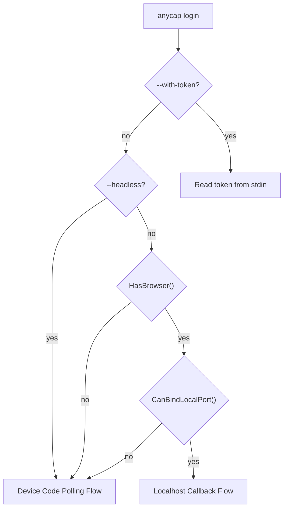
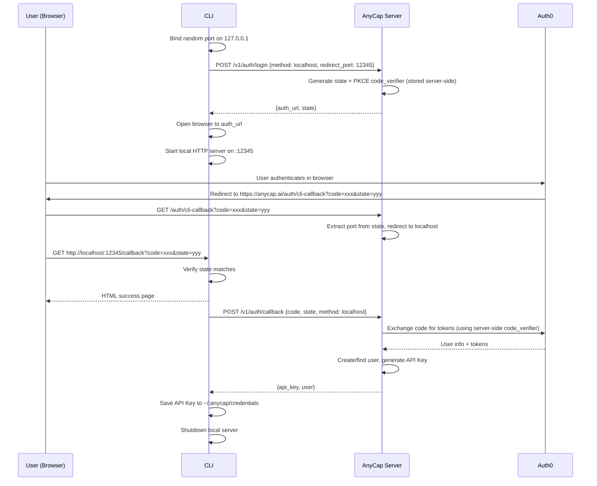
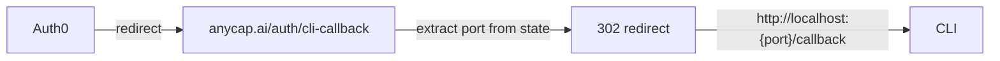
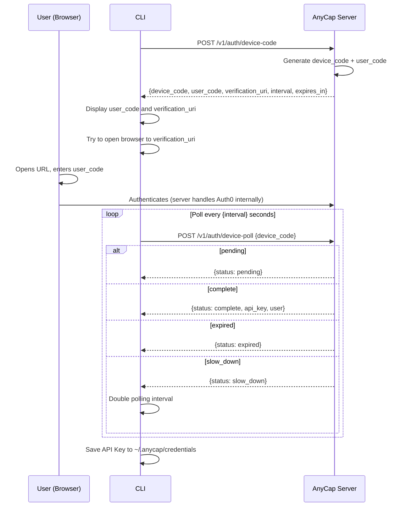
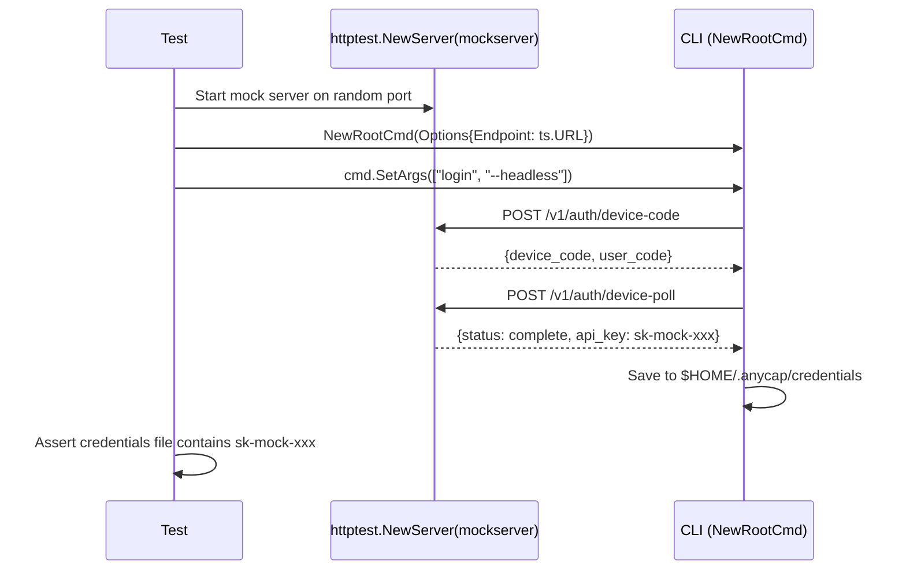

# CLI OAuth Authentication Spec

> Date: 2026-03-24
> Status: Active (Phase 1+2 implemented)

## 1. Overview

AnyCap CLI supports multiple authentication methods for `anycap login`:

| Method | Mechanism | Best for |
|--------|-----------|----------|
| **Localhost Callback** | CLI starts local HTTP server, browser redirects back to `localhost` | Interactive terminals with browser access |
| **Device Code Polling** | CLI displays a code, user enters it on a web page, CLI polls for completion | Headless / SSH / remote environments |
| **Direct Key Input** | `anycap config set-key sk-xxx` or `anycap login --with-token` | CI/CD, scripted provisioning |

The CLI auto-detects the best flow and falls back gracefully. Users can force a specific method via flags.

**Core principle:** CLI never talks to Auth0 directly. All auth flows go through the AnyCap Server, which internally integrates with Auth0. This is consistent with the system architecture where Server is the sole gateway.

## 2. API Path Migration

The current login command calls `/v1/login/init`. This spec defines new endpoints under `/v1/auth/`:

| Old (current code) | New (this spec) | Purpose |
|----|----|----|
| `POST /v1/login/init` | `POST /v1/auth/login` | Initiate localhost callback flow |
| (none) | `POST /v1/auth/callback` | Complete localhost callback flow |
| (none) | `POST /v1/auth/device-code` | Initiate device code flow |
| (none) | `POST /v1/auth/device-poll` | Poll device code status |

The server must implement the new endpoints. The old `/v1/login/init` can be removed once the CLI is updated.

## 3. User Experience

### 3.1 Interactive (Localhost Callback, default)

```
$ anycap login

Opening browser to authenticate...
If the browser doesn't open, visit: https://anycap.ai/auth/cli?state=...

Waiting for authentication... done!
Logged in as user@example.com
API Key saved to ~/.anycap/credentials
```

### 3.2 Headless (Device Code Polling)

```
$ anycap login --headless

! First, copy your one-time code: ABCD-1234

Then open this URL in a browser: https://anycap.ai/device

Waiting for authentication... done!
Logged in as user@example.com
API Key saved to ~/.anycap/credentials
```

### 3.3 Direct Key Input (Skip OAuth entirely)

```
$ anycap config set-key sk-xxxxxxxx

API Key saved to ~/.anycap/credentials
```

### 3.4 Stdin Token (CI/CD pipelines)

Inspired by `gh auth login --with-token`:

```
$ echo "sk-xxxxxxxx" | anycap login --with-token

API Key saved to ~/.anycap/credentials
```

Reads a single line from stdin and saves it as the credential. No server call is made. Useful for CI/CD pipelines, scripted provisioning, and Docker entrypoints.

## 4. Flow Selection Logic (AutoFlow)



Decision logic:
1. If `--with-token` flag: read from stdin, save, done. No server interaction.
2. If `--headless` flag: use Device Code directly.
3. Check `HasBrowser()`: does the environment have graphical browser access?
4. Check `CanBindLocalPort()`: can we receive a localhost callback?
5. If both: use Localhost Callback.
6. Otherwise: fall back to Device Code.

`--headless` and `--with-token` are mutually exclusive.

### 4.1 HasBrowser() Detection

`HasBrowser()` determines whether the current environment can open a graphical browser.
This replaces the previous approach of only checking port binding, which was insufficient
(SSH and Docker can bind ports but cannot open local browsers).

| Signal | Result | Rationale |
|--------|--------|-----------|
| `CI` env var set | no browser | CI/CD pipelines (GitHub Actions, GitLab CI, etc.) |
| `SSH_CONNECTION` or `SSH_TTY` set | no browser | Remote SSH session, no local display |
| `CODESPACES` env var set | no browser | GitHub Codespaces container |
| `GITPOD_WORKSPACE_ID` env var set | no browser | Gitpod workspace container |
| Linux without `DISPLAY` or `WAYLAND_DISPLAY` | no browser | Headless Linux server, no X11/Wayland |
| macOS desktop (no SSH) | has browser | Desktop OS with default browser |
| Windows desktop (no SSH) | has browser | Desktop OS with default browser |
| Linux with display (no SSH) | has browser | Desktop Linux with X11/Wayland |

Implementation: `internal/cli/auth/auto.go` (`HasBrowser()` function).

### 4.2 Browser Opening

The browser opener is platform-specific and replaceable for testing:

| OS | Command |
|----|--------|
| macOS | `open <url>` |
| Linux | `xdg-open <url>` |
| Windows | `cmd /c start <url>` |

If the browser fails to open, the URL is printed to stderr for manual copy-paste.
The opener function is a package variable (`auth.BrowserLauncher`) that tests override
with a no-op to prevent browsers from opening during automated test runs.

Implementation: `internal/cli/auth/browser.go`.

## 5. Flow 1: Localhost Callback

### 5.1 Sequence



### 5.2 Key Design Decisions

**PKCE (Proof Key for Code Exchange)**
- Server generates `code_verifier` and `code_challenge` when creating the auth URL.
- The `code_verifier` is stored server-side (tied to `state`), not in the CLI.
- This prevents authorization code interception attacks.
- CLI never sees the code_verifier -- even if CLI is compromised, it cannot forge token exchanges.

**State parameter**
- Server generates a random `state` value that also encodes the redirect port.
- CLI verifies the `state` in the callback matches what the server returned.
- Prevents CSRF attacks.

**Auth0 redirect URI strategy (important)**
- Auth0 does NOT support wildcard ports in redirect URIs.
- Solution: **server-side redirect proxy.** Register a single redirect URI: `https://anycap.ai/auth/cli-callback`. Auth0 redirects there. The server-side handler extracts the port from the `state` parameter, then 302-redirects the browser to `http://localhost:{port}/callback?code=...&state=...`.
- This works with any port and requires no Auth0 configuration changes when adding ports.



**Random port binding**
- CLI binds to `127.0.0.1:0` (OS assigns a random available port).
- The port is sent to the server in the login init request.
- Local server only binds to `127.0.0.1`, not `0.0.0.0` -- not reachable from network.

**Browser opening**
- Use `open` (macOS), `xdg-open` (Linux), `cmd /c start` (Windows).
- If browser open fails, print the URL to stderr for manual copy-paste.

**Timeout**
- Local server waits a maximum of 5 minutes for the callback.
- After timeout, shuts down and suggests `--headless` as alternative.

## 6. Flow 2: Device Code Polling

Inspired by GitHub CLI (`gh auth login`) and the OAuth 2.0 Device Authorization Grant (RFC 8628).

### 6.1 Sequence



### 6.2 Key Design Decisions

**Server-generated device code (not Auth0 native)**
- The server generates its own device code and maps it to an Auth0 web login.
- Reasons: not all Auth0 plans support device flow natively; server can customize the verification page (`anycap.ai/device`); server controls the user_code format.

**User code format**
- 8 characters, split by hyphen: `ABCD-1234` (4 alpha + 4 numeric).
- Easy to read aloud, type, and visually verify.
- Expires in 15 minutes.

**Polling behavior**
- Initial interval: 5 seconds (server-specified in response).
- CLI respects `interval` from the server.
- On `slow_down` response, CLI doubles the interval.
- Maximum poll duration: 15 minutes (matches code expiry).

**Verification page flow**
- `https://anycap.ai/device` is a web page where user enters the code.
- After entering code, user is redirected to Auth0 for authentication.
- After auth, the page shows "Device authorized, you can return to the terminal."
- Server marks the device_code as authorized and returns the API key on next poll.

## 7. Server API Contracts

### 7.1 Localhost Flow

**POST /v1/auth/login**

| Direction | Field | Type | Description |
|-----------|-------|------|-------------|
| Request | `method` | string | `"localhost"` |
| Request | `redirect_port` | int | CLI's local server port |
| Response | `auth_url` | string | Full Auth0 authorize URL (with PKCE, state, scopes) |
| Response | `state` | string | State value for CLI to verify in callback |

**POST /v1/auth/callback**

| Direction | Field | Type | Description |
|-----------|-------|------|-------------|
| Request | `code` | string | Authorization code from Auth0 |
| Request | `state` | string | State value to verify |
| Request | `method` | string | `"localhost"` |
| Response | `api_key` | string | Generated API key (`sk-...`) |
| Response | `user.email` | string | User's email |
| Response | `user.name` | string | User's display name |

### 7.2 Device Code Flow

**POST /v1/auth/device-code**

| Direction | Field | Type | Description |
|-----------|-------|------|-------------|
| Request | (empty body) | | |
| Response | `device_code` | string | Server-generated device code (internal) |
| Response | `user_code` | string | User-facing code (`ABCD-1234`) |
| Response | `verification_uri` | string | URL to enter the code (`https://anycap.ai/device`) |
| Response | `interval` | int | Polling interval in seconds |
| Response | `expires_in` | int | Code expiry in seconds |

**POST /v1/auth/device-poll**

| Direction | Field | Type | Description |
|-----------|-------|------|-------------|
| Request | `device_code` | string | Device code from init response |
| Response | `status` | string | `"pending"`, `"complete"`, `"expired"`, or `"slow_down"` |
| Response | `api_key` | string | (only when status=complete) |
| Response | `user` | object | (only when status=complete) |

## 8. Credential Storage

**Resolution order:** `ANYCAP_API_KEY` env var > OS keychain > `~/.anycap/credentials` fallback file.

Env var always wins (for CI/CD, testing, enterprise proxy). The OS keychain is the primary persistent store. The plain-text file is a fallback for environments where no keychain backend is available (headless Linux without D-Bus/Secret Service, Docker containers, etc.).

**Keychain backend:** `github.com/zalando/go-keyring`
- macOS: Keychain (via Security framework)
- Linux: Secret Service D-Bus API (GNOME Keyring, KDE Wallet, etc.)
- Windows: Windows Credential Manager

Service name: `anycap`, Account: `api-key`.

**Save behavior:**
1. Try OS keychain. If success, delete any existing fallback file and return.
2. If keychain unavailable, write `~/.anycap/credentials` (plain text, single line, `0600`).

**Load behavior:**
1. Check `ANYCAP_API_KEY` env var.
2. Try OS keychain.
3. Try fallback file. If found AND keychain is available, auto-migrate to keychain and delete the file.

**Auto-migration:** When `LoadCredential()` finds a key in the fallback file and the keychain is working, it transparently migrates the credential to the keychain and removes the plain-text file. This ensures users who upgrade from file-only versions automatically get keychain protection.

**Logout:** `anycap logout` deletes from both keychain and fallback file. Does NOT revoke the API key server-side (keeps logout fast and offline-capable). Future: `anycap logout --revoke` for server-side revocation.

**Testing:** Tests call `keyring.MockInit()` in `TestMain` to use an in-memory keyring backend. No real OS keychain interaction during tests.

## 9. Security Considerations

| Concern | Mitigation |
|---------|------------|
| Auth code interception | PKCE with server-side code_verifier. CLI never sees it. |
| CSRF | Server-generated state parameter, CLI verifies match. |
| Local server exposure | Binds to `127.0.0.1` only, not reachable from network. |
| Credentials storage | OS keychain (macOS Keychain, Linux Secret Service, Windows Credential Manager) is primary. Fallback file written with `0600`. Auto-migrates from file to keychain on load. |
| Device code brute-force | 8-char code with 15-min expiry. Server rate-limits poll requests per device_code. |
| API Key in env | Env vars can be read by other processes. Acceptable for CI/CD; documented risk. |
| CLI compromise | Even if CLI is compromised, PKCE secrets live server-side only. Cannot forge token exchange. |

## 10. 401 Auto-Recovery

When any command receives HTTP 401, the CLI should:
- Map to exit code 1 (see framework.md Section 6)
- Output to stderr: `Error: Not authenticated or API key expired. Run 'anycap login' to authenticate.`
- In JSON mode, include `error.hint: "anycap login"` in stdout

This covers: first-time users, revoked keys, expired keys (if expiry is implemented later).

## 11. Edge Cases

| Scenario | Behavior |
|----------|----------|
| Port already in use | `net.Listen` on `:0` almost always succeeds (OS picks free port). If it fails, fall back to device code. |
| Browser fails to open | Print URL to stderr. User can manually copy-paste. |
| User closes browser mid-auth | CLI times out after 5 minutes, suggests `--headless`. |
| Network loss during polling | HTTP error on poll. CLI retries up to 3 times, then fails. |
| Multiple `anycap login` at same time | Each gets its own state/device_code. Last one to complete wins (overwrites credentials). |
| Credentials file is read-only | Save returns error. CLI prints "failed to save" with the API key in stderr so user can manually save. |
| Auth0 is down | Server returns error on `/v1/auth/login`. CLI shows error with hint to try later. |
| Already logged in | CLI prints "Already logged in. Use 'anycap logout' to switch accounts." and exits 0. |

## 12. Mock Auth Server (Development and Testing)

A lightweight mock auth server lives at `internal/cli/testutil/mockserver/`.
It implements all auth API contracts using plain `net/http`, with no server-side dependencies.

**Design decisions:**
- Mock is part of the CLI codebase, not the server -- avoids invasive changes to the shared server code.
- Only imported from `_test.go` files -- never compiled into the CLI production binary.
- Device codes are auto-approved on creation (first poll returns `complete`).
- Mock authorize endpoint (`/mock/authorize`) immediately 302-redirects to the CLI localhost callback.
- Generates deterministic-format API keys (`sk-mock-{random hex}`) for easy assertion.

**Automated testing pattern:**



Test isolation:
- `auth.BrowserLauncher` overridden to no-op in `TestMain` (no browser popups).
- `t.Setenv("HOME", t.TempDir())` isolates credential storage from real home directory.

**Manual testing:**

```bash
# Terminal 1: Start mock server
go run ./cmd/anycap-mock

# Terminal 2: Test flows
go run ./cmd/anycap --endpoint http://localhost:9999 login             # localhost callback
go run ./cmd/anycap --endpoint http://localhost:9999 login --headless  # device code
go run ./cmd/anycap --endpoint http://localhost:9999 status            # verify auth
go run ./cmd/anycap logout                                            # remove credentials
```

Implementation: `internal/cli/testutil/mockserver/server.go`, `cmd/anycap-mock/main.go`.

## 13. Implementation Status

### Done (Phase 1+2)

- [x] Credential storage: `LoadCredential()`, `SaveCredential()`, `DeleteCredential()` with OS keychain + file fallback + auto-migration
- [x] HTTP client with `Authorization: Bearer` header and `User-Agent`
- [x] `anycap login --with-token` -- stdin token input for CI/CD
- [x] `anycap login --headless` -- device code polling flow
- [x] `anycap login` -- localhost callback flow with auto-redirect
- [x] AutoFlow with `HasBrowser()` + `CanBindLocalPort()` detection
- [x] `anycap logout` -- delete credentials
- [x] Platform-specific browser opening (macOS/Linux/Windows)
- [x] Mock auth server for testing (`internal/cli/testutil/mockserver/`)
- [x] End-to-end test coverage (device code, with-token, logout, login-then-status)

### Pending (Phase 3)

- [ ] `anycap config set-key sk-xxx` -- direct key input command
- [ ] `anycap config show` -- display current config
- [ ] 401 auto-recovery messaging
- [ ] `anycap login --status` -- show current auth state
- [ ] `anycap logout --revoke` -- server-side key revocation
- [ ] Token refresh (if API keys have expiry)
- [ ] Real Auth0 integration on server side
