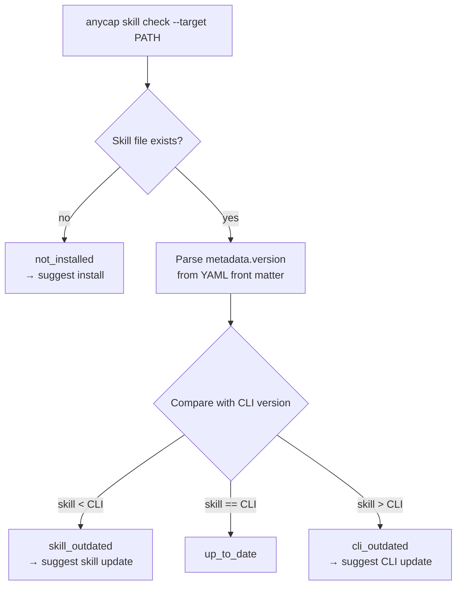
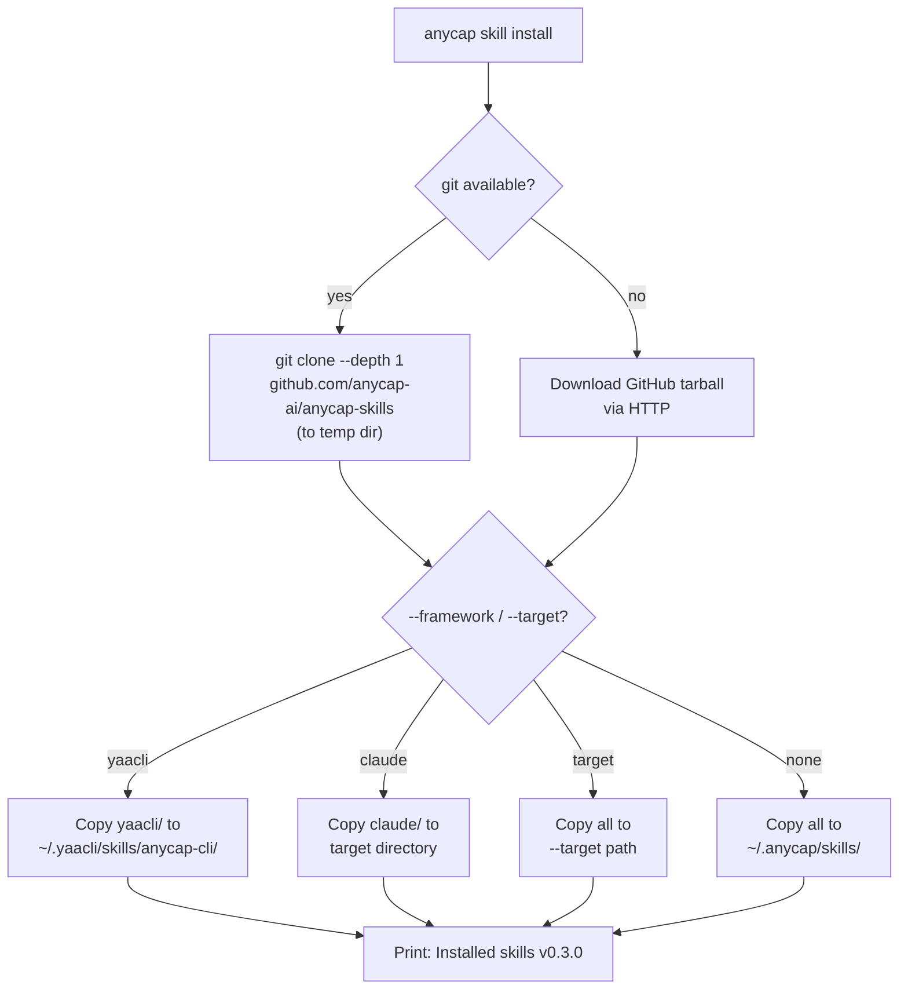
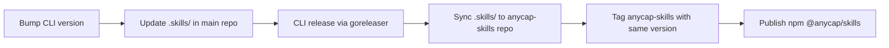

# Skills Management Spec

> Date: 2026-03-25
> Status: Draft

## 1. Overview

AnyCap skills are documentation files that teach AI agents how to use the AnyCap CLI. Different agent frameworks have different formats (YAACLI uses SKILL.md, Claude Code uses CLAUDE.md, etc.). This spec defines how skills are authored, versioned, distributed, installed, and kept up-to-date.

## 2. Design Principles

- **Stateless CLI.** The CLI binary does not maintain persistent state for skill management. Version checking is done by comparing the CLI's built-in version with the installed skill file's `metadata.version` field.
- **Multi-framework.** Skills ship in multiple formats to support YAACLI, Claude Code, and others.
- **Version = CLI version.** Skill files are released alongside the CLI. The `metadata.version` field always matches the CLI release version.
- **Agent-driven updates.** The SKILL.md itself contains instructions telling the agent how to check for and apply updates. The CLI provides the tooling; the agent decides when to act.

## 3. Skills Repository

Skills live in a dedicated public GitHub repository, separate from the main monorepo.

### 3.1 Repository

```
github.com/anycap-ai/anycap-skills
```

### 3.2 Layout

```
anycap-ai/anycap-skills/
  README.md                  # Human-readable overview + install instructions
  package.json               # npm package for npx @anycap/skills support
  version.json               # Machine-readable version metadata
  yaacli/
    anycap-cli/
      SKILL.md               # YAACLI skill format
  claude/
    CLAUDE.md                # Claude Code custom instructions
  generic/
    anycap-cli.md            # Framework-agnostic markdown reference
```

### 3.3 version.json

```json
{
  "version": "0.2.0",
  "released_at": "2026-03-25"
}
```

This is the single source of truth for the skills release version. It matches the corresponding CLI release.

## 4. Skill File Format

### 4.1 YAACLI Format

YAACLI skills use a strict YAML front matter schema. Custom fields go under `metadata`:

```yaml
---
name: anycap-cli
description: AnyCap CLI for AI agents. Use when the agent needs image understanding, video analysis, or checking AnyCap service status.
metadata:
  version: 0.2.0
---
```

Key elements:
- `name`, `description`: required YAACLI fields
- `metadata.version`: matches CLI release version, used by `anycap skill check`
- "Keeping Up to Date" section in body teaches the agent how to self-check

### 4.2 Claude Code Format

Claude Code uses project-level or global CLAUDE.md / AGENTS.md files. The exact format follows Claude's conventions (custom instructions, tool descriptions, etc.).

### 4.3 Generic Format

Plain markdown usable by any agent framework that can read text files. No framework-specific metadata.

## 5. Version Checking

### 5.1 Core Concept

Since skill version = CLI version, the CLI binary is the authority on what version skills should be. The agent does not need to parse YAML or compare semver strings. It calls one command and gets a machine-readable answer.

### 5.2 `anycap skill check`

The primary command for agents. Reads the locally installed skill file, compares with the CLI's own version, and returns a JSON verdict.

```bash
anycap skill check --target ~/.yaacli/skills/anycap-cli/SKILL.md
```

**Response: up to date**

```json
{
  "status": "up_to_date",
  "cli_version": "0.2.0",
  "skill_version": "0.2.0"
}
```

**Response: skill is outdated (most common)**

The skill file is from an older CLI release. Agent should update the skill.

```json
{
  "status": "skill_outdated",
  "cli_version": "0.3.0",
  "skill_version": "0.2.0",
  "action": "update_skill",
  "commands": [
    "anycap skill install --target ~/.yaacli/skills/anycap-cli/",
    "npx @anycap/skills install --target ~/.yaacli/skills/anycap-cli/"
  ]
}
```

**Response: CLI is outdated**

The skill file is from a newer CLI release (someone installed skills from a newer version). Agent should update the CLI.

```json
{
  "status": "cli_outdated",
  "cli_version": "0.2.0",
  "skill_version": "0.3.0",
  "action": "update_cli",
  "commands": [
    "anycap update"
  ]
}
```

**Response: no skill found**

```json
{
  "status": "not_installed",
  "cli_version": "0.2.0",
  "action": "install_skill",
  "commands": [
    "anycap skill install --target ~/.yaacli/skills/anycap-cli/",
    "npx @anycap/skills install --target ~/.yaacli/skills/anycap-cli/"
  ]
}
```

### 5.3 Check Flow



### 5.4 SKILL.md Hint Section

The skill file also includes a human/agent-readable section that describes the update protocol. This serves as a fallback when the agent encounters the skill for the first time:

```markdown
## Keeping Up to Date

Check whether this skill file matches your CLI version:

    anycap skill check --target <path-to-this-file>

Follow the output to update the skill or the CLI as needed.
```

## 6. CLI Commands

### 6.1 `anycap skill check`

Compares installed skill version against CLI version. Returns JSON verdict with actionable commands. See section 5.2 for full response format.

```bash
anycap skill check --target <path>     # Check a specific skill file
anycap skill check --target <dir>      # Check SKILL.md inside a directory
```

- Reads the `metadata.version` field from the target SKILL.md YAML front matter.
- Compares with `buildinfo.Version` (baked into CLI at compile time).
- Returns JSON to stdout. No network call, no persistent state.

### 6.2 `anycap skill install`

Downloads the skills repository and installs framework-specific files.

```bash
anycap skill install                         # Install to ~/.anycap/skills/
anycap skill install --framework yaacli      # Install to ~/.yaacli/skills/anycap-cli/
anycap skill install --framework claude      # Install Claude format to project
anycap skill install --target /custom/path/  # Install to custom directory
```

Implementation:



Fallback: if the skills repo is unreachable, `install` can write the `go:embed`-ed skill content from the binary itself (always matches CLI version).

### 6.3 `anycap skill update`

Alias for `anycap skill install` with the same flags. Semantically communicates "update existing" rather than "first install", but the behavior is identical: download latest and overwrite.

```bash
anycap skill update --framework yaacli
```

### 6.4 `anycap skill show`

Prints the embedded skill content to stdout. No network call. Useful for piping or inspection.

```bash
anycap skill show                        # Print generic skill content
anycap skill show --framework yaacli     # Print YAACLI SKILL.md format
anycap skill show --framework claude     # Print Claude CLAUDE.md format
```

Uses `go:embed` to include skill files in the binary at compile time. The embedded content always matches the CLI version.

## 7. Installation Channels

### 7.1 `anycap skill install` (CLI)

For users who already have the AnyCap CLI installed.

- Clones the skills repo via `git clone --depth 1`
- Fallback: download GitHub tarball via HTTP if git is not available
- Copies framework-specific files to the target directory

### 7.2 `npx @anycap/skills` (npm)

For users who do not have the CLI. Requires Node.js.

```bash
npx @anycap/skills install
npx @anycap/skills install --framework yaacli
npx @anycap/skills install --framework claude
```

The npm package contains a small install script that:
1. Downloads the skills repo tarball from GitHub
2. Extracts framework-specific files
3. Copies to the target directory

### 7.3 Direct `git clone`

For power users:

```bash
git clone --depth 1 https://github.com/anycap-ai/anycap-skills ~/.anycap/skills

# Then symlink or copy as needed:
cp -r ~/.anycap/skills/yaacli/anycap-cli ~/.yaacli/skills/
```

## 8. Framework Integration

### 8.1 Supported Frameworks

| Framework | Skill Format | Default Install Path | Auto-detect |
|-----------|-------------|---------------------|-------------|
| YAACLI | `SKILL.md` with YAML front matter | `~/.yaacli/skills/anycap-cli/` | Check for `~/.yaacli/` dir |
| Claude Code | `CLAUDE.md` | Project `.claude/` or global | Check for `.claude/` or `CLAUDE.md` |
| Generic | Plain markdown | `~/.anycap/skills/` | Fallback |

### 8.2 Adding a New Framework

1. Create a directory in the skills repo: `<framework>/`
2. Add the skill file in the framework's expected format
3. Update `anycap skill install` to recognize `--framework <name>`
4. Update this spec

## 9. Embedded Skills (go:embed)

The CLI binary embeds the generic skill content using `go:embed`. This enables `anycap skill show` to work without network or file system access.

```go
package skill

import "embed"

//go:embed embedded/anycap-cli.md
var GenericSkill string

//go:embed embedded/yaacli/SKILL.md
var YAACLISkill string
```

Embedded content is updated as part of the release build process. The embedded version always matches the CLI version.

This also enables a fast-path install that writes embedded content directly without cloning the repo:

```bash
anycap skill install --embedded  # Write from binary, no network
```

## 10. Release Process

Skills and CLI release together:



Steps:

1. Update skill content in the main repo `.skills/` directory during development.
2. On CLI release branch (`release/cli-v0.3.0`):
   - goreleaser builds CLI binaries with embedded skills.
   - CI pushes `.skills/` content to `anycap-ai/anycap-skills` repo.
   - CI tags the skills repo with the same version.
   - CI publishes `@anycap/skills` to npm.
3. `version.json` in the skills repo is auto-updated by CI.

## 11. Future Considerations

- **MCP server support.** If AnyCap exposes an MCP-compatible interface, include `mcp.json` in the skills repo for agents that support MCP tool discovery.
- **Auto-framework detection.** `anycap skill install` (without `--framework`) could auto-detect installed agent frameworks and install to all of them.
- **Skill marketplace.** If third-party skills emerge, the install command could support `anycap skill install <name>` from a registry.
