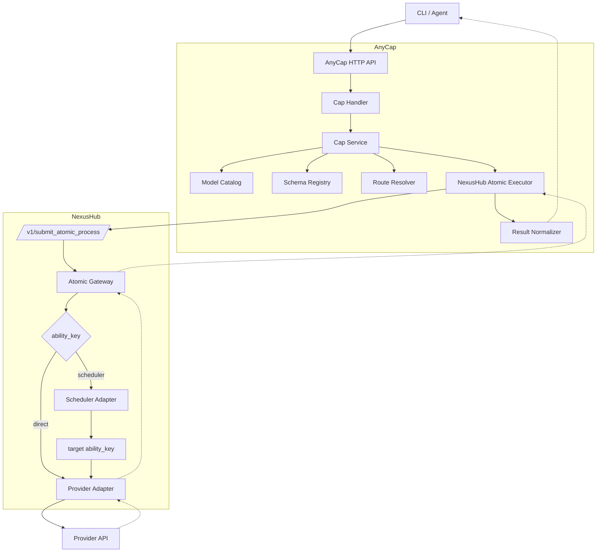

# AnyCap 多模态 Cap 技术方案（图片 / 视频 / 音频）

## 1. 背景

AnyCap 的 `Cap` 是面向 Agent 的能力层，对外提供统一、稳定、可扩展的能力接口。
当前底层执行依赖 NexusHub，且第一阶段以 NexusHub 的同步 atomic 调用作为基础能力。

本文档聚焦以下范围：

- 图片（image）
- 视频（video）
- 音频（audio）
- 不讨论 LLM
- 不讨论 Infra
- 不讨论 Action / Agent

设计目标：

- 对外提供产品语义一致的 Cap 接口
- 对内兼容 NexusHub 现有 `ability_key + req_payload` 同步调用模型
- 将 AnyCap 的领域模型与 NexusHub 的底层协议解耦
- 为未来扩展 direct route / scheduler route / async executor 预留空间

---

## 2. 设计原则

### 2.1 Public Contract Stable

AnyCap 对外稳定暴露：

- `capability`
- `operation`
- `model_id`

不直接暴露：

- `ability_key`
- `gen_type`
- `algo_type`
- `req_payload`
- `atomic_node`

### 2.2 Route Is Internal

`ability_key` 属于底层路由实现细节，应只存在于 AnyCap 的 route binding 和 executor 层。

### 2.3 Model ID != Ability Key

- `model_id` 是对外产品标识
- `ability_key` 是对内执行标识
- 两者必须解耦

### 2.4 One Abstraction For Multimodal

图片、视频、音频共用同一套：

- catalog
- schema
- resolver
- executor
- result normalizer

### 2.5 Scheduler Is a Route Type

后续支持 `scheduler ability key`，但 scheduler 只是一种 route，不是公共模型标识。

---

## 3. 总体架构



核心流程：

```text
capability + operation + model_id
    -> model catalog
    -> route resolver
    -> route binding
    -> nexushub atomic executor
    -> normalized result
```

---

## 4. 分层设计

各层详细设计见后续章节：

| 层 | 对应章节 |
|---|---|
| Public Contract | Section 5（领域模型）、Section 6（接口与 Discovery） |
| Catalog | Section 5.2（ModelSpec）、Section 12（映射设计） |
| Resolver | Section 13（Resolver 设计） |
| Executor | Section 11（NexusHub 包装结构） |
| Result Normalizer | Section 14（输出标准化） |

---

## 5. 核心领域模型

### 5.1 通用请求模型

```go
type InvokeRequest struct {
    Capability string         `json:"capability"`
    Operation  string         `json:"operation"`
    ModelID    string         `json:"model"`
    Input      map[string]any `json:"input"`
    Options    map[string]any `json:"options,omitempty"`
    Metadata   map[string]any `json:"metadata,omitempty"`
}
```

### 5.2 模型目录模型

```go
type ModelSpec struct {
    ModelID     string
    Capability  string
    DisplayName string
    Status      string
    Operations  map[string]OperationSpec
}

type OperationSpec struct {
    SchemaRef    string
    RequestHints map[string]any
    Routes       []RouteBinding
}
```

说明：

- `SchemaRef` 指向字段级 schema，是 discovery contract 的主体。
- `RequestHints` 是可选的薄提示层，只服务端上/CLI 构建请求，不承担底层路由职责。
- `RequestHints` 只建议放少量信息，如 `input_mode`、`defaults`、`examples`；未知字段必须允许客户端忽略。

### 5.3 路由绑定模型

```go
type RouteBinding struct {
    RouteType  string // direct | scheduler
    AbilityKey string
    GenType    string
    AlgoType   string
    Region     string
    Tier       string
    Env        string
    Priority   int
    Enabled    bool
}
```

### 5.4 统一响应模型

```go
type InvokeResult struct {
    ID      string           `json:"id"`
    Status  string           `json:"status"` // succeed / failed / processing / canceled / timeout
    ModelID string           `json:"model"`
    Outputs []OutputArtifact `json:"outputs,omitempty"`
    Usage   map[string]any   `json:"usage,omitempty"`
    Cost    float64          `json:"cost,omitempty"`
    Error   *InvokeError     `json:"error,omitempty"`
    Trace   map[string]any   `json:"trace,omitempty"`
}

type OutputArtifact struct {
    Type     string         `json:"type"`
    URL      string         `json:"url,omitempty"`
    MIMEType string         `json:"mime_type,omitempty"`
    Meta     map[string]any `json:"meta,omitempty"`
}

type InvokeError struct {
    Code    string         `json:"code"`
    Message string         `json:"message"`
    Detail  map[string]any `json:"detail,omitempty"`
}
```

状态值与 NexusHub 保持一致（`internal/constant/nexushub.go`）：

| AnyCap Status | NexusHub State | 说明 |
|---|---|---|
| `succeed` | `succeed` | 处理成功 |
| `failed` | `failed` | 处理失败 |
| `processing` | `processing` / `queueing` / `init` / `created` | 统一归为处理中 |
| `canceled` | `canceled` | 已取消 |
| `timeout` | `timeout` | 已超时 |

---

## 6. 对外接口与 Discovery Contract

### 6.1 发现类接口

- `GET /v1/image/models`
- `GET /v1/video/models`
- `GET /v1/audio/models`
- `GET /v1/{capability}/models/{model}/schema?operation={operation}`
- `GET /v1/audio/voices?model={model}`

`models` 接口响应示例：

```json
{
  "capability": "image",
  "models": [
    {
      "model": "nano-banana-2",
      "display_name": "Nano Banana 2",
      "status": "active",
      "operations": ["generate", "edit"]
    },
    {
      "model": "topaz-upscale",
      "display_name": "Topaz Upscale",
      "status": "active",
      "operations": ["upscale"]
    }
  ]
}
```

### 6.2 Discovery Contract 边界

本方案不把 discovery 做成一套大协议，只保留 3 层信息：

| 层 | 作用 | 数据来源建议 |
|---|---|---|
| `schema` | 描述字段结构、类型、必填和校验 | `operation_schemas` |
| `request_hints` | 帮助端上/CLI 更顺地构建请求 | `extra_info` 或 handler 聚合 |
| `capabilities` | 描述枚举约束和能力开关 | `capabilities` |

边界约束：

- `schema` 负责“字段长什么样”。
- `request_hints` 负责“请求怎么更顺地组出来”。
- `capabilities` 负责“这个模型能不能、有哪些可选值”。
- `ability_key`、`gen_type`、`algo_type` 仍然是内部执行细节，不进入公共 discovery contract。
- `tool_definition` 只在 LLM / tool 场景复用，不纳入当前多模态 discovery 核心。

推荐的 schema 接口返回形态：

```json
{
  "capability": "image",
  "model": "nano-banana-2",
  "operation": "generate",
  "schema": {
    "type": "object",
    "properties": {
      "input": {
        "type": "object"
      },
      "options": {
        "type": "object"
      }
    }
  },
  "request_hints": {
    "input_mode": "text",
    "defaults": {
      "options.ratio": "1:1"
    },
    "examples": [
      {
        "input": {
          "prompt": "a red sports car on a mountain road"
        },
        "options": {
          "ratio": "1:1"
        }
      }
    ]
  },
  "capabilities": {
    "supported_aspect_ratios": ["1:1", "16:9"]
  }
}
```

其中：

- `schema` 是稳定主体，适合做校验和自动补全。
- `request_hints` 是薄提示层，适合做默认值、示例、输入模式提示。
- `capabilities` 是约束补充，适合做下拉、开关和可选值过滤。

### 6.3 端上 / CLI 构建请求流程

推荐的构建流程：

1. 先调用 `models` 接口，拿到某个 `model_id` 支持哪些 `operation`。
2. 再调用 `schema` 接口，拿到该 `operation` 的 `schema + request_hints + capabilities`。
3. CLI / 端上根据 `schema` 生成参数骨架，根据 `request_hints` 补默认值和示例，根据 `capabilities` 渲染可选项。
4. 最终统一提交为 `InvokeRequest`，不要在端上感知 `ability_key`。

一句话：

```text
model_id + operation
    -> schema
    -> request_hints
    -> capabilities
    -> InvokeRequest
```

### 6.4 执行类接口

- `POST /v1/image/generate`
- `POST /v1/image/edit`
- `POST /v1/image/upscale`
- `POST /v1/video/generate`
- `POST /v1/video/from-image`
- `POST /v1/audio/speak`

### 6.5 内部统一入口（可选）

- `POST /v1/caps/{capability}/{operation}`

Section 6.4 的资源风格路由（如 `/v1/image/generate`）是对外公共契约，保持稳定。此统一入口是可选的内部收敛点，接受相同的 `InvokeRequest` 请求体，用于简化内部 handler 路由逻辑。两者可以共存，资源风格路由内部转发至此统一入口即可。

### 6.6 契约稳定性

- `capability`、`operation`、`model`、`schema` 是稳定 discovery contract 的主体。
- `request_hints` 只允许做增量扩展，客户端必须忽略未知字段。
- `capabilities` 可以按能力增加字段，但不应改变既有字段语义。
- 路由、`ability_key`、`gen_type`、`algo_type` 继续留在内部层，不向端上泄露。

---

## 7. 公共字段定义

### 7.1 公共请求字段

详见 Section 5.1 `InvokeRequest` 定义。其中 `model`、`input` 为必填，`options`、`metadata` 为可选。

### 7.2 公共响应字段

详见 Section 5.4 `InvokeResult` 定义。状态值为 `succeed / failed / processing / canceled / timeout`，与 NexusHub 保持一致。

---

## 8. 图片接口设计

### 8.1 支持的 operation

- `generate`
- `edit`
- `upscale`

### 8.2 图片生成

接口：

```http
POST /v1/image/generate
```

请求示例：

```json
{
  "model": "nano-banana-2",
  "input": {
    "prompt": "a red sports car on a mountain road"
  },
  "options": {
    "ratio": "1:1",
    "resolution": "1024x1024",
    "format": "png"
  }
}
```

字段映射：

| AnyCap 字段 | NexusHub 字段 |
|---|---|
| `model` | 解析为 `ability_key` |
| `input.prompt` | `req_payload.prompt` |
| `options.ratio` | `req_payload.image_option.ratio` |
| `options.resolution` | `req_payload.image_option.resolution` |
| `options.format` | `req_payload.image_option.format` |
| route binding | `req_payload.gen_type=image` |
| route binding | `req_payload.image_option.type=txt_2_img` |

### 8.3 图片编辑

接口：

```http
POST /v1/image/edit
```

请求示例：

```json
{
  "model": "nano-banana-2",
  "input": {
    "prompt": "remove background",
    "image_url": "https://..."
  },
  "options": {
    "format": "png"
  }
}
```

字段映射：

| AnyCap 字段 | NexusHub 字段 |
|---|---|
| `input.image_url` | `req_payload.resource_url` |
| `input.prompt` | `req_payload.prompt` |
| `options.format` | `req_payload.image_option.format` |
| route binding | `req_payload.gen_type=image` |
| route binding | `req_payload.image_option.type=img_edit` 或 `img_2_img` |

### 8.4 图片超分

接口：

```http
POST /v1/image/upscale
```

请求示例：

```json
{
  "model": "topaz-upscale",
  "input": {
    "image_url": "https://..."
  },
  "options": {
    "scale": "4x",
    "format": "png"
  }
}
```

字段映射：

| AnyCap 字段 | NexusHub 字段 |
|---|---|
| `input.image_url` | `req_payload.resource_url` |
| `options.scale` | 适配为 `image_option.resolution` 或 provider-specific factor |
| `options.format` | `req_payload.image_option.format` |
| route binding | `req_payload.gen_type=image` |
| route binding | `req_payload.image_option.type=ultra_img` |

---

## 9. 视频接口设计

### 9.1 支持的 operation

- `generate`
- `from-image`

### 9.2 文生视频

接口：

```http
POST /v1/video/generate
```

请求示例：

```json
{
  "model": "veo-3.1",
  "input": {
    "prompt": "a cinematic drone shot over snowy mountains"
  },
  "options": {
    "ratio": "16:9",
    "duration": 5,
    "resolution": "1080p",
    "fps": 24
  }
}
```

字段映射：

| AnyCap 字段 | NexusHub 字段 |
|---|---|
| `input.prompt` | `req_payload.prompt` |
| `options.ratio` | `req_payload.video_option.ratio` |
| `options.duration` | `req_payload.video_option.duration` |
| `options.resolution` | `req_payload.video_option.resolution` |
| `options.fps` | `req_payload.video_option.fps` |
| route binding | `req_payload.gen_type=video` |
| route binding | `req_payload.video_option.type=txt_2_video` |

### 9.3 图生视频

接口：

```http
POST /v1/video/from-image
```

请求示例：

```json
{
  "model": "runway-gen-4.5",
  "input": {
    "prompt": "make it rain",
    "image_url": "https://..."
  },
  "options": {
    "ratio": "16:9",
    "duration": 5,
    "resolution": "720p"
  }
}
```

字段映射：

| AnyCap 字段 | NexusHub 字段 |
|---|---|
| `input.image_url` | `req_payload.resource_url` |
| `input.prompt` | `req_payload.prompt` |
| `options.ratio` | `req_payload.video_option.ratio` |
| `options.duration` | `req_payload.video_option.duration` |
| `options.resolution` | `req_payload.video_option.resolution` |
| route binding | `req_payload.gen_type=video` |
| route binding | `req_payload.video_option.type=img_2_video` |

---

## 10. 音频接口设计

### 10.1 支持的 operation

- `speak`
- `voices`（发现类接口）

### 10.2 文本转语音

接口：

```http
POST /v1/audio/speak
```

请求示例：

```json
{
  "model": "elevenlabs-v3",
  "input": {
    "text": "Hello world"
  },
  "options": {
    "voice": "Rachel",
    "format": "mp3",
    "speed": 1.0,
    "sample_rate": 44100
  }
}
```

字段映射：

| AnyCap 字段 | NexusHub 字段 |
|---|---|
| `input.text` | `req_payload.prompt` |
| `options.voice` | `req_payload.audio_option.voice` |
| `options.format` | `req_payload.audio_option.format` |
| `options.speed` | `req_payload.audio_option.speed` |
| `options.sample_rate` | `req_payload.audio_option.sample_rate` |
| route binding | `req_payload.gen_type=audio` |
| route binding | `audio_option.type` 当前无强制要求，可为空（详见附录 A.5） |

### 10.3 音色发现

接口：

```http
GET /v1/audio/voices?model=elevenlabs-v3
```

响应示例：

```json
{
  "model": "elevenlabs-v3",
  "voices": [
    {
      "id": "voice_001",
      "name": "Rachel",
      "language": "en"
    }
  ]
}
```

注意：

- AnyCap 可以从 NexusHub platform 的 voice config 获取原始数据
- 但对外应统一成稳定格式，不直接透出底层结构

---

## 11. AnyCap 到 NexusHub 的包装结构

NexusHub 当前入口契约：

```json
{
  "ability_key": "...",
  "req_payload": "{...}",
  "token": "...",
  "biz_info": {
    "biz_id": "...",
    "enter_from": "..."
  },
  "user_info": {
    "uid": 123
  },
  "extra": {
    "...": "..."
  }
}
```

AnyCap executor 统一包装为：

```json
{
  "ability_key": "resolved_ability_key",
  "req_payload": "{...AtomicProcessPayload...}",
  "token": "service_or_user_token",
  "biz_info": {
    "biz_id": "anycap",
    "enter_from": "anycap_api"
  },
  "user_info": {
    "uid": 123
  },
  "extra": {
    "model_id": "nano-banana-2",
    "capability": "image",
    "operation": "generate",
    "request_id": "cap_xxx"
  }
}
```

字段映射：

| AnyCap 字段 | NexusHub 字段 |
|---|---|
| `model_id` | `extra.model_id` |
| `capability` | `extra.capability` |
| `operation` | `extra.operation` |
| `route_binding.ability_key` | `ability_key` |
| `route_binding.gen_type` | `req_payload.gen_type` |
| `route_binding.algo_type` | `req_payload.{modality}_option.type`（直接赋值，如 `image_option.type=txt_2_img`） |
| `metadata.request_id` | `extra.request_id` |
| authenticated user id | `user_info.uid` |

### 11.1 Discovery 数据来源建议

AnyCap 不需要要求 NexusHub 立刻新增复杂协议。优先复用 atomic node 已有元数据：

| NexusHub 原子节点数据 | AnyCap Discovery 用途 |
|---|---|
| `operation_schemas` | 作为 `schema` 主体 |
| `capabilities` | 作为能力约束和可选值来源 |
| `extra_info.request_hints` | 作为可选的构建提示来源 |

建议顺序：

1. 先直接消费 `operation_schemas + capabilities`。
2. 只有当端上/CLI 还缺少关键构建提示时，再补 `extra_info.request_hints`。
3. 如果某些提示可稳定从已有字段推导，优先由 handler 聚合成只读返回，不先改库表。

这意味着第一阶段可以只做“薄聚合”，而不是重新定义一套新的底层协议。

---

## 12. model_id 与 ability_key 的映射设计

不建议设计成：

```text
model_id -> ability_key
```

建议设计成：

```text
model_id + operation -> route binding -> ability_key
```

示例：

```yaml
model_id: nano-banana-2
capability: image
operations:
  generate:
    schema_ref: image.generate.v1
    routes:
      - route_type: direct
        ability_key: google_nano_banana_2
        gen_type: image
        algo_type: txt_2_img
        priority: 100
        enabled: true
  edit:
    schema_ref: image.edit.v1
    routes:
      - route_type: direct
        ability_key: google_nano_banana_2
        gen_type: image
        algo_type: img_edit
        priority: 100
        enabled: true
```

如果后面接 scheduler：

```yaml
model_id: image-pro
capability: image
operations:
  generate:
    schema_ref: image.generate.v1
    routes:
      - route_type: scheduler
        ability_key: scheduler_image_pro
        gen_type: image
        algo_type: txt_2_img
        priority: 100
        enabled: true
```

核心原则同 Section 2.3 / 2.5：`model_id` 与 `ability_key` 解耦，scheduler 只是一种 route type。

---

## 13. Resolver 设计

建议 resolver 接口：

```go
type ResolveContext struct {
    Region string
    Tier   string
    Env    string
}

type RouteResolver interface {
    Resolve(
        capability string,
        operation string,
        modelID string,
        ctx ResolveContext,
    ) (*RouteBinding, error)
}
```

解析流程：

1. 根据 `capability + model_id` 找 `ModelSpec`
2. 根据 `operation` 找 `OperationSpec`
3. 根据 `region / env / tier` 过滤 route
4. 选出优先级最高的 route
5. 将 route 交给 executor

---

## 14. 输出标准化

AnyCap 不直接透传 NexusHub `resp_payload` 字符串，而由 Result Normalizer 统一转换为 `InvokeResult`（详见 Section 5.4）。

响应示例：

```json
{
  "id": "cap_img_xxx",
  "status": "succeed",
  "model": "nano-banana-2",
  "outputs": [
    {
      "type": "image",
      "url": "https://...",
      "mime_type": "image/png"
    }
  ],
  "usage": {
    "image_count": 1
  },
  "cost": 0.12,
  "trace": {
    "route_type": "direct"
  }
}
```

Result Normalizer 需将 NexusHub 的多种中间状态（`init`、`created`、`queueing`）统一映射为 `processing`，终态（`succeed`、`failed`、`canceled`、`timeout`）直接透传。

---

## 15. 错误模型

错误结构详见 Section 5.4 `InvokeError` 定义。

建议错误码：

- `invalid_request`
- `schema_validation_failed`
- `model_not_found`
- `operation_not_supported`
- `route_not_found`
- `executor_failed`
- `upstream_timeout`

---

## 16. MVP 范围

第一阶段建议实现：

- `image.generate / edit / upscale`
- `video.generate / from-image`
- `audio.speak`
- `models / schema / voices`
- `route_type = direct | scheduler`
- `nexushub_atomic_sync` executor

暂不实现：

- LLM
- ASR
- Infra
- 自定义 workflow
- 完整 DB 配置中心

---

## 17. 实施建议

### 17.1 先做对抽象

建议一次性定稳：

- `model_id`
- `route binding`
- `resolver`
- `executor`
- `normalizer`

### 17.2 先用静态 catalog

第一阶段不必上 DB。
可先使用静态配置：

- `configs/models/image.yaml`
- `configs/models/video.yaml`
- `configs/models/audio.yaml`

### 17.3 handler 不拼底层 payload

handler 只处理公共请求。
底层 `req_payload` 只允许在 executor 中拼装。

### 17.4 与 NexusHub 对接的最小触点

如果后续要把这套 discovery contract 真正落到接口，建议只动很薄的一层：

- `internal/model/bda/atomic_node.go`：在响应层聚合 `operation_schemas`、`capabilities`、`extra_info.request_hints`。
- `internal/api/handlers/platform/atomic_node.go`：按读取场景返回只读 discovery 视图，必要时做轻量推导。

第一阶段不建议做：

- 新增存储表或新 JSONB 列
- 改 adapter / executor 主流程
- 在服务端引入一整套 schema DSL

---

## 18. 结论

AnyCap 多模态 Cap 的核心模式：

- 对外暴露 `capability + operation + model_id`，对内通过 `route binding` 解析为 `ability_key` 执行
- 图片、视频、音频共用同一套 catalog / resolver / executor / normalizer
- 各层映射边界与设计原则详见 Section 2 和附录 B

---

## 附录 A：枚举建议

本附录给出图片 / 视频 / 音频范围内，建议直接落到代码与配置中的枚举定义。

### A.1 Capability Enum

当前多模态 Cap 范围建议只定义以下公共 capability：

```go
type Capability string

const (
    CapabilityImage Capability = "image"
    CapabilityVideo Capability = "video"
    CapabilityAudio Capability = "audio"
)
```

说明：

- `audio` 是公共能力名
- `tts` 建议作为 CLI 命令别名，而不是领域层 capability enum
- `music / asr / llm` 不在当前文档范围内，后续单独扩展

### A.2 Operation Enum

建议将 `operation` 定义为“按 capability 解释”的公共动作枚举。

```go
type Operation string

const (
    OperationGenerate  Operation = "generate"
    OperationEdit      Operation = "edit"
    OperationUpscale   Operation = "upscale"
    OperationFromImage Operation = "from_image"
    OperationSpeak     Operation = "speak"
)
```

各 capability 支持的 operation 集合如下：

| Capability | Operation Enum | 路径别名 |
|---|---|---|
| `image` | `generate` | `/v1/image/generate` |
| `image` | `edit` | `/v1/image/edit` |
| `image` | `upscale` | `/v1/image/upscale` |
| `video` | `generate` | `/v1/video/generate` |
| `video` | `from_image` | `/v1/video/from-image` |
| `audio` | `speak` | `/v1/audio/speak` |

说明：

- `from_image` 建议作为代码和配置中的 canonical enum
- HTTP path 可以继续保留 `from-image`
- `voices / models / schema` 属于发现类接口，不属于调用 operation enum

如果内部需要构建全局唯一操作键，建议组合为：

```go
type OperationKey string

const (
    OperationKeyImageGenerate   OperationKey = "image.generate"
    OperationKeyImageEdit       OperationKey = "image.edit"
    OperationKeyImageUpscale    OperationKey = "image.upscale"
    OperationKeyVideoGenerate   OperationKey = "video.generate"
    OperationKeyVideoFromImage  OperationKey = "video.from_image"
    OperationKeyAudioSpeak      OperationKey = "audio.speak"
)
```

### A.3 Model ID Enum 策略

`model_id` 不建议做成长期写死在代码里的 compile-time enum。

更推荐的方式是：

- capability 和 operation 用代码 enum 固化
- `model_id` 由 catalog 配置驱动
- 运行时通过 `CatalogRepository` 读取当前有效的 model 集合

也就是说：

```text
Capability / Operation = strong enum
Model ID = catalog value set
```

原因：

- 模型数量会持续增长
- `ability_key` 会变
- direct route 未来可能切 scheduler route
- 某些 model 可能临时下线、迁移 provider、改名展示

### A.4 MVP 建议的 Model ID 集合

虽然 `model_id` 不建议硬编码为长期 enum，但第一版可以在 catalog 中约定首批稳定值：

#### Image

- `nano-banana-2`
- `topaz-upscale`
- `image-pro`

#### Video

- `veo-3.1`
- `runway-gen-4.5`
- `video-pro`

#### Audio

- `elevenlabs-v3`
- `audio-default`

说明：

- `nano-banana-2`、`veo-3.1`、`elevenlabs-v3` 偏“明确模型”
- `image-pro`、`video-pro`、`audio-default` 偏“产品化别名”
- 产品化别名更适合绑定 `scheduler ability key`

### A.5 Route Binding 里的枚举建议

建议 route binding 里固定以下枚举：

```go
type RouteType string

const (
    RouteTypeDirect    RouteType = "direct"
    RouteTypeScheduler RouteType = "scheduler"
)
```

`gen_type` 建议直接复用 nexushub 语义，但只在 executor / route binding 层出现：

```go
type GenType string

const (
    GenTypeImage GenType = "image"
    GenTypeVideo GenType = "video"
    GenTypeAudio GenType = "audio"
)
```

当前建议支持的 `algo_type`：

```go
type AlgoType string

const (
    AlgoTypeText2Img  AlgoType = "txt_2_img"
    AlgoTypeImageEdit AlgoType = "img_edit"
    AlgoTypeUltraImg  AlgoType = "ultra_img"

    AlgoTypeText2Video AlgoType = "txt_2_video"
    AlgoTypeImg2Video  AlgoType = "img_2_video"
)
```

说明：

- `audio.speak` 当前可以不强制要求 `algo_type`
- `algo_type` 只存在于 route binding 和 nexushub adapter，不进入公共 API

### A.6 代码建议

建议最终分层如下：

- `capability`、`operation`、`route_type` 用代码 enum
- `model_id` 用配置 catalog 管理
- `ability_key` 用 route binding 管理

一句话总结：

```text
固定抽象用 enum
易变模型用 catalog
底层路由用 binding
```

---

## 附录 B：映射关系总表

本附录用于明确 AnyCap 多模态 Cap 中最容易混淆的几个概念，以及它们之间的映射责任。

### B.1 一条完整映射链

建议将整条链路统一理解为：

```text
CLI / HTTP Request
    -> capability
    -> operation
    -> model_id
    -> ModelSpec
    -> RouteBinding
    -> ability_key
    -> atomic_node
    -> provider
    -> NexusHub execution
```

### B.2 各层对象的职责

| 概念 | 所在层 | 是否对外暴露 | 作用 |
|---|---|---|---|
| `capability` | Public Contract | 是 | 表示能力分类，如 `image` / `video` / `audio` |
| `operation` | Public Contract | 是 | 表示能力动作，如 `generate` / `edit` / `speak` |
| `model_id` | Public Contract / Catalog | 是 | 对外稳定模型标识 |
| `ModelSpec` | Catalog | 否 | 描述一个 public model 支持哪些 operation |
| `RouteBinding` | Resolver / Execution | 否 | 描述某个 `model_id + operation` 应如何路由 |
| `route_type` | RouteBinding | 否 | 描述路由方式，如 `direct` / `scheduler` |
| `ability_key` | NexusHub Routing | 否 | 底层执行节点标识 |
| `atomic_node` | NexusHub Config | 否 | ability 对应的配置实体 |
| `provider` | NexusHub Config / Runtime | 否 | 最终执行方，如 `tengda` / `google` |

### B.3 三组最容易混淆的概念

#### 1. `model_id` vs `ability_key`

| 项 | `model_id` | `ability_key` |
|---|---|---|
| 面向谁 | CLI / API / Skill | NexusHub / Executor |
| 稳定性 | 应长期稳定 | 可以随底层实现变化 |
| 命名风格 | 产品语义 | 基础设施语义 |
| 例子 | `nano-banana-2` | `tengda_nano_banana_2` |

#### 2. `route_type` vs `provider`

| 项 | `route_type` | `provider` |
|---|---|---|
| 回答的问题 | 怎么路由 | 谁来执行 |
| 例子 | `direct` / `scheduler` | `tengda` / `google` / `cloudsway` |
| 是否固定 | 由 route binding 决定 | 由 atomic node 或 runtime 决定 |

#### 3. `operation` vs `algo_type`

| 项 | `operation` | `algo_type` |
|---|---|---|
| 所在层 | Public API | NexusHub Atomic Payload |
| 语义 | 产品动作 | 底层执行类型 |
| 例子 | `edit` | `img_edit` |

### B.4 责任边界

建议将映射责任固定如下：

| 映射关系 | 负责组件 |
|---|---|
| `capability + operation + model_id -> ModelSpec` | CatalogRepository |
| `ModelSpec + operation + context -> RouteBinding` | RouteResolver |
| `RouteBinding -> ability_key + gen_type + algo_type` | RouteResolver |
| `ability_key -> atomic_node` | NexusHub |
| `atomic_node -> provider` | NexusHub |
| `InvokeRequest -> SubmitAtomicProcessRequest` | NexusHub Executor |
| `SubmitAtomicProcessResponse -> InvokeResult` | ResultNormalizer |

### B.5 一张完整示例表

以图片生成为例：

| 层级 | 字段值 |
|---|---|
| capability | `image` |
| operation | `generate` |
| model_id | `nano-banana-2` |
| route_type | `direct` |
| ability_key | `tengda_nano_banana_2` |
| gen_type | `image` |
| algo_type | `txt_2_img` |
| provider | `tengda` |

以图生视频为例：

| 层级 | 字段值 |
|---|---|
| capability | `video` |
| operation | `from_image` |
| model_id | `veo-3.1` |
| route_type | `scheduler` 或 `direct` |
| ability_key | `scheduler_veo31_img2video` 或某个 direct key |
| gen_type | `video` |
| algo_type | `img_2_video` |
| provider | 最终由目标 atomic node 决定 |

以语音合成为例：

| 层级 | 字段值 |
|---|---|
| capability | `audio` |
| operation | `speak` |
| model_id | `elevenlabs-v3` |
| route_type | `direct` |
| ability_key | `cloudsway_elevenlabs_tts` |
| gen_type | `audio` |
| algo_type | 可为空 |
| provider | `cloudsway` |

### B.6 推荐记忆方式

```text
公共语义：capability / operation / model_id
执行语义：route_type / ability_key / gen_type / algo_type
运行时：  provider
```

三组不可混淆的对应关系见 B.3，映射责任见 B.4。
