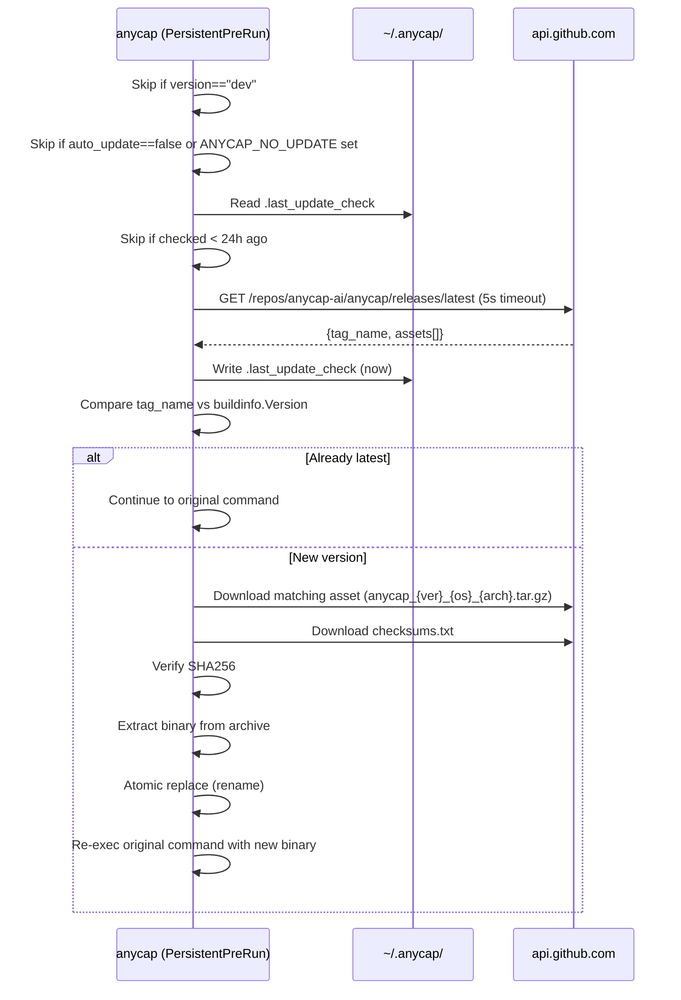
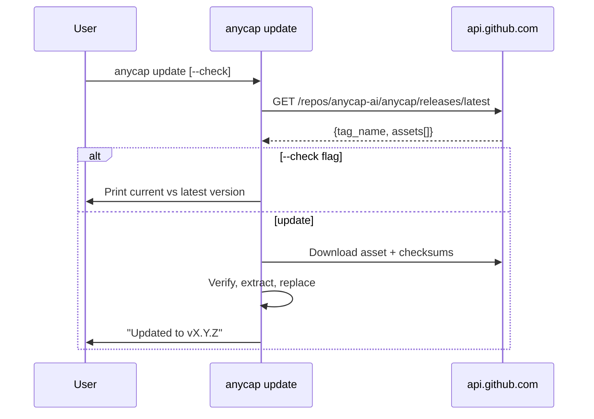

# CLI Self-Update via GitHub Releases

Date: 2026-03-25

## Goal

Allow the `anycap` CLI to update itself from GitHub Releases (`anycap-ai/anycap`).
Auto-update is enabled by default; users can opt out via config.

## Design

### User-Facing Behavior

```bash
anycap update          # check and update to latest
anycap update --check  # check only, print available version
```

Auto-update runs transparently before every command (throttled to once per 24h).
On success, the CLI re-executes the original command with the new binary.

### Config

`~/.anycap/config.toml`:

```toml
auto_update = false
```

| Field | Type | Default | Description |
|-------|------|---------|-------------|
| `auto_update` | bool | `true` | Enable automatic update check before commands |

Environment escape hatch: `ANYCAP_NO_UPDATE=1` disables auto-update regardless of config.

### Update Flow



### Manual Update (`anycap update`)



### Asset Matching

goreleaser produces archives named:

```
anycap_{version}_{os}_{arch}.tar.gz   (linux, darwin)
anycap_{version}_{os}_{arch}.zip      (windows)
checksums.txt
```

The updater matches assets by suffix `_{runtime.GOOS}_{runtime.GOARCH}.tar.gz`
(or `.zip` on Windows). This avoids needing to know the version in the filename.

### Skipped Scenarios

Auto-update is silently skipped when:

- `buildinfo.Version == "dev"` (local development build)
- `auto_update` is `false` in config
- `ANYCAP_NO_UPDATE=1` environment variable is set
- Last check was less than 24 hours ago
- Network error or timeout (5s deadline)
- Current command is `update`, `help`, or `version`

### Re-exec After Update

On Unix (darwin/linux), after replacing the binary, the CLI uses `syscall.Exec`
to replace the current process with the new binary, passing the original `os.Args`.
This is transparent to the caller.

On Windows, `syscall.Exec` is not available. The CLI prints a message to stderr
and exits with code 0, asking the user to re-run.

### Code Layout

```
internal/cli/
  selfupdate/
    updater.go         # Core logic: check, download, verify, replace, re-exec
    updater_test.go    # Tests with httptest mock
  config/
    config.go          # +AutoUpdate field
  command/
    meta/
      update.go        # anycap update [--check]
    root.go            # +PersistentPreRunE hook
```

### Security

- Checksums verified via `checksums.txt` (SHA256) from the same release.
- Downloads use HTTPS only.
- Binary replacement uses atomic rename to avoid partial writes.
- Old binary is not retained (no rollback). If checksum fails, update is aborted.

### No New Dependencies

The implementation uses only the Go standard library:
- `net/http` for GitHub API and downloads
- `encoding/json` for API response parsing
- `archive/tar`, `compress/gzip`, `archive/zip` for extraction
- `crypto/sha256` for checksum verification
- `syscall` for re-exec on Unix
