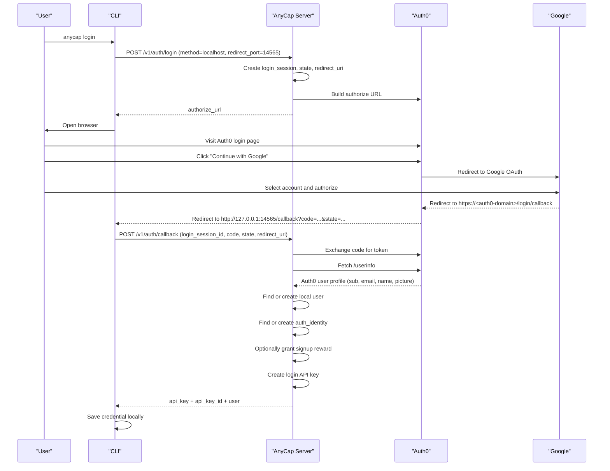

# AnyCap CLI Login with Auth0 + Google

> Date: 2026-03-26  
> Scope: `anycap login` 浏览器登录链路，以及 Auth0 / Google 侧最小配置清单

## 1. Overview

当前 `anycap login` 的主链路是：

- CLI 只与 AnyCap Server 通信
- Server 负责与 Auth0 交互
- Auth0 负责统一登录编排
- Google 作为 Auth0 的上游身份源之一
- 登录完成后，Server 返回给 CLI 的是 **AnyCap API Key**

也就是说，CLI 并不会长期持有 Google token，也不会长期持有 Auth0 token。

## 2. End-to-End Flow

### 2.1 Localhost callback flow

当前交互式浏览器登录使用固定 localhost callback：

```text
http://127.0.0.1:14565/callback
```

完整链路如下：



### 2.2 Device flow

在无浏览器、SSH、远程环境下，CLI 使用：

```bash
anycap login --headless
```

这条链路不依赖 localhost callback，但身份编排仍然是：

- CLI -> Server
- Server -> Auth0
- 用户在 Auth0 页面上使用 Google 登录
- Server 最终返回 AnyCap API Key 给 CLI

## 3. Responsibility Split

### 3.1 CLI

- 发起登录请求
- 在 localhost flow 下监听 `127.0.0.1:14565`
- 把浏览器 callback 中的 `code` 回传给 Server
- 最终保存 AnyCap API Key 到本地凭据存储

### 3.2 AnyCap Server

- 创建和维护 `login_sessions`
- 调用 Auth0 authorize / token / userinfo 接口
- 创建或查找本地 `users`
- 维护 `auth_identities`
- 生成 AnyCap 本地 API Key

### 3.3 Auth0

- 展示统一登录页
- 承接 Google social login
- 向 AnyCap Server 返回认证结果

### 3.4 Google

- 只负责“用户是谁”
- 只向 Auth0 回调
- 不直接回调 AnyCap CLI，也不直接回调 AnyCap Server

## 4. Important Callback Distinction

这是当前最容易混淆的两条回调：

### 4.1 Google callback

Google OAuth Client 里配置的是：

```text
https://<auth0-domain>/login/callback
```

这表示：

- `Google -> Auth0`

### 4.2 Auth0 callback

Auth0 Application 的 `Allowed Callback URLs` 里配置的是：

```text
http://127.0.0.1:14565/callback
```

这表示：

- `Auth0 -> CLI`

它们不是同一个地址。

## 5. Auth0 Configuration Checklist

### 5.1 Application type

用于 AnyCap CLI / Server 登录编排的 Auth0 Application，推荐使用：

- `Regular Web Application`

不推荐使用：

- `Machine to Machine`

当前 AnyCap Server 会持有 `client_secret` 并自行完成 code exchange，因此它是一个 server-side confidential client 场景。

### 5.2 Application URIs

在 Auth0 Application 中至少配置：

#### Allowed Callback URLs

```text
http://127.0.0.1:14565/callback
```

如果未来要做 server-side callback relay，再额外加入：

```text
https://<your-server-domain>/auth/callback
```

#### Allowed Logout URLs

当前 CLI MVP 可先保守配置：

```text
http://127.0.0.1:14565/callback
```

#### Application Login URL

当前 CLI 不是强依赖该字段，可以先留空，或填未来 dashboard 登录入口。

### 5.3 Application credentials

在 Auth0 Application 页面中获取：

- `Client ID`
- `Client Secret`

这两个值是给 AnyCap Server 用的：

```env
ANYCAP_AUTH0_CLIENT_ID=<Auth0 Application Client ID>
ANYCAP_AUTH0_CLIENT_SECRET=<Auth0 Application Client Secret>
```

注意：这里不是填 Google 的 Client ID / Client Secret。

### 5.4 Audience

在 Auth0 控制台中找到：

- `Applications`
- `APIs`
- 目标 API 的 `Identifier`

将其配置为：

```env
ANYCAP_AUTH0_AUDIENCE=<Auth0 API Identifier>
```

### 5.5 Google social connection

在 Auth0 中：

1. 启用 Google social connection
2. 填入 Google OAuth Client 的：
   - `Google Client ID`
   - `Google Client Secret`
3. 将该 Google connection 绑定到当前 AnyCap 使用的 Auth0 Application

## 6. Google Configuration Checklist

### 6.1 Create OAuth Client

在 Google Cloud Console 中创建：

- `OAuth client ID`

### 6.2 Authorized redirect URI

在 Google OAuth Client 中配置：

```text
https://<auth0-domain>/login/callback
```

例如：

```text
https://anycap.us.auth0.com/login/callback
```

这表示：

- Google 登录成功后，先回 Auth0

### 6.3 Credentials

Google OAuth Client 创建后会得到：

- `Google Client ID`
- `Google Client Secret`

这两个值用于填写到：

- Auth0 的 Google social connection

不是直接填到 AnyCap Server 环境变量里。

### 6.4 Test users

如果 Google OAuth app 仍处于 `Testing` 状态，需要将实际测试账号加入：

- `Test users`

否则 Google 登录可能会被拒绝。

## 7. AnyCap Server Environment Mapping

当前 AnyCap Server 至少需要：

```env
ANYCAP_AUTH0_ENABLED=true
ANYCAP_AUTH0_ISSUER=https://<auth0-domain>/
ANYCAP_AUTH0_CLIENT_ID=<Auth0 Application Client ID>
ANYCAP_AUTH0_CLIENT_SECRET=<Auth0 Application Client Secret>
ANYCAP_AUTH0_AUDIENCE=<Auth0 API Identifier>
```

可选：

```env
ANYCAP_AUTH0_REDIRECT_URL=https://<your-server-domain>/auth/callback
```

说明：

- 当前 localhost flow 实际使用的是 CLI 的 localhost callback
- `ANYCAP_AUTH0_REDIRECT_URL` 更像是默认/兜底值
- 如果后续实现 server-side callback relay，这个值会变得更重要

## 8. Minimum Ready-to-Test Checklist

### 8.1 Google

- [ ] 已创建 Google OAuth Client
- [ ] 已拿到 Google Client ID / Client Secret
- [ ] 已配置 Google redirect URI 为 `https://<auth0-domain>/login/callback`
- [ ] 如处于 Testing，已加入测试账号到 Test users

### 8.2 Auth0

- [ ] AnyCap 对应 Application 类型为 `Regular Web Application`
- [ ] `Allowed Callback URLs` 已包含 `http://127.0.0.1:14565/callback`
- [ ] 已创建或确认 Auth0 API，并拿到 `Identifier`
- [ ] 已启用 Google social connection
- [ ] Google social connection 已绑定到当前 AnyCap Application
- [ ] 已拿到当前 Auth0 Application 的 Client ID / Client Secret

### 8.3 AnyCap Server

- [ ] `ANYCAP_AUTH0_ENABLED=true`
- [ ] `ANYCAP_AUTH0_ISSUER` 已正确配置
- [ ] `ANYCAP_AUTH0_CLIENT_ID` 已使用 Auth0 Application 的 Client ID
- [ ] `ANYCAP_AUTH0_CLIENT_SECRET` 已使用 Auth0 Application 的 Client Secret
- [ ] `ANYCAP_AUTH0_AUDIENCE` 已使用 Auth0 API Identifier

## 9. Verification Commands

推荐按下面顺序验证：

```bash
go run ./cmd/anycap --endpoint http://<server-host>:<port> status
go run ./cmd/anycap --endpoint http://<server-host>:<port> login
go run ./cmd/anycap --endpoint http://<server-host>:<port> status
go run ./cmd/anycap --endpoint http://<server-host>:<port> logout
```

如果第二次 `status` 返回中包含：

- `auth_type=api_key`
- `api_key_id=...`

则表示当前真实的：

- `CLI -> Server -> Auth0 -> Google -> Auth0 -> Server -> API Key -> CLI`

链路已经打通。
