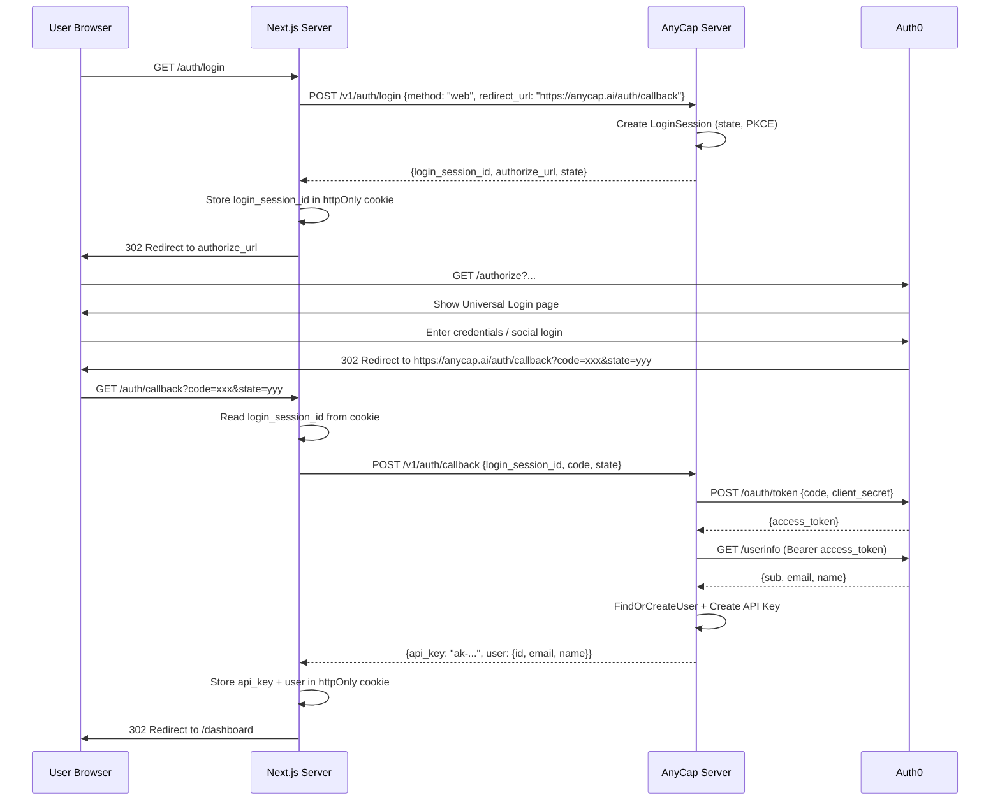
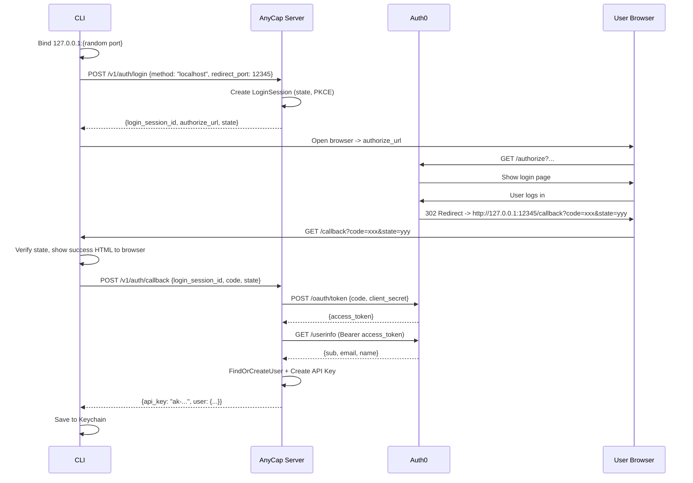
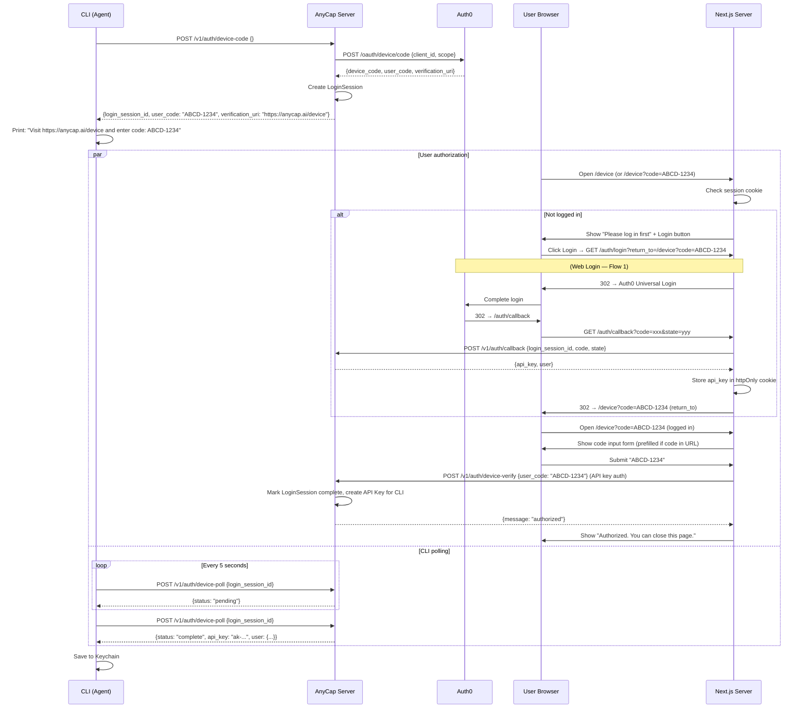

# Web Auth Flows

> Date: 2026-03-26
> Status: Draft
> Scope: All login-related flows — Web, CLI Localhost, CLI Device Code

## Overview

AnyCap has three login flows. All flows go through the AnyCap Server as the auth gateway
to Auth0. The web frontend uses Auth0 Universal Login for the login UI, but the OAuth
token exchange and user provisioning happen on the AnyCap Server (reusing the same
`/v1/auth/login` + `/v1/auth/callback` endpoints as the CLI).

Key principle: **API key never touches the browser.** The Next.js server acts as a BFF
(Backend for Frontend), holding the API key in an httpOnly cookie.

---

## Flow 1: Web Login (via AnyCap Server + Auth0 Universal Login)

Users click "Login" on the landing page. The Next.js server initiates the login via
AnyCap Server, which returns an Auth0 authorize URL. After Auth0 login, the callback
returns to Next.js, which exchanges the code via AnyCap Server to get an API key.

### APIs involved

| API | Called by | Target | Auth |
|-----|----------|--------|------|
| `GET /auth/login` | Browser | Next.js | None |
| `POST /v1/auth/login` | Next.js | AnyCap Server | None |
| `GET /auth/callback` | Browser (Auth0 redirect) | Next.js | None |
| `POST /v1/auth/callback` | Next.js | AnyCap Server | None |
| `POST /oauth/token` | AnyCap Server | Auth0 | client_secret |
| `GET /userinfo` | AnyCap Server | Auth0 | Bearer token |

### What is new vs existing

- `POST /v1/auth/login`: **exists**, but needs new `method: "web"` + `redirect_url` support
- `POST /v1/auth/callback`: **exists**, but hardcoded to `flow_type == "localhost"` — needs to accept `"web"`
- Next.js route handlers (`/auth/login`, `/auth/callback`): **new** (frontend)

---

## Flow 2: CLI Login — Localhost Callback

For interactive terminals with browser access. CLI binds a local port, opens the browser
to Auth0 via the Server's authorize URL, and receives the OAuth callback locally.

### APIs involved

| API | Called by | Target | Auth |
|-----|----------|--------|------|
| `POST /v1/auth/login` | CLI | AnyCap Server | None |
| `POST /v1/auth/callback` | CLI | AnyCap Server | None |
| `POST /oauth/token` | AnyCap Server | Auth0 | client_secret |
| `GET /userinfo` | AnyCap Server | Auth0 | Bearer token |

All APIs exist and working. No changes needed.

---

## Flow 3: CLI Login — Device Code (Agent Scenario)

For headless/SSH/agent environments without browser access. CLI displays a user code
and verification URL. The user completes authorization on a separate device.

### /device page UX states

| State | Page shows |
|-------|-----------|
| Not logged in, no code in URL | "Please log in to authorize a device" + Login button |
| Not logged in, code in URL | "Please log in to authorize a device" + Login button (code preserved in return_to) |
| Logged in, no code in URL | Code input form |
| Logged in, code in URL | Code input form (prefilled), user clicks "Authorize" |
| Authorization success | "Device authorized. You can close this page." |
| Code invalid/expired | Error message + option to re-enter |

### APIs involved

| API | Called by | Target | Auth | Status |
|-----|----------|--------|------|--------|
| `POST /v1/auth/device-code` | CLI | AnyCap Server | None | Exists |
| `POST /v1/auth/device-poll` | CLI | AnyCap Server | None | Exists |
| `POST /v1/auth/device-verify` | Next.js | AnyCap Server | API Key | **New** |
| `POST /oauth/device/code` | AnyCap Server | Auth0 | client_secret | Exists |

Note: The `/device` page requires the user to be logged in (web login, Flow 1) before
they can authorize a device. The Next.js server calls `device-verify` using the user's
API key from the web session.

---

## API Summary

### All AnyCap Server endpoints

| API | Caller | Auth | Status |
|-----|--------|------|--------|
| `POST /v1/auth/login` | CLI / Next.js | None | Exists (needs `method: "web"` support) |
| `POST /v1/auth/callback` | CLI / Next.js | None | Exists (needs `flow_type: "web"` support) |
| `POST /v1/auth/device-code` | CLI | None | Exists |
| `POST /v1/auth/device-poll` | CLI | None | Exists |
| `POST /v1/auth/logout` | CLI / Next.js | API Key | Exists |
| `POST /v1/auth/device-verify` | Next.js | API Key | **New** |

### Next.js route handlers (frontend)

| Route | Method | Purpose |
|-------|--------|---------|
| `/auth/login` | GET | Initiate web login: call Server, redirect to Auth0 |
| `/auth/callback` | GET | Handle Auth0 callback: exchange code via Server, set cookie |
| `/auth/logout` | GET | Clear cookie, call Server logout, redirect home |
