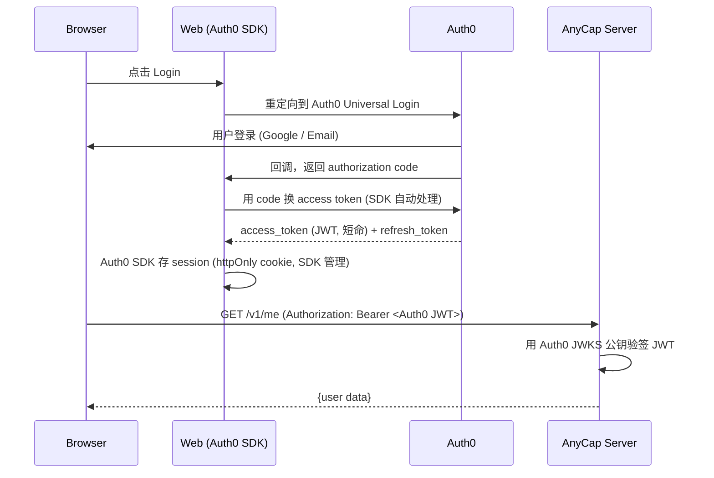
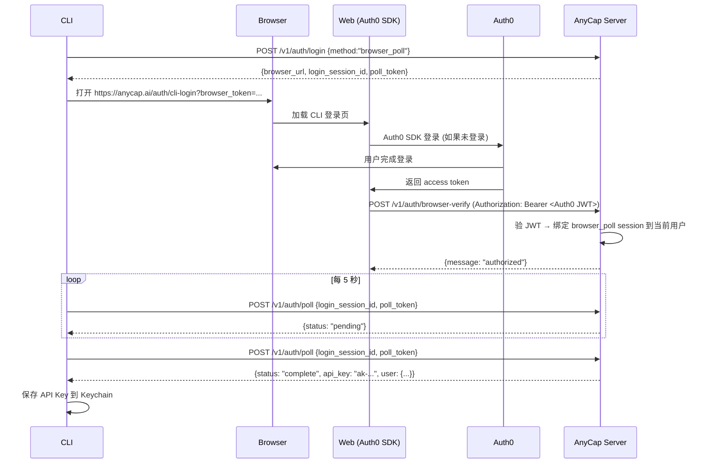
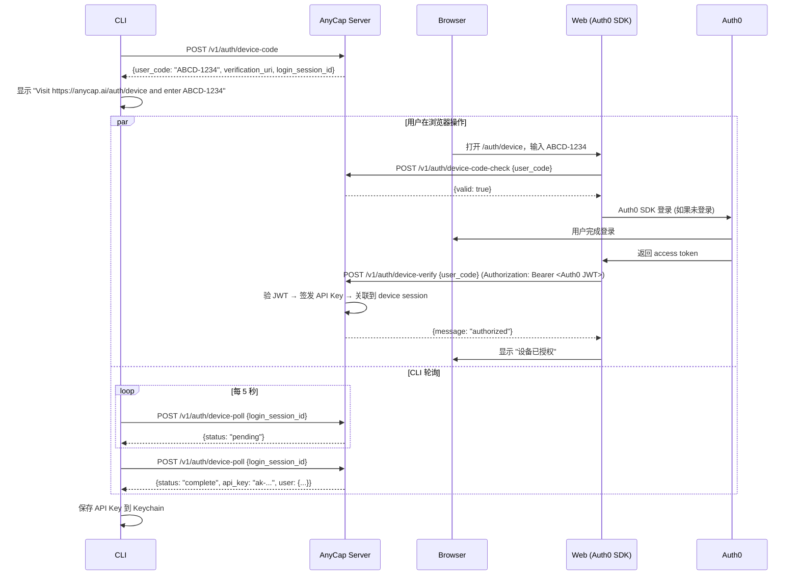

# Web 认证安全改造方案

> Date: 2026-03-27
> Status: Proposed
> Scope: 认证架构重构——Web 直接对接 Auth0，后端验 JWT，CLI 通过 Web 换 API Key
> References: [web-auth-flows.md](2026-03-26-web-auth-flows.md), [anycap-auth-apikey-lifecycle.md](2026-03-25-anycap-auth-apikey-lifecycle.md)

## 1. 问题

### 1.1 当前架构

```
Web / CLI → AnyCap Server → Auth0 → Server 签发 API Key → Web/CLI 都用 API Key
```

Server 同时承担 Auth0 对接（OAuth token exchange）和 API Key 签发。Web 把 API Key 存在 JS 可读的 cookie 里当 session 用。

### 1.2 风险

| 风险 | 等级 | 说明 |
|------|------|------|
| XSS 窃取凭证 | **高** | JS 可读 cookie 存储 API Key，任何 XSS 可窃取并在外部设备使用 |
| API Key 当 Web Session | **高** | API Key 是长期凭证，没有过期/刷新机制，不适合 Web 场景 |
| Server 耦合 Auth0 | 中 | Server 保存 Auth0 client_secret，做 token exchange，职责过重 |
| 无 token rotation | 中 | 30 天内复用同一凭证 |

### 1.3 根本原因

Web 登录不应该用 API Key 来保持登录态。API Key 是为 CLI/机器设计的长期凭证，Web 应该用标准的 OAuth token（短命 + 自动刷新）。

## 2. 目标

- Web 直接对接 Auth0，使用标准 OAuth 认证（Auth0 SDK 管理 session）
- API Key 不再暴露给浏览器
- CLI 通过 Web 完成 Auth0 登录，然后换取 API Key
- 后端不再对接 Auth0（不再需要 client_secret），只验证 Auth0 JWT

## 3. 新架构

### 3.1 整体模型

```
                        Auth0
                          |
                    ┌─────┴─────┐
                    |           |
                   Web      (仅 Auth0)
              (Auth0 SDK)
                 /    \
                /      \
    Auth0 JWT 调后端    帮 CLI 换 API Key
               |            |
               ↓            ↓
           AnyCap Server ──────────── CLI
         (验 JWT 或 API Key)      (用 API Key)
```

| 角色 | 职责 |
|------|------|
| Auth0 | 唯一身份源，管理用户登录、token 签发、session 刷新 |
| Web | Auth0 SDK 处理登录/session，用 Auth0 access token 调后端 |
| AnyCap Server | 验证 Auth0 JWT（公钥验签）或 API Key，提供 exchange 接口 |
| CLI | 通过 Web 完成登录，拿 API Key，长期使用 |

### 3.2 Web 认证流程



关键点：
- Auth0 SDK（`@auth0/nextjs-auth0`）自动处理 token exchange、session 存储、token 刷新
- Session 存在 Auth0 SDK 管理的 httpOnly cookie 中，JS 不可读
- 调后端时，SDK 提供 access token，前端放到 `Authorization: Bearer` header
- **后端不再需要 Auth0 client_secret**，只用公钥验签 JWT

### 3.3 CLI 认证流程

CLI 通过 Web 完成 Auth0 登录，Web 用 Auth0 access token 代 CLI 换取 API Key。

#### Browser Poll 模式（推荐）



说明：
- 这是当前推荐的 CLI 浏览器登录模型
- Auth0 callback 始终落在前端真实域名，而不是 localhost
- 避免了 Auth0 将 localhost callback 识别为本地应用而触发 consent 的问题
- CLI 统一通过 poll 获取最终 API Key，更适合 agent、SSH 和无桌面环境

#### Device Code 模式（Headless）



### 3.4 后端 Auth Middleware

```
请求进来 → 读 Authorization header
  |
  ├─ Bearer ak-xxx  → 查 API Key 表 (CLI)
  ├─ Bearer eyJhb... → Auth0 JWKS 公钥验签 (Web)
  └─ 无 header       → 401
```

Auth0 JWT 验签是纯本地操作：
- 启动时从 Auth0 JWKS endpoint 拉取公钥并缓存
- 每次请求用缓存的公钥验证 JWT 签名
- 不需要调 Auth0 API，无网络开销

### 3.5 后端 Exchange 接口

```
POST /v1/auth/exchange
Authorization: Bearer <Auth0 JWT>

Response:
{
  "data": {
    "api_key": "ak-...",
    "user": { "id": "...", "email": "...", "name": "..." }
  }
}
```

逻辑：
1. 验证 Auth0 JWT
2. 从 JWT claims 提取用户身份（sub, email, name）
3. FindOrCreateUser
4. 签发 API Key
5. 返回

## 4. 安全对比

| 维度 | 改造前 (API Key in cookie) | 改造后 (Auth0 SDK) |
|------|--------|--------|
| Web 凭证类型 | API Key (长期) | Auth0 access token (短命, ~1h) |
| XSS 可窃取凭证 | 可以 | **不可以** (httpOnly, SDK 管理) |
| Token 自动刷新 | 无 | Auth0 SDK 自动用 refresh token 续期 |
| Token 过期 | 无过期 | access token ~1h 过期 |
| 后端持有 Auth0 secret | 是 | **否** (只需公钥) |
| Session 撤销 | 需要自己实现 | Auth0 Dashboard 直接操作 |
| CLI 影响 | - | 无 (仍用 API Key) |

## 5. 改动清单

### 5.1 后端改动

| 改动 | 模块 | 说明 |
|------|------|------|
| Auth middleware 支持 JWT | `internal/middleware/auth.go` | 检查 Bearer token 格式：`ak-` 前缀查 API Key 表，否则用 JWKS 验 JWT |
| JWKS 公钥缓存 | `internal/infrastructure/auth/` | 启动时加载 Auth0 JWKS，定期刷新 |
| Exchange 接口 | `internal/transport/http/handlers/` | `POST /v1/auth/exchange`：验 JWT → FindOrCreateUser → 签发 API Key |
| Device verify 改为接受 JWT | `internal/transport/http/handlers/login.go` | `/v1/auth/device-verify` 从 API Key 认证改为 JWT 认证 |
| 移除 Auth0 token exchange | `internal/infrastructure/auth/auth0_client.go` | 不再需要 `ExchangeCode()`、`GetUserInfo()` |
| 移除 Auth0 client_secret | 配置 / 环境变量 | 后端不再需要 |
| CORS 配置 | `internal/middleware/` | `AllowHeaders` 加 `Authorization` |

### 5.2 前端改动

| 改动 | 文件 | 说明 |
|------|------|------|
| 引入 Auth0 SDK | `package.json` | 加 `@auth0/nextjs-auth0` |
| Auth0 配置 | `.env` / `auth0.ts` | `AUTH0_SECRET`, `AUTH0_ISSUER_BASE_URL`, `AUTH0_CLIENT_ID`, `AUTH0_CLIENT_SECRET` |
| 登录/回调路由 | `src/app/auth/` | 替换为 Auth0 SDK 提供的 route handlers |
| CLI 登录页 | `src/app/auth/cli-login/` | 新建，处理 CLI browser poll 模式 |
| 删除自建 session 管理 | `src/lib/auth/session.ts` | 删除 `setSessionCookie`、`clearSessionCookie`、`getSession` |
| 删除自建 API 客户端 auth | `src/lib/auth/anycap-api.ts` | 不再需要 `apiKey` 参数 |
| API client 改用 Auth0 token | `src/lib/api/client.ts` | 从 Auth0 SDK 获取 access token 放到 Bearer header |
| SWR hooks 简化 | `src/lib/api/hooks.ts` | 移除 `useApiKey`，改用 Auth0 SDK 提供 token |
| Auth guard 改用 Auth0 session | middleware + layout | 用 Auth0 SDK 的 `withMiddlewareAuthRequired` 或 `getSession()` |

### 5.3 删除的代码

- `src/lib/auth/session.ts` 中的 cookie 编解码逻辑
- `src/app/auth/callback/CallbackClient.tsx` 中旧的 server-side Auth0 code exchange 分支
- `src/app/auth/login/LoginClient.tsx` 中旧的 CLI browser poll 绑定逻辑
- 后端 `auth0_client.go` 中的 `ExchangeCode()`、`GetUserInfo()`

### 5.4 不变的部分

- CLI 使用 API Key 调后端（不变）
- 后端 API Key 签发和管理（不变）
- Device code 生成和轮询接口（不变）
- 后端业务逻辑和 handler（不变）

## 6. Auth0 配置变化

### 改造前

```
Auth0 Application Type: Regular Web Application
Token Endpoint Auth Method: client_secret_post
Callback URL: https://api.anycap.ai/auth/callback (后端)
```

### 改造后

```
Auth0 Application Type: Regular Web Application
Token Endpoint Auth Method: client_secret_post
Callback URL: https://anycap.ai/api/auth/callback (前端, Auth0 SDK route)
API Audience: https://api.anycap.ai (新建 Auth0 API，用于 JWT 验签)
```

需要在 Auth0 Dashboard 新建一个 **API**（Resource Server），设置 audience 为 `https://api.anycap.ai`。这样 Auth0 签发的 access token 才是 JWT 格式（而非 opaque token），后端才能用公钥验签。

## 7. 开发环境

| 环境 | 前端 | 后端 | Auth0 Callback URL |
|------|------|------|------|
| 本地 | `localhost:3000` | `localhost:8080` | `http://localhost:3000/api/auth/callback` |
| Dev | `*.anycap-web.pages.dev` | `anycap-server.dev.knoffice.tech` | Preview URL 需加到 Auth0 Allowed Callbacks |
| 生产 | `anycap.ai` | `api.anycap.ai` | `https://anycap.ai/api/auth/callback` |

不再有跨域 cookie 问题——Auth0 SDK 的 session cookie 在前端域（`anycap.ai`）上，调后端用 `Authorization: Bearer` header。

## 8. 实施顺序

### Phase 1 — 后端：JWT 验签 + exchange 接口

1. 实现 JWKS 公钥加载与缓存
2. Auth middleware 支持 JWT 验签（与 API Key 并存）
3. 新增 `POST /v1/auth/exchange` 接口
4. `/v1/auth/device-verify` 改为接受 JWT 认证

### Phase 2 — 前端：Auth0 SDK 集成

1. 引入 `@auth0/nextjs-auth0`，配置 Auth0
2. 替换登录/回调路由
3. API client 改用 Auth0 token
4. 删除自建 session 管理代码

### Phase 3 — 清理

1. 后端移除 Auth0 token exchange 代码
2. 移除 Auth0 client_secret 配置
3. 更新 CLI 登录流程（如果需要适配新的 Web 登录页）
4. 更新 Auth0 Dashboard 配置

Phase 1 和 Phase 2 可以并行开发。Phase 1 完成后后端同时支持 JWT 和 API Key，不影响现有功能。Phase 2 完成后前端切换到 Auth0 SDK。Phase 3 清理旧代码。
