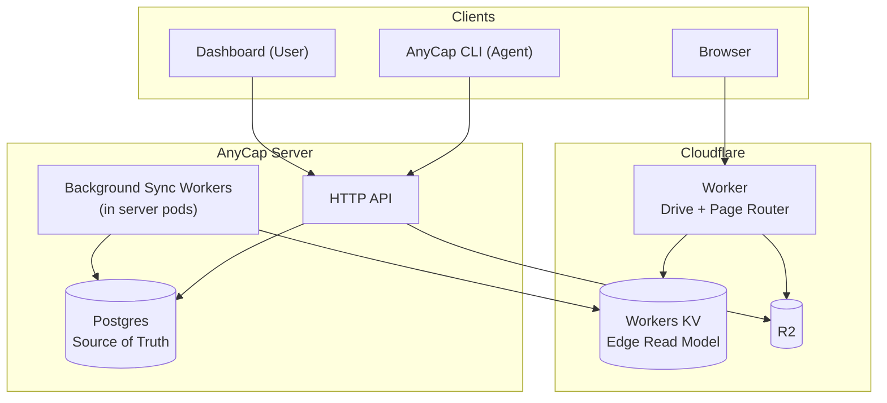

# Drive / Page (R2 + Worker) 设计方案

> Date: 2026-03-28
> Last Updated: 2026-03-28
> Status: Draft v6 (spa_fallback 归属、presign 分配 node_id、worker 设计收敛)
> Scope: Drive、Page、Space、PG->KV 同步、Dashboard/CLI 管理面

## 1. 目标与约束

### 1.1 目标

- 提供 Drive 文件存储与目录管理能力（Agent CLI + Dashboard）。
- 提供 Page 静态网页托管能力（Agent 上传产物 -> 可访问域名）。
- 对外访问统一由 Cloudflare Worker 承载，Worker 只读 KV/R2，不回源 AnyCap Server。

### 1.2 已确认约束

- Page 版本只能向前推进；rollback 通过复制旧版本内容到新版本再发布。
- Page 域名为 `<page-name>.page.anycap.cloud`。
- `page-name` 需语义化 + 随机后缀，且有最小长度，删除后不可复用。
- Drive 对外链接不暴露路径，仅使用 token 链接。
- Drive 支持嵌套目录与目录浏览（Phase 1 即支持）。
- Drive 每个文件/目录仅保留一个 active 分享链接（可续期、改永久、rotate）。
- 当前默认每用户一个独立 space。
- 架构直接采用 Worker + KV，不做“先无 Worker”的过渡方案。
- Phase 1 不做 multipart 上传。
- 所有 KV 变更统一走 `kv_sync_jobs`（不做 inline KV 写）。

## 2. 总体架构



设计原则：

- `PG` 是唯一真相源。
- `KV` 是 Worker 的边缘读模型。
- Drive 索引与分享 token 解耦：索引按目录/文件 ID 组织，token 只做授权入口。

## 3. 数据模型（Phase 1 简化）

### 3.1 Space（简化）

- `spaces`
  - `id`, `owner_user_id`, `name`, `created_at`

说明：

- Phase 1 不建 `space_members`。
- 权限判断以 `spaces.owner_user_id == current_user_id` 为准。
- 角色化协作（owner/admin/editor/viewer）放到后续阶段。

### 3.2 Drive 领域表

- `drive_nodes`
  - `id`, `space_id`, `parent_id(nullable)`, `kind(folder|file)`, `name`
  - `storage_object_id(nullable)`, `size(nullable)`, `mime(nullable)`
  - `edge_version`, `created_by`, `created_at`, `updated_at`, `deleted_at(nullable)`

- `drive_share_links`
  - `id`, `node_id`, `token`, `status(active|revoked)`
  - `expires_at(nullable)`, `password_hash(nullable)`, `password_salt(nullable)`
  - `edge_version`, `created_at`, `updated_at`

约束：每个 `node_id` 仅允许一个 `active` 链接。

### 3.3 Page 领域表

- `page_sites`
  - `id`, `space_id`, `name`, `page_name`, `current_version_id(nullable)`
  - `access_mode(public|password|private_reserved)`
  - `password_hash(nullable)`, `password_salt(nullable)`, `spa_fallback(bool)`
  - `edge_version`, `created_at`, `updated_at`, `deleted_at(nullable)`

- `page_versions`
  - `id`, `page_id`, `version_no`, `source_version_id(nullable)`
  - `status(draft|uploaded|verified|published|archived)`
  - `asset_prefix`, `created_by`, `created_at`

- `page_slug_registry`
  - `slug`, `status(active|tombstone)`, `page_id`, `created_at`

说明：`tombstone` 不清理，保证“删除后不可复用”。

约束：`page_versions(page_id, version_no)` 唯一，防并发创建版本号冲突。

### 3.4 上传会话与存储对象

- `upload_sessions`
  - `id`, `space_id`, `target_type(drive|page)`, `target_id`, `object_key`
  - `status(pending|completed|expired)`, `expires_at`, `created_at`

- `storage_objects`
  - `id`, `space_id`, `bucket`, `object_key`, `size`, `mime`, `etag`, `sha256`, `created_at`

规则：

- `storage_objects` 在 complete 阶段创建，不在 presign 阶段创建。
- Drive 上传在 presign 阶段预分配 `drive_node(file)`，用于稳定 object key 中的 `{node_id}`。
- complete 时服务端对 R2 执行 `HEAD` 校验对象存在与基础元信息。
- 后台定时清理 `expired` upload session：删除对应 R2 对象并标记 session 过期，避免 orphaned objects。

### 3.5 KV 同步任务表

- `kv_sync_jobs`
  - `id`, `job_type`, `target_id`, `edge_version`, `payload`
  - `status(pending|processing|done|obsolete|failed|dead)`
  - `attempts`, `max_attempts`, `next_retry_at`, `locked_by(nullable)`, `locked_at(nullable)`
  - `last_error(nullable)`, `created_at`, `updated_at`

## 4. Bucket 与 Object Key 策略

### 4.1 Bucket

- 现有 bucket 保留：用于 capabilities 临时上传（例如 `anycap-tmp`）。
- 新增 bucket：`anycap-cloud`（Drive + Page 专用）。

### 4.2 Prefix

- Drive: `drive/spaces/{space_id}/nodes/{node_id}/{object_id}`
- Page: `page/spaces/{space_id}/sites/{page_id}/versions/{version_no}/{asset_path}`

## 5. Drive 设计

### 5.1 目录与文件

- 支持 `mkdir/upload/list/rename/move/delete`。
- 目录树使用 `parent_id`，支持嵌套目录。
- rename/move 修改逻辑元数据，不强制重写 R2 object key。

### 5.2 上传

- Phase 1 仅支持单次 PUT（presign 上传）。
- 不支持 multipart。
- 必须设置服务端文件大小上限（小于 5GB；建议业务上限 500MB/1GB）。
- presign 负责预分配 `file node_id` 与 `object_key`（上传前即可确定 key）。
- complete 负责 `HEAD` 校验、创建 `storage_object`、回填 `drive_node` 的对象关联与元信息。

### 5.3 分享

- 外链格式：`https://drive.anycap.cloud/s/{token}`
- `token` 是分享链接随机串，仅用于授权入口。
- `drive:share:{token}` 记录：`root_node_id`、`root_node_kind(file|folder)`、访问策略、过期、密码等。
  - 分享文件时，`root_node_kind=file`，入口直接返回文件。
  - 分享目录时，`root_node_kind=folder`，入口返回目录浏览页。

### 5.4 目录索引 KV 设计（与 token 解耦）

- `drive:dir:{dir_id}:meta`
  - `{dir_id,parent_id,space_id,name,edge_version,updated_at}`
- `drive:dir:{dir_id}:children`
  - 当前目录一层子节点列表（文件+子目录，含基础展示字段）
- `drive:file:{file_id}`
  - 文件元数据（`object_key,mime,size,etag,name,parent_id,edge_version`）

说明：

- 这些索引由 Drive 的 create/update/delete/move 统一维护，与 share 是否存在无关。
- Dashboard 提供 `Rebuild Index`（修复索引漂移）。

### 5.5 目录操作并发规则

- 所有会影响目录 children 的操作，不直接写 KV。
- 事务内更新对应节点的 `edge_version`，并写入 `kv_sync_jobs`。
- worker 执行 job 时先读取 PG 当前 `edge_version`：
  - 若 `job.edge_version < current`，直接标记 `obsolete`。
  - 仅 `==` 时重建并写 KV。

### 5.6 单文件操作的同步 job 粒度（Phase 1）

- 上传/移动/重命名单文件时，拆分为两个独立 job（不做 compound job）：
  - `drive_file_meta_sync`：同步 `drive:file:{file_id}`
  - `drive_dir_children_sync`：同步 `drive:dir:{parent_id}:children`
- 该策略实现更简单，Phase 1 性能足够；若后续出现吞吐瓶颈，再评估合并为 compound job。

### 5.7 目录删除级联策略

- 删除目录 = 递归软删整棵子树。
- 子树内所有 share link 统一置 `revoked`。
- 触发 `dir_tree_delete` 类型 job，由后台分批清理/重建 KV 索引。

### 5.8 Worker 目录浏览路由

- `GET /s/{token}`
  - 若 `root_node_kind=file`：直接返回该文件
  - 若 `root_node_kind=folder`：展示该目录的 children
- `GET /s/{token}/dir/{dir_id}` -> 展示该目录 children
- `GET /s/{token}/file/{file_id}` -> 文件读取/渲染/下载

授权边界：

- token 先鉴权，再校验目标 `dir_id/file_id` 是否位于 `root_node_id` 授权范围。
- `root_node_kind=file` 时，仅允许访问该 `file_id` 本身。
- `root_node_kind=folder` 时，子树校验通过 `parent_id` 向上追溯实现（依赖 `drive:dir:*:meta` / `drive:file:*`）。

## 6. Page 设计

### 6.1 page-name 生成

- 规则：`语义 slug + 随机后缀`（例如 `docs-center-k7m4xq2n`）。
- 语义来源：
  - 有用户输入 `name` 时，从 `name` 提取 slug。
  - 无有效 `name` 时，使用词库短语 + 随机后缀。
- 最小长度限制（建议 >= 12）。

### 6.2 版本

- 只允许发布更高版本。
- rollback = 从历史版本复制资产生成新版本，再发布新版本。

### 6.3 状态流转触发

- `draft -> uploaded`: 调用 `finalize` API（声明“版本上传结束”）
- `uploaded -> verified`: `finalize` 内执行资产校验通过后推进
- `verified -> published`: 用户显式调用 publish API
- `published -> archived`: 新版本发布后旧版本自动归档

说明：

- 单文件 `complete` 只表示该文件上传完成，不表示整个版本上传结束。
- `finalize` 是版本级收口点，避免半上传版本进入发布链路。

### 6.4 访问模式

- `public`: 任意访问。
- `password`: 密码访问（Header 或密码页）。
- `private`: 后续实现（当前先保留枚举占位）。

### 6.5 资产上传与路由

- 上传方式：目录文件逐个 presign 上传。
- Phase 1 不要求 manifest。
- Worker 路由规则（按 `asset_prefix` 解析，`spa_fallback` 取自 `page_sites` 站点默认配置）：
  - 先尝试 `{path}`
  - 再尝试 `{path}/index.html`
  - 再尝试 `{path}.html`
  - 若 `spa_fallback=true`，回退到 `index.html`

## 7. KV 读模型与同步

### 7.1 KV Key

- 分享入口
  - `drive:share:{token}`
  - `page:host:{hostname}`
- Drive 索引
  - `drive:dir:{dir_id}:meta`
  - `drive:dir:{dir_id}:children`
  - `drive:file:{file_id}`

### 7.2 同步原则

- 所有 KV 变更均由 `kv_sync_jobs` 驱动。
- API 请求成功语义基于 PG 成功提交。
- 安全敏感操作默认启用 wait-for-sync：`share/rotate/unshare`、`publish/unpublish`。
- wait-for-sync 有超时保护；超时返回“同步中”状态，由客户端轮询或重试确认。

### 7.3 同步流程


### 7.4 多 Pod 并发处理

- 所有 pod 都可运行后台 worker。
- 抢任务 SQL 使用 `FOR UPDATE SKIP LOCKED`，避免同一 job 被并发处理。
- `processing` 超时自动回收为 `pending`（防 pod 崩溃丢任务）。
- `max_attempts`（建议 10）后置 `dead` 并告警。
- `obsolete` 任务不重试，仅用于观测“任务因版本落后被淘汰”。

### 7.5 删除与失效同步

- 软删除文件/目录后，必须同步失效相关 share token（`revoked`）。
- Page 软删除/下线后，必须同步删除 `page:host:{hostname}` 或切换到无效状态。

## 8. Worker 设计

### 8.1 域名与路由

- `drive.anycap.cloud` — Drive 分享访问
- `*.page.anycap.cloud` — Page 站点访问

入口分发：

```ts
if (host === "drive.anycap.cloud") {
	return handleDrive(req)
}
if (host.endsWith(".page.anycap.cloud")) {
	return handlePage(req)
}
return notFound()
```

### 8.2 Worker 实现规范（实现前已收敛）

- **项目结构**：`workers/edge/`；`wrangler.toml` 绑定 KV namespace、R2 bucket、secret。
- **Drive handler 流程**：token 鉴权 → 过期/撤销检查 → 密码校验 → 子树权限校验 → 目录浏览或文件服务。
- **Page handler 流程**：hostname → KV 查 `page:host:{hostname}` → access_mode 校验 → convention routing → R2 取资产。
- **内容处理策略**：`text/*`、`image/*`、`application/pdf` 默认 inline；未知二进制默认 attachment。
- **UI 页面**：目录浏览页、密码页、错误页（404/410/expired/unpublished）统一极简品牌样式。
- **缓存策略**：静态资产响应使用 Cache API（短 TTL）；分享入口与密码页不缓存。
- **Rate limit**：密码校验按 `token + IP` 限流，采用 KV counter（时间窗计数）。

### 8.3 密码校验

- 算法：`PBKDF2-HMAC-SHA256`。
- 存储：
  - `password_salt`：随机 salt（建议 16/32 bytes，base64 编码）
  - `password_hash`：格式 `pbkdf2_sha256$<iter>$<pepper_version>$<base64(hash)>`
- 全局 `pepper`：存放在 Server/Worker Secret，不落库；按 `pepper_version` 支持轮换。
- 校验：常量时间比较。
- 防爆破：按 `token + IP` 进行 rate limit。

计算规则：

- `derived = PBKDF2(password + pepper, salt, iter, 32 bytes, sha256)`
- 存储/比较 `derived` 的 base64 值。

## 9. API 草案（最小集）

### 9.1 Drive

- `POST /v1/drive/folders`
- `POST /v1/drive/files/presign`
- `POST /v1/drive/files/complete`
- `GET /v1/drive/nodes`（id-first：按 `parent_id` 列目录）
- `PATCH /v1/drive/nodes/{id}`
- `DELETE /v1/drive/nodes/{id}`
- `PUT /v1/drive/nodes/{id}/share`
- `POST /v1/drive/nodes/{id}/share/rotate`
- `DELETE /v1/drive/nodes/{id}/share`

### 9.2 Page

- `POST /v1/pages`
- `POST /v1/pages/{id}/versions`
- `POST /v1/pages/{id}/versions/{version_id}/finalize`
- `GET /v1/pages/{id}/versions`
- `POST /v1/pages/{id}/versions/{version_id}/publish`
- `POST /v1/pages/{id}/versions/{version_id}/rollback-clone`
- `POST /v1/pages/{id}/unpublish`
- `PATCH /v1/pages/{id}`
- `GET /v1/pages`
- `GET /v1/pages/{id}`

## 10. CLI 设计

### 10.1 命令层级

Drive 和 Page 作为**顶层命令**，与 `image`/`video` 平级。
实现代码放在 `internal/cli/command/infra/` 子包中，但通过 `root.go` 注册为顶层入口（`anycap drive/page`）。

```
anycap drive ...
anycap page ...
```

### 10.2 Drive 命令

```bash
# 文件操作（服务端 API 为 id-first）
anycap drive upload <file> --parent <id>         # 上传文件（透明处理 presign+PUT+complete）
anycap drive mkdir --parent <id> --name <name>   # 创建目录
anycap drive ls --parent <id>                    # 列出目录内容
anycap drive mv <id> --dst-parent <id> [--name <n>]  # 移动/重命名
anycap drive rm <id>                             # 删除

# 分享
anycap drive share <id>                          # 创建或查看 active 链接
    [--expires <duration>]                       #   设置过期时间（如 7d, 24h, 30d）
    [--no-expire]                                #   改为永久
    [--password <pwd>]                           #   设置密码
    [--no-password]                              #   移除密码
anycap drive share rotate <id>                   # 失效旧 token，生成新 token
anycap drive unshare <id>                        # 撤销分享
```

说明：

- `drive upload` 对 Agent 透明：内部自动完成 presign -> PUT R2 -> complete 三步。
- `drive share <id>` 幂等：无 active 链接则创建，已有则显示并可通过 flags 更新。
- 上传后**不**自动创建分享链接，Agent 按需调用 `drive share`。
- CLI 提供路径便捷输入（如 `--parent-path /a/b`、`--src-path`、`--dst-path`），内部先 resolve path -> id，再调用 id-first API。

### 10.3 Page 命令

```bash
# 站点管理
anycap page create --name <name>                 # 创建站点
anycap page list                                 # 列出站点
anycap page info <id>                            # 站点详情（含当前版本、URL）
anycap page set <id>                             # 修改站点设置
    [--access public|password]                   #   访问模式
    [--password <pwd>]                           #   设置密码
    [--no-password]                              #   移除密码
    [--spa-fallback]                             #   启用 SPA fallback
    [--no-spa-fallback]                          #   关闭 SPA fallback

# 版本与发布
anycap page deploy <dir> [--name <name>]         # 上传版本（无站点则自动创建）
    [--publish]                                  #   上传后自动发布
anycap page publish <id> [--version <n>]         # 发布指定版本（默认最新 verified）
anycap page rollback <id> --version <n>          # 从历史版本克隆资产生成新版本并发布
anycap page versions <id>                        # 版本历史
anycap page unpublish <id>                       # 下架（current_version_id 置空，当前版本归档）
```

说明：

- `page deploy` 默认**不**自动发布，需显式 `--publish`。Agent 一步到位：`anycap page deploy ./dist --publish`。
- `page unpublish` = 下架：`current_version_id` 设为 null，当前 published 版本状态改为 archived。站点仍存在，Worker 返回 404/下架页。
- `page deploy` 对 Agent 透明：内部逐文件 presign + upload + complete + finalize，最终生成可发布版本。

### 10.4 access_mode 与 publish 的关系

两个正交概念：

- `access_mode`（`page_sites` 表）：控制**谁能访问**（public / password / private_reserved）。
- `spa_fallback`（`page_sites` 表）：控制站点默认 SPA 回退行为。
- `published`（`page_versions` 表状态）：控制**是否有 live 版本**。

站点可以是 `access_mode=public` 但没有 published 版本（已下架），此时 Worker 返回 404。

## 11. Dashboard 设计

### 11.1 导航

在现有 sidebar 分组中新增 Drive 和 Page：

```
Overview / Logs / Billing
───
Drive
Pages
───
API Keys / Settings (disabled)
```

### 11.2 Drive 页面

文件浏览器视图：

- 顶部操作栏：`[Upload]` `[New Folder]`
- 面包屑导航：`/ > projects > demo`
- 文件列表表格：Name / Size / Modified / Share
- 目录行点击进入子目录
- 文件/目录行提供 `...` 菜单：Rename、Move、Delete
- Share 列：有 active 链接时显示链接图标，点击打开 share 管理面板

Share 管理面板（侧边栏或弹窗）：

- 显示当前分享链接 URL
- 过期时间设置（duration 选择 / 永久）
- 密码开关与设置
- Rotate 按钮（重新生成 token）
- 撤销按钮

### 11.3 Page 管理页面

站点列表视图：

- 顶部操作栏：`[Create Page]`
- 列表表格：Name / URL / Status / Updated

站点详情视图（点击进入）：

- 基本信息：name、page-name、URL、access_mode
- 版本列表表格：Version / Status / Created
- 操作按钮：Publish（对 verified 版本）、Unpublish（下架）
- 设置面板：access_mode、password、SPA fallback

## 12. 复用策略（合理复用）

- 只复用稳定基础层：`ObjectStore`、`EdgeProjector`、`ShareSecurityCore`、`TokenGenerator`、`Audit`。
- Drive/Page 业务层独立演进，不做统一”超级资源表”。

## 13. 运行策略（Phase 1）

- 配额：按 space 总存储量做硬上限。
- GC：软删后异步物理删除（按保留期）。
- Worker + KV 架构直接上线，不做 Phase 0.5。

## 14. 分阶段

### Phase 1

- Drive：目录树、上传、目录浏览、token 分享、密码、续期/rotate。
- Page：站点、版本上传、forward-only 发布、password/public、默认静态路由。
- PG->KV：全量 job 化同步 + 多 pod 抢占重试。

### Phase 2

- Page `private`（账号/space 权限）
- Space 协作成员与角色模型（owner/admin/editor/viewer）
- Page 自定义 page-name（收费能力）
- Page manifest/rewrite/redirect 高级路由能力
