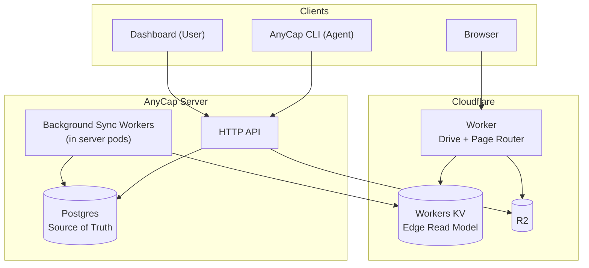
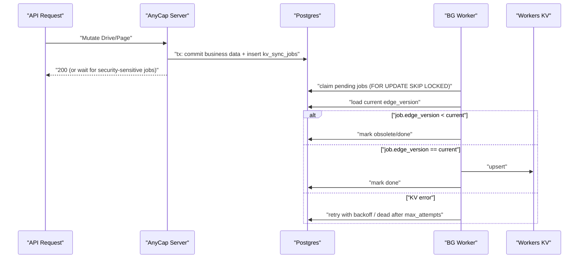

# Drive / Page (R2 + Worker) 设计方案

> Date: 2026-03-28
> Status: Draft v4 (补充 CLI/Dashboard 设计)
> Scope: Drive、Page、Space、PG->KV 同步、Dashboard/CLI 管理面

## 1. 目标与约束

### 1.1 目标

- 提供 Drive 文件存储与目录管理能力（Agent CLI + Dashboard）。
- 提供 Page 静态网页托管能力（Agent 上传产物 -> 可访问域名）。
- 对外访问统一由 Cloudflare Worker 承载，Worker 只读 KV/R2，不回源 AnyCap Server。

### 1.2 已确认约束

- Page 版本只能向前推进；rollback 通过复制旧版本内容到新版本再发布。
- Page 域名为 `<page-name>.page.anycap.cloud`。
- `page-name` 需语义化 + 随机后缀，且有最小长度，删除后不可复用。
- Drive 对外链接不暴露路径，仅使用 token 链接。
- Drive 支持嵌套目录与目录浏览（Phase 1 即支持）。
- Drive 每个文件/目录仅保留一个 active 分享链接（可续期、改永久、rotate）。
- 当前默认每用户一个独立 space。
- 架构直接采用 Worker + KV，不做“先无 Worker”的过渡方案。
- Phase 1 不做 multipart 上传。
- 所有 KV 变更统一走 `kv_sync_jobs`（不做 inline KV 写）。

## 2. 总体架构



设计原则：

- `PG` 是唯一真相源。
- `KV` 是 Worker 的边缘读模型。
- Drive 索引与分享 token 解耦：索引按目录/文件 ID 组织，token 只做授权入口。

## 3. 数据模型（Phase 1 简化）

### 3.1 Space（简化）

- `spaces`
  - `id`, `owner_user_id`, `name`, `created_at`

说明：

- Phase 1 不建 `space_members`。
- 权限判断以 `spaces.owner_user_id == current_user_id` 为准。
- 角色化协作（owner/admin/editor/viewer）放到后续阶段。

### 3.2 Drive 领域表

- `drive_nodes`
  - `id`, `space_id`, `parent_id(nullable)`, `kind(folder|file)`, `name`
  - `storage_object_id(nullable)`, `size(nullable)`, `mime(nullable)`
  - `edge_version`, `created_by`, `created_at`, `updated_at`, `deleted_at(nullable)`

- `drive_share_links`
  - `id`, `node_id`, `token`, `status(active|revoked)`
  - `expires_at(nullable)`, `password_hash(nullable)`, `password_salt(nullable)`
  - `edge_version`, `created_at`, `updated_at`

约束：每个 `node_id` 仅允许一个 `active` 链接。

### 3.3 Page 领域表

- `page_sites`
  - `id`, `space_id`, `name`, `page_name`, `current_version_id(nullable)`
  - `access_mode(public|password|private_reserved)`
  - `password_hash(nullable)`, `password_salt(nullable)`
  - `edge_version`, `created_at`, `updated_at`, `deleted_at(nullable)`

- `page_versions`
  - `id`, `page_id`, `version_no`, `source_version_id(nullable)`
  - `status(draft|uploaded|verified|published|archived)`
  - `asset_prefix`, `spa_fallback(bool)`, `created_by`, `created_at`

- `page_slug_registry`
  - `slug`, `status(active|tombstone)`, `page_id`, `created_at`

说明：`tombstone` 不清理，保证“删除后不可复用”。

### 3.4 上传会话与存储对象

- `upload_sessions`
  - `id`, `space_id`, `target_type(drive|page)`, `target_id`, `object_key`
  - `status(pending|completed|expired)`, `expires_at`, `created_at`

- `storage_objects`
  - `id`, `space_id`, `bucket`, `object_key`, `size`, `mime`, `etag`, `sha256`, `created_at`

规则：

- `storage_objects` 在 complete 阶段创建，不在 presign 阶段创建。
- complete 时服务端对 R2 执行 `HEAD` 校验对象存在与基础元信息。
- 后台定时清理 `expired` upload session：删除对应 R2 对象并标记 session 过期，避免 orphaned objects。

### 3.5 KV 同步任务表

- `kv_sync_jobs`
  - `id`, `job_type`, `target_id`, `edge_version`, `payload`
  - `status(pending|processing|done|failed|dead)`
  - `attempts`, `max_attempts`, `next_retry_at`, `locked_by(nullable)`, `locked_at(nullable)`
  - `last_error(nullable)`, `created_at`, `updated_at`

## 4. Bucket 与 Object Key 策略

### 4.1 Bucket

- 现有 bucket 保留：用于 capabilities 临时上传（例如 `anycap-tmp`）。
- 新增 bucket：`anycap-cloud`（Drive + Page 专用）。

### 4.2 Prefix

- Drive: `drive/spaces/{space_id}/nodes/{node_id}/{object_id}`
- Page: `page/spaces/{space_id}/sites/{page_id}/versions/{version_no}/{asset_path}`

## 5. Drive 设计

### 5.1 目录与文件

- 支持 `mkdir/upload/list/rename/move/delete`。
- 目录树使用 `parent_id`，支持嵌套目录。
- rename/move 修改逻辑元数据，不强制重写 R2 object key。

### 5.2 上传

- Phase 1 仅支持单次 PUT（presign 上传）。
- 不支持 multipart。
- 必须设置服务端文件大小上限（小于 5GB；建议业务上限 500MB/1GB）。

### 5.3 分享

- 外链格式：`https://drive.anycap.cloud/s/{token}`
- `token` 是分享链接随机串，仅用于授权入口。
- `drive:share:{token}` 记录：`root_dir_id`（分享根目录）、访问策略、过期、密码等。
  - 分享子目录时，`root_dir_id` 为该子目录。
  - 分享整个 drive 根目录时，`root_dir_id` 为 space 根目录。

### 5.4 目录索引 KV 设计（与 token 解耦）

- `drive:dir:{dir_id}:meta`
  - `{dir_id,parent_id,space_id,name,edge_version,updated_at}`
- `drive:dir:{dir_id}:children`
  - 当前目录一层子节点列表（文件+子目录，含基础展示字段）
- `drive:file:{file_id}`
  - 文件元数据（`object_key,mime,size,etag,name,parent_id,edge_version`）

说明：

- 这些索引由 Drive 的 create/update/delete/move 统一维护，与 share 是否存在无关。
- Dashboard 提供 `Rebuild Index`（修复索引漂移）。

### 5.5 目录操作并发规则

- 所有会影响目录 children 的操作，不直接写 KV。
- 事务内更新对应节点的 `edge_version`，并写入 `kv_sync_jobs`。
- worker 执行 job 时先读取 PG 当前 `edge_version`：
  - 若 `job.edge_version < current`，直接标记 obsolete/done。
  - 仅 `==` 时重建并写 KV。

### 5.6 单文件操作的同步 job 粒度（Phase 1）

- 上传/移动/重命名单文件时，拆分为两个独立 job（不做 compound job）：
  - `drive_file_meta_sync`：同步 `drive:file:{file_id}`
  - `drive_dir_children_sync`：同步 `drive:dir:{parent_id}:children`
- 该策略实现更简单，Phase 1 性能足够；若后续出现吞吐瓶颈，再评估合并为 compound job。

### 5.7 目录删除级联策略

- 删除目录 = 递归软删整棵子树。
- 子树内所有 share link 统一置 `revoked`。
- 触发 `dir_tree_delete` 类型 job，由后台分批清理/重建 KV 索引。

### 5.8 Worker 目录浏览路由

- `GET /s/{token}` -> 展示 `root_dir_id` 的 children
- `GET /s/{token}/dir/{dir_id}` -> 展示该目录 children
- `GET /s/{token}/file/{file_id}` -> 文件读取/渲染/下载

授权边界：

- token 先鉴权，再校验目标 `dir_id/file_id` 是否位于 `root_dir_id` 子树。
- 子树校验通过 `parent_id` 向上追溯实现（依赖 `drive:dir:*:meta` / `drive:file:*`）。

## 6. Page 设计

### 6.1 page-name 生成

- 规则：`语义 slug + 随机后缀`（例如 `docs-center-k7m4xq2n`）。
- 语义来源：
  - 有用户输入 `name` 时，从 `name` 提取 slug。
  - 无有效 `name` 时，使用词库短语 + 随机后缀。
- 最小长度限制（建议 >= 12）。

### 6.2 版本

- 只允许发布更高版本。
- rollback = 从历史版本复制资产生成新版本，再发布新版本。

### 6.3 状态流转触发

- `draft -> uploaded`: upload complete API
- `uploaded -> verified`: 服务端校验 R2 资产存在性通过
- `verified -> published`: 用户显式调用 publish API
- `published -> archived`: 新版本发布后旧版本自动归档

### 6.4 访问模式

- `public`: 任意访问。
- `password`: 密码访问（Header 或密码页）。
- `private`: 后续实现（当前先保留枚举占位）。

### 6.5 资产上传与路由

- 上传方式：目录文件逐个 presign 上传。
- Phase 1 不要求 manifest。
- Worker 路由规则（按 `asset_prefix` 解析）：
  - 先尝试 `{path}`
  - 再尝试 `{path}/index.html`
  - 再尝试 `{path}.html`
  - 若 `spa_fallback=true`，回退到 `index.html`

## 7. KV 读模型与同步

### 7.1 KV Key

- 分享入口
  - `drive:share:{token}`
  - `page:host:{hostname}`
- Drive 索引
  - `drive:dir:{dir_id}:meta`
  - `drive:dir:{dir_id}:children`
  - `drive:file:{file_id}`

### 7.2 同步原则

- 所有 KV 变更均由 `kv_sync_jobs` 驱动。
- API 请求成功语义基于 PG 成功提交。
- 安全敏感操作可配置为“等待对应 KV job 完成后再返回成功”。

### 7.3 同步流程



### 7.4 多 Pod 并发处理

- 所有 pod 都可运行后台 worker。
- 抢任务 SQL 使用 `FOR UPDATE SKIP LOCKED`，避免同一 job 被并发处理。
- `processing` 超时自动回收为 `pending`（防 pod 崩溃丢任务）。
- `max_attempts`（建议 10）后置 `dead` 并告警。

### 7.5 删除与失效同步

- 软删除文件/目录后，必须同步失效相关 share token（`revoked`）。
- Page 软删除/下线后，必须同步删除 `page:host:{hostname}` 或切换到无效状态。

## 8. Worker 路由与部署

### 8.1 域名

- `drive.anycap.cloud`
- `*.page.anycap.cloud`

### 8.2 入口分发伪代码

```ts
if (host === "drive.anycap.cloud") {
	return handleDrive(req)
}
if (host.endsWith(".page.anycap.cloud")) {
	return handlePage(req)
}
return notFound()
```

## 9. 密码校验（Worker 侧）

- 算法：`PBKDF2-HMAC-SHA256`。
- 存储：`password_hash + per-resource random salt`。
- 全局 `pepper`：存放在 Worker Secret，不落库。
- 校验：常量时间比较。
- 防爆破：按 `token + IP` 进行 rate limit。

## 10. API 草案（最小集）

### 10.1 Drive

- `POST /v1/drive/folders`
- `POST /v1/drive/files/presign`
- `POST /v1/drive/files/complete`
- `GET /v1/drive/nodes`
- `PATCH /v1/drive/nodes/{id}`
- `DELETE /v1/drive/nodes/{id}`
- `PUT /v1/drive/nodes/{id}/share`
- `POST /v1/drive/nodes/{id}/share/rotate`
- `DELETE /v1/drive/nodes/{id}/share`

### 10.2 Page

- `POST /v1/pages`
- `POST /v1/pages/{id}/versions`
- `POST /v1/pages/{id}/versions/{version_id}/publish`
- `POST /v1/pages/{id}/versions/{version_id}/rollback-clone`
- `PATCH /v1/pages/{id}`
- `GET /v1/pages`
- `GET /v1/pages/{id}`

## 11. 复用策略（合理复用）

- 只复用稳定基础层：`ObjectStore`、`EdgeProjector`、`ShareSecurityCore`、`TokenGenerator`、`Audit`。
- Drive/Page 业务层独立演进，不做统一“超级资源表”。

## 12. 运行策略（Phase 1）

- 配额：按 space 总存储量做硬上限。
- GC：软删后异步物理删除（按保留期）。
- Worker + KV 架构直接上线，不做 Phase 0.5。

## 13. 分阶段

### Phase 1

- Drive：目录树、上传、目录浏览、token 分享、密码、续期/rotate。
- Page：站点、版本上传、forward-only 发布、password/public、默认静态路由。
- PG->KV：全量 job 化同步 + 多 pod 抢占重试。

### Phase 2

- Page `private`（账号/space 权限）
- Space 协作成员与角色模型（owner/admin/editor/viewer）
- Page 自定义 page-name（收费能力）
- Page manifest/rewrite/redirect 高级路由能力
