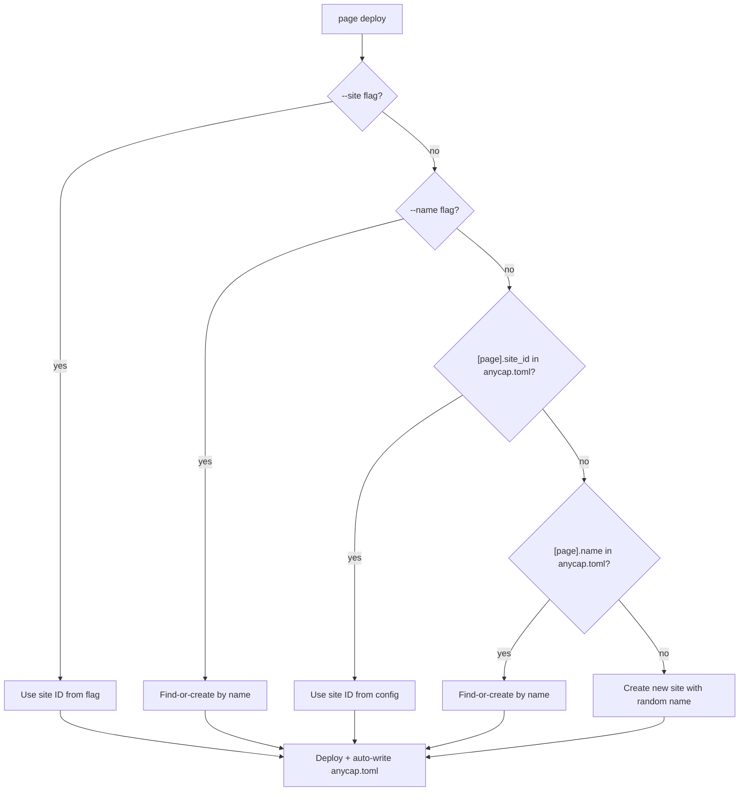

# anycap.toml -- Project-Level Configuration

Date: 2026-03-30

## Overview

Add a project-level TOML config file (`anycap.toml`) that binds a directory to AnyCap resources. This eliminates repetitive flags for `page deploy` and `drive upload`, enables session-less state recovery for agents, and is safe to commit to version control.

Design reference: `docs/cli/spec/framework.md` Section 11.

## Motivation

Current pain points:

1. **Stateless deploys.** Every `page deploy` requires `--site` or `--name` to target an existing site. Agents must track IDs externally or create new sites each time.
2. **Repetitive drive flags.** `drive upload --parent-path /docs` must be repeated on every invocation.
3. **No cross-session memory.** If an agent session ends, the mapping between local directory and remote resource is lost.

With `anycap.toml`:

```bash
# First time -- creates site, writes anycap.toml
anycap page deploy ./dist --name "API Docs" --publish

# Every subsequent time -- reads site_id from anycap.toml
anycap page deploy ./dist --publish
```

The file is committed to git, so any agent (or human) cloning the repo gets the same deployment target.

## File Format

```toml
# AnyCap project configuration
# Safe to commit -- contains only external IDs and display names.

[page]
site_id = "pg_aBcDeFgHiJkLmNoP"
name = "API Docs"

[drive]
folder_id = "dn_aBcDeFgHiJkLmNoP"
path = "/project-assets"
```

All fields are optional. Sections are omitted entirely when unused.

**Why TOML:** Consistent with `~/.anycap/config.toml`. Human-readable, supports comments, well-supported in Go via `github.com/BurntSushi/toml` (already a dependency).

## Discovery

Look for `anycap.toml` in the current working directory. No upward directory traversal.

Rationale: agents control their CWD precisely. Upward traversal adds complexity (monorepo ambiguity, unexpected parent matches) without clear benefit for the agent use case.

## Resolution Precedence

```
CLI flag  >  anycap.toml  >  default behavior
```

### Page Deploy



### Drive (Future -- `drive push` / `drive pull`)

The `[drive]` section in `anycap.toml` is reserved for future directory sync commands. Low-level commands like `drive upload`, `drive mkdir`, and `drive ls` do not interact with `anycap.toml`.

## Auto-Write Behavior

After successful operations, the CLI writes back resolved resource bindings to `anycap.toml`:

| Command | Writes |
|---------|--------|
| `page deploy` | `[page].site_id`, `[page].name` |
| `drive push` (future) | `[drive].folder_id`, `[drive].path` |

Write rules:
- If `anycap.toml` does not exist, create it
- If it exists, merge -- preserve existing sections, update only the relevant section
- File permissions: 0644

Low-level commands (`drive upload`, `drive mkdir`, etc.) do not read or write `anycap.toml`. Project config is for high-level commands that represent the primary workflow (`page deploy`, future `drive push`/`drive pull`).

### Merge Strategy

Use `toml.DecodeFile` to load existing config, update fields in the Go struct, then re-encode with `toml.Encoder`. This preserves structure but does not preserve comments (acceptable trade-off; the file is machine-managed with occasional human edits).

For a more comment-friendly approach in the future, consider switching to `github.com/pelletier/go-toml/v2` which supports comment preservation. For now, `BurntSushi/toml` (already in go.mod) is sufficient.

## Security

The file is safe to commit:

| Content | Risk | Mitigation |
|---------|------|------------|
| External IDs (`pg_xxx`, `dn_xxx`) | Information disclosure | IDs are opaque random strings, not sequential. Knowing an ID grants zero access without valid auth credentials. |
| Display names | None | Human-readable labels only |
| **No credentials** | N/A | Credentials live in `~/.anycap/credentials` (0600) |
| **No endpoints** | N/A | Endpoint lives in `~/.anycap/config.toml` or env var |

## Deploy Exclusion

When `page deploy .` deploys the current directory, `anycap.toml` must be excluded from the uploaded file set. Implementation: add a filename check in `collectPageDeployFiles`:

```go
// Skip project config file
if assetPath == "anycap.toml" {
    return nil
}
```

This mirrors how `wrangler.toml` is not uploaded to Cloudflare Workers.

## Implementation

### New Package: `internal/cli/projectconfig/`

```go
package projectconfig

import (
    "os"
    "github.com/BurntSushi/toml"
)

const Filename = "anycap.toml"

type Config struct {
    Page  *PageConfig  `toml:"page,omitempty"`
    Drive *DriveConfig `toml:"drive,omitempty"`
}

type PageConfig struct {
    SiteID string `toml:"site_id,omitempty"`
    Name   string `toml:"name,omitempty"`
}

type DriveConfig struct {
    FolderID string `toml:"folder_id,omitempty"`
    Path     string `toml:"path,omitempty"`
}

// Load reads anycap.toml from the current directory.
// Returns zero Config if the file does not exist (not an error).
func Load() (*Config, error) {
    var cfg Config
    if _, err := toml.DecodeFile(Filename, &cfg); err != nil {
        if os.IsNotExist(err) {
            return &Config{}, nil
        }
        return nil, err
    }
    return &cfg, nil
}

// Save writes the config to anycap.toml in the current directory.
func Save(cfg *Config) error {
    f, err := os.OpenFile(Filename, os.O_WRONLY|os.O_CREATE|os.O_TRUNC, 0644)
    if err != nil {
        return err
    }
    defer f.Close()

    _, _ = f.WriteString("# AnyCap project configuration\n")
    _, _ = f.WriteString("# Safe to commit -- contains only external IDs and display names.\n\n")
    return toml.NewEncoder(f).Encode(cfg)
}

// SavePage updates only the [page] section, preserving other sections.
func SavePage(page PageConfig) error {
    cfg, err := Load()
    if err != nil {
        return err
    }
    cfg.Page = &page
    return Save(cfg)
}

// SaveDrive updates only the [drive] section, preserving other sections.
func SaveDrive(drive DriveConfig) error {
    cfg, err := Load()
    if err != nil {
        return err
    }
    cfg.Drive = &drive
    return Save(cfg)
}
```

### Changes to `page_deploy.go`

```go
// In newPageDeployCmd, after flag parsing:

// Site resolution (in RunE, before the existing switch):
projCfg, _ := projectconfig.Load()

switch {
case siteID != "":
    // --site flag: highest priority (existing code)
case siteName != "":
    // --name flag: second priority (existing code)
case projCfg.Page != nil && projCfg.Page.SiteID != "":
    // anycap.toml site_id: verify it exists
    resp, err := client.Get(ctx, "/v1/pages/"+projCfg.Page.SiteID)
    ...
case projCfg.Page != nil && projCfg.Page.Name != "":
    // anycap.toml name: find-or-create
    site, err = ensureDeploySiteByName(ctx, client, projCfg.Page.Name)
    ...
default:
    // Create new with random name (existing code)
}

// After successful deploy, before returning:
_ = projectconfig.SavePage(projectconfig.PageConfig{
    SiteID: site.ID,
    Name:   site.Name,
})
```

### Changes to `drive_upload.go`

No changes. Low-level drive commands do not interact with `anycap.toml`. The `[drive]` config section will be consumed by future `drive push` / `drive pull` commands.

### Changes to `collectPageDeployFiles`

Add exclusion in the `WalkDir` callback:

```go
// Skip anycap.toml from deploy uploads
if assetPath == projectconfig.Filename {
    return nil
}
```

## Files Changed

| File | Action |
|------|--------|
| `internal/cli/projectconfig/config.go` | **New** -- Load/Save/SavePage/SaveDrive |
| `internal/cli/projectconfig/config_test.go` | **New** -- unit tests |
| `internal/cli/command/infra/page_deploy.go` | Read project config for site resolution, auto-write after deploy, exclude `anycap.toml` from uploads |
| `docs/cli/spec/framework.md` | Updated Section 3 (resolution chain), added Section 11 |

## Testing

| Test | Description |
|------|-------------|
| `projectconfig/config_test.go` | Load missing file returns zero config; Load valid file parses all fields; Save round-trips; SavePage preserves [drive] section; SaveDrive preserves [page] section |
| `page_deploy_test.go` | Deploy reads site_id from anycap.toml when no flags; flags override anycap.toml; anycap.toml excluded from file list |

All tests use temp directories with `os.Chdir` to isolate `anycap.toml` reads/writes.

## Future Extensions

These are out of scope for this iteration but inform the design:

- **`anycap init`**: Interactive scaffolding that creates `anycap.toml` with guided prompts
- **`drive push` / `drive pull`**: Directory sync commands that rely heavily on `[drive]` config
- **`[browser]` section**: Browser session config for `anycap browser` commands
- **`[sandbox]` section**: Sandbox environment config
- **Multiple page sites**: `[page.docs]`, `[page.landing]` for monorepos with multiple deploy targets (requires design work)
