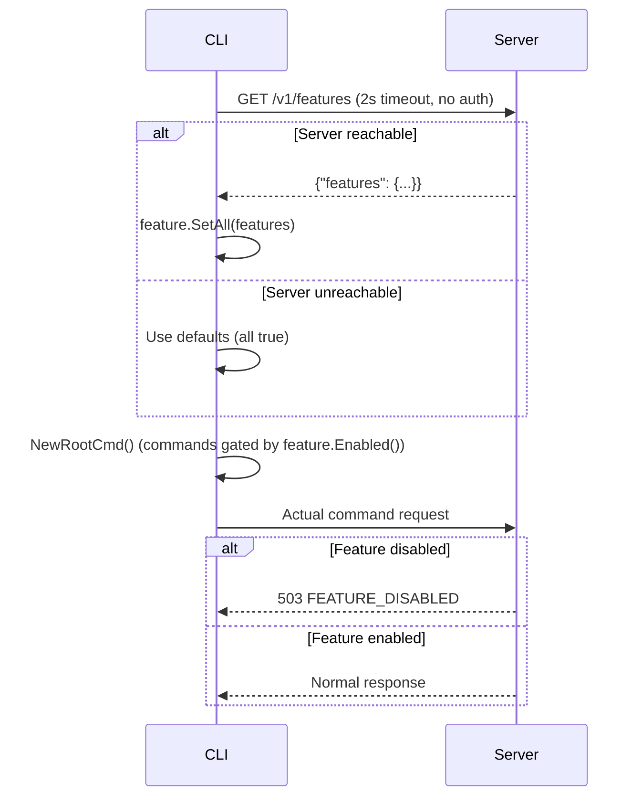

# Feature Gate: Server-Side Enforcement + CLI Preflight

Date: 2026-03-30

## Problem

Feature flags exist in both server (`buildServerFeatures`) and CLI (`pkg/feature`), but:

1. CLI never reads server features -- uses compile-time defaults (all `true`)
2. Server routes are always registered -- disabled features return unclear errors instead of clean `FEATURE_DISABLED`
3. `feature.SetAll()` exists but is never called

## Design

### Server Side

#### 1. Public features endpoint

New endpoint: `GET /v1/features` (no auth required)

```json
{
  "features": {
    "image.generate": true,
    "image.models": true,
    "music.generate": false,
    "music.models": false
  }
}
```

Registered as a public (non-protected) route in system handler. Lightweight, no auth, suitable for CLI preflight.

#### 2. Feature gate middleware

A Hertz middleware that maps URL path prefixes to feature flag names. When a request hits a disabled feature, it returns 503:

```json
{
  "error": {"code": "FEATURE_DISABLED", "message": "music.generate is not available on this server"},
  "hint": "run 'anycap status' to see available features"
}
```

Route-to-feature mapping:

| Path prefix | Feature flag |
|---|---|
| `/v1/image/generate` | `image.generate` |
| `/v1/image/models`, `/v1/catalog/image` | `image.models` |
| `/v1/video/generate` | `video.generate` |
| `/v1/video/models`, `/v1/catalog/video` | `video.models` |
| `/v1/music/generate` | `music.generate` |
| `/v1/music/models`, `/v1/catalog/music` | `music.models` |
| `/v1/capabilities/image/read` | `image.read` |
| `/v1/capabilities/video/read` | `video.read` |

Applied only to capability routes, after auth middleware.

### CLI Side

#### 3. Preflight feature sync

Before building the command tree in `main()`:

```
main()
  1. Parse --endpoint from os.Args (simple scan, before cobra)
  2. Resolve endpoint: args > env > config > default
  3. HTTP GET /v1/features (2s timeout, no auth, no retry)
  4. On success: feature.SetAll(serverFeatures)
  5. On failure: use defaults (all true) -- degrade gracefully
  6. Build command tree via NewRootCmd()
```

This ensures `feature.Enabled()` checks in command constructors use real server state.

#### 4. Skip preflight for certain commands

No preflight for: `status`, `login`, `config`, `help`, `version`, `update`, `--help`, `--version`.
These must work without server connectivity.

### Sequence



## Implementation Order

1. Server: add `GET /v1/features` public endpoint
2. Server: add feature gate middleware
3. CLI: add preflight in `main.go`
4. Tests for all three

## Edge Cases

- **Server unreachable**: CLI falls back to defaults (all true), server gate catches at request time
- **Old CLI + new server**: No preflight, but server gate returns clean error
- **New CLI + old server**: Preflight gets 404, falls back to defaults
- **--endpoint flag**: Parsed from os.Args before cobra, covers dev use case
