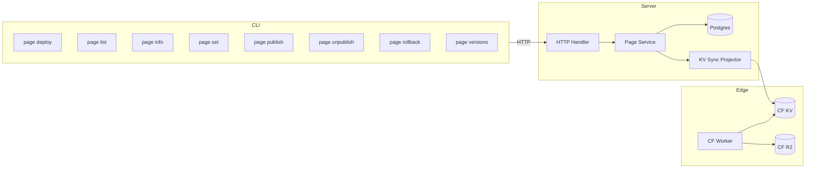
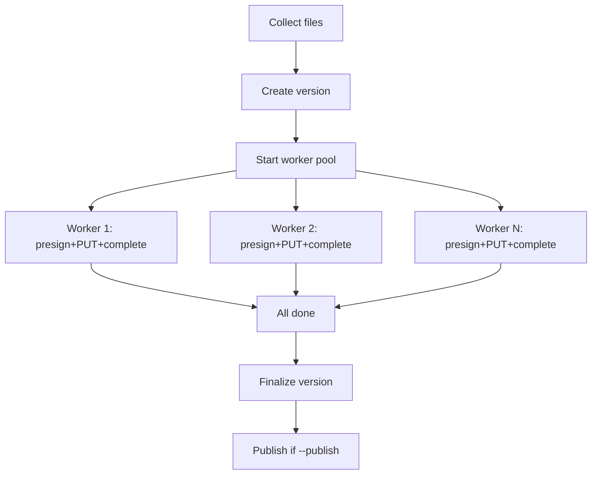

# Page Feature Optimization Plan

Date: 2026-03-30

## Overview

Full review of the Page static site hosting feature across all layers (domain, application, infrastructure, transport, CLI, edge worker, skill). This document covers new features, query optimizations, code quality improvements, and cross-cutting refinements that also affect Drive.

## Current Architecture



---

## Part 1: New Features

### F1: DeleteSite

**Problem**: `SoftDelete` exists in the repo but is unreachable -- no service method, no handler endpoint, no CLI command. Users cannot delete page sites.

**Changes**:

| Layer | File | Change |
|-------|------|--------|
| Port | `internal/domain/port/page.go` | Add `DeleteSite` to `PageService` interface |
| Application | `internal/application/page/service.go` | Implement `DeleteSite`: ownership check, soft delete site, mark slug tombstone, if site was published enqueue `page_host_delete` KV sync job |
| Handler | `internal/transport/http/handlers/page/site.go` | Add `DELETE /v1/pages/:id` handler |
| Handler | `internal/transport/http/handlers/page/handler.go` | Register route |
| CLI | `internal/cli/command/infra/page_delete.go` | New `anycap page delete <page-id>` command |
| CLI | `internal/cli/command/infra/page.go` | Register subcommand |

**Behavior**:
- Soft deletes the site (sets `deleted_at`)
- Marks the slug as tombstone (prevents reuse)
- If site had `current_version_id`, enqueues `page_host_delete` job to remove from KV/edge
- Returns the deleted site DTO (with `deleted_at` populated)
- Idempotent: deleting an already-deleted site returns 404

### F2: Deploy `--site` Flag

**Problem**: `page deploy` only supports `--name` (text match to find/create site). No way to deploy to a specific existing site by ID.

**Changes**:

| File | Change |
|------|--------|
| `internal/cli/command/infra/page_deploy.go` | Add `--site <page-id>` flag; mutual exclusion with `--name` |

**Resolution logic**:
1. `--site pg_xxx` -- use directly (GET to verify it exists)
2. `--name "My Site"` -- server-side name filter (see S3), find or create
3. Neither -- random name, create new site

### F3: Edge Badge Opt-out

**Problem**: Edge worker injects an HTML badge into every page via `injectPageBadge`. Users cannot disable this. Breaks API docs, iframes, and any page where injected HTML is unwanted.

**Changes**:

| Layer | File | Change |
|-------|------|--------|
| Model | `internal/domain/model/page.go` | Add `ShowBadge bool` field to `PageSite` (default `true`) |
| Model | `internal/domain/model/page.go` | Add `ShowBadge *bool` field to `UpdatePageSiteInput` |
| Migration | `0013_page_optimization.sql` | `ALTER TABLE page_sites ADD COLUMN IF NOT EXISTS show_badge BOOLEAN NOT NULL DEFAULT TRUE` |
| Postgres | `page_site_repo.go` | Include `show_badge` in all queries and scans |
| Application | `service.go` | Handle `ShowBadge` in `UpdateSite` |
| Handler | `site.go` | Parse `show_badge` in PATCH body |
| Presenter | `presenter/page.go` | Add `ShowBadge` to `PageSiteDTO` |
| KV Sync | `kvsync/page_projector.go` | Include `show_badge` in KV payload |
| Edge | `workers/edge/src/types.ts` | Add `show_badge?: boolean` to `PageHostRecord` |
| Edge | `workers/edge/src/page.ts` | Only call `injectPageBadge` when `host.show_badge !== false` |
| CLI | `internal/cli/command/infra/page_set.go` | Add `--badge` / `--no-badge` flags |

---

## Part 2: Query Optimizations

### S1: List Pagination (Page Sites + Versions + Drive Nodes)

**Problem**: `ListBySpace` (page sites), `ListByPageID` (page versions), and `ListByParent` (drive nodes) all return full result sets. No limit/offset.

**API contract**:

```
GET /v1/pages?limit=50&offset=0
GET /v1/pages/:id/versions?limit=50&offset=0
GET /v1/drive/nodes?limit=50&offset=0&parent_id=dn_xxx
```

Response format (unchanged structure, `total` now reflects DB count):

```json
{
  "status": "success",
  "data": {
    "items": [...],
    "total": 42
  }
}
```

**Defaults**: limit=50, max limit=200, offset=0.

**Page changes**:

| Layer | File | Change |
|-------|------|--------|
| Model | `internal/domain/model/page.go` | Add `ListPageSitesFilter` (Limit, Offset, Name) and `ListPageVersionsFilter` (Limit, Offset) |
| Port | `internal/domain/port/page.go` | `ListBySpace(ctx, filter) ([]PageSite, int, error)` -- add filter param, return total count |
| Port | `internal/domain/port/page.go` | `ListByPageID(ctx, filter) ([]PageVersion, int, error)` -- same |
| Port | `internal/domain/port/page.go` | Update `PageService` interface signatures |
| Postgres | `page_site_repo.go` | Add `COUNT(*)` query + `LIMIT/OFFSET` + optional `name` filter |
| Postgres | `page_version_repo.go` | Add `COUNT(*)` query + `LIMIT/OFFSET` |
| Application | `service.go`, `version.go` | Pass filter through, return total |
| Handler | `site.go`, `version.go` | Parse `limit`/`offset`/`name` query params |

**Drive changes** (same pattern):

| Layer | File | Change |
|-------|------|--------|
| Model | `internal/domain/model/drive.go` | Add `Limit`, `Offset` fields to existing `ListDriveNodesFilter` |
| Port | `internal/domain/port/drive.go` | `ListByParent(ctx, filter) ([]DriveNode, int, error)` -- return total count |
| Port | `internal/domain/port/drive.go` | Update `DriveService.ListNodes` signature |
| Postgres | `drive_node_repo.go` | Add `COUNT(*)` + `LIMIT/OFFSET` |
| Application | `drive/service.go` | Pass filter through |
| Handler | `drive/node.go` | Parse `limit`/`offset` query params |

### S2: Version Lookup by Number

**Problem**: CLI `publish --version N` and `rollback --version N` fetch ALL versions then scan client-side. Wasteful.

**Changes**:

| Layer | File | Change |
|-------|------|--------|
| Port | `internal/domain/port/page.go` | Add `GetByPageIDAndVersionNo(ctx, pageID, versionNo int64) (*PageVersion, error)` to `PageVersionRepository` |
| Port | `internal/domain/port/page.go` | Add `GetVersionByNumber(ctx, userID string, pageID, versionNo int64) (*PageVersion, error)` to `PageService` |
| Postgres | `page_version_repo.go` | `SELECT ... WHERE page_id = $1 AND version_no = $2` (uses existing unique index `idx_page_versions_page_version_unique`) |
| Application | `version.go` | Implement: call repo, verify ownership via site |
| Handler | `handler.go` | Register `GET /v1/pages/:id/versions/by-number/:no` |
| Handler | `version.go` | New handler method |
| CLI | `page_publish.go` | Use new endpoint instead of list-all + client-side pick |
| CLI | `page_rollback.go` | Same |
| CLI | `common.go` | Add `getPageVersionByNumber` helper |

**SQL**: The unique index `(page_id, version_no)` already exists, so the query is an index seek. No new index needed.

### S3: Site Name Filter

**Problem**: CLI `deploy --name "X"` calls list-all then linear scans. With pagination, this pattern breaks entirely.

Integrated into S1 -- `ListPageSitesFilter` includes a `Name *string` field. The handler parses `?name=xxx` query param. Exact match, case-sensitive (matching current `ensureDeploySite` behavior).

---

## Part 3: CLI Deploy Improvements

### C1: Parallel Upload

**Problem**: Deploy uploads files sequentially. Each file = 3 HTTP calls (presign + PUT + complete). 100 files = 300 serial requests.

**Design**:



**Implementation**: goroutine worker pool using channels.

- Default concurrency: 6. Configurable via `--concurrency N` (range 1-20).
- Error handling: first worker error cancels context. All workers drain. First error returned.
- Each worker independently runs presign -> PUT -> complete for its assigned file.

### C2: TTY-Aware Progress

**Problem**: No feedback during deploy.

**Design**:

| stderr is TTY (human terminal) | stderr is NOT TTY (agent pipe) |
|---|---|
| `Uploading [3/12] assets/style.css (8.4 KB)` | Zero output on stderr |

Implementation: `deployProgress` interface with `ttyProgress` and `silentProgress` implementations. Use `term.IsTerminal()` or `os.Stderr.Fd()` check.

**Final JSON** (stdout, always) adds summary fields:

```json
{
  "status": "success",
  "page_id": "pg_xxx",
  "page_name": "my-site-a1b2c3",
  "page_url": "https://page-my-site-a1b2c3.anycap.cloud",
  "version": 3,
  "published": true,
  "files_uploaded": 12,
  "total_size_bytes": 245760
}
```

### C3: CLI Publish/Rollback Use by-number API

Depends on S2. Replace list-all + client-side pick with single `GET /v1/pages/:id/versions/by-number/:no` call.

### C4: page delete Command

New `anycap page delete <page-id>` -- calls `DELETE /v1/pages/:id`.

---

## Part 4: Code Quality

### Q1: Domain Error Types

**Problem**: `statusCodeForPageError` and `statusCodeForDriveError` both use brittle string matching (`ContainsAny(err.Error(), "required", "must be", ...)`) to map errors to HTTP status codes.

**Fix**: Introduce domain-level error types in `internal/domain/model/errors.go`:

```go
package model

type DomainError struct {
    Code    string // e.g. "not_found", "validation", "conflict", "not_configured"
    Message string
}

func (e *DomainError) Error() string { return e.Message }

func ErrNotFound(msg string) error      { return &DomainError{Code: "not_found", Message: msg} }
func ErrValidation(msg string) error    { return &DomainError{Code: "validation", Message: msg} }
func ErrConflict(msg string) error      { return &DomainError{Code: "conflict", Message: msg} }
func ErrNotConfigured(msg string) error { return &DomainError{Code: "not_configured", Message: msg} }
```

**Changes**:

| Layer | File | Change |
|-------|------|--------|
| Model | `internal/domain/model/errors.go` | New file with domain error types |
| Application | `page/service.go`, `page/version.go`, `page/publish.go` | Replace `fmt.Errorf("...not found")` with `model.ErrNotFound(...)` etc. |
| Application | `drive/service.go` | Same pattern |
| Handler helpers | `page/helpers.go`, `drive/helpers.go` | Replace string matching with `errors.As(&domainErr)` + switch on `domainErr.Code` |

### Q2: Conditional KV Sync on UpdateSite

**Problem**: `UpdateSite` enqueues a KV sync job on every update, even when only `name` changed. KV record only cares about `access_mode`, `password_hash`, `password_salt`, `spa_fallback`, `show_badge`.

**Fix**:

```go
edgeRelevant := input.AccessMode != nil || input.UpdatePassword || input.SPAFallback != nil || input.ShowBadge != nil
if edgeRelevant && updatedSite.CurrentVersionID != nil {
    jobID, err := s.enqueueKVSyncJob(...)
    ...
}
```

Also skip sync when site has no `CurrentVersionID` (unpublished site has no KV entry to sync).

### Q3: Fix randomString Modulo Bias

**Problem**: `int(randomBytes[i]) % len(alphabet)` where alphabet is 36 chars. `256 % 36 = 4`, so first 4 chars have slightly higher probability.

**Fix**: Rejection sampling.

```go
func randomString(length int) (string, error) {
    const alphabet = "abcdefghijklmnopqrstuvwxyz0123456789"
    const maxValid = 252 // largest multiple of 36 that fits in a byte (36 * 7 = 252)
    buf := make([]byte, length)
    for i := 0; i < length; {
        b := make([]byte, 1)
        if _, err := rand.Read(b); err != nil {
            return "", fmt.Errorf("generate random string: %w", err)
        }
        if b[0] < maxValid {
            buf[i] = alphabet[b[0]%byte(len(alphabet))]
            i++
        }
    }
    return string(buf), nil
}
```

### Q4: Simplify FinalizeVersion Status Transition

**Problem**: `FinalizeVersion` does `draft -> uploaded -> verified` as two sequential DB updates. The `uploaded` status is never independently observed -- no code path stops at `uploaded`.

**Fix**: Skip `uploaded` for new versions. Change `FinalizeVersion` to go directly from `draft` to `verified`.

```go
switch version.Status {
case model.PageVersionStatusVerified:
    return version, nil
case model.PageVersionStatusDraft, model.PageVersionStatusUploaded:
    // go directly to verified
default:
    return nil, model.ErrValidation(...)
}
version, err = s.versionRepo.UpdateStatus(ctx, version.ID, model.PageVersionStatusVerified)
```

Keep `uploaded` as a valid enum value (for backward compat with existing DB rows) but no longer produce it in new code.

### Q5: Single-File Deploy Source Hint

**Problem**: `anycap page deploy about.html` silently renames to `index.html`. Surprising.

**Fix**: Keep the rename (required for page hosting). Add `"source_file": "about.html"` to the final JSON output so the caller is aware of the mapping.

---

## Part 5: DB Migration

New migration file: `0013_page_optimization.sql`

```sql
-- F3: Badge opt-out column
ALTER TABLE page_sites ADD COLUMN IF NOT EXISTS show_badge BOOLEAN NOT NULL DEFAULT TRUE;

-- S1/S3: Index for site name filtering with pagination
CREATE INDEX IF NOT EXISTS idx_page_sites_space_name
    ON page_sites (space_id, name)
    WHERE deleted_at IS NULL;

-- S2: page_versions already has unique index (page_id, version_no)
-- which covers GetByPageIDAndVersionNo. No new index needed.
```

---

## Implementation Order

```mermaid
gantt
    title Implementation Plan
    dateFormat X
    axisFormat %s

    section Foundation
    Q1 Domain error types                     :q1, 0, 1
    Migration (0013)                          :mig, 0, 1

    section Server Queries
    S1 Pagination (Page + Drive)              :s1, 1, 3
    S2 Version by number                      :s2, 1, 2
    S3 Site name filter (in S1)               :s3, 1, 2

    section Server Features
    F1 DeleteSite                             :f1, 3, 4
    F3 Edge badge opt-out                     :f3, 3, 4

    section CLI
    C1+C2 Parallel upload + progress          :c1, 4, 6
    F2 Deploy --site flag                     :f2, 4, 5
    C3 Publish/Rollback by-number             :c3, 4, 5
    C4 page delete command                    :c4, 4, 5

    section Quality
    Q2 Conditional KV sync                    :q2, 6, 7
    Q3 randomString bias fix                  :q3, 6, 7
    Q4 FinalizeVersion simplify              :q4, 6, 7
    Q5 Single-file deploy hint               :q5, 6, 7
```



**Phase 1 -- Foundation**: Domain error types + migration. Everything else builds on these.

**Phase 2 -- Server queries**: Pagination (Page + Drive), version by number, name filter. Non-breaking additions.

**Phase 3 -- Server features**: DeleteSite + badge opt-out. Both need the migration from phase 1.

**Phase 4 -- CLI**: Parallel upload, progress, deploy flags, publish/rollback optimization, delete command.

**Phase 5 -- Quality polish**: Conditional KV sync, random fix, finalize simplification, deploy hint.

---

## Files Changed Summary

### Phase 1: Foundation

| File | Action |
|------|--------|
| `internal/domain/model/errors.go` | **New** -- domain error types |
| `internal/infrastructure/migration/migrations/0013_page_optimization.sql` | **New** -- `show_badge` column + name index |

### Phase 2: Server Queries

| File | Action |
|------|--------|
| `internal/domain/model/page.go` | Add `ListPageSitesFilter`, `ListPageVersionsFilter` |
| `internal/domain/model/drive.go` | Add `Limit`, `Offset` to `ListDriveNodesFilter` |
| `internal/domain/port/page.go` | Update repo + service signatures for pagination, add `GetByPageIDAndVersionNo`, `GetVersionByNumber` |
| `internal/domain/port/drive.go` | Update `ListByParent` and `ListNodes` signatures for pagination |
| `internal/infrastructure/postgres/page_site_repo.go` | Count query, limit/offset, name filter |
| `internal/infrastructure/postgres/page_version_repo.go` | Count query, limit/offset, `GetByPageIDAndVersionNo` |
| `internal/infrastructure/postgres/drive_node_repo.go` | Count query, limit/offset |
| `internal/application/page/service.go` | Update `ListSites` |
| `internal/application/page/version.go` | Update `ListVersions`, add `GetVersionByNumber` |
| `internal/application/drive/service.go` | Update `ListNodes` |
| `internal/transport/http/handlers/page/handler.go` | Register by-number route |
| `internal/transport/http/handlers/page/site.go` | Parse query params |
| `internal/transport/http/handlers/page/version.go` | Parse query params, new by-number handler |
| `internal/transport/http/handlers/drive/node.go` | Parse query params |
| `internal/application/page/service_test.go` | Update tests for new signatures |
| `internal/application/page/version_test.go` | Same |
| `internal/application/drive/service_test.go` | Same |

### Phase 3: Server Features

| File | Action |
|------|--------|
| `internal/domain/model/page.go` | Add `ShowBadge` to `PageSite`, `UpdatePageSiteInput` |
| `internal/domain/port/page.go` | Add `DeleteSite` to `PageService` |
| `internal/application/page/service.go` | Implement `DeleteSite`, handle `ShowBadge` in `UpdateSite`, use domain error types |
| `internal/application/page/version.go` | Use domain error types |
| `internal/application/page/publish.go` | Use domain error types |
| `internal/infrastructure/postgres/page_site_repo.go` | Include `show_badge` in all queries/scans |
| `internal/transport/http/handlers/page/site.go` | Add DELETE handler, parse `show_badge` in PATCH |
| `internal/transport/http/handlers/page/handler.go` | Register DELETE route |
| `internal/transport/http/handlers/page/helpers.go` | Replace string matching with `errors.As` |
| `internal/transport/http/handlers/drive/helpers.go` | Same pattern |
| `internal/transport/http/presenter/page.go` | Add `ShowBadge` to `PageSiteDTO` |
| `internal/infrastructure/kvsync/page_projector.go` | Include `show_badge` in KV payload |
| `workers/edge/src/types.ts` | Add `show_badge` to `PageHostRecord` |
| `workers/edge/src/page.ts` | Conditional badge injection |

### Phase 4: CLI

| File | Action |
|------|--------|
| `internal/cli/command/infra/page_deploy.go` | Parallel upload, progress, `--site` flag, `--concurrency` flag, richer output |
| `internal/cli/command/infra/page_delete.go` | **New** |
| `internal/cli/command/infra/page_publish.go` | Use by-number API |
| `internal/cli/command/infra/page_rollback.go` | Use by-number API |
| `internal/cli/command/infra/page_set.go` | Add `--badge`/`--no-badge` flags |
| `internal/cli/command/infra/page.go` | Register delete subcommand |
| `internal/cli/command/infra/common.go` | Add `getPageVersionByNumber`, `deployProgress` types, `isTerminal` helper |

### Phase 5: Quality

| File | Action |
|------|--------|
| `internal/application/page/service.go` | Conditional KV sync in `UpdateSite`, fix `randomString` |
| `internal/application/page/version.go` | Simplify `FinalizeVersion` (skip `uploaded` state) |
| `internal/cli/command/infra/page_deploy.go` | Add `source_file` to single-file deploy output |
| `internal/infrastructure/kvsync/page_projector_test.go` | Update for `show_badge` field |
