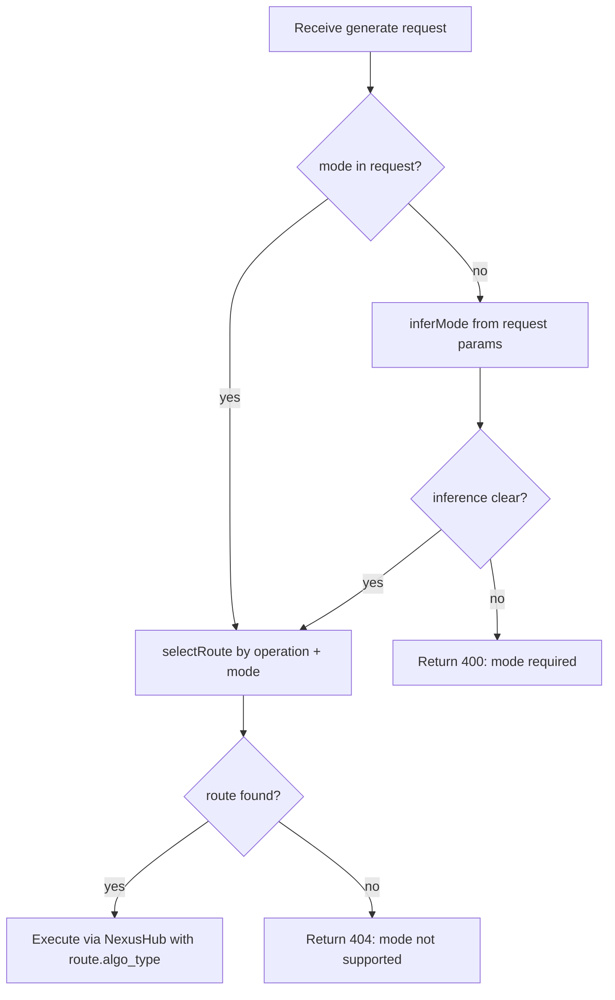

# Capability Mode Refactor

Date: 2026-03-31

## Background

The current model routing system uses `algo_type` (e.g., `txt_2_video`, `img_2_video`) as an internal field for NexusHub dispatch, but this concept is not exposed to CLI or API consumers. This causes two problems:

1. **Route selection is broken for multi-mode models.** `selectGenerateRoute()` picks routes by priority alone, ignoring whether the user wants text-to-video or image-to-video. When both routes share the same priority, the selection is arbitrary.

2. **Agents cannot discover modes.** The `models` API returns `"operations": ["generate"]` without indicating that a model supports multiple input modalities (e.g., text input vs image input).

This document describes a refactor that introduces **mode** as a first-class concept in the public contract, while keeping `algo_type` / `ability_key` as internal NexusHub routing details.

## Design Decisions

### D1: Single table, no new tables

Add columns to the existing `anycap_model_routes` table. No separate model catalog table. `model_description` and `display_name` are denormalized per row; the catalog layer deduplicates by `model_id` using the most recently updated row.

### D2: Mode as external name, algo_type stays internal

`mode` is the user-facing identifier (`text-to-video`, `image-to-video`). `algo_type` remains as the NexusHub-specific dispatch value. The two are colocated on the same row.

### D3: Kebab-case full names for modes

Mode values use kebab-case full names for readability by both humans and agents.

| mode | algo_type (internal) | Capability |
|---|---|---|
| `text-to-video` | `txt_2_video` | video |
| `image-to-video` | `img_2_video` | video |
| `text-to-image` | `txt_2_img` | image |
| `image-to-image` | `img_2_img` | image |
| `text-to-music` | `text_2_music` | music |

### D4: Three separate endpoints retained

`POST /v1/image/generate`, `POST /v1/video/generate`, `POST /v1/music/generate` remain separate. No unified `/v1/generate` endpoint.

### D5: Schema marks file-type parameters

Schema properties that accept local file paths or URLs use `"format": "file-or-url"` so the CLI knows to trigger upload logic.

## DB Changes

### New columns on `anycap_model_routes`

```sql
ALTER TABLE anycap_model_routes
    ADD COLUMN IF NOT EXISTS mode              VARCHAR(64)  NOT NULL DEFAULT '',
    ADD COLUMN IF NOT EXISTS mode_description  TEXT         NOT NULL DEFAULT '',
    ADD COLUMN IF NOT EXISTS model_description TEXT         NOT NULL DEFAULT '';
```

### Unique constraint migration

```sql
-- Drop old constraint
ALTER TABLE anycap_model_routes
    DROP CONSTRAINT IF EXISTS anycap_model_routes_model_id_operation_algo_type_key;

-- New constraint: (model_id, operation, mode)
ALTER TABLE anycap_model_routes
    ADD CONSTRAINT anycap_model_routes_model_id_operation_mode_key
    UNIQUE (model_id, operation, mode);
```

### Seed data example

```csv
model_id,capability,operation,ability_key,algo_type,mode,display_name,model_description,mode_description,status
seedance-1.5-pro,video,generate,ark-doubao-seedance-1.5-pro,txt_2_video,text-to-video,Seedance 1.5 Pro,High-quality video generation by Doubao,Generate video from text prompt,active
seedance-1.5-pro,video,generate,ark-doubao-seedance-1.5-pro,img_2_video,image-to-video,Seedance 1.5 Pro,High-quality video generation by Doubao,Animate a reference image into video,active
veo-3.1,video,generate,veo3.1,txt_2_video,text-to-video,Veo 3.1,Google DeepMind video generation model,Generate video from text prompt,active
```

## API Contract

### Models list: `GET /v1/{cap}/models`

```json
{
  "capability": "video",
  "models": [
    {
      "model": "seedance-1.5-pro",
      "display_name": "Seedance 1.5 Pro",
      "description": "High-quality video generation by Doubao",
      "status": "active",
      "operations": [
        {
          "operation": "generate",
          "modes": [
            {
              "mode": "text-to-video",
              "description": "Generate video from text prompt"
            },
            {
              "mode": "image-to-video",
              "description": "Animate a reference image into video"
            }
          ]
        }
      ]
    }
  ],
  "status": "success"
}
```

Model-level `description` is resolved from the row with the latest `updated_at` for each `model_id`.

### Model schema: `GET /v1/{cap}/models/{model}/schema`

Query params: `?operation=generate&mode=image-to-video` (both optional filters).

Returns schemas grouped by operation and mode. File-type params use `format`:

```json
{
  "capability": "video",
  "model": "seedance-1.5-pro",
  "schemas": [
    {
      "operation": "generate",
      "mode": "image-to-video",
      "schema": {
        "type": "object",
        "properties": {
          "prompt": {
            "type": "string",
            "description": "Text prompt describing desired motion"
          },
          "reference_image": {
            "type": "string",
            "format": "file-or-url",
            "description": "Reference image: local file path or URL"
          },
          "ratio": {
            "type": "string",
            "description": "Aspect ratio",
            "enum": ["16:9", "9:16", "1:1"]
          },
          "duration": {
            "type": "integer",
            "description": "Duration in seconds"
          }
        },
        "required": ["prompt", "reference_image"]
      }
    }
  ]
}
```

### Generate: `POST /v1/{cap}/generate`

Request body adds optional `mode` field:

```json
{
  "model": "seedance-1.5-pro",
  "mode": "image-to-video",
  "prompt": "A cat slowly turning its head",
  "reference_image": "https://example.com/cat.jpg",
  "ratio": "16:9"
}
```

If `mode` is omitted, server infers from request content (e.g., presence of `reference_image` implies `image-to-video`). If inference is ambiguous, server returns 400 asking for explicit `mode`.

Response unchanged (follows existing `InvokeResult` pattern from `cap-multimodal-design.md`).

## CLI Commands

### List models

```bash
anycap video models
anycap image models
anycap music models
```

Output includes operations and modes.

### Model schema

```bash
# All schemas for a model
anycap video models seedance-1.5-pro schema

# Filtered by mode and/or operation
anycap video models seedance-1.5-pro schema --mode image-to-video
anycap video models seedance-1.5-pro schema --mode image-to-video --operation generate
```

### Generate (operation as subcommand)

```bash
# Text-to-video (mode inferred)
anycap video generate --model veo-3.1 --prompt "ocean waves"

# Image-to-video (mode explicit)
anycap video generate --model seedance-1.5-pro --mode image-to-video \
  --prompt "animate this" --param reference_image=./cat.jpg

# Image-to-image
anycap image generate --model seedream-5 --mode image-to-image \
  --param reference_image=./sketch.png --prompt "colorize"
```

### File upload handling

When CLI encounters a `--param` whose schema has `format: file-or-url`:

1. If value starts with `http://` or `https://` -- pass URL directly.
2. If value is a local file path -- upload via `POST /v1/capabilities/upload`, get back a URL, substitute it in the request body.

## Server-Side Route Selection

### Current (broken)

```
selectGenerateRoute(spec) -> pick highest priority route, ignore mode
resolveVideoAlgoType(route, req) -> override algo_type based on request content (unreliable)
```

### New

```
selectRoute(spec, operation, mode) -> exact match on (operation, mode)
```



The `resolveVideoAlgoType` function is removed. `algo_type` comes directly from the matched route row.

## Implementation Phases

### Phase 1: DB + Domain

1. Migration: add `mode`, `mode_description`, `model_description` columns; change unique constraint.
2. Update seed CSV with mode values and descriptions.
3. Domain model: add `Mode` type/constants, update `ModelSpec` and `OperationSpec` to include modes, add `Mode` field to `GenerateXxxRequest`.

### Phase 2: Catalog + Route Selection

4. Catalog adapter: `ListModels()` returns models with nested operations and modes. `GetModel()` returns full spec. Query uses `DISTINCT ON` for model-level fields.
5. Route selection: new `selectRoute(spec, operation, mode)` replacing old functions. Remove `resolveVideoAlgoType`.

### Phase 3: API + Handlers

6. Models endpoint: return new nested structure with modes and descriptions.
7. Schema endpoint: support `?mode=` and `?operation=` query params.
8. Generate endpoints: parse `mode` from request body, pass to service layer.
9. Presenter DTOs updated for new response shape.

### Phase 4: CLI

10. `{cap} models` command: display modes in output.
11. `{cap} models <model> schema`: add `--mode` and `--operation` flags.
12. `{cap} generate`: add `--mode` flag.
13. File upload: CLI detects `format: file-or-url` in schema, auto-uploads local paths.

### Phase 5: Data

14. Write descriptions for all models and modes in seed CSV.
15. Verify end-to-end with `anycap video models` and `anycap video generate --mode image-to-video`.

### Phase 6: Skills Update

16. Update `skills/anycap-cli/SKILL.md` and `skills/anycap-cli/references/` to reflect the new CLI command structure (modes, `--mode` flag, new models output format).
17. Verify skill accuracy by cross-checking with actual CLI help output and behavior.
