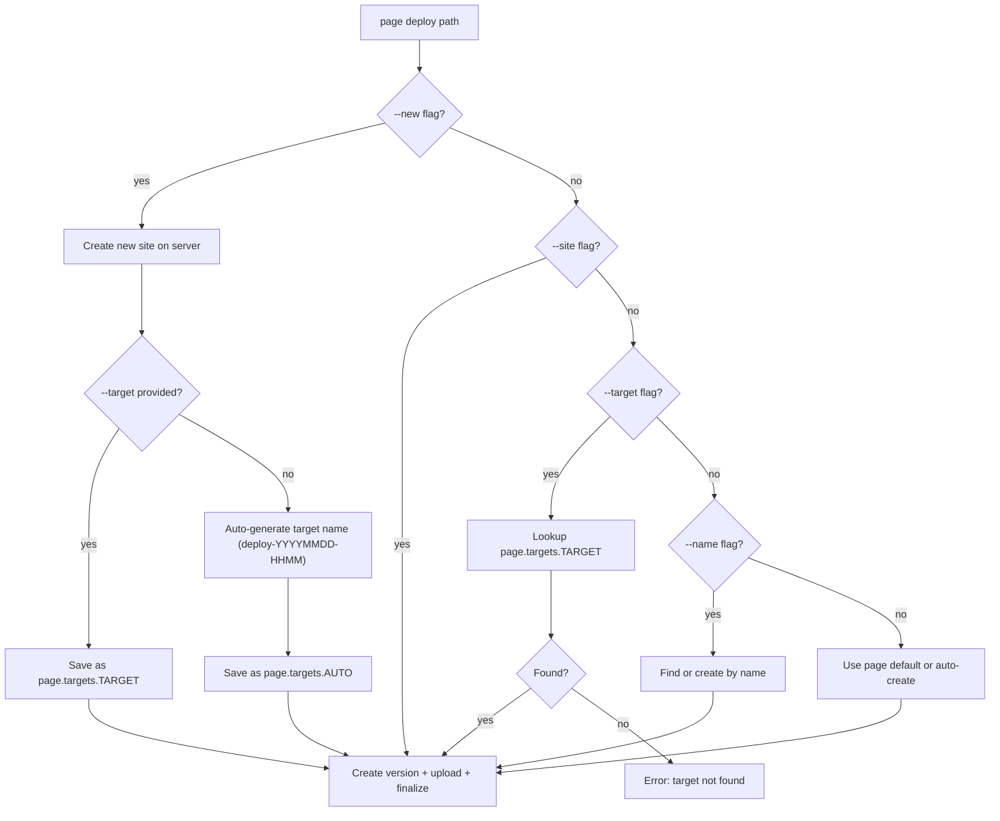

# Page/Drive Multi-Target and One-Click Creation

Date: 2026-03-31

## Problem

The current `anycap.toml` supports only a single page site and a single drive folder binding. Agents and users who need multiple sites (e.g., preview + release) have no way to manage them through config. Additionally, there is no way to create a new site without simultaneously deploying local files -- creation is a hidden side effect of `page deploy`.

## Design Decisions

### D1: Named targets in anycap.toml

Extend the config with a `targets` map. The flat `[page]` section remains as the default target for backwards compatibility.

```toml
# Default target (backwards compatible)
[page]
site_id = "pg_xyz"
name = "My App"

# Named targets
[page.targets.preview]
site_id = "pg_abc"
name = "My App Preview"

[page.targets.staging]
site_id = "pg_def"
name = "Staging"

# Drive follows the same pattern
[drive]
folder_id = "dn_xxx"
path = "/project-files"

[drive.targets.archive]
folder_id = "dn_yyy"
path = "/archive"
```

### D2: `--target` flag selects a named target

All page management commands (`deploy`, `info`, `versions`, `publish`, `unpublish`, `rollback`, `delete`) accept `--target <name>` to operate on a named target instead of the default.

Resolution priority (unchanged for existing flags, extended with target):
1. `--site pg_xxx` -- explicit ID, highest priority
2. `--target preview` -- lookup `[page.targets.preview]`
3. `--name "xxx"` -- find-or-create by display name
4. `[page]` section -- default target from config
5. Auto-create -- random name (existing behavior)

### D3: `--new` flag forces fresh creation

`--new` on `page deploy` always creates a brand new site, never reuses an existing one. The new site is saved back to `anycap.toml`.

| Flags | Behavior |
|-------|----------|
| `--new` | Create new site, auto-generate target name (`deploy-YYYYMMDD-HHMM`), save to `[page.targets.<auto>]` |
| `--new --target preview` | Create new site, save to `[page.targets.preview]` (overwrites if exists) |
| `--new --name "My Preview"` | Create new site with that display name, auto-generate target name |
| `--new --target preview --name "Preview"` | Create new site named "Preview", save as target `preview` |

Without `--new`, existing behavior is preserved: `--target` looks up config, `--name` does find-or-create, bare deploy uses `[page]` default.

### D4: `page create` as standalone command

Explicit site creation without deploying content:

```bash
anycap page create --name "My Report"                      # save as default [page]
anycap page create --name "Preview" --target preview       # save as [page.targets.preview]
```

This is useful when an agent wants to reserve a URL before content is ready.

### D5: Auto-generated target names use timestamp

Format: `deploy-YYYYMMDD-HHMM` (local time). Examples: `deploy-20260331-1405`, `deploy-20260401-0930`. Short, readable, sortable, unlikely to collide.

### D6: Drive targets follow the same pattern

```bash
anycap drive mkdir --name "campaign-assets" --target campaign
# Creates folder, saves as [drive.targets.campaign]

anycap drive upload ./files --parent-path /campaign --target campaign
# Uses [drive.targets.campaign] to resolve parent
```

## Config Structure (Go)

```go
type Config struct {
    Page  *PageConfig  `toml:"page,omitempty"`
    Drive *DriveConfig `toml:"drive,omitempty"`
}

type PageConfig struct {
    SiteID  string                `toml:"site_id,omitempty"`
    Name    string                `toml:"name,omitempty"`
    Targets map[string]PageTarget `toml:"targets,omitempty"`
}

type PageTarget struct {
    SiteID string `toml:"site_id,omitempty"`
    Name   string `toml:"name,omitempty"`
}

type DriveConfig struct {
    FolderID string                 `toml:"folder_id,omitempty"`
    Path     string                 `toml:"path,omitempty"`
    Targets  map[string]DriveTarget `toml:"targets,omitempty"`
}

type DriveTarget struct {
    FolderID string `toml:"folder_id,omitempty"`
    Path     string `toml:"path,omitempty"`
}
```

## Command Changes

### `page deploy`

New flags:
- `--target <name>` -- select or save-to a named target
- `--new` -- force create a new site (never reuse)



### `page create` (new command)

```bash
anycap page create --name <display-name> [--target <name>]
```

- Creates an empty site on the server
- Saves binding to `anycap.toml`
- Returns `page_id`, `page_url`, `target` in JSON output

### `page list --local` (new flag)

Shows targets from `anycap.toml` alongside their site IDs and URLs:

```json
{
  "targets": {
    "default": {"site_id": "pg_xyz", "name": "My App", "page_url": "..."},
    "preview": {"site_id": "pg_abc", "name": "Preview", "page_url": "..."}
  }
}
```

## Example Workflows

### Agent: one-shot deploy, get a URL

```bash
anycap page deploy ./report.html --new --publish
# -> Creates new site "deploy-20260331-1405"
# -> Deploys, publishes
# -> Returns page_url
# -> Writes [page.targets.deploy-20260331-1405] to anycap.toml
```

### Agent: preview/release workflow

```bash
# First time: create both targets
anycap page create --name "App Preview" --target preview
anycap page create --name "App Release" --target release

# Deploy to preview (iterative)
anycap page deploy ./dist --target preview --publish

# Happy with preview? Deploy to release
anycap page deploy ./dist --target release --publish
```

### Agent: multiple one-shots (reports, dashboards)

```bash
anycap page deploy ./report-q1.html --new --name "Q1 Report" --publish
anycap page deploy ./report-q2.html --new --name "Q2 Report" --publish
# Each gets its own auto-target in anycap.toml
# Agent can reference them later by target name
```

## Implementation Phases

### Phase 1: Config + Target Resolution

1. Extend `PageConfig` and `DriveConfig` with `Targets` map.
2. Add `SavePageTarget(targetName, PageTarget)` to projectconfig.
3. Add `ResolvePageTarget(targetName) (siteID, name, error)` helper.
4. Update `page_deploy.go` site resolution to check targets.
5. Add `--target` flag to `page deploy`.

### Phase 2: `--new` Flag

6. Add `--new` flag to `page deploy`.
7. Implement auto-target-name generation (`deploy-YYYYMMDD-HHMM`).
8. When `--new`, always create site, save target, then deploy.
9. Mutual exclusion: `--new` + `--site` is an error. `--new` + `--target` is fine.

### Phase 3: `page create` Command

10. New `page_create.go` command.
11. Creates site on server, saves to config, returns JSON.
12. Register in `page.go` command tree.

### Phase 4: Target Support in Other Commands

13. Add `--target` to `page info`, `page versions`, `page publish`, `page unpublish`, `page rollback`, `page delete`.
14. Add `--local` flag to `page list`.

### Phase 5: Drive Targets (optional, lower priority)

15. Same pattern for `drive mkdir`, `drive upload`, etc.

### Phase 6: Skills Update

16. Update `references/page.md` with target workflows.
17. Add best-practice patterns for preview/release and one-shot deploys.
