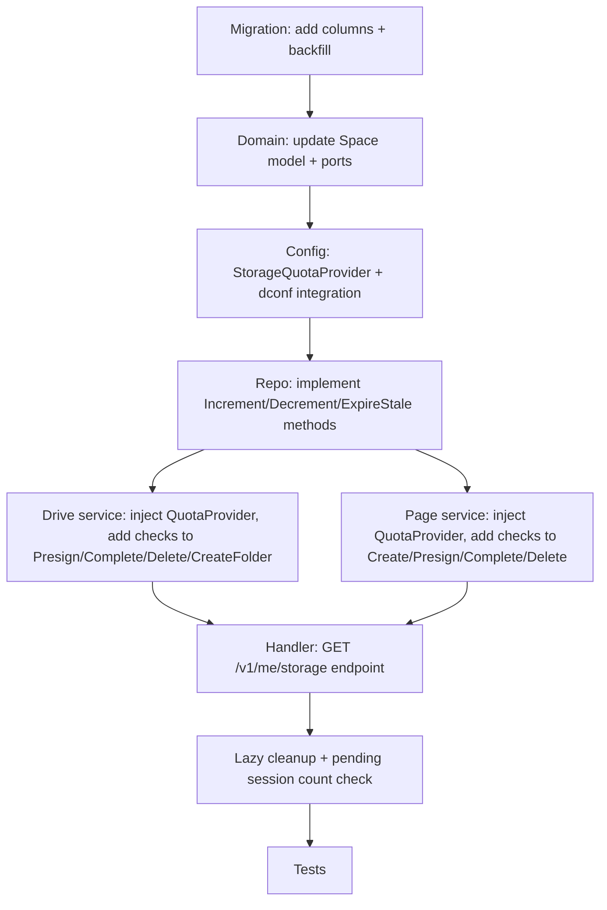

# Storage Quota and Limits Design

Date: 2026-04-02

## Background

Drive and Page currently have no storage limits. A single authenticated user can:

- Upload unlimited files to Drive (each up to 1GB)
- Create unlimited Page sites with unlimited versions (each asset up to 1GB)
- Generate unlimited presigned URLs, creating orphan DB records even without completing uploads

Caps Upload already has content type and per-file size limits. Drive and Page objects have **no lifecycle rules** and persist indefinitely.

**Note:** The R2 lifecycle rule in `deploy/r2-lifecycle.json` targets the legacy `user_upload/` prefix. Current caps uploads use `caps/inputs/` prefix, which is **not covered** by the lifecycle rule. Caps upload R2 objects also persist indefinitely. DB records are lightweight and low-risk for the preview period, but a `caps/inputs/` lifecycle rule should be added separately.

### R2 Cost Model

| Item | Price | Free Tier |
|------|-------|-----------|
| Storage | $0.015 / GB-month | 10 GB |
| Class A ops (write) | $4.50 / million | 1 million |
| Class B ops (read) | $0.36 / million | 10 million |
| Egress | Free | Free |

Worst-case without limits: 1 user uploads 10,000 x 1GB files = 10 TB = **$150/month** in storage alone.

### Current Object Key Layout

| Feature | Prefix | Lifecycle |
|---------|--------|-----------|
| Caps Upload | `caps/inputs/spaces/{spaceID}/{date}/{uuid}/{filename}` | **None** -- legacy `user_upload/` lifecycle rule does not cover this prefix |
| Drive | `drive/spaces/{spaceID}/nodes/{nodeID}/{uuid}` | **None** -- persists forever |
| Page | `page/spaces/{spaceID}/sites/{siteID}/versions/{no}/{path}` | **None** -- persists forever |

## Design

### 1. Quota Model

Add storage tracking fields to the `spaces` table. Quotas are enforced per-space (each user has one personal space). Quota **limits** are resolved dynamically via dconf (section 2), not stored in the DB.

```sql
ALTER TABLE spaces
  ADD COLUMN IF NOT EXISTS storage_used_bytes  BIGINT NOT NULL DEFAULT 0,
  ADD COLUMN IF NOT EXISTS drive_node_count    INT    NOT NULL DEFAULT 0,
  ADD COLUMN IF NOT EXISTS page_site_count     INT    NOT NULL DEFAULT 0;
```

| Field | Purpose | Default |
|-------|---------|---------|
| `storage_used_bytes` | Sum of all completed Drive files + Page assets (bytes) | 0 |
| `drive_node_count` | Current count of "real" Drive nodes (completed files + folders). Does NOT include orphan file nodes from incomplete uploads. | 0 |
| `page_site_count` | Current count of non-deleted Page sites | 0 |

Counters are updated atomically at Complete time (not at Presign time), so failed/expired uploads do not consume quota.

**CHECK constraint** to prevent negative counters:

```sql
ALTER TABLE spaces ADD CONSTRAINT spaces_storage_used_bytes_non_negative CHECK (storage_used_bytes >= 0);
ALTER TABLE spaces ADD CONSTRAINT spaces_drive_node_count_non_negative CHECK (drive_node_count >= 0);
ALTER TABLE spaces ADD CONSTRAINT spaces_page_site_count_non_negative CHECK (page_site_count >= 0);
```

Note: no `storage_quota_bytes` column in DB. All quota limits are resolved at runtime from dconf / env defaults (section 2). This keeps the DB clean and avoids stale per-user overrides out of sync with tier changes. A future per-user override column can be added when the billing tier system ships.

### 2. Quota Configuration via DConf

All limits are resolved at runtime via a `StorageQuotaProvider`, following the same pattern as `RateLimitProvider` and `DConfFeatureProvider`.

#### Resolution Order

For a given limit field:

1. If dconf is enabled and `storage_quota` payload has a value for the user's tier, use it
2. If dconf is enabled and `storage_quota.default` has a value, use it
3. Otherwise fall back to env variable (e.g. `ANYCAP_STORAGE_QUOTA_BYTES`)
4. Otherwise use code constant (hardcoded safe default)

#### Env Controls

```env
ANYCAP_STORAGE_QUOTA_DCONF_ENABLED=false
ANYCAP_STORAGE_QUOTA_DCONF_GROUP=anycap
ANYCAP_STORAGE_QUOTA_DCONF_DATA_ID=storage_quota
```

#### DConf JSON Shape

```json
{
  "storage_quota_bytes": 10737418240,
  "max_drive_file_size_bytes": 1073741824,
  "max_drive_nodes": 10000,
  "max_page_asset_size_bytes": 1073741824,
  "max_page_sites": 100,
  "max_page_versions_per_site": 500,
  "max_files_per_page_version": 5000,
  "max_pending_drive_sessions": 50,
  "max_pending_page_sessions": 200
}
```

Flat key-value structure. All fields must be present. Values apply to all users uniformly.

**Future tier support:** when a billing system ships, extend the JSON shape to support per-tier overrides (e.g. add a `tiers` map). The `ResolveQuota` method already takes `*model.Principal`, so adding tier-based lookup is a backward-compatible change to the provider implementation. No interface change needed.

#### Env Fallback Defaults

When dconf is disabled, these env vars provide the limits (with code-level safe defaults):

| Env var | Code default | Description |
|---------|--------------|-------------|
| `ANYCAP_STORAGE_QUOTA_BYTES` | 10737418240 (10 GB) | Total storage per user |
| `ANYCAP_MAX_DRIVE_FILE_SIZE_BYTES` | 1073741824 (1 GB) | Max single Drive file |
| `ANYCAP_MAX_DRIVE_NODES` | 10000 | Max Drive nodes (files + folders) |
| `ANYCAP_MAX_PAGE_ASSET_SIZE_BYTES` | 1073741824 (1 GB) | Max single Page asset |
| `ANYCAP_MAX_PAGE_SITES` | 100 | Max Page sites per user |
| `ANYCAP_MAX_PAGE_VERSIONS_PER_SITE` | 500 | Max versions per site |
| `ANYCAP_MAX_FILES_PER_PAGE_VERSION` | 5000 | Max files per version |
| `ANYCAP_MAX_PENDING_DRIVE_SESSIONS` | 50 | Max pending Drive uploads |
| `ANYCAP_MAX_PENDING_PAGE_SESSIONS` | 200 | Max pending Page uploads |

#### Preview Period Defaults

All code defaults are set generously for the preview period. The goal is to observe real usage patterns before tightening. With dconf, any value can be tuned at runtime without a deploy.

| Limit | Preview default | Rationale |
|-------|-----------------|-----------|
| Total storage quota | 10 GB | Preview users are few; cost is bounded. Gives agents room for video/audio workflows. |
| Max Drive file size | 1 GB | Keep current value. Video/audio files can hit this range. |
| Max Drive nodes | 10,000 | Generous to observe patterns. |
| Max Page asset size | 1 GB | Parity with Drive file size limit. Media-heavy sites. |
| Max Page sites | 100 | Agents may create many test sites. |
| Max Page versions per site | 500 | CI/CD deploys can consume quickly. |
| Max files per Page version | 5,000 | Monorepo build outputs. |
| Max pending Drive sessions | 50 | Concurrent upload headroom. |
| Max pending Page sessions | 200 | Multi-file deploy headroom. |

#### Cost Projection (10 GB/user)

| Scenario | Users | Max Storage | Monthly R2 Cost |
|----------|-------|-------------|-----------------|
| Early access | 50 | 500 GB | $7.35 |
| Growth | 500 | 5 TB | $75 |
| Scale | 5,000 | 50 TB | $750 |

Note: worst-case (every user fills quota). Real usage will be a fraction.

#### Application Layer Interface

```go
// StorageQuota holds resolved limits for a specific user/space.
type StorageQuota struct {
    StorageQuotaBytes       int64
    MaxDriveFileSizeBytes   int64
    MaxDriveNodes           int
    MaxPageAssetSizeBytes   int64
    MaxPageSites            int
    MaxPageVersionsPerSite  int
    MaxFilesPerPageVersion  int
    MaxPendingDriveSessions int
    MaxPendingPageSessions  int
}

// StorageQuotaProvider resolves quota limits for a user.
// Implementations: DConfStorageQuotaProvider (prod), StaticStorageQuotaProvider (stub/test).
type StorageQuotaProvider interface {
    ResolveQuota(principal *model.Principal) StorageQuota
}
```

`ResolveQuota` takes a `*model.Principal` (which carries user identity for future tier-based lookup). For the preview period, the implementation ignores the principal and returns the same quota for all users. Services call this at enforcement time, not at startup, so dconf changes take effect immediately.

The Drive and Page services receive `StorageQuotaProvider` via constructor injection (same as how rate limit provider is wired through bootstrap).

### 3. Enforcement Points

#### 3a. Presign-time Checks (lazy cleanup + fast-fail)

Pending session enforcement uses an **expire-then-count** lazy cleanup pattern. No cron job needed -- stale sessions are cleaned up inline on each presign call.

```
PresignFileUpload(ctx, principal, ...):
  quota := s.quotaProvider.ResolveQuota(principal)
  1. Check contentLength <= quota.MaxDriveFileSizeBytes
  2. Check storage_used_bytes + contentLength <= quota.StorageQuotaBytes
  3. Check drive_node_count < quota.MaxDriveNodes
  4. Lazy cleanup: ExpireStaleUploadSessions(spaceID, "drive", now)
     - UPDATE upload_sessions SET status='expired' WHERE space_id=? AND target_type='drive' AND status='pending' AND expires_at < now
     - Also soft-delete orphan Drive file nodes for those expired sessions (storage_object_id IS NULL)
  5. Count remaining pending Drive sessions; reject if >= quota.MaxPendingDriveSessions
  (then proceed with existing logic)

PresignVersionAsset(ctx, principal, ...):
  quota := s.quotaProvider.ResolveQuota(principal)
  1. Check contentLength <= quota.MaxPageAssetSizeBytes
  2. Check storage_used_bytes + contentLength <= quota.StorageQuotaBytes
  3. Lazy cleanup: ExpireStaleUploadSessions(spaceID, "page", now)
     - UPDATE upload_sessions SET status='expired' WHERE space_id=? AND target_type='page' AND status='pending' AND expires_at < now
  4. Count total files for this version (completed + pending); reject if >= quota.MaxFilesPerPageVersion
  5. Count remaining pending Page sessions per space; reject if >= quota.MaxPendingPageSessions
  (then proceed with existing logic)

CreateSite(ctx, principal, ...):
  quota := s.quotaProvider.ResolveQuota(principal)
  1. Check page_site_count < quota.MaxPageSites (enforced atomically in IncrementPageSiteCount)

CreateVersion(ctx, principal, ...):
  quota := s.quotaProvider.ResolveQuota(principal)
  1. COUNT(*) query on page_versions for this site; reject if >= quota.MaxPageVersionsPerSite
     (intentionally uses a COUNT query instead of a counter column -- version count per site
     is small and bounded, and a counter would add complexity to the version lifecycle
     without meaningful benefit)
```

The lazy cleanup is cheap (one UPDATE + one DELETE per presign call, scoped to the user's space). For normal users with 0-2 expired sessions, this touches very few rows. For abusers who spammed presigns, it cleans up their mess before rejecting further requests.

**Note on concurrent presign quota accuracy:**

Presign-time quota check uses a simple read of `storage_used_bytes`. Multiple concurrent presigns may all pass the check before any complete. This is by design for the preview period:

- The atomic `WHERE` clause at complete time is the true enforcement. Postgres row-level locking serializes concurrent completes, so `storage_used_bytes` never exceeds `storage_quota_bytes`.
- The presign check is an **optimistic fast-fail**, not the source of truth. A user with 10 concurrent presigns at 1GB each will see some completes succeed and others fail with `storage_quota_exceeded`.
- The tradeoff: users may waste upload bandwidth for files that later fail at complete time. This is acceptable for preview.
- Future improvement: add a `pending_reserved_bytes` field for presign-time reservation with automatic release on expiry. Tracked as future work.

#### 3b. Complete-time Updates (atomic counter increments)

The quota increment and session status update happen together to prevent double-counting on retry. If `IncrementStorageUsage` succeeds but `MarkCompleted` fails, a retry would increment again.

```
CompleteFileUpload:
  (after HeadObject confirms size)
  1. Create StorageObject record
  2. AttachStorageObject to DriveNode
  3. Atomically: IncrementStorageAndMarkSessionCompleted(spaceID, sessionID, head.Size, 1, quota.StorageQuotaBytes)
     UPDATE spaces SET storage_used_bytes = storage_used_bytes + head.Size,
                       drive_node_count = drive_node_count + 1
     WHERE id = spaceID
       AND storage_used_bytes + head.Size <= quota.StorageQuotaBytes
     + UPDATE upload_sessions SET status='completed' WHERE id = sessionID
     (if affected rows = 0 on spaces update, reject -- quota exceeded under concurrency)
     Both within the same DB transaction.
  4. If transaction fails (quota exceeded), caller should clean up the StorageObject.

CompleteVersionAsset:
  (after HeadObject confirms size)
  1. Create StorageObject record
  2. Atomically: IncrementStorageAndMarkSessionCompleted(spaceID, sessionID, head.Size, 0, quota.StorageQuotaBytes)
     UPDATE spaces SET storage_used_bytes = storage_used_bytes + head.Size
     WHERE id = spaceID
       AND storage_used_bytes + head.Size <= quota.StorageQuotaBytes
     + UPDATE upload_sessions SET status='completed' WHERE id = sessionID
     (if affected rows = 0 on spaces update, reject)
     Both within the same DB transaction.
```

The atomic `WHERE` clause provides race-condition-safe enforcement even under concurrent uploads. Postgres row-level lock ensures serial execution -- no two concurrent completes can both succeed if it would exceed quota.

**Quota limit at complete time:** the `StorageQuotaBytes` value used in the `WHERE` clause is resolved from dconf at request time and passed as a parameter. This means if the quota is raised via dconf between presign and complete, the new higher limit applies. This is the desired behavior -- quota changes are immediately effective.

**Idempotency:** the existing check `if session.Status == completed { return existing }` runs before the increment path, so a retry of an already-completed session is safe.

#### 3c. Delete-time Decrements (atomic CTE)

Delete operations use writable CTEs to atomically soft-delete and decrement counters in a single SQL statement. This prevents counter drift if a failure occurs between operations. R2 objects are cleaned up best-effort after the atomic DB operation.

#### Drive: SoftDeleteSubtreeWithStorageDecrement

A single CTE atomically: (1) recursively soft-deletes drive nodes, (2) joins with `storage_objects` to collect R2 object keys, (3) aggregates bytes/node counts, (4) decrements space counters.

```go
// SoftDeleteResult contains aggregated data from a subtree soft-delete.
type SoftDeleteResult struct {
    DeletedCount  int64    // total nodes soft-deleted
    TotalBytes    int64    // sum of size for nodes with storage_object_id IS NOT NULL
    RealNodeCount int      // folders + files with storage_object_id IS NOT NULL
    DirIDs        []int64  // for KV sync
    FileIDs       []int64  // for KV sync
    ObjectKeys    []string // R2 object keys for cleanup after delete
}
```

The SQL:

```sql
WITH RECURSIVE subtree AS (...),
deleted AS (
  UPDATE drive_nodes SET deleted_at = NOW(), ...
  WHERE id IN (SELECT id FROM subtree) AND deleted_at IS NULL
  RETURNING id, kind, storage_object_id, COALESCE(size, 0) AS size
),
deleted_with_keys AS (
  SELECT d.*, d.storage_object_id IS NOT NULL AS has_storage, so.object_key
  FROM deleted d LEFT JOIN storage_objects so ON d.storage_object_id = so.id
),
aggregated AS (
  SELECT COALESCE(SUM(CASE WHEN has_storage THEN size ELSE 0 END), 0) AS total_bytes,
         COALESCE(COUNT(*) FILTER (WHERE kind = 'folder' OR has_storage), 0) AS real_node_count
  FROM deleted_with_keys
),
space_decrement AS (
  UPDATE spaces
  SET storage_used_bytes = GREATEST(0, storage_used_bytes - (SELECT total_bytes FROM aggregated)),
      drive_node_count = GREATEST(0, drive_node_count - (SELECT real_node_count FROM aggregated))
  WHERE id = $1
)
SELECT id, kind, has_storage, size, object_key FROM deleted_with_keys
```

`drive_node_count` only decrements for "real" nodes -- folders (always counted at creation) and files with `storage_object_id IS NOT NULL` (counted at complete time). Orphan file nodes (presigned but never completed, `storage_object_id IS NULL`, `kind = 'file'`) were never counted, so they must not be decremented.

After the atomic DB operation, the service loops through `ObjectKeys` and calls `objectStore.DeleteObject` best-effort. If R2 delete fails, the DB state is already correct; R2 orphans can be cleaned up later.

#### Page: SoftDeleteWithStorageDecrement

A single CTE atomically: (1) soft-deletes the page site, (2) sums completed storage bytes, (3) decrements space counters.

```sql
WITH site_delete AS (
  UPDATE page_sites SET deleted_at = NOW(), ...
  WHERE id = $2 AND space_id = $1 AND deleted_at IS NULL
  RETURNING id
),
completed_storage AS (
  SELECT COALESCE(SUM(so.size), 0) AS total_bytes
  FROM storage_objects so
  JOIN upload_sessions us ON us.object_key = so.object_key AND us.space_id = so.space_id
  WHERE us.target_type = 'page'
    AND us.target_id IN (SELECT id FROM page_versions WHERE page_id = $2)
    AND us.status = 'completed' AND us.space_id = $1
    AND EXISTS (SELECT 1 FROM site_delete)
),
space_decrement AS (
  UPDATE spaces
  SET storage_used_bytes = GREATEST(0, storage_used_bytes - (SELECT total_bytes FROM completed_storage)),
      page_site_count = GREATEST(0, page_site_count - 1)
  WHERE id = $1 AND EXISTS (SELECT 1 FROM site_delete)
)
SELECT (SELECT COUNT(*) FROM site_delete), (SELECT total_bytes FROM completed_storage)
```

R2 object keys for Page are collected before the atomic delete via `StorageObjectRepository.ListByPrefix` (prefix: `page/spaces/{spaceID}/sites/{siteID}/`), then cleaned up best-effort after the DB operation.

The `GREATEST(0, ...)` guard prevents counters from going negative. The DB-level CHECK constraint provides a safety net.

### 4. Drive node_count Tracking

Drive `node_count` requires tracking both creates and deletes:

- **CreateFolder**: increment `drive_node_count` immediately (no presign flow). Atomically: `UPDATE spaces SET drive_node_count = drive_node_count + 1 WHERE id = spaceID AND drive_node_count < quota.MaxDriveNodes`. Returns false if limit reached.
- **CompleteFileUpload**: increment `drive_node_count` (as shown in 3b, same transaction as storage increment + mark completed)
- **DeleteNode/SoftDeleteSubtreeWithStorageDecrement**: atomically soft-deletes subtree and decrements counters in a single CTE (section 3c). Also collects R2 object keys for best-effort cleanup.

At Presign time we check `drive_node_count` for the fast-fail, but don't increment it yet. The file node is created in DB at presign time (current behavior), but it has no storage object. The `drive_node_count` only tracks "real" nodes -- increment happens at complete time for files, and at create time for folders (since folders are immediately real).

If a presigned upload expires without completing, the orphan file node exists in DB but doesn't count toward the limit. The lazy cleanup (section 6) handles these.

**Error messages should distinguish:**

- `drive_node_limit_reached`: "drive node limit reached (10000/10000 files and folders). Delete unused files or folders to free up space."
- `storage_quota_exceeded`: "storage quota exceeded (10.0/10.0 GB). Delete files to free up storage."

### 5. Port and Domain Changes

```go
// model/space.go -- add fields
type Space struct {
    ID               int64
    OwnerUserID      int64
    Name             string
    StorageUsedBytes int64
    DriveNodeCount   int
    PageSiteCount    int
    CreatedAt        time.Time
}

// model/drive.go -- add SoftDeleteResult
// SoftDeleteResult contains aggregated data from a subtree soft-delete.
type SoftDeleteResult struct {
    DeletedCount  int64   // total nodes soft-deleted
    TotalBytes    int64   // sum of size for nodes with storage_object_id IS NOT NULL
    RealNodeCount int     // folders + files with storage_object_id IS NOT NULL
    DirIDs        []int64 // for KV sync
    FileIDs       []int64 // for KV sync
}

// port/drive.go -- update SoftDeleteSubtree return type
type DriveNodeRepository interface {
    // ... existing methods ...
    // Changed: returns SoftDeleteResult instead of (int64, error)
    SoftDeleteSubtree(ctx context.Context, spaceID, rootID int64) (*model.SoftDeleteResult, error)
}

// port/page.go -- add storage query
type PageSiteRepository interface {
    // ... existing methods ...
    // SumCompletedStorageByPageID returns total bytes of completed uploads for a page site.
    SumCompletedStorageByPageID(ctx context.Context, spaceID, pageID int64) (int64, error)
}

// port/space.go -- add methods
type SpaceRepository interface {
    GetByOwnerUserID(ctx context.Context, ownerUserID int64) (*model.Space, error)
    CreatePersonalSpace(ctx context.Context, ownerUserID int64, name string) (*model.Space, error)

    // IncrementStorageAndMarkSessionCompleted atomically increments storage counters
    // and marks the upload session as completed within the same transaction.
    // Returns false if the increment would exceed quotaBytes.
    // This bundles two aggregates (Space + UploadSession) in one transaction for
    // correctness: prevents double-counting on retry if increment succeeds but
    // session mark fails. The cross-aggregate coupling is a pragmatic tradeoff.
    IncrementStorageAndMarkSessionCompleted(ctx context.Context, spaceID int64, sessionID int64, deltaBytes int64, deltaDriveNodes int, quotaBytes int64) (bool, error)

    // IncrementDriveNodeCount atomically increments drive_node_count if below maxNodes.
    // Used by CreateFolder (no upload session involved). Returns false if limit reached.
    IncrementDriveNodeCount(ctx context.Context, spaceID int64, maxNodes int) (bool, error)

    // DecrementDriveStorage atomically decrements storage_used_bytes and drive_node_count.
    // Used by DeleteNode. Values are clamped to 0 via GREATEST.
    DecrementDriveStorage(ctx context.Context, spaceID int64, deltaBytes int64, deltaRealNodes int) error

    // IncrementPageSiteCount atomically increments page_site_count if below maxSites.
    // Returns false if limit reached.
    IncrementPageSiteCount(ctx context.Context, spaceID int64, maxSites int) (bool, error)

    // DecrementPageSiteStorage atomically decrements storage_used_bytes and page_site_count by 1.
    // Used specifically by DeleteSite. Values are clamped to 0 via GREATEST.
    // If a future DeleteVersion (without deleting the site) is needed, add a separate
    // DecrementPageVersionStorage(ctx, spaceID, deltaBytes) method that only touches storage_used_bytes.
    DecrementPageSiteStorage(ctx context.Context, spaceID int64, deltaBytes int64) error
}

// port/storage.go -- add to UploadSessionRepository
type UploadSessionRepository interface {
    // ... existing methods ...
    ExpireStaleBySpace(ctx context.Context, spaceID int64, targetType model.UploadTargetType, now time.Time) ([]ExpiredSessionInfo, error)
    CountPendingBySpaceAndType(ctx context.Context, spaceID int64, targetType model.UploadTargetType) (int64, error)
    CountByTargetAndStatuses(ctx context.Context, targetType model.UploadTargetType, targetID int64, statuses []model.UploadSessionStatus) (int64, error)
}

// ExpiredSessionInfo carries target_id for orphan cleanup
type ExpiredSessionInfo struct {
    SessionID int64
    TargetID  int64
}
```

Key design decision: `IncrementStorageAndMarkSessionCompleted` bundles the quota increment with session completion in one transaction. This eliminates the double-count risk on retry. The method takes `quotaBytes` as a parameter (resolved from dconf at request time), not read from DB. The cross-aggregate coupling (Space + UploadSession in one repo method) is a pragmatic choice -- the alternative (application-layer transaction manager) adds complexity without benefit for the preview period.

`IncrementPageSiteCount` takes `maxSites` and uses atomic `WHERE page_site_count < maxSites` to prevent race conditions.

`CountByTargetAndStatuses` is used by PresignVersionAsset to count **completed + pending** sessions for a version, giving accurate file-count enforcement.

### 6. Lazy Cleanup (No Cron)

Orphan cleanup is handled inline via the **expire-then-count** pattern in section 3a. No cron job or background goroutine needed.

#### What gets cleaned up and when

| Target | Trigger | Condition | Action |
|--------|---------|-----------|--------|
| Expired pending upload sessions | Every presign call | `status='pending' AND expires_at < now()` | Mark as `expired` |
| Orphan Drive file nodes | Drive presign call | Session expired + `storage_object_id IS NULL` | Soft delete (do NOT decrement `drive_node_count` since they were never counted) |

#### What is NOT cleaned up (future work)

| Target | Notes |
|--------|-------|
| Stale draft Page versions | Versions with status `draft` and no completed uploads. Low urgency -- they don't consume storage quota. |
| R2 orphan objects | S3 objects whose DB records were soft-deleted. Requires a separate GC design. |

#### Caps Upload records

Caps uploads use a **separate table** (`caps_uploads`) and repository (`CapsUploadRepository`), not the `upload_sessions` table. They are not affected by this design. Caps upload records are lightweight (no storage quota tracking). Note: caps upload R2 objects use `caps/inputs/` prefix which is **not** covered by the legacy `user_upload/` lifecycle rule (see Background section). DB record and object accumulation is low-risk for the preview period. Adding a `caps/inputs/` lifecycle rule is tracked as a separate follow-up.

#### Implementation

```go
// port/storage.go -- add to UploadSessionRepository
ExpireStaleBySpace(ctx context.Context, spaceID int64, targetType model.UploadTargetType, now time.Time) ([]ExpiredSessionInfo, error)

// The repo method runs:
//   UPDATE upload_sessions SET status='expired'
//   WHERE space_id=$1 AND target_type=$2 AND status='pending' AND expires_at < $3
//   RETURNING id, target_id

// For Drive, the caller then soft-deletes orphan file nodes:
//   UPDATE drive_nodes SET deleted_at=now()
//   WHERE id IN (target_ids) AND storage_object_id IS NULL AND deleted_at IS NULL
//   (no drive_node_count decrement -- orphans were never counted)
```

This approach is simple, correct, and self-healing: even if a user abandons uploads, the next presign call cleans up the mess.

### 7. Page Site Soft Delete Alignment

Page sites use soft delete (`deleted_at IS NOT NULL`). The interaction with `page_site_count`:

- **CreateSite**: `IncrementPageSiteCount` atomically checks `page_site_count < maxSites` and increments. A soft-deleted site does not block creation because:
  - Its slug is tombstoned (`page_slug_registry.status = 'tombstone'`), so a new slug is generated.
  - Its `page_name` uniqueness is enforced only among `deleted_at IS NULL` rows.
- **DeleteSite**: atomically soft-deletes the site, sums storage, and decrements both `page_site_count` and `storage_used_bytes` in a single CTE. R2 objects cleaned up best-effort.
- **ListSites**: filters by `deleted_at IS NULL`, consistent with the count.

No conflict: after soft-deleting a site, `page_site_count` decreases, allowing new sites. The deleted site's slug is tombstoned, preventing reuse but not blocking new site creation.

### 8. R2 Lifecycle Gap

Current R2 lifecycle rules only cover the legacy `user_upload/` prefix. Need to add rules for `drive/` and `page/` prefixes -- but these are persistent storage, not temporary.

For Drive and Page, R2 lifecycle is NOT the right approach (users expect their files to persist). Instead, storage quota (this design) prevents unbounded growth. R2 lifecycle should be added only for objects whose DB records have been deleted (i.e., the object is orphaned in R2 after a soft-delete), but that requires a separate garbage collector design.

For now: no new R2 lifecycle rules. Quota enforcement prevents cost runaway. S3 object cleanup after Drive/Page deletes is tracked as future work.

### 9. Error Responses

Error codes use semantically appropriate HTTP status codes:

| Error Code | HTTP Status | Message |
|------------|-------------|---------|
| `drive_file_too_large` | 413 | `file size exceeds {limit} limit` |
| `page_asset_too_large` | 413 | `asset size exceeds {limit} limit` |
| `storage_quota_exceeded` | 403 | `storage quota exceeded ({used}/{quota}). Delete files to free up storage.` |
| `drive_node_limit_reached` | 403 | `drive node limit reached ({count}/{limit} files and folders). Delete unused items to free up space.` |
| `page_site_limit_reached` | 403 | `page site limit reached ({count}/{limit}). Delete unused sites to free up space.` |
| `page_version_limit_reached` | 403 | `page version limit reached ({count}/{limit}).` |
| `page_version_file_limit_reached` | 403 | `page version file limit reached ({count}/{limit}).` |
| `too_many_pending_uploads` | 429 | `too many pending uploads, complete existing uploads or wait for expiry` |

Rationale for status codes:
- **413** for single file exceeding max size (semantically "Request Entity Too Large")
- **403** for quota/count limits (request is valid but forbidden due to account state -- not a rate limit issue)
- **429** for pending session limit only (genuinely "too many requests" in-flight)

All responses include a `hint` field: `"Upgrade your plan for higher limits or contact support."` (placeholder for future billing integration).

### 10. Quota Query API

Users need to check their current usage and limits. Without this, they only learn about quota limits when blocked.

#### Endpoint

```
GET /v1/me/storage
```

Requires authentication. Returns the current user's storage usage and resolved limits.

#### Response

```json
{
  "storage_used_bytes": 1073741824,
  "storage_quota_bytes": 10737418240,
  "drive_node_count": 42,
  "drive_node_limit": 10000,
  "page_site_count": 3,
  "page_site_limit": 50
}
```

Implementation: handler reads `Space` counters from DB and `StorageQuota` limits from provider, combines into response DTO.

CLI: `anycap status` already exists and shows account info. Extend it to include storage usage when the user is authenticated.

### 11. Migration File

New migration: `internal/infrastructure/migration/migrations/0024_space_storage_quota.sql`

```sql
-- Add storage tracking columns to spaces table
ALTER TABLE spaces
  ADD COLUMN IF NOT EXISTS storage_used_bytes  BIGINT NOT NULL DEFAULT 0;
ALTER TABLE spaces
  ADD COLUMN IF NOT EXISTS drive_node_count    INT    NOT NULL DEFAULT 0;
ALTER TABLE spaces
  ADD COLUMN IF NOT EXISTS page_site_count     INT    NOT NULL DEFAULT 0;

-- CHECK constraints to prevent negative counters
DO $$ BEGIN
  IF NOT EXISTS (SELECT 1 FROM pg_constraint WHERE conname = 'spaces_storage_used_bytes_non_negative') THEN
    ALTER TABLE spaces ADD CONSTRAINT spaces_storage_used_bytes_non_negative CHECK (storage_used_bytes >= 0);
  END IF;
  IF NOT EXISTS (SELECT 1 FROM pg_constraint WHERE conname = 'spaces_drive_node_count_non_negative') THEN
    ALTER TABLE spaces ADD CONSTRAINT spaces_drive_node_count_non_negative CHECK (drive_node_count >= 0);
  END IF;
  IF NOT EXISTS (SELECT 1 FROM pg_constraint WHERE conname = 'spaces_page_site_count_non_negative') THEN
    ALTER TABLE spaces ADD CONSTRAINT spaces_page_site_count_non_negative CHECK (page_site_count >= 0);
  END IF;
END $$;

-- Backfill existing spaces with current usage.
-- Uses 4 independent UPDATEs for clarity and correctness (no FULL OUTER JOIN).
-- Safe to re-run: recomputes from source tables each time.
--
-- Note: re-running this migration resets counters to 0 then rebuilds.
-- During the brief rebuild window, enforcement is temporarily relaxed.
-- This is acceptable for preview (low traffic at deploy time).

-- Step 1: Reset all counters to 0 (idempotent baseline)
UPDATE spaces SET storage_used_bytes = 0, drive_node_count = 0, page_site_count = 0;

-- Step 2: Backfill Drive storage bytes (only completed files with storage objects)
UPDATE spaces s SET storage_used_bytes = storage_used_bytes + sub.total
FROM (
  SELECT space_id, SUM(COALESCE(size, 0)) AS total
  FROM drive_nodes
  WHERE deleted_at IS NULL AND storage_object_id IS NOT NULL
  GROUP BY space_id
) sub WHERE s.id = sub.space_id;

-- Step 3: Backfill Drive node count (folders + completed files)
UPDATE spaces s SET drive_node_count = sub.cnt
FROM (
  SELECT space_id, COUNT(*) AS cnt
  FROM drive_nodes
  WHERE deleted_at IS NULL
    AND (kind = 'folder' OR storage_object_id IS NOT NULL)
  GROUP BY space_id
) sub WHERE s.id = sub.space_id;

-- Step 4: Backfill Page storage bytes
UPDATE spaces s SET storage_used_bytes = storage_used_bytes + sub.total
FROM (
  SELECT us.space_id, SUM(so.size) AS total
  FROM storage_objects so
  JOIN upload_sessions us ON us.object_key = so.object_key AND us.space_id = so.space_id
  WHERE us.target_type = 'page' AND us.status = 'completed'
  GROUP BY us.space_id
) sub WHERE s.id = sub.space_id;

-- Step 5: Backfill Page site count
UPDATE spaces s SET page_site_count = sub.cnt
FROM (
  SELECT space_id, COUNT(*) AS cnt
  FROM page_sites
  WHERE deleted_at IS NULL
  GROUP BY space_id
) sub WHERE s.id = sub.space_id;
```

The backfill runs in the same migration, ensuring counters are accurate before the enforcement code deploys. Given the preview period, data volume is small and this is safe to run inline.

Note: Step 3 counts `drive_node_count` as folders + files with storage objects. This matches the runtime counting semantics (folders counted at creation, files counted at complete). Orphan file nodes (no storage_object_id) are excluded.

### 12. DConf Config File

New example config: `configs/server/dconf/storage_quota.example.json`

```json
{
  "storage_quota_bytes": 10737418240,
  "max_drive_file_size_bytes": 1073741824,
  "max_drive_nodes": 10000,
  "max_page_asset_size_bytes": 536870912,
  "max_page_sites": 50,
  "max_page_versions_per_site": 200,
  "max_files_per_page_version": 2000,
  "max_pending_drive_sessions": 50,
  "max_pending_page_sessions": 100
}
```

Add to `docs/config/server-dconf.md` the storage quota section documenting the JSON shape and resolution rules (analogous to existing rate limit and feature access sections).

### 13. Implementation Sequence



### 14. Summary of Changes

| File | Change |
|------|--------|
| `internal/config/config.go` | Add `StorageQuotaDConfEnabled`, `StorageQuotaDConfGroup`, `StorageQuotaDConfDataID` fields + env fallback fields |
| `internal/config/dconf.go` | Add storage quota dconf init/stop (extend `DConfEnabled` check) |
| `internal/config/storage_quota_provider.go` | **New file.** `StorageQuotaProvider` with dconf container, flat quota lookup, env fallback. Preview: same quota for all users. `ResolveQuota(principal)` signature reserves extension point for future tier-based lookup. |
| `internal/domain/model/space.go` | Add `StorageUsedBytes`, `DriveNodeCount`, `PageSiteCount` fields |
| `internal/domain/model/quota.go` | **New file.** `StorageQuota` struct |
| `internal/domain/port/space.go` | Add `IncrementStorageAndMarkSessionCompleted`, `IncrementDriveNodeCount`, `DecrementDriveStorage`, `IncrementPageSiteCount`, `DecrementPageSiteStorage` to `SpaceRepository` |
| `internal/domain/port/storage.go` | Add `ExpireStaleBySpace`, `CountPendingBySpaceAndType`, `CountByTargetAndStatuses` to `UploadSessionRepository` |
| `internal/domain/port/quota.go` | **New file.** `StorageQuotaProvider` interface |
| `internal/infrastructure/postgres/space_repo.go` | Implement new methods with atomic WHERE clause + GREATEST guards |
| `internal/infrastructure/postgres/upload_session_repo.go` | Implement `ExpireStaleBySpace`, `CountPendingBySpaceAndType`, `CountByTargetAndStatuses` |
| `internal/application/drive/service.go` | Inject `StorageQuotaProvider`; update `CreateFolder` with node count check; update `DeleteNode` with atomic CTE decrement |
| `internal/application/drive/upload.go` | Inject `StorageQuotaProvider`; add quota + pending checks to `PresignFileUpload`; update `CompleteFileUpload` to use `IncrementStorageAndMarkSessionCompleted` |
| `internal/application/page/service.go` | Inject `StorageQuotaProvider`; add site count check to `CreateSite`; update `DeleteSite` with atomic CTE decrement |
| `internal/application/page/version.go` | Inject `StorageQuotaProvider`; add quota + file count + pending checks to `PresignVersionAsset`; update `CompleteVersionAsset` to use `IncrementStorageAndMarkSessionCompleted` |
| `internal/transport/http/handlers/` | Add handler for `GET /v1/me/storage` |
| `internal/app/bootstrap.go` | Wire `StorageQuotaProvider` from config, inject into Drive/Page services |
| `internal/infrastructure/migration/migrations/0024_space_storage_quota.sql` | New migration with columns + constraints + backfill |
| `configs/server/dconf/storage_quota.example.json` | **New file.** Example dconf payload |
| `docs/config/server-dconf.md` | Add storage quota dconf section |

### 15. What This Design Does NOT Cover (Future Work)

- **Presign-time storage reservation** (`pending_reserved_bytes`) for more accurate concurrent presign rejection
- **Per-user quota overrides** via DB column (add `spaces.storage_quota_override_bytes` when billing tier ships)
- **R2 orphan garbage collector** (delete S3 objects after DB soft-delete)
- **Dashboard quota display** (show usage/quota in web UI)
- **Caps Upload DB record cleanup** (caps_uploads table, separate from upload_sessions; low urgency)
- **Per-tier quota differentiation** (extend dconf JSON with a `tiers` map and add tier resolution logic to `StorageQuotaProvider` when billing service ships; interface already accepts `*model.Principal`)
- **Delete individual Page version** with storage decrement (add `DecrementPageVersionStorage` that only touches `storage_used_bytes`, not `page_site_count`)
- **`upload_sessions` index** for lazy cleanup performance: `(space_id, target_type, status, expires_at)` composite index if presign-time cleanup becomes slow
