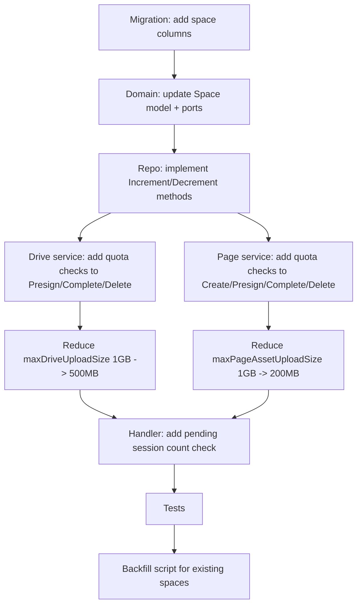

# Storage Quota and Limits Design

Date: 2026-04-02

## Background

Drive and Page currently have no storage limits. A single authenticated user can:

- Upload unlimited files to Drive (each up to 1GB)
- Create unlimited Page sites with unlimited versions (each asset up to 1GB)
- Generate unlimited presigned URLs, creating orphan DB records even without completing uploads

Caps Upload already has content type and per-file size limits, plus R2 lifecycle auto-expires objects after 7 days. Drive and Page objects have **no lifecycle rules** and persist indefinitely.

### R2 Cost Model

| Item | Price | Free Tier |
|------|-------|-----------|
| Storage | $0.015 / GB-month | 10 GB |
| Class A ops (write) | $4.50 / million | 1 million |
| Class B ops (read) | $0.36 / million | 10 million |
| Egress | Free | Free |

Worst-case without limits: 1 user uploads 10,000 x 1GB files = 10 TB = **$150/month** in storage alone.

### Current Object Key Layout

| Feature | Prefix | Lifecycle |
|---------|--------|-----------|
| Caps Upload | `caps/spaces/{spaceID}/...` | 7-day expiry via R2 rule on `user_upload/` (legacy prefix) |
| Drive | `drive/spaces/{spaceID}/nodes/{nodeID}/{uuid}` | **None** -- persists forever |
| Page | `page/spaces/{spaceID}/sites/{siteID}/versions/{no}/{path}` | **None** -- persists forever |

## Design

### 1. Quota Model

Add storage tracking fields to the `spaces` table. Quotas are enforced per-space (each user has one personal space).

```sql
ALTER TABLE spaces
  ADD COLUMN IF NOT EXISTS storage_used_bytes  BIGINT NOT NULL DEFAULT 0,
  ADD COLUMN IF NOT EXISTS storage_quota_bytes BIGINT NOT NULL DEFAULT 5368709120,
  ADD COLUMN IF NOT EXISTS drive_node_count    INT    NOT NULL DEFAULT 0,
  ADD COLUMN IF NOT EXISTS page_site_count     INT    NOT NULL DEFAULT 0;
```

| Field | Purpose | Default |
|-------|---------|---------|
| `storage_used_bytes` | Sum of all completed Drive files + Page assets (bytes) | 0 |
| `storage_quota_bytes` | Per-user total storage quota | 5 GB (5368709120) |
| `drive_node_count` | Current count of non-deleted Drive nodes (files + folders) | 0 |
| `page_site_count` | Current count of non-deleted Page sites | 0 |

Counters are updated atomically at Complete time (not at Presign time), so failed/expired uploads do not consume quota.

### 2. Limit Constants

All limits are defined in the application layer as constants. No dconf for now -- keep it simple and deploy code changes when adjusting.

#### Drive Limits

| Limit | Value | Rationale |
|-------|-------|-----------|
| Max single file size | 500 MB | Down from 1GB. Generous for preview; covers most agent use-cases including video/audio. |
| Max nodes per space | 5,000 | Files + folders combined. Generous for preview to observe usage patterns. |
| Max pending upload sessions | 20 | Per space, Drive-only pending sessions. Prevents presign spam. |

#### Page Limits

| Limit | Value | Rationale |
|-------|-------|-----------|
| Max single asset size | 200 MB | Generous for preview; covers sites with large media assets. |
| Max sites per space | 20 | Generous for preview to observe usage patterns. |
| Max versions per site | 100 | Old versions can be archived for cleanup later. |
| Max files per version | 1,000 | Covers large static sites and monorepo builds. |
| Max pending upload sessions | 50 | Per space, Page-only pending sessions. Higher than Drive because deploys are multi-file. |

#### Shared Limit

| Limit | Value | Rationale |
|-------|-------|-----------|
| Total storage quota per user | 5 GB | Drive + Page combined. Generous for preview period to observe real usage distribution before tightening. |

#### Cost Projection

| Scenario | Users | Max Storage | Monthly R2 Cost |
|----------|-------|-------------|-----------------|
| Early access | 50 | 250 GB | $3.60 |
| Growth | 500 | 2.5 TB | $37.50 |
| Scale | 5,000 | 25 TB | $375 |

Note: these are theoretical worst-case (every user fills quota). Real usage will be a fraction. The preview period will provide data on actual usage distribution to inform future tier design.

### 3. Enforcement Points

#### 3a. Presign-time Checks (lazy cleanup + fast-fail)

Pending session enforcement uses an **expire-then-count** lazy cleanup pattern. No cron job needed -- stale sessions are cleaned up inline on each presign call.

```
PresignFileUpload:
  1. Check contentLength <= maxDriveFileSize
  2. Check storage_used_bytes + contentLength <= storage_quota_bytes
  3. Check drive_node_count < maxDriveNodesPerSpace
  4. Lazy cleanup: ExpireStaleUploadSessions(spaceID, "drive", now)
     - UPDATE upload_sessions SET status='expired' WHERE space_id=? AND target_type='drive' AND status='pending' AND expires_at < now
     - Also soft-delete orphan Drive file nodes for those expired sessions (storage_object_id IS NULL)
  5. Count remaining pending Drive sessions; reject if >= maxPendingDriveSessions
  (then proceed with existing logic)

PresignVersionAsset:
  1. Check contentLength <= maxPageAssetSize
  2. Check storage_used_bytes + contentLength <= storage_quota_bytes
  3. Lazy cleanup: ExpireStaleUploadSessions(spaceID, "page", now)
     - UPDATE upload_sessions SET status='expired' WHERE space_id=? AND target_type='page' AND status='pending' AND expires_at < now
  4. Count remaining pending Page sessions for this version; reject if >= maxFilesPerPageVersion
  (then proceed with existing logic)

CreateSite:
  1. Check page_site_count < maxPageSitesPerSpace

CreateVersion:
  1. Check version count for this site < maxPageVersionsPerSite
```

The lazy cleanup is cheap (one UPDATE + one DELETE per presign call, scoped to the user's space). For normal users with 0-2 expired sessions, this touches very few rows. For abusers who spammed presigns, it cleans up their mess before rejecting further requests.

#### 3b. Complete-time Updates (atomic counter increments)

```
CompleteFileUpload:
  (after HeadObject confirms size)
  1. UPDATE spaces SET storage_used_bytes = storage_used_bytes + head.Size,
                       drive_node_count = drive_node_count + 1
     WHERE id = spaceID
       AND storage_used_bytes + head.Size <= storage_quota_bytes
  (if affected rows = 0, reject -- race condition protection)

CompleteVersionAsset:
  (after HeadObject confirms size)
  1. UPDATE spaces SET storage_used_bytes = storage_used_bytes + head.Size
     WHERE id = spaceID
       AND storage_used_bytes + head.Size <= storage_quota_bytes
  (if affected rows = 0, reject)
```

The atomic `WHERE` clause provides race-condition-safe enforcement even under concurrent uploads.

#### 3c. Delete-time Decrements

```
DeleteNode (Drive):
  1. Sum size of all files in subtree being deleted
  2. UPDATE spaces SET storage_used_bytes = storage_used_bytes - totalSize,
                       drive_node_count = drive_node_count - deletedCount

DeleteSite (Page):
  1. Sum size of all storage objects under this site's versions
  2. UPDATE spaces SET storage_used_bytes = storage_used_bytes - totalSize,
                       page_site_count = page_site_count - 1
```

### 4. Drive node_count Tracking

Drive `node_count` requires tracking both creates and deletes:

- **CreateFolder**: increment `drive_node_count` immediately (no presign flow)
- **CompleteFileUpload**: increment `drive_node_count` (as shown above)
- **DeleteNode/SoftDeleteSubtree**: decrement by count of deleted nodes

At Presign time we check `drive_node_count` for the fast-fail, but don't increment it yet. The file node is created in DB at presign time (current behavior), but it has no storage object. The `drive_node_count` only tracks "real" nodes -- increment happens at complete time for files, and at create time for folders (since folders are immediately real).

If a presigned upload expires without completing, the orphan file node exists in DB but doesn't count toward the limit. The orphan cleanup job (section 6) handles these.

### 5. Port and Domain Changes

```go
// model/space.go -- add fields
type Space struct {
    ID                int64
    OwnerUserID       int64
    Name              string
    StorageUsedBytes  int64
    StorageQuotaBytes int64
    DriveNodeCount    int
    PageSiteCount     int
    CreatedAt         time.Time
}

// port/space.go -- add methods
type SpaceRepository interface {
    GetByOwnerUserID(ctx context.Context, ownerUserID int64) (*model.Space, error)
    CreatePersonalSpace(ctx context.Context, ownerUserID int64, name string) (*model.Space, error)
    IncrementStorageUsage(ctx context.Context, spaceID int64, deltaBytes int64, deltaDriveNodes int) (bool, error)
    DecrementStorageUsage(ctx context.Context, spaceID int64, deltaBytes int64, deltaDriveNodes int) error
    IncrementPageSiteCount(ctx context.Context, spaceID int64) (bool, error)
    DecrementPageSiteCount(ctx context.Context, spaceID int64) error
}
```

`IncrementStorageUsage` returns `false` if the update would exceed quota (0 rows affected by the conditional WHERE clause). This is the single source of truth for quota enforcement.

### 6. Lazy Cleanup (No Cron)

Orphan cleanup is handled inline via the **expire-then-count** pattern in section 3a. No cron job or background goroutine needed.

#### What gets cleaned up and when

| Target | Trigger | Condition | Action |
|--------|---------|-----------|--------|
| Expired pending upload sessions | Every presign call | `status='pending' AND expires_at < now()` | Mark as `expired` |
| Orphan Drive file nodes | Drive presign call | Session expired + `storage_object_id IS NULL` | Soft delete (do NOT decrement `drive_node_count` since they were never counted) |

#### What is NOT cleaned up (future work)

| Target | Notes |
|--------|-------|
| Stale draft Page versions | Versions with status `draft` and no completed uploads. Low urgency -- they don't consume storage quota. |
| R2 orphan objects | S3 objects whose DB records were soft-deleted. Requires a separate GC design. |

#### Implementation

```go
// port/storage.go -- add to UploadSessionRepository
ExpireStaleBySpace(ctx context.Context, spaceID int64, targetType model.UploadTargetType, now time.Time) (expiredIDs []int64, err error)

// The repo method runs:
//   UPDATE upload_sessions SET status='expired'
//   WHERE space_id=$1 AND target_type=$2 AND status='pending' AND expires_at < $3
//   RETURNING id, target_id

// For Drive, the caller then soft-deletes orphan file nodes:
//   UPDATE drive_nodes SET deleted_at=now()
//   WHERE id IN (target_ids) AND storage_object_id IS NULL AND deleted_at IS NULL
```

This approach is simple, correct, and self-healing: even if a user abandons uploads, the next presign call cleans up the mess.

### 7. R2 Lifecycle Gap

Current R2 lifecycle rules only cover the legacy `user_upload/` prefix. Need to add rules for `drive/` and `page/` prefixes -- but these are persistent storage, not temporary.

For Drive and Page, R2 lifecycle is NOT the right approach (users expect their files to persist). Instead, storage quota (this design) prevents unbounded growth. R2 lifecycle should be added only for objects whose DB records have been deleted (i.e., the object is orphaned in R2 after a soft-delete), but that requires a separate garbage collector design.

For now: no new R2 lifecycle rules. Quota enforcement prevents cost runaway. S3 object cleanup after Drive/Page deletes is tracked as future work.

### 8. Error Responses

All quota/limit errors return HTTP 429 (or 413 for size) with clear error codes:

| Error Code | HTTP Status | Message |
|------------|-------------|---------|
| `storage_quota_exceeded` | 413 | `storage quota exceeded ({used}/{quota} bytes)` |
| `drive_file_too_large` | 413 | `file size exceeds {limit} byte limit` |
| `page_asset_too_large` | 413 | `asset size exceeds {limit} byte limit` |
| `drive_node_limit_reached` | 429 | `drive node limit reached ({count}/{limit})` |
| `page_site_limit_reached` | 429 | `page site limit reached ({count}/{limit})` |
| `page_version_limit_reached` | 429 | `page version limit reached ({count}/{limit})` |
| `page_version_file_limit_reached` | 429 | `page version file limit reached ({count}/{limit})` |
| `too_many_pending_uploads` | 429 | `too many pending uploads, complete existing uploads or wait for expiry` |

All responses include a `hint` field: `"Upgrade your plan for higher limits or contact support."` (placeholder for future billing integration).

### 9. Migration File

New migration: `internal/infrastructure/migration/migrations/0023_space_storage_quota.sql`

```sql
-- Add storage tracking columns to spaces table
ALTER TABLE spaces
  ADD COLUMN IF NOT EXISTS storage_used_bytes  BIGINT NOT NULL DEFAULT 0;
ALTER TABLE spaces
  ADD COLUMN IF NOT EXISTS storage_quota_bytes BIGINT NOT NULL DEFAULT 5368709120;
ALTER TABLE spaces
  ADD COLUMN IF NOT EXISTS drive_node_count    INT    NOT NULL DEFAULT 0;
ALTER TABLE spaces
  ADD COLUMN IF NOT EXISTS page_site_count     INT    NOT NULL DEFAULT 0;
```

For existing spaces, a one-time backfill script will calculate current usage from `storage_objects` and `drive_nodes` tables. This is a manual operation, not part of the migration.

### 10. Implementation Sequence



### 11. Summary of Changes

| File | Change |
|------|--------|
| `internal/domain/model/space.go` | Add StorageUsedBytes, StorageQuotaBytes, DriveNodeCount, PageSiteCount fields |
| `internal/domain/port/space.go` | Add Increment/Decrement methods to SpaceRepository |
| `internal/domain/port/storage.go` | Add ExpireStaleBySpace to UploadSessionRepository; add CountPendingBySpaceAndType |
| `internal/infrastructure/postgres/space_repo.go` | Implement new methods with atomic WHERE clause |
| `internal/infrastructure/postgres/upload_session_repo.go` | Implement ExpireStaleBySpace and CountPendingBySpaceAndType |
| `internal/application/drive/upload.go` | Add quota + pending checks to PresignFileUpload; update CompleteFileUpload; reduce max size to 500MB |
| `internal/application/drive/service.go` | Add node count check to CreateFolder; update DeleteNode to decrement |
| `internal/application/page/service.go` | Add site count check to CreateSite; update DeleteSite to decrement |
| `internal/application/page/version.go` | Add quota + pending + version count + file count checks; reduce max size to 200MB |
| `internal/infrastructure/migration/migrations/0023_space_storage_quota.sql` | New migration |

### 12. What This Design Does NOT Cover (Future Work)

- **Per-endpoint rate limiting** for Drive/Page (defer to existing rate limit middleware extension)
- **Per-user quota overrides** via admin API or billing tier (keep default for now)
- **R2 orphan garbage collector** (delete S3 objects after DB soft-delete)
- **Dashboard quota display** (show usage/quota in web UI)
- **Caps Upload quota** (already time-limited by R2 lifecycle; add space-level quota later if needed)
