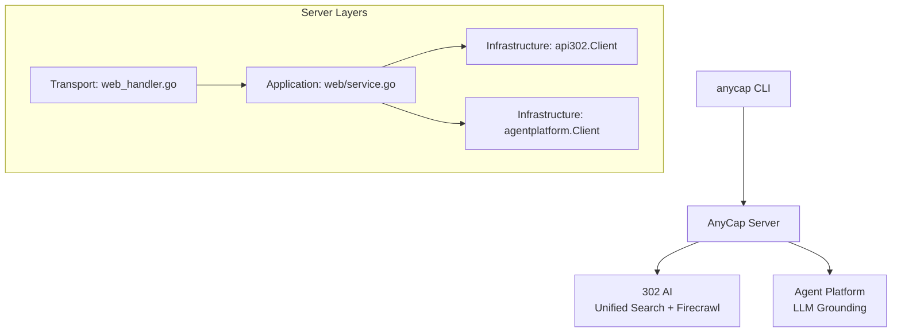

# Web Search and Crawl -- Design

Date: 2026-04-03

## Overview

Add web search and web crawl capabilities to AnyCap. Search has two modes:

- **General search** -- Google web search via 302 AI Unified Search API. Returns a list of results with title, URL, description, and optionally full page content. Cost: 1 credit.
- **LLM grounding search** -- LLM-powered search via Agent Platform. Returns a synthesized answer with citations grounded in real-time web data. Cost: 5 credits.

Crawl converts a web page to Markdown. Cost: 1 credit.

## Architecture



## Server API

### POST /v1/web/search

Feature gate: `web.search`

Request:

```json
{
  "query": "Go programming language",
  "mode": "general",
  "max_results": 5,
  "crawl_results": 5,
  "time_range": "month",
  "include_domains": ["github.com"],
  "exclude_domains": ["pinterest.com"],
  "instruction": "Focus on recent developments"
}
```

| Field | Type | Required | Default | Modes | Description |
|-------|------|----------|---------|-------|-------------|
| `query` | string | yes | | both | Search query |
| `mode` | string | no | `general` | | `general` or `grounding` |
| `max_results` | int | no | 5 | general | Max results (1-20) |
| `crawl_results` | int | no | = max_results | general | Number of results to crawl for full content. 0 to skip. |
| `time_range` | string | no | | general | `day`, `month`, `year` |
| `include_domains` | []string | no | | general | Whitelist domains |
| `exclude_domains` | []string | no | | general | Blacklist domains |
| `instruction` | string | no | | grounding | Additional instruction (e.g. language, format, focus) |
| `model` | string | no | | grounding | Model override (default: `AGENT_SEARCH_GROUNDING_MODEL` env var) |

Response (general mode):

```json
{
  "mode": "general",
  "results": [
    {
      "title": "The Go Programming Language",
      "url": "https://go.dev/",
      "description": "An open-source programming language...",
      "content": "Full page content...",
      "published_at": ""
    }
  ],
  "credits_used": 1,
  "request_id": "req_abc123"
}
```

Response (grounding mode):

Uses Google Search grounding via the Gemini API. The model automatically generates search queries,
retrieves results, and produces a grounded response with per-segment source attribution.

```json
{
  "mode": "grounding",
  "content": "**Spain** won the UEFA Euro 2024, defeating England 2-1 in the final...",
  "search_metadata": {
    "queries": ["who won UEFA Euro 2024"],
    "sources": [
      {"index": 1, "title": "aljazeera.com", "uri": "https://vertexaisearch.cloud.google.com/..."},
      {"index": 2, "title": "wikipedia.org", "uri": "https://vertexaisearch.cloud.google.com/..."},
      {"index": 3, "title": "uefa.com", "uri": "https://vertexaisearch.cloud.google.com/..."}
    ],
    "citations": [
      {
        "start_index": 0,
        "end_index": 72,
        "text": "**Spain** won the UEFA Euro 2024, defeating England 2-1 in the final...",
        "source_indices": [1, 2, 3]
      }
    ]
  },
  "model": "gcp-gemini-3-flash-preview",
  "usage": {
    "input_tokens": 11,
    "output_tokens": 310,
    "total_tokens": 530
  },
  "duration_ms": 3200,
  "credits_used": 5,
  "request_id": "req_abc123"
}
```

Grounding response fields:

- **`content`** -- The generated answer text.
- **`search_metadata`** -- Structured grounding data (null if the model decided not to search):
  - **`queries`** -- Search queries the model generated and executed.
  - **`sources`** -- Web sources used, each with a 1-based `index`, `title`, and `uri`.
  - **`citations`** -- Per-segment attribution mapping text ranges (`start_index`/`end_index` in `content`) to `source_indices`.
- **`model`** / **`usage`** / **`duration_ms`** -- Same as other capabilities endpoints.

### POST /v1/web/crawl

Feature gate: `web.crawl`

Request:

```json
{
  "url": "https://example.com"
}
```

Response:

```json
{
  "url": "https://example.com",
  "markdown": "# Example Domain\n\nThis domain is for use in...",
  "credits_used": 1,
  "request_id": "req_abc123"
}
```

## CLI Design

### anycap search

Top-level command (like `anycap download`), not nested under a subgroup.

Two distinct parameter sets for two modes. Use `--query` for general search, `--grounding --prompt` for
grounding search. No positional argument -- explicit flags prevent mode confusion.

```bash
# General search
anycap search --query "Go programming language"
anycap search --query "AI agent framework" --max-results 3 --time-range month
anycap search --query "Go context" --include github.com --include stackoverflow.com
anycap search --query "Go context" --no-crawl

# LLM grounding search
anycap search --grounding --prompt "What are the latest changes in Go 1.25?"
anycap search --grounding --prompt "Compare React vs Vue" --instruction "Focus on performance"
anycap search --grounding --prompt "UEFA Euro 2024 winner" | jq -r '.content'
```

#### General mode flags

| Flag | Default | Description |
|------|---------|-------------|
| `--query` | (required) | Search query |
| `--max-results` | 5 | Max results (1-20) |
| `--time-range` | | Filter by recency: `day`, `month`, `year` |
| `--include` | | Include domain (repeatable) |
| `--exclude` | | Exclude domain (repeatable) |
| `--no-crawl` | false | Skip full content crawling, just titles+URLs |

#### Grounding mode flags

| Flag | Default | Description |
|------|---------|-------------|
| `--grounding` | false | Enable LLM grounding mode (5 credits) |
| `--prompt` | (required) | Search prompt for the LLM |
| `--instruction` | | Additional guidance for the LLM response |
| `--model` | | Model override |

### anycap crawl

```bash
anycap crawl https://example.com
anycap crawl https://docs.go.dev/ref/spec
```

No flags needed. Single argument: the URL.

## Skills Design

### SKILL.md Updates

In the Capabilities section, replace the "Coming soon" bullet for search/crawl with:

```markdown
### Web Search and Crawl

Search the web and crawl pages to get structured content.

**Search** has two modes:
- **General** (default) -- returns a list of results with titles, URLs, descriptions, and full page content. 1 credit per search.
- **Grounding** -- uses an LLM with real-time web access to synthesize an answer with citations. 5 credits per search. Best for complex questions that need reasoning across multiple sources.

**Crawl** converts a single web page to Markdown. 1 credit per crawl.
```

### New reference file: references/web.md

Full documentation for search and crawl commands, with examples for both general and grounding modes, jq parsing patterns, and guidance on when to use each mode.

Agent decision guide (included in the reference):

| Scenario | Recommended | Why |
|----------|-------------|-----|
| Find URLs/links on a topic | `anycap search` | Get structured results list |
| Quick fact lookup | `anycap search` | Simple query, list is enough |
| Complex research question | `anycap search --grounding` | LLM synthesizes across sources |
| Get full page content | `anycap search` (default crawls) | Results include content |
| Read a specific known URL | `anycap crawl <url>` | Direct page-to-markdown |
| Save a page for later | `anycap crawl <url>` then process | Get clean markdown |

### SKILL.md jq examples

```bash
# General search -- get titles and URLs
anycap search --query "Go error handling" | jq -r '.results[] | "\(.title) -- \(.url)"'

# General search -- get content of first result
anycap search --query "Go context package" --max-results 1 | jq -r '.results[0].content'

# Grounding search -- get the synthesized answer
anycap search --grounding --prompt "What is context engineering?" | jq -r '.content'

# Grounding search -- get sources
anycap search --grounding --prompt "latest Go releases" | jq -r '.search_metadata.sources[] | "\(.title): \(.uri)"'

# Grounding search -- get citation text with source indices
anycap search --grounding --prompt "latest Go releases" | jq -r '.search_metadata.citations[] | "[\(.source_indices | join(","))] \(.text)"'

# Crawl -- get markdown content
anycap crawl https://example.com | jq -r '.markdown'
```

## Credit Costs

| Operation | Credits |
|-----------|---------|
| General search | 1 |
| LLM grounding search | 5 |
| Web crawl | 1 |

## Feature Flags

| Feature | Env var | Default |
|---------|---------|---------|
| `web.search` | `ANYCAP_FEATURE_WEB_SEARCH` | true if `API_302_API_KEY` OR `AGENT_PLATFORM` configured |
| `web.crawl` | `ANYCAP_FEATURE_WEB_CRAWL` | true if `API_302_API_KEY` configured |

The `web.search` feature is enabled if either provider is available. The server returns a specific error
if the requested mode's provider is not configured (e.g. grounding requested but Agent Platform not set up,
or general requested but 302 AI not set up).

## Infrastructure Dependencies

| Mode | Provider | Env var |
|------|----------|---------|
| General search | 302 AI (search1_search, Google) | `API_302_API_KEY` |
| Grounding search | Agent Platform (Gemini grounding) | `AGENT_PLATFORM_BASE_URL` + `AGENT_PLATFORM_API_KEY` + `AGENT_SEARCH_GROUNDING_MODEL` |
| Crawl | 302 AI (Firecrawl) | `API_302_API_KEY` |

## Implementation Plan

### Phase 1: Crawl (done)

- [x] Domain models: `WebCrawlRequest`, `WebCrawlResult`
- [x] Port: `WebCrawler`, `WebService.Crawl`
- [x] Infrastructure: `api302.Client.Crawl`
- [x] Application: `web.Service.Crawl` (1 credit)
- [x] Handler: `POST /v1/web/crawl`
- [x] Config: `Api302Config` (`API_302_API_KEY`, `API_302_BASE_URL`)
- [x] Feature flag: `web.crawl`
- [x] Bootstrap wiring
- [x] CLI: `anycap crawl <url>`
- [x] Skill files: SKILL.md + references/web.md

### Phase 2: Grounding search (in progress)

- [x] Domain models: `WebSearchRequest`, `WebSearchGroundingResult`, `SearchMetadata`
- [x] Port: `WebSearchProvider.SearchGrounding`, `WebService.Search`
- [x] Infrastructure: `agentplatform.Client.SearchGrounding`
- [x] Application: `web.Service.Search` (grounding mode, 5 credits)
- [x] Handler: `POST /v1/web/search`
- [x] Feature flag: `web.search` updated (Api302 OR AgentPlatform)
- [x] Bootstrap wiring: `buildWebSearchProvider`
- [x] CLI: `anycap search --grounding --prompt` (needs arg redesign)
- [x] Live test against server
- [x] Skill files update
- [x] `anycap-current-status.md` update

### Phase 3: General search (done)

- [x] Infrastructure: `api302.Client.SearchGeneral` (302 AI Unified Search API port adapter)
- [x] Application: `web.Service.SearchGeneral` (general mode, 1 credit)
- [x] Handler: dispatch by mode, strip model/usage/duration_ms from grounding response
- [x] CLI: `anycap search --query` with general mode flags (--max-results, --time-range, --include, --exclude, --no-crawl)
- [x] Tests + live verification
- [x] Skill files update
- [x] `anycap-current-status.md` update
