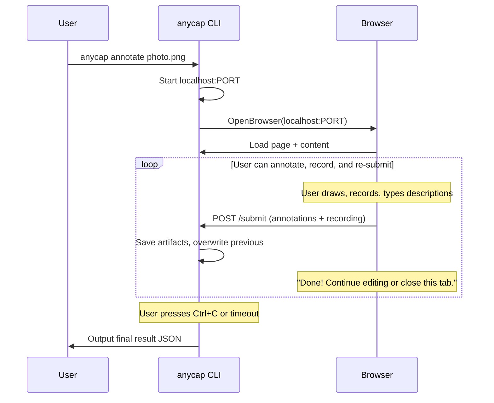
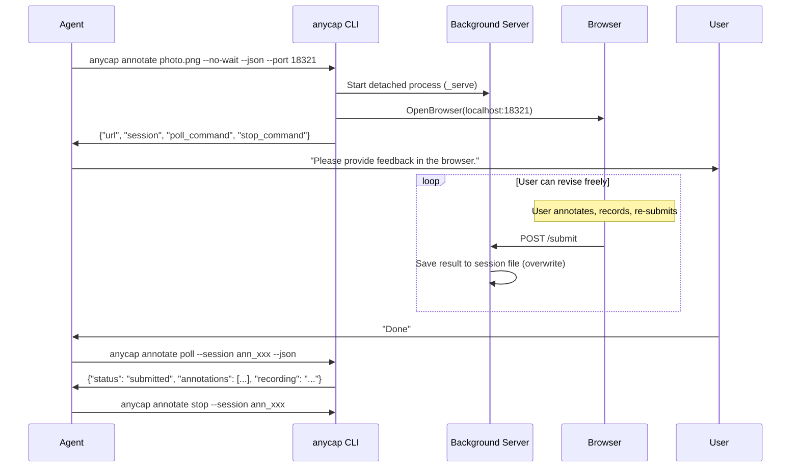
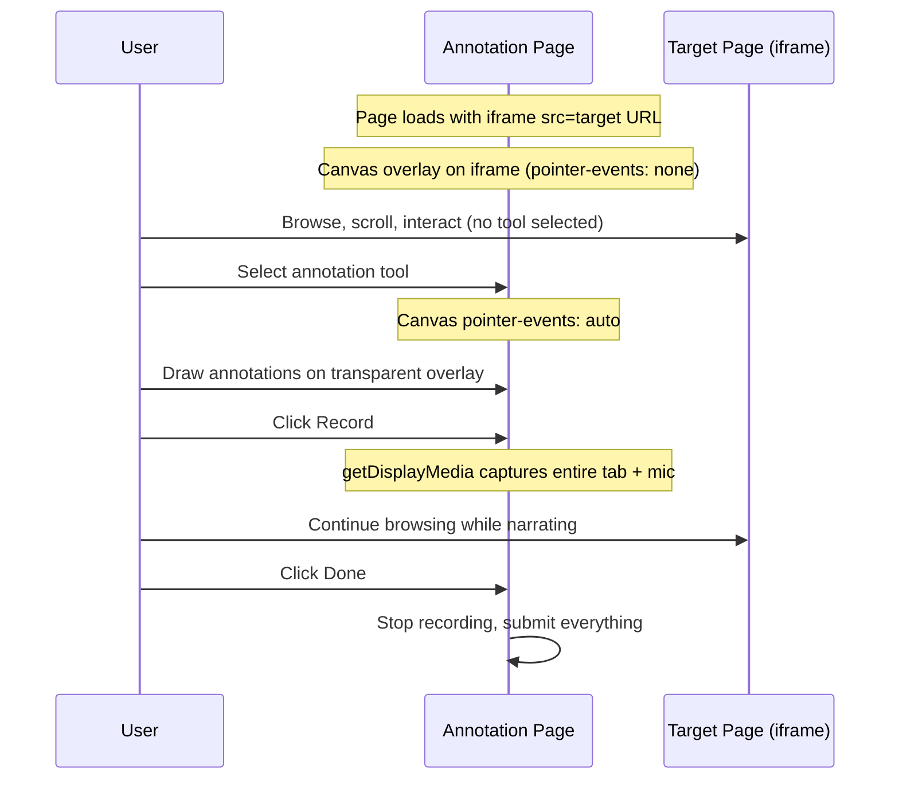
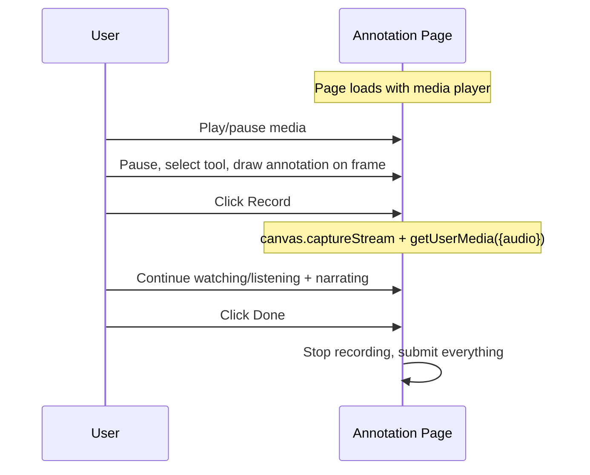
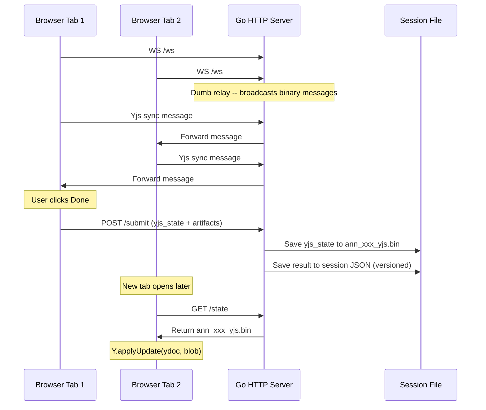

# Annotate: Multimodal Human Feedback -- Design

> Date: 2026-04-07
> Status: Implementing

## Problem

After generating an image, building a web page, or producing audio/video, agents struggle to understand what the user wants to modify. Text descriptions of spatial/temporal edits are imprecise and error-prone.

Agent shells (Claude Code, Codex, YAACLI, Cursor) have command execution timeouts (30-120s), but annotation is a human-speed task (1-5 minutes). A blocking command will be killed.

## Solution

`anycap annotate` is a top-level CLI command that opens a browser-based multimodal feedback page. The page always provides both **annotation tools** and a **record button**. The user decides how to give feedback -- draw annotations, record narration, or both. The agent reads whatever comes back.

Four target types, auto-detected:

1. **Image** -- draw annotations on a local image file
2. **URL** -- browse a live web page via iframe, annotate + record
3. **Video** -- play a local video, annotate paused frames, record commentary
4. **Audio** -- play local audio, record narrated feedback

No `--record` flag. Recording capability is always available in the page. No chromedp/CDP dependency.

## Command Interface

```bash
# Auto-detected by target type
anycap annotate photo.png                      # image
anycap annotate https://localhost:3000          # url (iframe)
anycap annotate output.mp4                     # video
anycap annotate song.mp3                       # audio

# Agent mode
anycap annotate photo.png --no-wait --json
anycap annotate output.mp4 --no-wait --json --port 18321

# Session management
anycap annotate poll --session ann_xxx --json
anycap annotate stop --session ann_xxx
```

### Auto-detection

| Pattern | Mode |
|---------|------|
| `http://` or `https://` prefix | URL (iframe) |
| `.png`, `.jpg`, `.jpeg`, `.gif`, `.webp`, `.bmp`, `.svg` | Image |
| `.mp4`, `.webm`, `.mov`, `.avi` | Video |
| `.mp3`, `.wav`, `.ogg`, `.m4a`, `.flac`, `.aac` | Audio |

### Flags

| Flag | Default | Description |
|------|---------|-------------|
| `--no-wait` | false | Non-blocking mode (background server) |
| `--json` | auto | JSON output |
| `--port` | 0 (random) | Server port. Agents should specify a fixed port. |
| `-o` | `{name}_annotated.png` | Output path for annotated image |
| `--bind` | `127.0.0.1` | Bind address |
| ~~`--viewport`~~ | ~~`1440x900`~~ | ~~URL mode: iframe dimensions~~ (removed: iframe uses 100% responsive sizing) |

## Architecture

Pure CLI-side feature. No server changes required.

### Blocking Mode



### Non-blocking Mode (for agents)



### URL Mode (iframe)



### Video/Audio Mode



## Recording Strategy

### Scope: content area only

Recording captures only the content area (canvas or iframe), never the toolbar or annotation list. This keeps recordings clean for `anycap video read` consumption.

| Mode | Stream Source | Captures |
|------|-------------|----------|
| Image | `canvas.captureStream(15)` | Canvas content (image + annotations) |
| Video | `canvas.captureStream(15)` | Canvas content (video frame + annotations) |
| Audio | `canvas.captureStream(15)` | Canvas content (blank/drawings) |
| URL | `getDisplayMedia` + Region Capture | iframe area only (cropped) |

All modes combine the video stream with `getUserMedia({audio: true})` for microphone narration. Output: WebM via MediaRecorder.

### URL mode: Region Capture

Chrome 104+ supports cropping a display capture to a specific element:

```javascript
const cropTarget = await CropTarget.fromElement(iframeElement);
const stream = await navigator.mediaDevices.getDisplayMedia({preferCurrentTab: true});
const [track] = stream.getVideoTracks();
await track.cropTo(cropTarget);  // crop to iframe area
```

Fallback (no Region Capture support): auto-hide toolbar during recording and maximize iframe to fill the viewport, so `getDisplayMedia` captures mostly iframe content.

### Compression

Target: < 8 MB per minute of recording. Annotation is slow-paced content (low motion), so aggressive compression works well.

```javascript
const recorder = new MediaRecorder(combinedStream, {
    mimeType: 'video/webm; codecs=vp9',   // VP9 preferred, VP8 fallback
    videoBitsPerSecond: 1_000_000,         // 1 Mbps
});
```

| Parameter | Value | Rationale |
|-----------|-------|-----------|
| Frame rate | 15 fps | Annotation is slow, no need for 30fps |
| Codec | VP9, fallback VP8 | VP9 has better compression ratio |
| Video bitrate | 1 Mbps | ~7.5 MB/min, clear enough for video read |
| Audio codec | Opus 64 kbps | Speech quality, not music |
| Resolution | No cap, controlled by bitrate | 1 Mbps naturally limits quality at high res |

No explicit resolution downscale. The 1 Mbps bitrate cap keeps file sizes small regardless of canvas/iframe dimensions. Low-motion annotation content encodes very efficiently.

## Page Layout

### Common Toolbar (all modes)

```
[Rect] [Arrow] [Point] [Free]                    [Rec] [Done]
```

- Annotation tools: always available
- Record button: always available, starts/stops recording
- Done button: stops recording if active, submits all artifacts

### Image Mode

Canvas displays the source image. User draws annotations directly on it. Recording via `canvas.captureStream` captures the image + annotations being drawn + mic narration.

### URL Mode (iframe)

`<iframe>` displays the target page. Transparent `<canvas>` overlays on top.

- **No tool selected**: `pointer-events: none` on canvas. User interacts with iframe normally (scroll, click, navigate).
- **Tool selected**: `pointer-events: auto` on canvas. User draws annotations on the transparent overlay. Iframe is still visible underneath.
- **Recording**: `getDisplayMedia` captures the entire tab (iframe content + annotation overlay + everything the user sees).

iframe security: localhost dev servers (Next.js, Vite, webpack-dev-server, Express, etc.) do not set `X-Frame-Options` by default. Cross-origin `localhost:A` -> `localhost:B` iframe embedding works. If a target blocks iframe embedding, the page shows an error message.

### Video Mode

`<video>` element with player controls. Transparent `<canvas>` overlays on the video.

- User plays/pauses video with standard controls
- When paused, user can draw annotations on the current frame
- When playing, annotations become semi-transparent
- Recording via `canvas.captureStream` captures the video frame + annotations + narration

### Audio Mode

`<audio>` element with player controls. Blank `<canvas>` area for freeform notes.

- User plays/pauses audio
- Canvas available for drawing (timestamps, visual notes, text labels)
- Primary value: recording (user listens and narrates feedback)

## Localhost Server

### Endpoints

| Method | Path | Purpose |
|--------|------|---------|
| GET | `/` | Serve the annotation HTML page |
| GET | `/image` | Serve source image file (image mode) |
| GET | `/media` | Serve video/audio file (video/audio mode) |
| POST | `/submit` | Save annotations + recording + Yjs state (repeatable) |
| POST | `/shutdown` | Graceful shutdown (called by `stop` command) |
| GET | `/state` | Return latest Yjs state snapshot (binary) |
| WS | `/ws` | Yjs sync relay (WebSocket) |

### Security

- Bind to `127.0.0.1` only by default (not `0.0.0.0`)
- CSRF token: generated per session, embedded in HTML, validated on POST
- `/shutdown` requires CSRF token

### Lifecycle

Server stays alive after submissions. Shuts down on:

| Trigger | Blocking mode | Non-blocking mode |
|---------|---------------|-------------------|
| User submits | Server stays alive | Server stays alive |
| Ctrl+C | Outputs latest result, exits | N/A (background) |
| `stop` command | N/A | Sends POST /shutdown |
| Timeout | 10 min from start | 10 min from start |

## Browser-side Submit Flow

When the user clicks "Done":

1. If recording is in progress -> stop recording
2. Collect all artifacts:
   - **Annotated image** (if annotations exist): export canvas as PNG via `toBlob` at original resolution
   - **Annotations JSON** (if annotations exist): array of annotation objects in original pixel space
   - **Recording blob** (if user recorded): WebM from MediaRecorder
   - **Recording duration** (if user recorded): elapsed seconds
3. POST `/submit` as `multipart/form-data` with all available artifacts
4. Show "Done! You can continue editing or close this tab."
5. User can modify and re-submit (overwrites previous result)

### Submit Payload

POST `/submit` as `multipart/form-data`:

| Field | Type | Required | Description |
|-------|------|----------|-------------|
| `csrf_token` | string | yes | CSRF token |
| `annotated_image` | PNG file | no | Canvas exported at original resolution |
| `annotations` | JSON string | no | Array of annotation objects |
| `image_dimensions` | JSON string | no | `{"width": N, "height": N}` |
| `recording` | WebM file | no | Tab/canvas recording + mic |
| `recording_duration` | string | no | Duration in seconds |
| `yjs_state` | binary file | no | `Y.encodeStateAsUpdate(ydoc)` snapshot |

### Coordinate System

All annotation coordinates are in **original image pixel space**, not display space.

```
Original:  4000 x 3000 px (naturalWidth x naturalHeight)
Display:   1200 x 900 px  (clientWidth x clientHeight)
Scale:     scaleX = 4000/1200 = 3.33

User draws rect at display (100, 50, 200, 150)
Stored as original-space (333, 167, 667, 500)
```

## Yjs Collaboration

Multiple users (or the same user across tabs) can annotate simultaneously via Yjs CRDT sync.

### Architecture



### Go server: dumb WebSocket relay

The Go server does NOT parse Yjs binary protocol. It maintains a set of connected WebSocket clients and broadcasts every incoming binary message to all other clients. This is ~30 lines of Go code.

```go
// Simplified relay logic
type relay struct {
    mu      sync.Mutex
    clients map[*websocket.Conn]struct{}
}

func (r *relay) broadcast(sender *websocket.Conn, msg []byte) {
    r.mu.Lock()
    defer r.mu.Unlock()
    for c := range r.clients {
        if c != sender {
            c.Write(context.Background(), websocket.MessageBinary, msg)
        }
    }
}
```

Dependency: `nhooyr.io/websocket` (lightweight, stdlib-friendly, no gorilla).

### State persistence via snapshots

Yjs state is persisted as binary snapshots, not event streams. This keeps the design simple and storage minimal.

| Event | Action | Storage |
|-------|--------|---------|
| User clicks Done | Client sends `Y.encodeStateAsUpdate(ydoc)` as `yjs_state` field in POST /submit | `~/.anycap/annotate/ann_xxx_yjs.bin` (~2-10 KB) |
| New client connects | Client calls `GET /state`, receives binary blob | N/A |
| Client applies state | `Y.applyUpdate(ydoc, blob)` -- merges with local state | N/A |
| Between submits | Unsaved edits exist only in connected clients' memory | Lost if all clients disconnect |

This is acceptable because:
- "Done" is a deliberate checkpoint action
- Annotation sessions are short-lived (< 10 min)
- Losing intermediate doodles between submits is fine

### Versioning

Each submit creates a numbered version in the session file. The Yjs state blob is overwritten on each submit (only latest state matters for new clients joining).

```json
{
    "session_id": "ann_a1b2c3d4",
    "version": 3,
    "result": { "...current result..." },
    "yjs_state_path": "~/.anycap/annotate/ann_a1b2c3d4_yjs.bin"
}
```

### Multi-user scenario

1. Agent opens `anycap annotate photo.png --no-wait --json --port 18321`
2. Agent shares URL `http://127.0.0.1:18321` with multiple users
3. Each user opens the URL in their browser -> WebSocket connects -> Yjs syncs
4. Users see each other's annotations in real-time (different cursor colors)
5. Any user can click Done -> submits the merged state
6. Agent polls -> gets the collaborative result

### Yjs in page.html

Yjs library (~30 KB gzipped) is inlined in `page.html` via a bundled IIFE script block. This keeps the annotation page fully self-contained -- no CDN dependency, no extra HTTP requests.

The Yjs document structure:

```javascript
const ydoc = new Y.Doc();
const yAnnotations = ydoc.getArray('annotations');  // shared annotation list
// Each annotation: { id, type, bounds, label, color, userId }

// On local draw -> push to yAnnotations
// On remote change -> re-render canvas
```

### WebSocket lifecycle

- Client connects to `ws://127.0.0.1:{port}/ws` on page load
- If connection drops, client retries with exponential backoff (1s, 2s, 4s, max 10s)
- Server removes client from relay set on disconnect
- When server shuts down, all WebSocket connections close gracefully

## Non-blocking Mode: Background Process

Agent shells have command timeouts (30-120s). Annotation takes 1-5 minutes.

### Self-re-exec with detach

```go
func startBackgroundServer(sessionID string) error {
    exe, _ := os.Executable()
    cmd := exec.Command(exe, "annotate", "_serve",
        "--session", sessionID,
    )
    cmd.SysProcAttr = &syscall.SysProcAttr{Setsid: true}
    cmd.Stdin, cmd.Stdout, cmd.Stderr = nil, nil, nil
    return cmd.Start()
}
```

### Session File

Location: `~/.anycap/annotate/{session_id}.json`

```json
{
    "session_id": "ann_a1b2c3d4",
    "pid": 12345,
    "port": 18321,
    "bind": "127.0.0.1",
    "csrf_token": "random-token",
    "image_path": "/path/to/photo.png",
    "output_path": "/path/to/photo_annotated.png",
    "media_type": "image",
    "media_path": "",
    "source_url": "",
    "recording_path": "/path/to/recording.webm",
    "yjs_state_path": "/path/to/ann_a1b2c3d4_yjs.bin",
    "created_at": "2026-04-07T20:00:00Z",
    "expires_at": "2026-04-07T20:10:00Z",
    "status": "pending",
    "result": null
}
```

### Subcommands

- **`poll --session xxx`**: Reads session file, returns latest status + result.
- **`stop --session xxx`**: Sends POST /shutdown, cleans up session file.
- **`_serve --session xxx`**: Hidden. Runs the HTTP server from session config.

## Output

### Start response (non-blocking)

```json
{
    "status": "started",
    "session": "ann_a1b2c3d4",
    "url": "http://127.0.0.1:18321",
    "poll_command": "anycap annotate poll --session ann_a1b2c3d4 --json",
    "stop_command": "anycap annotate stop --session ann_a1b2c3d4",
    "expires_in": 600,
    "next_action_hint": "Show the URL to the user. They can annotate, record narrated feedback, or both. After the user confirms they are done, run poll_command to retrieve all feedback, then run stop_command."
}
```

### Result (all fields optional except status and source)

```json
{
    "status": "submitted",
    "source": "/path/to/output.mp4",
    "source_type": "video",

    "annotated_image": "/path/to/output_frame_annotated.png",
    "annotations": [
        {"id": 1, "type": "rect", "bounds": {"x": 120, "y": 80, "width": 200, "height": 150}, "label": "Change this color"}
    ],
    "image_dimensions": {"width": 1920, "height": 1080},

    "recording": "/path/to/session_recording.webm",
    "recording_duration_seconds": 90,

    "hint": "User provided annotations and a narrated recording. Use the annotated image with 'anycap image generate --mode image-to-image'. Use 'anycap video read' on the recording for temporal narration."
}
```

### Dynamic hint rules

| Present artifacts | Hint |
|-------------------|------|
| Annotations only | "Use annotated image with `image generate --mode image-to-image`" |
| Recording only | "Use `anycap video read` on the recording" |
| Both | "Use annotated image for spatial edits. Use `anycap video read` for narrated context." |
| URL source | Append: "The source is a web page. Modify source code accordingly." |
| Video/audio source | Append: "The source is a media file. Regenerate with adjusted parameters." |

### TTY Output (blocking mode)

```
Annotations saved. 3 regions marked. Recording: 45s

  #1 [rect] (120,80 200x150): Change background to blue gradient
  #2 [arrow] (400,50 -> 450,100): Make this logo 2x larger
  #3 [point] (300,250): Remove this object

Annotated image: /path/to/photo_annotated.png
Recording: /path/to/session_recording.webm
```

## Domain Model

### Session

```go
type Session struct {
    SessionID     string            `json:"session_id"`
    PID           int               `json:"pid"`
    Port          int               `json:"port"`
    Bind          string            `json:"bind"`
    CSRFToken     string            `json:"csrf_token"`
    ImagePath     string            `json:"image_path"`
    OutputPath    string            `json:"output_path"`
    MediaType     string            `json:"media_type"`              // image, url, video, audio
    MediaPath     string            `json:"media_path,omitempty"`    // original file (video/audio)
    SourceURL     string            `json:"source_url,omitempty"`    // target URL (url mode)
    RecordingPath string            `json:"recording_path,omitempty"`
    YjsStatePath  string            `json:"yjs_state_path,omitempty"`
    Version       int               `json:"version"`
    CreatedAt     time.Time         `json:"created_at"`
    ExpiresAt     time.Time         `json:"expires_at"`
    Status        string            `json:"status"`
    Result        *AnnotationResult `json:"result"`
}
```

### AnnotationResult

```go
type AnnotationResult struct {
    Status            string           `json:"status"`
    Source            string           `json:"source"`
    SourceType        string           `json:"source_type"`                        // image, url, video, audio
    AnnotatedImage    string           `json:"annotated_image,omitempty"`
    Annotations       []Annotation     `json:"annotations,omitempty"`
    ImageDimensions   *ImageDimensions `json:"image_dimensions,omitempty"`
    Recording         string           `json:"recording,omitempty"`
    RecordingDuration float64          `json:"recording_duration_seconds,omitempty"`
    Hint              string           `json:"hint"`
}
```

## Template Variables

| Variable | Values | Purpose |
|----------|--------|---------|
| `{{CSRF_TOKEN}}` | hex string | CSRF validation |
| `{{MEDIA_TYPE}}` | `image`, `url`, `video`, `audio` | Page layout selection |
| `{{TARGET_URL}}` | URL string or empty | iframe src (url mode only) |

## Annotation Tools

| Tool | Shortcut | Description |
|------|----------|-------------|
| Rectangle | `R` | Draw bounding box around a region |
| Arrow | `A` | Draw arrow pointing to a specific area |
| Point | `P` | Place a numbered marker at a position |
| Freehand | `F` | Draw freehand highlight/circle |

Keyboard: `Ctrl/Cmd+Z` undo, `Escape` cancel, `Delete/Backspace` remove selected.

## File Structure

```
internal/cli/
  annotate/
    annotate.go           # Server, session, lifecycle
    annotate_test.go      # Tests
    page.go               # go:embed HTML, template injection
    page.html             # Self-contained annotation UI (all modes, Yjs inlined)
  command/
    infra/
      annotate.go         # Top-level annotate command registration
    cap/
      image.go            # REMOVE image annotate subcommands
```

### Command Registration

Register in `internal/cli/command/infra/annotate.go` and add to root.go alongside drive, page.

## Agent Workflows

### Image feedback loop

```bash
# 1. Generate image
anycap image generate --prompt "a landing page" -o landing.png

# 2. Open feedback page
anycap annotate landing.png --no-wait --json --port 18321

# 3. Agent tells user: "Please provide feedback at http://127.0.0.1:18321"

# 4. User annotates and/or records, says "done"

# 5. Agent retrieves feedback
anycap annotate poll --session ann_xxx --json

# 6. Agent uses feedback
anycap image generate --mode image-to-image --prompt "..." \
    --param images='["./landing_annotated.png"]' -o landing_v2.png

# 7. Clean up
anycap annotate stop --session ann_xxx
```

### Web page feedback loop

```bash
# Agent builds a page, dev server running on :3000
anycap annotate http://localhost:3000 --no-wait --json --port 18322

# User browses in iframe, draws annotations, records narration
# User: "Done"

anycap annotate poll --session ann_xxx --json
# Agent reads annotations + recording
anycap video read ./session_recording.webm --json
# Agent modifies code, dev server hot-reloads
# Repeat
```

### Video/audio feedback

```bash
anycap annotate output.mp4 --no-wait --json --port 18323
# User watches, pauses, annotates frames, narrates
anycap annotate poll --session ann_xxx --json
anycap video read ./session_recording.webm --json
# Agent regenerates with adjusted parameters
```

## Skill File Guidance

The skill documentation should instruct agents to:

1. **Always use `--no-wait --json`** to avoid timeout kills.
2. **Specify `--port`** with a fixed port number (e.g., 18321) to ensure deterministic URLs. Pick a port in the high range (18000-19000) to avoid conflicts with common dev servers.
3. **Check port availability** before starting. If a previous session is still running on the same port, run `stop` first or pick a different port.
4. **Consider the machine environment:**
   - Does the machine have a GUI browser? If not (headless server, SSH), suggest `--bind 0.0.0.0` and provide the URL for the user to open from another machine.
   - Is the target URL accessible from the annotation server? For URL mode, both the annotation server and the iframe load the target URL from the same machine.
5. **Wait for user confirmation** before polling. Never poll in a loop. The user's verbal "done" is the signal.
6. **Process feedback based on available artifacts:**
   - `annotated_image` present -> use for image-to-image editing
   - `recording` present -> use `anycap video read` to understand temporal/verbal feedback
   - Both present -> combine spatial annotations with narrated context
7. **Clean up** with `stop_command` after retrieving results.

## Dependencies

| Dependency | Purpose |
|------------|---------|
| `nhooyr.io/websocket` | WebSocket server for Yjs relay |

Removed `chromedp` from the design -- URL mode uses iframe only.

## Scope

### In scope

- `anycap annotate` -- four target types (image, URL, video, audio)
- Annotation tools: rect, arrow, point, freehand (all modes)
- Recording: canvas.captureStream / getDisplayMedia + mic (all modes)
- Blocking + non-blocking modes with session management
- `--port` flag for agent-specified ports
- iframe for URL mode (no CDP screenshots)

### Out of scope

- Video timeline annotation (frame-by-frame editing)
- Remote/hosted annotation server
- Auto-piping results to image generate
- Mask generation for inpainting

## Implementation Order

1. **Promote to top-level command** -- `infra/annotate.go`, remove from `cap/image.go`, update root.go
2. **Extend domain model** -- add MediaType, SourceURL, RecordingPath, new AnnotationResult fields
3. **Extend server** -- `/media` endpoint, recording upload in `/submit`, `--port` flag
4. **Extend page.html** -- media type layouts (iframe/video/audio), recording UI, pointer-events toggle
5. **Extend template injection** -- `{{MEDIA_TYPE}}`, `{{TARGET_URL}}`
6. **Auto-detection logic** -- parse target arg, determine media type
7. **Dynamic hint generation** -- based on present artifacts
8. **Tests** -- target detection, media type routing, recording upload, port specification
9. **Update skill files** -- document all modes, port guidance, environment considerations
