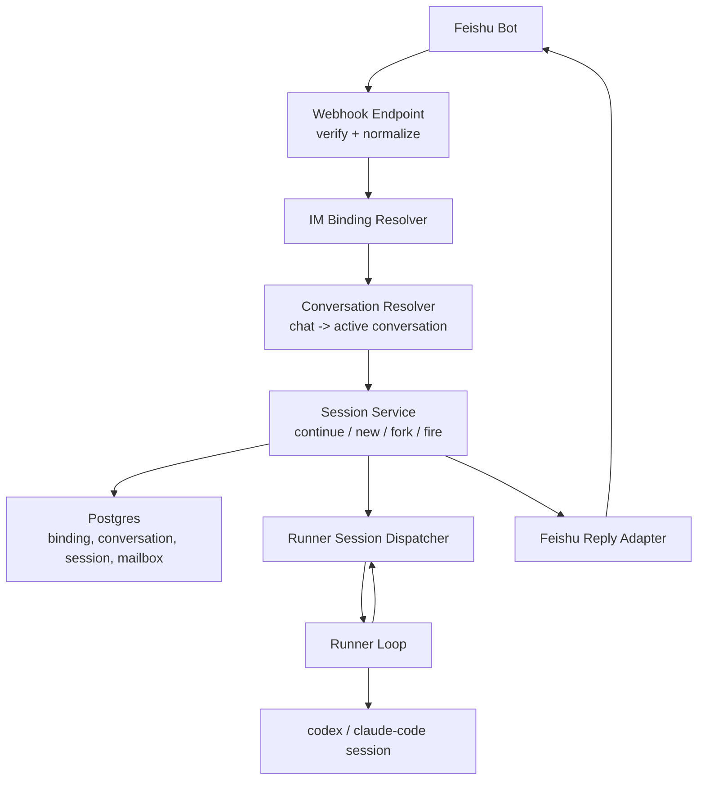

# IM Chat Agent Design

Date: 2026-04-08

## 1. Overview

AnyCap should expose a chat-style agent control surface over IM, starting with Feishu.

Primary story:

1. User binds a Feishu identity to an AnyCap account.
2. User sends a normal message to the Feishu bot.
3. AnyCap verifies the platform request, resolves the binding, and finds or creates the user's active conversation.
4. AnyCap appends the message as a new session in that conversation.
5. A bound runner resumes or creates the underlying codex / claude-code session.
6. AnyCap returns agent progress and final output back to Feishu.

This is not "task dispatch with chat-like syntax." This is a real conversation runtime with IM as the front door.

## 2. Product Positioning

AnyCap already has:

- capability plane: media, web, storage, publishing
- control plane beginnings: runner registration, task dispatch, status reporting

This feature extends AnyCap into:

- IM-native agent runtime: the user can talk to a remote coding agent from a phone as if the bot were the agent

The product promise is:

- direct message the bot, no laptop required
- keep durable conversational context
- support interruption, reset, branching, and later async sub-work
- keep auth, audit, routing, and reply delivery centralized in AnyCap

## 3. Scope and Non-Goals

### In scope

- Feishu bot inbound webhook and outbound reply
- explicit IM identity binding
- conversation-first routing
- durable conversation/session/mailbox persistence
- fixed-runner session execution for v1
- normal chat messages plus a small system command set

### Out of scope for v1

- group chat shared agent ownership
- automatic project/workspace routing
- async subagent fan-out execution
- generic shell passthrough
- hosted cloud agent runtime by AnyCap

## 4. Phase Roadmap

### Phase 1: Single chat -> fixed runner -> single active conversation

- one Feishu direct-message chat maps to one active conversation
- the conversation is bound to one fixed runner
- same conversation reuses agent context
- slash commands support reset/status/stop/new

### Phase 2: Multi-runner and explicit branch control

- user can target runner aliases
- fork from a historical session
- one user may keep multiple active conversations

### Phase 3: Project/workspace auto-routing and mailbox-driven async work

- route by workspace or project instead of runner
- async sub-results land in mailbox
- manual or semi-automatic fire of mailbox back into the main conversation

## 5. Core Principles

1. IM is the transport, conversation is the product primitive.
2. Persist conversation/session state before execution.
3. Keep webhook ingress public-but-verified; user auth begins after binding resolution.
4. Reuse agent context inside a conversation; do not rebuild context from scratch for every message.
5. Preserve branchability: continue is default, fork is explicit.
6. Never expose internal numeric IDs.

## 6. Architecture

Responsibilities:

- webhook endpoint: verify Feishu request, normalize inbound event
- binding resolver: map sender identity to AnyCap user
- conversation resolver: find or create the active chat conversation
- session service: append a new conversation session and decide execution mode
- runner dispatcher: route to the bound runner and maintain session affinity
- reply adapter: send accepted/running/completed messages back to IM

## 7. Routing Model

The HTTP surface must stay split:

- root/public webhook route:
  - receives Feishu callbacks
  - verifies platform signature
  - resolves sender binding
  - routes into conversation/session services
- protected routes:
  - manage bindings
  - manage runners
  - inspect conversations/sessions
  - interrupt/reset/fork/status

The Feishu platform never presents an AnyCap user token on webhook ingress, so inbound IM traffic cannot go through the normal protected route stack before binding resolution.

## 8. Identity and Binding Model

### Binding remains required

The Feishu sender identity is not an AnyCap principal by itself.

v1 keeps explicit bind-token exchange:

1. user signs in to AnyCap
2. user creates a bind token
3. user sends `/bind <token>` to the Feishu bot
4. AnyCap validates and consumes the token
5. AnyCap stores the sender -> user binding

### Binding resource

- IMBinding (`imb_`)

Fields:

- external id
- user internal id
- platform
- bot id
- chat id when useful
- sender id
- status
- created / updated / last_bound timestamps

## 9. Conversation Model

Conversation is the main external resource for chat-style agent control.

- AgentConversation (`agc_`)

Suggested fields:

- external id
- user internal id
- platform
- bot id
- chat id
- runner id
- agent kind (`codex`, `claude_code`)
- status (`active`, `archived`)
- last_session_id
- created_at
- updated_at

v1 routing rule:

- one Feishu DM chat resolves to one active conversation for that user + bot + chat
- `/new` creates a fresh conversation
- `/reset` archives current conversation and creates a new one

## 10. Session Model

Session is an immutable execution snapshot inside a conversation.

- AgentSession (`ags_`)

Suggested fields:

- external id
- conversation id
- parent session id
- runner id
- agent kind
- mode (`continue`, `fork`, `fire`, `system`)
- user_message
- final_message
- status (`created`, `running`, `committed`, `failed`, `interrupted`)
- executor reference / process reference if needed
- started_at
- completed_at
- created_at
- updated_at

Rules:

- normal user messages default to `continue`
- fork starts from a historical session and creates a new conversation in v1
- sessions are append-only snapshots; do not mutate historical content

## 11. Mailbox Model

Mailbox is the conversation-scoped holding area for async results that should be consumed later by the main conversation.

- MailboxMessage (`agm_`)

Suggested fields:

- external id
- conversation id
- source session id
- source type (`subtask_result`, `subtask_failed`, `tool_result`)
- payload
- delivered_to_session_id
- created_at

V1 posture:

- add the resource and persistence shape now
- keep business logic narrow
- mailbox-driven `fire` can be introduced without reworking the core data model later

## 12. Continue / Fork / Fire Semantics

### Continue

Default mode for a new inbound user message.

1. resolve active conversation
2. read last session
3. create new session with `parent_session_id = last_session_id`
4. dispatch to runner with conversation affinity

### Fork

Create a new branch from a historical session.

V1 simplification:

- fork from session X creates a new conversation whose first session uses X as logical source
- this avoids multi-branch complexity inside one chat thread

### Fire

Feed undelivered mailbox messages back into the main conversation.

1. resolve active conversation
2. load mailbox messages with `delivered_to_session_id IS NULL`
3. render them into continuation context
4. create a new `fire` session
5. mark mailbox messages delivered to that new session

## 13. Runner Model

Runner stays a first-class resource:

- Runner (`run_`)

Runner state:

- `offline`
- `idle`
- `busy`
- `draining`

Runner responsibilities for chat mode:

- register and heartbeat
- maintain one or more live agent sessions
- continue an existing codex / claude-code session for a conversation
- interrupt or reset the executor when requested

V1 runner binding:

- a conversation is pinned to one fixed runner
- later phases may route by alias, workspace, or project

## 14. Command Contract

Chat is the default.

Plain text means "continue current conversation."

System commands are intentionally small:

- `/bind <token>`
- `/new`
- `/reset`
- `/status`
- `/stop`
- `/fork`

AnyCap should not force command grammar for normal conversation messages.

## 15. API Surface

Suggested root/public route:

- `POST /im/events/:platform`

Suggested protected routes:

- `POST /v1/agent/bindings/tokens`
- `GET /v1/agent/bindings`
- `POST /v1/agent/runners/register`
- `POST /v1/agent/runners/:id/heartbeat`
- `GET /v1/agent/conversations`
- `GET /v1/agent/conversations/:id`
- `POST /v1/agent/conversations/:id/new`
- `POST /v1/agent/conversations/:id/reset`
- `POST /v1/agent/conversations/:id/fork`
- `POST /v1/agent/conversations/:id/fire`
- `POST /v1/agent/conversations/:id/interrupt`
- `GET /v1/agent/conversations/:id/sessions`

The webhook path remains the primary user-facing entrypoint for Feishu.

## 16. External ID and Presentation Rules

This feature must fully follow repository external-ID rules.

Resources:

- `imb_` for IM binding
- `run_` for runner
- `agc_` for conversation
- `ags_` for session
- `agm_` for mailbox message

For each externally visible resource:

1. add prefix constant in `pkg/externalid`
2. add `external_id` column in migration
3. extend `PostgresExternalIDMapper`
4. extend `idresolver.IDResolver`
5. add presenter DTOs
6. never marshal domain models directly

## 17. Reliability and Delivery

Minimum durability rules:

1. conversation/session row must exist before runner execution starts
2. runner updates must be idempotent
3. Feishu reply failure must not roll back durable session state
4. webhook reply path should be narrow and fast; long work happens after durable persist

## 18. Testing Strategy

Required test layers:

- domain tests for session transitions
- repo tests for conversation/session/mailbox CRUD
- handler tests for Feishu webhook -> conversation resolution
- application tests for continue/new/reset/fork/fire
- runner tests for conversation-affine execution
- integration test for bind -> DM -> conversation session -> runner update

## 19. Migration Strategy

The existing task-first code is not thrown away immediately.

Migration posture:

1. keep binding and runner resources
2. add conversation/session/mailbox as the new primary execution path
3. keep task APIs temporarily if they help runner bootstrap or observability
4. once chat flow is stable, de-emphasize task-first surfaces in docs and CLI
