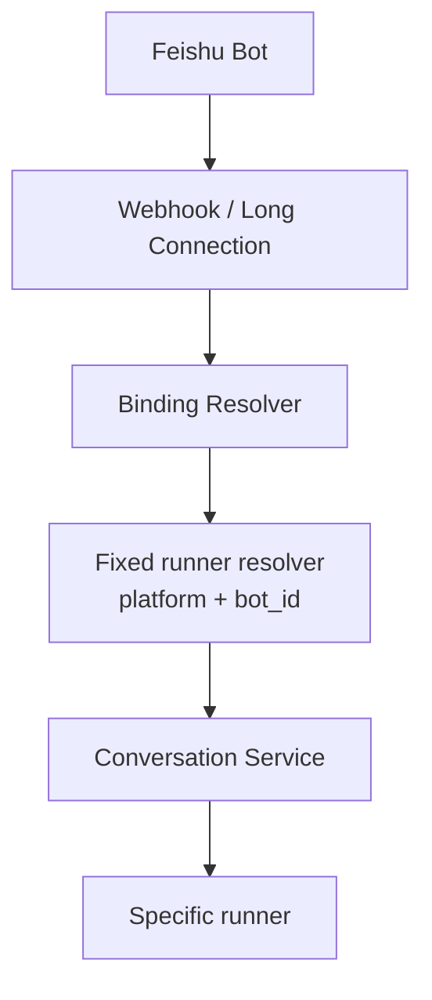
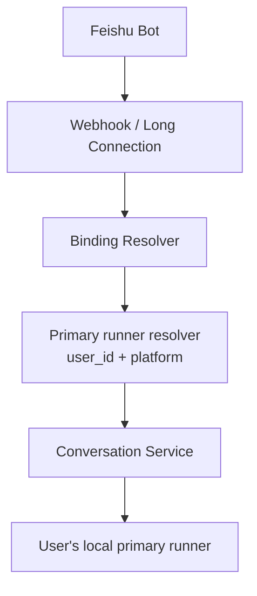

# Agent Daemon Primary Runner Design

Date: 2026-04-09

## 1. Overview

Current Feishu IM onboarding is operational but too manual:

1. user starts a local runner
2. user or operator copies `runner_id`
3. operator writes `ANYCAP_AGENT_CONTROL_FIXED_RUNNERS_JSON`
4. server restarts
5. user restarts the runner with `--runner-id`

This creates deployment friction and exposes control-plane details to end users.

The new v1 model is:

1. user signs in with `anycap login`
2. user runs `anycap agent daemon start --platform feishu --executor codex --workspace ...`
3. daemon registers or reuses a runner
4. daemon claims itself as the user's primary Feishu runner
5. Feishu messages route to that primary runner automatically

The user should never need to know `runner_id`.

## 2. Product Goal

For the first IM execution mode, AnyCap should act as:

- cloud control plane: binding, IM ingress, conversation/session persistence
- local execution plane: one daemon on the user's own machine

This is explicitly not multi-runner scheduling. It is "one Feishu bot talks to the user's own local machine."

## 3. Scope

### In scope

- add a user+platform -> primary runner mapping
- add runner claim API
- route Feishu conversations by bound user primary runner
- add `anycap agent daemon start|status|stop`
- keep `anycap agent runners serve` as a low-level/debug path
- update help, skill docs, and current-status docs

### Out of scope

- multi-runner scheduling
- pairing codes
- multi-machine selection UX
- group chat ownership
- background daemon process supervisor / OS service management

`daemon` is a product-facing command surface in v1, not a fully separate background process manager.

## 4. Core Rules

1. One user can have at most one primary runner per IM platform.
2. A new daemon start for `feishu` overwrites the previous primary runner for that user+platform.
3. Feishu inbound routing must no longer depend on `ANYCAP_AGENT_CONTROL_FIXED_RUNNERS_JSON`.
4. If no primary runner exists or the primary runner is offline, the bot should reply that the local AnyCap agent is offline.
5. `runner_id` remains an internal implementation detail for operators and debugging.

## 5. Architecture Change

### Before



### After



## 6. Data Model

Add a small internal table:

- `agent_primary_runners`

Fields:

- `user_id`
- `platform`
- `runner_id`
- `updated_at`

Constraints:

- unique `(user_id, platform)`
- foreign key semantics are logical only; keep migration style aligned with existing repository conventions

This resource is internal and does not need an external ID.

## 7. Server Behavior

### Claim primary runner

Add:

- `POST /v1/agent/runners/:id/claim-primary`

Behavior:

1. authenticate caller
2. verify runner belongs to caller
3. normalize platform from the runner
4. upsert `(user_id, platform) -> runner_id`
5. return the claimed runner DTO

### Resolve inbound Feishu conversation

Current conversation routing should change from:

- fixed resolver by `platform + bot_id`

to:

- resolve binding by `platform + bot_id + sender_id`
- read bound `user_id`
- resolve primary runner by `user_id + platform`

If no primary runner exists:

- return a user-facing error that the local AnyCap agent is offline

If the primary runner exists but is stale/offline:

- same user-facing offline response

## 8. CLI Shape

Keep:

- `anycap agent runners serve`

Add:

- `anycap agent daemon start`
- `anycap agent daemon status`
- `anycap agent daemon stop`

### `daemon start`

This is the main product path.

It should:

1. require logged-in user credentials through the normal CLI client
2. register or reuse a runner
3. call `claim-primary`
4. start the existing runner loop

The initial implementation can still run in the foreground. The key product improvement is automatic claim and routing, not background process management.

### `daemon status`

For v1, show:

- whether a primary runner is configured for the current user+platform
- the claimed runner
- whether the last observed state is idle/busy/offline

### `daemon stop`

For v1, keep this small and honest:

- stop means mark the current primary runner as draining/offline if possible, or explain that foreground process termination is manual
- do not fake local process control if we do not yet have PID/socket-based daemon management

## 9. User Flow

1. user runs `anycap login`
2. user runs:

```bash
anycap agent daemon start --platform feishu --executor codex --workspace /path/to/repo
```

3. daemon registers and claims primary automatically
4. user goes to Feishu and chats with the bot
5. if daemon exits, bot replies that the local AnyCap agent is offline

No `/pair`, no `runner_id`, no server env edits.

## 10. Backward Compatibility

- keep `ANYCAP_AGENT_CONTROL_FIXED_RUNNERS_JSON` support only as a legacy fallback if needed for non-daemon integration paths
- but Feishu chat-first flow should prefer primary-runner routing
- keep `agent runners serve` untouched for operators and tests

## 11. Testing Strategy

Focus on:

1. repository tests for primary runner upsert/get
2. conversation service tests for:
   - binding user with a primary runner
   - missing primary runner -> offline error
3. HTTP handler tests for `claim-primary`
4. CLI tests for `daemon start` calling register + claim before loop
5. doc/help verification for the new command path

## 12. Success Criteria

The feature is complete when:

1. a logged-in user can run `anycap agent daemon start --platform feishu --executor codex --workspace ...`
2. no server env change is needed per user machine
3. no manual `runner_id` copy/paste is needed
4. Feishu messages route to the current user's local machine automatically
5. missing daemon state produces a clear offline reply
