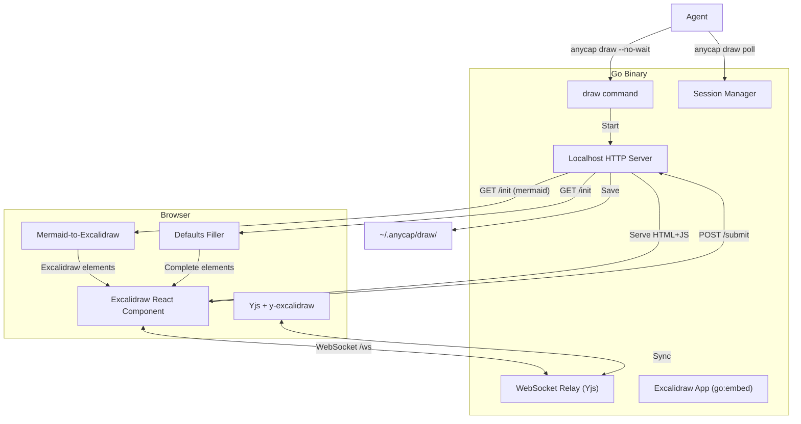
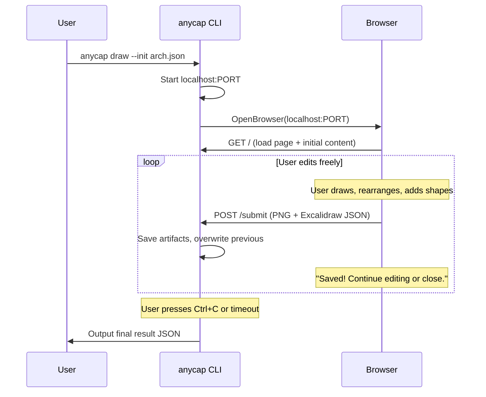
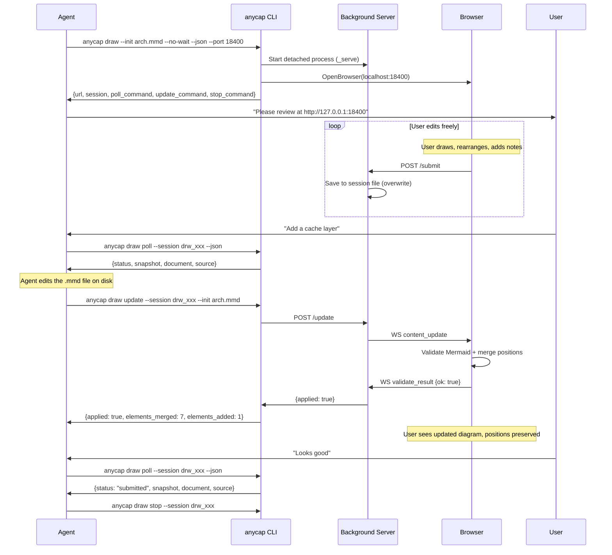
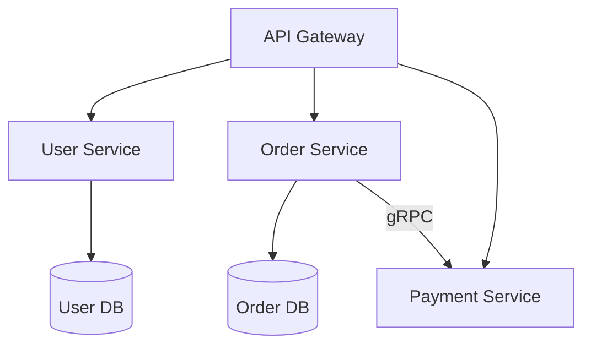
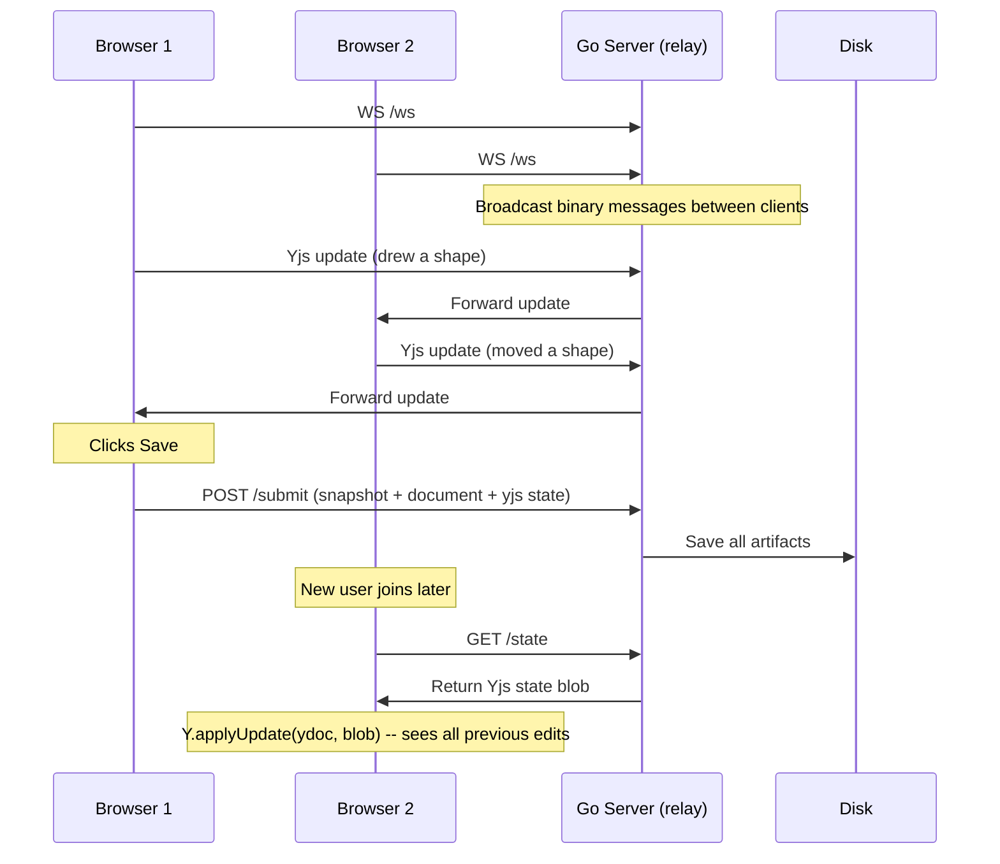
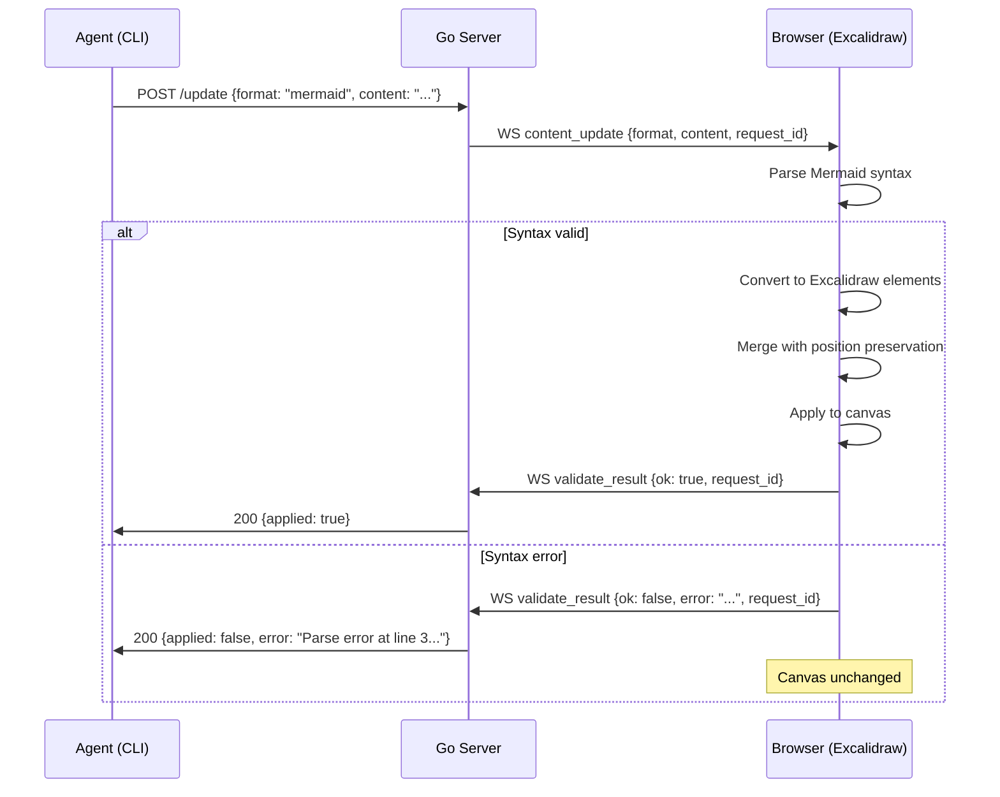

# Draw: Interactive Whiteboard for Agent-Human Co-creation -- Design

> Date: 2026-04-09
> Status: Draft

## Problem

Agents and humans discuss solutions (architecture, workflows, UI, brainstorming) through text. Text is linear and imprecise for spatial/visual reasoning. When an agent proposes an architecture diagram or a UI layout, the human cannot interact with it -- they can only describe modifications in words, leading to slow, error-prone iteration.

`anycap annotate` solves feedback on **existing** content. There is no tool for **creating** visual artifacts from scratch and iterating on them collaboratively.

## Solution

`anycap draw` is a top-level CLI command that opens a browser-based interactive whiteboard (powered by Excalidraw). The agent can pre-populate the whiteboard with shapes, diagrams, and notes. The user (or multiple users) can freely edit, rearrange, and annotate. The result is saved locally as both a PNG snapshot and an Excalidraw document for iteration.

### Positioning

| | annotate | draw |
|--|----------|------|
| Purpose | Feedback on existing content | Create and discuss from scratch |
| Input | Required target (image/url/video/audio) | Optional initial content (blank, JSON, image) |
| Canvas | Custom vanilla JS canvas, simple tools | Excalidraw (full whiteboard, rich shapes) |
| Output | Annotated image + recording | PNG snapshot + Excalidraw JSON |
| Collaboration | Yjs (custom annotation array) | Yjs (Excalidraw native) |
| Recording | Yes (screen + mic) | No |

## Why Excalidraw

| Criteria | tldraw | Excalidraw | Decision |
|----------|--------|------------|----------|
| License | Commercial license required for production | MIT | Excalidraw |
| React embedding | `@tldraw/tldraw` | `@excalidraw/excalidraw` (library mode) | Both good |
| Yjs support | Official | Community (mature) | Both good |
| Shape richness | Very good | Very good | Tie |
| Export | SVG/PNG | SVG/PNG + Excalidraw JSON | Excalidraw |
| Ecosystem | Newer | Widely supported (Obsidian, VS Code, Notion) | Excalidraw |
| Bundle size | ~2-3MB | ~1.5-2MB | Excalidraw slightly smaller |
| LLM familiarity | Less training data | Well-known format, LLMs can generate | Excalidraw |

Excalidraw wins on license (MIT vs commercial), ecosystem breadth, and LLM familiarity with the format.

## Command Interface

```bash
# Blank whiteboard
anycap draw --no-wait --json --port 18400

# Pre-populated with agent-generated content (simplified format)
anycap draw --init diagram.json --no-wait --json --port 18400

# Load existing Excalidraw document
anycap draw --init existing.excalidraw --no-wait --json --port 18400

# Load an image onto the canvas
anycap draw --image mockup.png --no-wait --json --port 18400

# Push updated content to active session (validates + merges)
anycap draw update --session drw_xxx --init arch_v2.mmd

# Session management (same pattern as annotate)
anycap draw poll --session drw_xxx --json
anycap draw stop --session drw_xxx

# Blocking mode (human direct use)
anycap draw
anycap draw --init existing.excalidraw
```

### Auto-detection for --init

| File extension | Behavior |
|---|---|
| `.excalidraw` | Load as native Excalidraw JSON |
| `.excalidraw.json` | Load as native Excalidraw JSON |
| `.json` | Inspect content: has `"type": "excalidraw"` -> native; has `"elements"` array -> simplified format |
| `.png`, `.jpg`, `.svg` | Load as background image on canvas |

### Flags

| Flag | Default | Description |
|------|---------|-------------|
| `--no-wait` | false | Non-blocking mode (background server) |
| `--json` | auto | JSON output |
| `--port` | 0 (random) | Server port |
| `--init` | none | Initial content file (JSON or Excalidraw) |
| `--image` | none | Background image file |
| `-o` | `./` | Output directory for saved artifacts |
| `--bind` | `127.0.0.1` | Bind address |

## Architecture

Pure CLI-side feature. No server changes required.

### Component Overview



### Blocking Mode



### Non-blocking Mode (for agents)



## Agent Pre-population

Two input formats, both already well-known to LLMs from training data.

### Format 1: Excalidraw JSON (with defaults filling)

LLMs have seen Excalidraw JSON extensively in training data. The format is well-documented and widely used (Obsidian, VS Code extensions, web tools). Agents can generate it directly.

The browser-side app fills in missing fields with sensible defaults, so the agent does not need to specify every field. A minimal valid element:

```json
{
  "type": "excalidraw",
  "version": 2,
  "elements": [
    {"type": "rectangle", "x": 100, "y": 100, "width": 200, "height": 80},
    {"type": "text", "x": 120, "y": 125, "text": "Frontend"}
  ]
}
```

The browser fills in `id`, `seed`, `versionNonce`, `strokeColor`, `roughness`, and all other required fields with defaults. This means agents can write partial Excalidraw JSON -- only the fields they care about -- and it just works.

### Format 2: Mermaid (converted to editable Excalidraw shapes)

LLMs are excellent at generating Mermaid syntax. The `@excalidraw/mermaid-to-excalidraw` library converts Mermaid diagrams into native Excalidraw elements with automatic layout.

This is the most natural path for agents generating architecture diagrams, flowcharts, sequence diagrams, etc.:



The agent writes this to a `.mmd` file, passes it to `--init`, and the user sees a fully laid-out, editable diagram. Every shape can be dragged, resized, recolored, and annotated.

Advantages over raw Excalidraw JSON for diagrams:
- **No coordinate math** -- Mermaid-to-Excalidraw handles layout automatically
- **No arrow binding** -- connections are defined by node IDs, not pixel coordinates
- **Compact** -- a 10-line Mermaid block replaces 100+ lines of Excalidraw JSON
- **LLMs are very good at Mermaid** -- far more Mermaid in training data than Excalidraw JSON

### Format detection

```
--init file auto-detection:

  *.excalidraw       -> Excalidraw JSON, fill defaults, load
  *.excalidraw.json  -> Excalidraw JSON, fill defaults, load
  *.mmd              -> Mermaid, convert via mermaid-to-excalidraw, load
  *.mermaid          -> Mermaid, convert via mermaid-to-excalidraw, load
  *.json             -> Excalidraw JSON (inspect for "type": "excalidraw"), fill defaults, load
  *.png, *.jpg, *.svg -> Load as image on canvas (same as --image)
```

### When to use which format

| Scenario | Best format | Why |
|----------|-------------|-----|
| Architecture diagram | Mermaid | Auto-layout, compact, agents excel at it |
| Flowchart / sequence | Mermaid | Native Mermaid diagram types |
| UI wireframe | Excalidraw JSON | Need precise positioning |
| Freeform brainstorm | Blank (no --init) | User draws from scratch |
| Iterate on previous | `.excalidraw` file | Re-open saved document |

### Defaults filling implementation

Browser-side (~50 lines JS):

```javascript
function fillDefaults(elements) {
    return elements.map(el => ({
        id: randomId(),
        seed: randomSeed(),
        version: 1,
        versionNonce: randomSeed(),
        angle: 0,
        strokeColor: '#1e1e1e',
        backgroundColor: 'transparent',
        fillStyle: 'solid',
        strokeWidth: 2,
        strokeStyle: 'solid',
        roughness: 1,
        opacity: 100,
        groupIds: [],
        frameId: null,
        roundness: el.type === 'rectangle' ? { type: 3 } : null,
        isDeleted: false,
        locked: false,
        boundElements: null,
        link: null,
        updated: Date.now(),
        ...el,  // agent-provided fields override defaults
    }));
}
```

## Multi-user Collaboration (Yjs)

Same dumb WebSocket relay pattern as annotate:



### Excalidraw + Yjs wiring

Excalidraw has community-maintained Yjs bindings. The integration:

```javascript
const ydoc = new Y.Doc();
const provider = new WebsocketProvider('ws://localhost:PORT', 'draw-room', ydoc);

// Excalidraw collaboration API
const collaboratorAPI = excalidrawAPI.getCollaborationAPI();
// Sync Excalidraw elements via Yjs shared types
const yElements = ydoc.getArray('elements');
```

Each user gets a different cursor color and name label. Excalidraw handles real-time cursor display natively when collaboration is active.

### State persistence

Same snapshot model as annotate:

| Event | Action |
|-------|--------|
| User clicks Save/Done | Client sends PNG + Excalidraw JSON + `Y.encodeStateAsUpdate(ydoc)` |
| New client connects | `GET /state` -> apply Yjs snapshot |
| Between saves | Edits exist only in connected clients (lost if all disconnect) |

Acceptable because sessions are short-lived and "Save" is a deliberate checkpoint.

## Localhost Server

### Endpoints

| Method | Path | Purpose |
|--------|------|---------|
| GET | `/` | Serve the Excalidraw HTML page |
| GET | `/init` | Return initial content JSON (if --init provided) |
| GET | `/image/*` | Serve image files (if --image provided) |
| POST | `/submit` | Save snapshot + document + Yjs state |
| POST | `/update` | Push new content to browser via WebSocket (validates + merges) |
| GET | `/poll` | Return latest submitted result |
| POST | `/shutdown` | Graceful shutdown (called by `stop` command) |
| GET | `/state` | Return latest Yjs state snapshot (binary) |
| WS | `/ws` | Yjs sync relay (WebSocket) |

### Security

- Bind to `127.0.0.1` only by default
- CSRF token: generated per session, embedded in HTML, validated on POST
- `/shutdown` requires CSRF token

### Lifecycle

Same as annotate:

| Trigger | Blocking mode | Non-blocking mode |
|---------|---------------|-------------------|
| User saves | Server stays alive | Server stays alive |
| Ctrl+C | Outputs latest result, exits | N/A |
| `stop` command | N/A | POST /shutdown |
| Timeout | 30 min from start | 30 min from start |

Timeout is longer than annotate (30 min vs 10 min) because whiteboard sessions tend to run longer.

## Submit Flow

When the user clicks "Save" (or "Done"):

1. Export canvas as PNG via Excalidraw's `exportToBlob()`
2. Export Excalidraw document JSON via `getSceneElements()` + `getAppState()`
3. Encode Yjs state: `Y.encodeStateAsUpdate(ydoc)`
4. POST `/submit` as `multipart/form-data`

### Submit Payload

| Field | Type | Required | Description |
|-------|------|----------|-------------|
| `csrf_token` | string | yes | CSRF token |
| `snapshot` | PNG file | yes | Canvas exported as PNG |
| `document` | JSON file | yes | Full Excalidraw document |
| `yjs_state` | binary file | no | Yjs state snapshot |

### Saved Artifacts

| File | Path | Purpose |
|------|------|---------|
| Snapshot | `{output_dir}/drw_{session}_snapshot.png` | Visual snapshot for agent consumption |
| Document | `{output_dir}/drw_{session}.excalidraw` | Full document for re-opening |
| Source | `{output_dir}/drw_{session}_source.mmd` | Original Mermaid source (if Mermaid input) |
| Yjs state | `~/.anycap/draw/{session}_yjs.bin` | Multi-user state sync |
| Session | `~/.anycap/draw/{session}.json` | Session metadata |

## Update Command and Multi-round Iteration

The `update` subcommand enables agents to push new content to an active draw session without restarting it. The agent edits files on disk (like editing code), then explicitly calls `update` to push changes to the browser.

### File-based Workflow

The agent's iteration path for Mermaid diagrams:

1. Agent writes initial `.mmd` file on disk
2. Agent starts a draw session: `anycap draw --init arch.mmd --no-wait --json`
3. User edits the diagram in the browser (drag, recolor, annotate)
4. Agent modifies the `.mmd` file on disk (standard file editing -- same as editing code)
5. Agent pushes the update: `anycap draw update --session drw_xxx --init arch.mmd`
6. Browser validates, merges positions, and applies
7. Repeat steps 4-6 as needed

No file watching. The agent decides when to push. This is deliberate -- agents already know how to edit files, and explicit push gives the agent control over timing.

### WebSocket Control Protocol

The `/ws` WebSocket carries two types of messages:

| Message type | Format | Direction | Purpose |
|---|---|---|---|
| Yjs sync | Binary | Bidirectional | Real-time collaboration (element sync, cursor positions) |
| Control | JSON text | Both | Content updates, validation results, session lifecycle |

Control message schema:

```json
// Server -> Browser: push new content
{
  "type": "content_update",
  "format": "mermaid",
  "content": "graph TD\n    A --> B\n    B --> C",
  "request_id": "req_abc123"
}

// Browser -> Server: validation success
{
  "type": "validate_result",
  "request_id": "req_abc123",
  "ok": true
}

// Browser -> Server: validation failure
{
  "type": "validate_result",
  "request_id": "req_abc123",
  "ok": false,
  "error": "Parse error at line 3: Expected node identifier"
}

// Server -> Browser: session closing
{
  "type": "session_closing"
}
```

### Mermaid Validation in Update

When the agent calls `update`, the browser validates the Mermaid syntax before applying. The CLI blocks until the validation result comes back via WebSocket. If validation fails, the canvas is unchanged and the agent gets the parse error immediately.



### Position-preserving Merge

When `update` pushes new Mermaid content, existing user modifications (element positions, colors, manual annotations) are preserved through label-based matching.

**Prerequisite:** Mermaid-origin elements are tagged with `customData.source = "mermaid"` when first converted, distinguishing them from user-added elements.

Merge algorithm (browser-side, ~80 lines TypeScript):

1. Extract position map from current Mermaid-tagged elements: `{ nodeLabel -> { x, y, width, height } }`
2. Convert new Mermaid to Excalidraw elements
3. For each new element with a label matching the position map: override auto-layout coordinates with saved position
4. For new elements (label not in map): keep auto-layout position
5. For deleted elements (old label not in new Mermaid): remove from canvas
6. User-added elements (no `mermaid` tag): preserved untouched

| Scenario | Behavior |
|----------|----------|
| Agent adds a new service node | Existing nodes stay in place, new node gets auto-layout position |
| Agent removes a node | That node disappears, everything else untouched |
| Agent changes connections | Arrows update, node positions preserved |
| User manually added annotations/shapes | Fully preserved (no mermaid tag) |
| User dragged Mermaid nodes to new positions | Positions preserved (matched by label) |

```typescript
function mergeWithPositionPreservation(
    oldElements: ExcalidrawElement[],
    newElements: ExcalidrawElement[]
): ExcalidrawElement[] {
    // 1. Build position map from old Mermaid-tagged elements
    const posMap = new Map<string, {x: number, y: number}>();
    for (const el of oldElements) {
        if (el.customData?.source === 'mermaid') {
            const label = getElementLabel(el, oldElements);
            if (label) posMap.set(label, { x: el.x, y: el.y });
        }
    }

    // 2. Apply saved positions to new elements where labels match
    const result = newElements.map(el => {
        const label = getElementLabel(el, newElements);
        const saved = label ? posMap.get(label) : undefined;
        return {
            ...el,
            ...(saved ? { x: saved.x, y: saved.y } : {}),
            customData: { source: 'mermaid' },
        };
    });

    // 3. Keep user-added elements (no mermaid tag)
    const userElements = oldElements.filter(
        el => el.customData?.source !== 'mermaid'
    );

    return [...result, ...userElements];
}

function getElementLabel(
    el: ExcalidrawElement,
    allElements: ExcalidrawElement[]
): string | undefined {
    if (el.type === 'text') return el.text;
    // For shapes, find bound text element
    const boundText = el.boundElements
        ?.filter(b => b.type === 'text')
        .map(b => allElements.find(e => e.id === b.id))
        .find(e => e?.type === 'text');
    return boundText?.text;
}
```

### Source Preservation

When the initial input is Mermaid, the original `.mmd` source is preserved alongside the `.excalidraw` output. The poll result returns both:

```json
{
    "status": "submitted",
    "snapshot": "/path/to/drw_xxx_snapshot.png",
    "document": "/path/to/drw_xxx.excalidraw",
    "source": "/path/to/arch.mmd",
    "hint": "..."
}
```

The agent chooses the iteration path based on what it needs to change:

- **Structural change** (add/remove nodes, change connections): edit the `.mmd` file, call `update`
- **Preserve user layout** (re-open for more manual editing): use `--init` with the `.excalidraw` file in a new session

## Output

### Start response (non-blocking)

```json
{
    "status": "started",
    "session": "drw_a1b2c3d4",
    "url": "http://127.0.0.1:18400",
    "poll_command": "anycap draw poll --session drw_a1b2c3d4 --json",
    "update_command": "anycap draw update --session drw_a1b2c3d4 --init <file>",
    "stop_command": "anycap draw stop --session drw_a1b2c3d4",
    "expires_in": 1800,
    "next_action_hint": "Show the URL to the user. They can draw, add shapes, and collaborate on the whiteboard. Use update_command to push new Mermaid content (validates before applying, preserves user positions). Use poll_command to retrieve the latest result. Use stop_command when done."
}
```

### Update response

```json
// Success: Mermaid valid, applied with position merge
{
    "applied": true,
    "elements_merged": 8,
    "elements_added": 2,
    "elements_removed": 0
}

// Failure: Mermaid syntax error, canvas unchanged
{
    "applied": false,
    "error": "Parse error at line 3: Expected node identifier after '-->'",
    "hint": "Fix the Mermaid syntax and retry with 'anycap draw update'"
}
```

### Result (poll)

```json
{
    "status": "submitted",
    "snapshot": "/path/to/drw_a1b2c3d4_snapshot.png",
    "document": "/path/to/drw_a1b2c3d4.excalidraw",
    "source": "/path/to/arch.mmd",
    "snapshot_dimensions": {"width": 1920, "height": 1080},
    "hint": "User modified the whiteboard. Use 'anycap image read' on the snapshot to understand the current state. Edit the .mmd source and use 'anycap draw update' for structural changes, or re-open the .excalidraw file with 'anycap draw --init' to preserve user layout."
}
```

### TTY Output (blocking mode)

```
Whiteboard saved. 12 elements on canvas.

Snapshot:  /path/to/drw_a1b2c3d4_snapshot.png
Document:  /path/to/drw_a1b2c3d4.excalidraw
```

## Bundle Strategy

Excalidraw is a React application. It must be pre-built and embedded in the Go binary.

### Build pipeline

```
draw/                        # Standalone build directory (not part of web/)
  src/
    App.tsx                  # Excalidraw component + Yjs wiring + translator
    translator.ts            # Simplified JSON -> Excalidraw elements
    main.tsx                 # React entry point
  index.html                 # Template HTML
  vite.config.ts             # Build config: single IIFE bundle, inline CSS
  package.json               # React + Excalidraw + Yjs deps

# Build output:
draw/dist/index.html         # Self-contained HTML (~1.5-2MB gzip)

# Embedded in Go:
internal/cli/draw/page.go    # go:embed draw/dist/index.html
```

### Build integration

```makefile
# In Makefile
draw-build:
    cd draw && npm ci && npm run build

# goreleaser pre-hook builds the draw bundle before compiling Go
```

The built `index.html` is committed to the repo (or built in CI) so that `go build` works without Node.js installed.

### Size impact

| Component | Gzipped size |
|-----------|-------------|
| React + ReactDOM | ~45 KB |
| Excalidraw | ~800 KB |
| Yjs + WebSocket provider | ~30 KB |
| Mermaid-to-Excalidraw + app code | ~50 KB |
| CSS (inlined) | ~50 KB |
| **Total** | **~930 KB gzip** |

Go binary size increase: ~1.5 MB (uncompressed embed). Acceptable -- the current CLI binary is already ~15-20 MB.

## Domain Model

### Session

```go
type DrawSession struct {
    SessionID    string      `json:"session_id"`
    PID          int         `json:"pid"`
    Port         int         `json:"port"`
    Bind         string      `json:"bind"`
    CSRFToken    string      `json:"csrf_token"`
    InitPath     string      `json:"init_path,omitempty"`
    InitFormat   string      `json:"init_format,omitempty"`  // "mermaid", "excalidraw", "image"
    SourcePath   string      `json:"source_path,omitempty"` // preserved .mmd source
    ImagePath    string      `json:"image_path,omitempty"`
    OutputDir    string      `json:"output_dir"`
    SnapshotPath string      `json:"snapshot_path,omitempty"`
    DocumentPath string      `json:"document_path,omitempty"`
    YjsStatePath string      `json:"yjs_state_path,omitempty"`
    Version      int         `json:"version"`
    CreatedAt    time.Time   `json:"created_at"`
    ExpiresAt    time.Time   `json:"expires_at"`
    Status       string      `json:"status"`
    Result       *DrawResult `json:"result"`
}
```

### DrawResult

```go
type DrawResult struct {
    Status             string          `json:"status"`
    Snapshot           string          `json:"snapshot"`
    Document           string          `json:"document"`
    Source             string          `json:"source,omitempty"`    // original .mmd file path (if Mermaid input)
    SnapshotDimensions *ImageDimensions `json:"snapshot_dimensions,omitempty"`
    Hint               string          `json:"hint"`
}
```

## Agent Workflows

### Architecture discussion

```bash
# 1. Agent generates a Mermaid diagram (most natural for agents)
cat > /tmp/arch.mmd << 'EOF'
graph TD
    GW[API Gateway] --> US[User Service]
    GW --> OS[Order Service]
    GW --> PS[Payment Service]
    OS --> DB[(Order DB)]
    US --> UDB[(User DB)]
    OS -->|gRPC| PS
EOF

# 2. Open interactive whiteboard (Mermaid auto-converts to editable shapes)
anycap draw --init /tmp/arch.mmd --no-wait --json --port 18400

# 3. Agent tells user: "Please review and modify at http://127.0.0.1:18400"

# 4. User drags things around, adds annotations, repositions nodes

# 5. User says "I think we need a cache layer"
anycap draw poll --session drw_xxx --json
anycap image read ./drw_xxx_snapshot.png --json

# 6. Agent edits the .mmd file (standard file editing, like editing code)
# Adds Cache node, updates connections
cat > /tmp/arch.mmd << 'EOF'
graph TD
    GW[API Gateway] --> Cache[Redis Cache]
    Cache --> US[User Service]
    Cache --> OS[Order Service]
    GW --> PS[Payment Service]
    OS --> DB[(Order DB)]
    US --> UDB[(User DB)]
    OS -->|gRPC| PS
EOF

# 7. Push update to same session (validates Mermaid, preserves user's positions)
anycap draw update --session drw_xxx --init /tmp/arch.mmd
# Returns: {"applied": true, "elements_merged": 7, "elements_added": 1, ...}

# 8. User sees updated diagram with their positions preserved + new Cache node
# User refines further...

# 9. Done -- poll final result and clean up
anycap draw poll --session drw_xxx --json
anycap draw stop --session drw_xxx
```

### Multi-user brainstorm

```bash
# Agent opens whiteboard with initial Mermaid or blank canvas
anycap draw --init brainstorm.mmd --no-wait --json --port 18400 --bind 0.0.0.0

# Agent shares URL with multiple people
# Each person opens http://<host>:18400 in their browser
# Everyone sees each other's cursors and edits in real-time
# Anyone can click Save to checkpoint

# Agent polls for result when team is done
anycap draw poll --session drw_xxx --json
```

### Iterative design

```bash
# Round 1: agent creates initial diagram via Mermaid
anycap draw --init wireframe.mmd --no-wait --json --port 18400
# User modifies -> agent polls -> reads snapshot

# Round 2: agent edits the .mmd file, pushes update (same session)
# Positions and user annotations are preserved
anycap draw update --session drw_xxx --init wireframe.mmd
# User refines -> agent polls -> reads snapshot

# Round 3: agent pushes another update
anycap draw update --session drw_xxx --init wireframe.mmd
# Converged.

# Alternative: if user made extensive manual changes and agent wants to
# build on the .excalidraw rather than the .mmd, start a NEW session:
anycap draw stop --session drw_xxx
anycap draw --init ./drw_xxx.excalidraw --no-wait --json --port 18400
# Now agent works with Excalidraw JSON directly
```

## File Structure

```
draw/                              # Excalidraw build (standalone, not in web/)
  src/
    App.tsx                        # Main Excalidraw app component
    defaults.ts                    # Fill missing Excalidraw element fields
    mermaid.ts                     # Mermaid-to-Excalidraw conversion wrapper
    merge.ts                       # Position-preserving merge for updates
    collaboration.ts               # Yjs + WebSocket provider setup
    control.ts                     # WebSocket control message handler
    main.tsx                       # React entry point
  index.html                      # HTML template
  vite.config.ts                  # Vite build config
  package.json
  tsconfig.json

internal/cli/
  draw/
    draw.go                       # Server, session, lifecycle
    draw_test.go                  # Tests
    page.go                       # go:embed HTML
  command/
    infra/
      draw.go                    # Top-level draw command registration
```

## Scope

### In scope

- `anycap draw` with blank / --init / --image modes
- Excalidraw-based whiteboard with full shape library
- Excalidraw JSON input with defaults filling (agents write partial JSON)
- Mermaid input with auto-conversion to editable Excalidraw shapes
- Blocking + non-blocking modes with session management
- Multi-user collaboration via Yjs WebSocket relay
- PNG snapshot + Excalidraw JSON export
- Iterative workflow (re-open .excalidraw files)

### Out of scope

- Recording (screen + mic) -- use `annotate` for that
- Server-side rendering of diagrams
- Hosted/cloud whiteboard sessions
- Real-time agent participation in the whiteboard (agent as a Yjs client)
- Template library (pre-built diagram templates)
- PlantUML import

## Dependencies

| Dependency | Purpose | License |
|------------|---------|---------|
| `@excalidraw/excalidraw` | Whiteboard React component | MIT |
| `@excalidraw/mermaid-to-excalidraw` | Mermaid diagram conversion | MIT |
| `react`, `react-dom` | UI framework | MIT |
| `yjs` | CRDT for collaboration | MIT |
| `y-websocket` | Yjs WebSocket provider | MIT |
| `nhooyr.io/websocket` (Go) | WebSocket server for Yjs relay | MIT |

## Implementation Order

1. **Draw build setup** -- `draw/` directory with Vite + Excalidraw + Yjs, build to single HTML
2. **Go server skeleton** -- `internal/cli/draw/`, embed HTML, serve endpoints, session management
3. **Excalidraw defaults filler** -- `defaults.ts`, fill missing fields so agents can write partial JSON
4. **Mermaid conversion** -- `mermaid.ts`, wire `@excalidraw/mermaid-to-excalidraw` for `.mmd` input
5. **Command registration** -- `internal/cli/command/infra/draw.go`, add to root.go
6. **Non-blocking mode** -- `_serve`, `poll`, `stop` subcommands (reuse annotate patterns)
7. **Yjs collaboration** -- WebSocket relay in Go, Yjs provider in browser
8. **Tests** -- defaults filler tests, mermaid conversion tests, command integration tests
9. **Skill file update** -- document `anycap draw` in skill references

## Open Questions

1. **Excalidraw version pinning**: which version of `@excalidraw/excalidraw` to target? Need to verify Yjs integration stability and `mermaid-to-excalidraw` compatibility with the chosen version.

2. **Mermaid subset support**: `@excalidraw/mermaid-to-excalidraw` may not support all Mermaid diagram types. Need to verify which types work (flowchart, sequence, class, ER, etc.) and document supported subset in skill files.

3. **Auto-layout for Excalidraw JSON input**: Mermaid handles layout automatically, but raw Excalidraw JSON requires manual coordinates. Could optionally support a layout pass (dagre or similar) for Excalidraw JSON input, but this adds complexity. Defer to v1.1 if needed.
