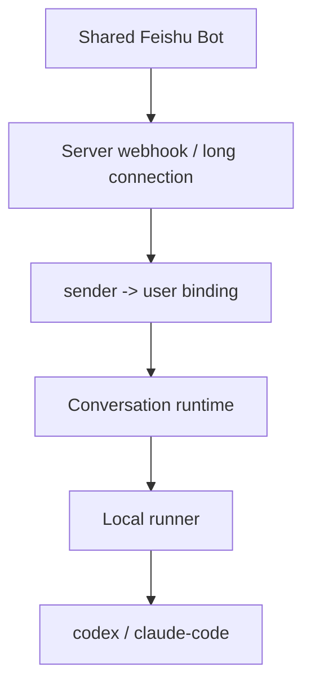
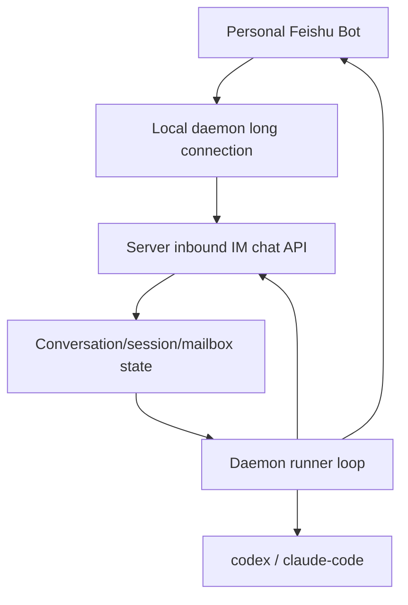

# Feishu Personal Bot Daemon Design

Date: 2026-04-09

## 1. Overview

The previous AnyCap IM design assumed:

1. server owns a shared Feishu bot
2. users bind their Feishu sender identity to an AnyCap account
3. server routes bot messages to a user's local runner

That model works for a shared bot, but it is awkward for the actual product goal:

- a user wants to control their own local codex / claude-code agent
- the bot is personal, not shared
- the user does not want `/bind`, pair codes, or server-side bot credential management

The new model is:

1. each user creates their own Feishu app bot
2. the local AnyCap daemon holds that bot's `app_id` and `app_secret`
3. the daemon opens the Feishu long connection directly
4. inbound messages from the personal bot are forwarded to AnyCap server as normalized chat events
5. conversation/session/mailbox state remains on AnyCap server
6. execution remains local on the daemon machine

This removes shared-bot identity binding from the main product path.

## 2. Product Goal

AnyCap IM should feel like:

- **personal bot**: the bot belongs to the user
- **local agent**: the agent runs on the user's own machine
- **remote control plane**: conversation state, execution history, and controls live on the server

The product promise becomes:

1. create a personal Feishu bot
2. start the local AnyCap daemon with Feishu credentials
3. chat with the bot
4. the bot controls the local coding agent while the server preserves history and control state

## 3. Scope

### In scope

- move Feishu long-connection ingress from server to local daemon
- let daemon own Feishu `app_id` / `app_secret`
- add a daemon -> server inbound chat API
- keep conversation/session/mailbox persistence on server
- remove `/bind` from the main path
- model a personal bot as part of daemon startup/configuration

### Out of scope

- shared bots
- team or group-chat ownership
- server-side storage of user Feishu bot secrets
- webhook-based public bot ingress as the default path
- multi-user bot multiplexing

## 4. Core Rules

1. A Feishu bot used for this flow is a **personal bot** tied to one AnyCap user.
2. Feishu bot credentials should live on the local daemon, not on AnyCap server.
3. Inbound Feishu messages should enter the system through the daemon, not through a public server webhook.
4. Conversation/session/mailbox state remains server-side.
5. The server stays the source of truth for history, control actions, and execution state.
6. `/bind` can remain as a legacy/debug path only while the old shared-bot flow still exists.

## 5. Architecture

### Before



### After



## 6. Responsibility Split

### Local daemon

- stores personal Feishu bot credentials
- opens and maintains Feishu long connection
- normalizes inbound Feishu message events
- sends normalized chat input to server
- polls runnable sessions from server
- runs local codex / claude-code
- sends result messages back to Feishu

### AnyCap server

- stores conversations
- stores sessions
- stores mailbox messages
- tracks runner / daemon lifecycle
- controls `stop` / `reset` / `fork` / `fire`
- returns session work to the daemon

This means:

- ingress is local
- persistence is remote

## 7. Identity Model

The previous shared-bot flow required:

- `sender -> AnyCap user`

because the server had to decide which user owned a shared bot message.

In the personal-bot model, the primary identity chain is:

- `daemon principal -> AnyCap user`
- `personal bot credentials -> same user`

Therefore:

- the daemon already represents one authenticated AnyCap user
- every inbound message received by that daemon's personal bot is implicitly for that same user

This removes the need for a separate sender-binding step in the normal path.

The sender identity from Feishu can still be stored as message metadata for audit/debugging, but it no longer drives user resolution.

## 8. Configuration Model

### Current problem

Server-level env vars:

- `ANYCAP_AGENT_CONTROL_FEISHU_APP_ID`
- `ANYCAP_AGENT_CONTROL_FEISHU_APP_SECRET`

only support one shared bot per server.

### New model

Move personal bot config to the daemon.

Suggested daemon inputs:

```bash
anycap connect credentials set feishu --app-id <FEISHU_APP_ID> --app-secret <FEISHU_APP_SECRET>

anycap connect feishu \
  --agent codex \
  --workspace /path/to/repo
```

Longer-term options:

- OS keychain integration for daemon-specific credentials
- interactive `anycap connect setup feishu`

But v1 can start with local daemon credential storage.

## 9. Chat Flow

### Normal message

1. user sends a DM to their personal Feishu bot
2. local daemon receives the event over long connection
3. daemon normalizes the event into:
   - platform
   - bot_id
   - chat_id
   - sender_id
   - message
4. daemon calls AnyCap server:
   - create/continue conversation
   - append session
5. server returns accepted state and persists the session
6. daemon continues its runner loop and executes the session locally
7. daemon sends progress/final reply back to Feishu
8. daemon updates the session state on server

### Control commands

Commands like:

- `/new`
- `/reset`
- `/status`
- `/stop`
- `/fork`

still go through the same daemon -> server path.

The parsing stays server-side so there is still one canonical conversation runtime.

## 10. Offline Behavior

If the daemon is offline:

- the personal Feishu bot is also offline

This is acceptable in the personal-bot model.

The tradeoff is deliberate:

- we avoid server-side bot secret storage and multi-tenant bot runtime management
- in exchange, IM availability matches local daemon availability

If needed later, AnyCap can add a lightweight server-managed health view or delayed catch-up path, but not in v1.

## 11. API Changes

Add a daemon-authenticated server endpoint such as:

- `POST /v1/agent/im/inbound`

Request body should contain normalized chat input:

- `platform`
- `bot_id`
- `chat_id`
- `sender_id`
- `message`

Behavior:

1. authenticate daemon through the normal AnyCap CLI/runner credentials
2. infer the owning user from the daemon principal
3. resolve or create conversation for that user
4. create or update a session
5. return the result payload needed by the daemon

This route replaces the shared-bot assumption in the main path.

## 12. Backward Compatibility

Keep existing server-side Feishu webhook / long-connection ingress temporarily for:

- legacy shared-bot experiments
- debugging
- migration

But make it clear in docs and skill guidance that the recommended path is now:

- personal bot on daemon

## 13. Testing Strategy

Focus on:

1. daemon command tests for personal Feishu config flags
2. daemon long-connection adapter tests
3. server inbound chat handler tests for daemon-submitted IM messages
4. conversation/session regression tests to prove server-side persistence remains unchanged
5. end-to-end manual test:
   - personal bot -> daemon -> server -> local codex -> daemon -> personal bot

## 14. Success Criteria

The feature is complete when:

1. a user can create their own Feishu bot and start AnyCap daemon with its credentials
2. no server env change is required per user bot
3. `/bind` is not needed in the normal product path
4. bot messages reach the local daemon first, but conversation/session state is still stored on server
5. the local daemon can execute codex / claude-code and reply back to the personal bot
