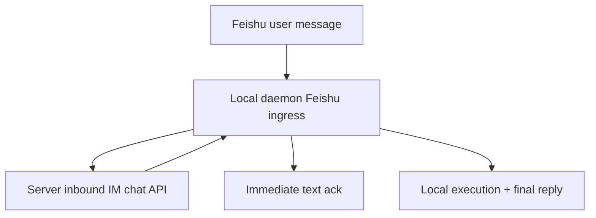
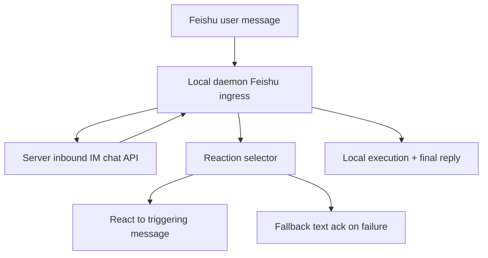

# Feishu Reaction Ack Design

Date: 2026-04-10

## 1. Overview

The current daemon-first personal Feishu bot flow sends an immediate text acknowledgment for most inbound chat messages:

- `会话已接收，正在处理中`
- `上一条还在处理中，这条消息已排队`

This works functionally, but it feels mechanical and chatty. In a personal bot workflow, the first acknowledgment should feel more like a natural teammate signal than a system banner.

The new design changes the immediate acknowledgment for normal personal-bot chat messages from a text reply to a Feishu reaction on the user's triggering message.

## 2. Goal

Make the daemon-first Feishu bot feel lighter and more human by:

1. reacting to the user's message instead of sending a repetitive text acknowledgment
2. allowing the agent to choose the reaction from a constrained allowlist
3. keeping the existing text acknowledgment as a fallback when reaction selection or delivery fails

## 3. Scope

### In scope

- daemon-first personal Feishu bot path only
- normal inbound chat messages
- lightweight reaction selection before the main run proceeds
- constrained emoji allowlist
- fallback to current text acknowledgments on failure

### Out of scope

- legacy shared-bot / server-owned Feishu ingress
- webhook path changes
- changing the final answer delivery model
- free-form emoji selection outside an allowlist
- reactions for non-Feishu platforms

## 4. Product Rules

1. Reaction ack only applies to the new local-daemon personal Feishu bot flow.
2. Reaction ack only applies to normal chat messages that would otherwise produce the generic immediate text acknowledgment.
3. Control commands keep their text replies:
   - `/new`
   - `/reset`
   - `/status`
   - `/stop`
   - `/fork`
   - `/fire`
4. The system must never block the main task execution if reaction ack fails.
5. If anything in the reaction-ack path fails, the daemon falls back to the current immediate text reply.

## 5. Desired User Experience

### Normal message

User message:

```text
帮我看一下这个报错
```

Immediate ack:

- the bot reacts to that message, for example `OnIt` or `SALUTE`

Later:

- the normal final answer still arrives as text

### Running/queued message

If a previous run is still active:

- the new user message still gets a reaction first
- if reaction cannot be applied, the daemon falls back to:
  - `上一条还在处理中，这条消息已排队`

### Command message

User message:

```text
/reset
```

Immediate ack:

- stays text-based
- no reaction-only behavior

## 6. Why Agent-Selected Reactions

There are three broad choices:

1. fixed single reaction
2. fixed reactions picked by server rules
3. agent-selected reaction from a restricted allowlist

This design chooses `3`.

Rationale:

- it matches the more natural teammate behavior already encouraged in the Present Lark integration
- it avoids hardcoding one mood for every message
- it still stays safe and testable because the final output must be validated against a strict allowlist

## 7. Allowlist

The first version should use a deliberately small set:

- `OnIt`
- `THUMBSUP`
- `SMILE`
- `SALUTE`
- `MUSCLE`
- `DONE`

The selector may propose only one value.

Any value outside this set is invalid and triggers fallback text acknowledgment.

## 8. Architecture

### Before



### After



## 9. Data Flow

1. Feishu long-connection event arrives at the local daemon.
2. Daemon normalizes the event.
3. Normalized event must now preserve the triggering Feishu `message_id`.
4. Daemon forwards the event to the existing server inbound IM API.
5. Server returns the existing inbound result and reply text as it does today.
6. Daemon decides whether the message is eligible for reaction ack:
   - Feishu personal-bot path
   - normal chat message
   - not a control command
7. If eligible, daemon runs a lightweight selector to choose one allowed reaction.
8. If selection succeeds and the reaction API succeeds, no immediate text ack is sent.
9. If selection fails or reaction create fails, daemon sends the existing immediate text ack.
10. Main task execution continues unchanged.

## 10. Selector Model

The selector should be a very small, bounded step that only returns one emoji type from the allowlist.

Requirements:

- input:
  - user message text
  - allowlist
- output:
  - exactly one emoji type
- validation:
  - trim whitespace
  - exact match against allowlist

The selector should not be allowed to:

- write files
- call tools
- produce explanatory text
- affect the main session result

This is a pre-run UX aid, not part of the task-solving pipeline.

## 11. Transport and Adapter Changes

### Normalized event

`NormalizedInboundEvent` needs a new field:

- `MessageID string`

This must be populated by:

- daemon-first Feishu long-connection normalization
- webhook normalization can add it too for consistency, but it is not required for the main product path

### Feishu adapter

`FeishuAdapter` needs a reaction API:

- `CreateReaction(ctx, binding, messageID, emojiType)`

This should use the direct Lark OpenAPI client and fail explicitly if:

- no message ID
- no direct client
- non-success response

## 12. Command vs Chat Behavior

### Keep text replies

These should remain text-only for now:

- `/new`
- `/reset`
- `/status`
- `/stop`
- `/fork`
- `/fire`

Reason:

- they communicate concrete state transitions
- they should remain explicit and auditable

### Use reaction ack

These should use reaction-first behavior:

- regular natural-language task requests
- ordinary follow-up chat messages

## 13. Failure Handling

Any failure in the new path must degrade safely.

Failure cases:

- no `message_id`
- selector error
- selector returns invalid emoji
- reaction API error
- context cancellation before reaction completes

Fallback behavior:

- send the current immediate text reply returned by the server

This preserves current reliability while improving UX when possible.

## 14. Testing Strategy

### Unit tests

- normalize Feishu long-connection event includes `message_id`
- command messages skip reaction path
- normal messages try reaction path
- invalid selected emoji falls back to text ack
- reaction API failure falls back to text ack
- successful reaction suppresses immediate text ack

### Integration-style handler tests

- daemon-owned inbound chat continues creating/queuing sessions exactly as before
- only the immediate acknowledgment transport changes

### Non-goals for tests

- no need to test actual emoji semantics
- no need to test legacy shared-bot behavior changes

## 15. Rollout

Roll out only on the personal-bot daemon path first.

This keeps blast radius small:

- no shared-bot regressions
- no server-side ingress changes
- no cross-platform behavior changes

If the UX is successful, later work can consider:

- richer allowlists
- queue-specific reaction choices
- limited command reactions

## 16. Summary

The main idea is simple:

- normal personal Feishu bot messages should feel acknowledged through reactions, not repetitive text
- the daemon should own this behavior
- the agent may choose the reaction, but only from a strict allowlist
- the existing text acknowledgment remains the reliability fallback
