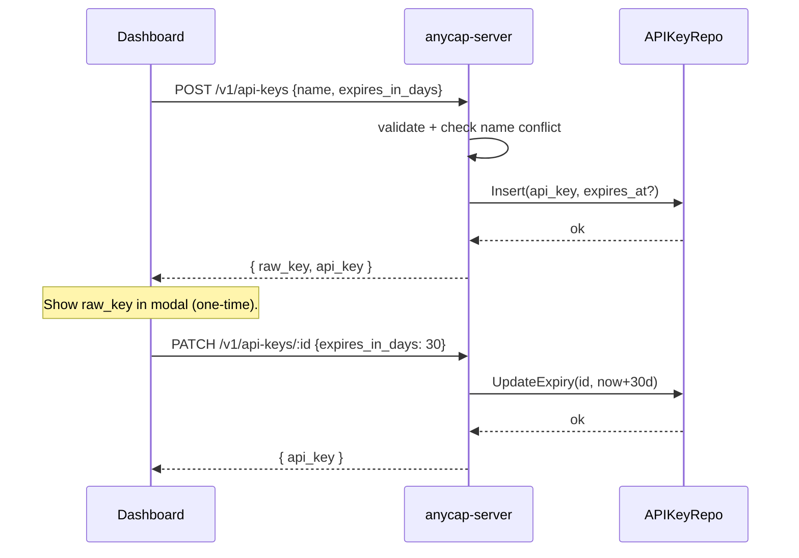

# Dashboard API Key Management

> 2026-04-17

## Goal

Let users create, list, extend, disable, and delete their own API keys from the
dashboard with configurable expiry — including unlimited (never expires) and
"extend / renew now" (reset expiry from now).

CLI behaviour stays unchanged. CLI authenticates via `anycap login` (OAuth),
which mints a `cli` API key automatically. The dashboard targets manual /
programmatic keys created and managed by the user.

The 401 "API key expired -> logout first" CLI hint is misleading because expired
keys cannot be revoked anyway. Updated to instruct re-login directly.

## Existing surface

- `port.APIKeyService` already has `Create`, `CreateWithTTL`, `Revoke`, `List`,
  `Disable`, `Delete`.
- DB column `api_keys.expires_at TIMESTAMPTZ NULL` already exists. `NULL` means
  no expiry.
- `GET /v1/api-keys`, `POST /v1/api-keys/:id/disable`, `DELETE /v1/api-keys/:id`
  already implemented.
- External ID prefix `akid_` already registered.

## New surface

| Method | Path | Purpose |
|---|---|---|
| `POST /v1/api-keys` | Create new key with optional expiry | Returns `raw_key` exactly once |
| `PATCH /v1/api-keys/:id` | Update name and/or expiry (extend / make permanent / time-bound) |

### Request bodies

**Create** (`POST /v1/api-keys`):

```json
{ "name": "ci-bot", "expires_in_days": 30 }
```

- `name`: required, `^[a-zA-Z0-9._-]{1,64}$`. Reserved name `cli` is rejected to
  avoid collision with the OAuth-managed CLI key.
- `expires_in_days`: optional. `0` or absent -> never expires. `1..3650` allowed.
- Conflict on duplicate active name -> `409 conflict`.

**Update** (`PATCH /v1/api-keys/:id`):

```json
{ "name": "ci-bot-prod", "expires_in_days": 30, "never_expires": false }
```

- All fields optional. At least one must be present.
- `expires_in_days >= 1` -> `expires_at = now + days`. (Extension = call with
  the same number again; computes from now, not from the previous expiry.)
- `never_expires: true` -> `expires_at = NULL`.
- `expires_in_days` and `never_expires: true` are mutually exclusive.

### Response

Both endpoints return a `ManagedAPIKey` DTO (extended) plus, for create only, a
top-level `raw_key`:

```json
{
  "data": {
    "raw_key": "ak_live_xxx",        // create only, surfaced once
    "api_key": {
      "id": "akid_xxx",
      "name": "ci-bot",
      "key_prefix": "ak_live_xx",
      "status": "active",
      "expires_at": "2026-05-17T00:00:00Z",
      "last_used_at": null,
      "created_at": "2026-04-17T00:00:00Z",
      "usage_summary": { ... }
    }
  }
}
```

### List response extension

`ManagedAPIKey` adds two fields: `key_prefix` (string) and `expires_at`
(`*time.Time`, omitempty). The web UI uses `expires_at` to render an "Expired"
or "Expires in N days" badge.

## Domain / port changes

```go
// port.APIKeyService
UpdateAPIKey(ctx, userID, keyID string, patch APIKeyUpdate) error

type APIKeyUpdate struct {
    Name          *string     // rename if non-nil
    ExpiresAt     *time.Time  // set explicit expiry
    ClearExpiry   bool        // unset expiry (never_expires)
    Rename        bool        // unused: presence implied by Name != nil
}
```

`MemoryService` and `RepositoryAPIKeyService` both implement it.

`Service.createAPIKey` (application/system) and `Service.UpdateAPIKey` enforce
input validation (name regex, `cli` reserved name, ttl bounds, name conflict
with other active keys belonging to the user).

## Flow



## Web

`/dashboard/api-keys` becomes a real page:

- Table: name, key prefix, status, expiry (badge: never expires / expires
  YYYY-MM-DD / expired), last used, created, actions.
- Toolbar: "New key" button -> `CreateApiKeyModal`.
- Per-row actions (in "..." menu): Extend, Make permanent, Disable, Delete.
- Reveal modal: shown once after create. Includes copy button + warning.
- Uses SWR `useApiKeys()` and mutation helpers in `web/src/lib/api/hooks.ts`.

Components live in `web/src/components/dashboard/`:
`ApiKeysTable`, `CreateApiKeyModal`, `RevealApiKeyModal`, `ExtendApiKeyModal`,
`ApiKeyRowActions`. All follow `web/docs/design-guideline.md`.

## Out of scope

- CLI: no `anycap apikey create` command. CLI continues to use the OAuth-minted
  `cli` key. Only the 401 message text is adjusted.
- Auto-renewal, expiry email notifications, admin/multi-tenant key management.
- Migration: no schema change required (`expires_at` is already nullable).
