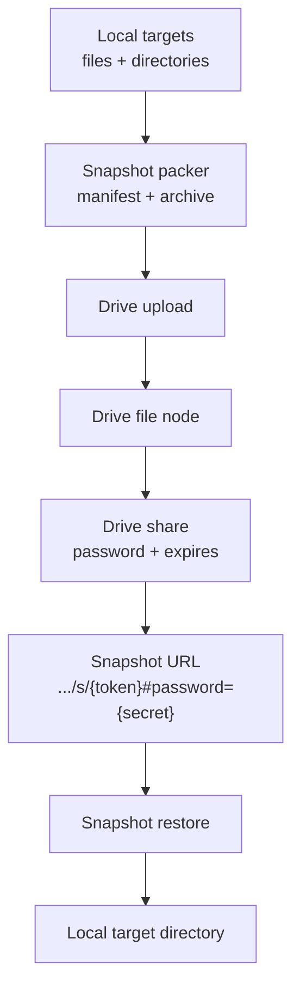

# Snapshot Infra Design

Date: 2026-04-20

## 1. Overview

AnyCap should add a new infra capability: `snapshot`.

`snapshot` is a portable project handoff primitive built on top of `drive`.

Primary story:

1. An agent selects one or more local targets (files and directories).
2. AnyCap packages them into a single archive file with a small manifest.
3. The archive is uploaded to `drive`.
4. AnyCap creates a password-protected drive share link with an expiration time.
5. The resulting snapshot URL can be handed to another device, another account, or another agent brand.
6. Another agent restores the snapshot from that single URL and continues work locally with one raw download request plus the fragment password.

This is not a generic backup system and not a machine image export. It is a narrow infra primitive for moving a recoverable working set between agents.

## 2. Product Positioning

AnyCap already has:

- `drive` for object storage and sharing
- `agent control` for persistent conversation/session state

`snapshot` sits in the infra layer and solves a different problem:

- move a recoverable project state across devices, accounts, and agent brands
- avoid manual upload/download of many files
- avoid binding work continuation to one local machine or one cloud agent thread

`handoff` is optional. The core value is the portable file snapshot itself.

## 3. Scope and Non-Goals

### In scope

- single-file snapshot archive
- multiple input targets
- targets can be files or directories
- upload snapshot archive to `drive`
- create password-protected expiring share link
- restore snapshot from a single URL
- default sensitive-file detection with safe-by-default blocking
- concise CLI help and skill guidance for agents

### Out of scope for v1

- full machine backup
- preserving private executor/session state from Codex, Claude Code, Cursor, etc.
- diff-based incremental snapshot sync
- server-side archive introspection before restore
- automatic reconstruction of conversation context from remote chat systems
- public share links without password
- permanent snapshots without expiration

## 4. Core Principles

1. `snapshot` is an infra abstraction; `drive` remains the storage substrate.
2. The snapshot should be one portable archive file.
3. Create should be safe by default.
4. Sensitive files should block create unless the user explicitly opts in with `--force`.
5. Cross-account restore should require only one URL.
6. Password material in the URL must stay in the fragment so it is parsed locally and not sent to the server.
7. Snapshot packing should be deterministic and predictable.
8. Agent guidance should optimize for correctness and brevity, not for exhaustive education.

## 5. Architecture



Responsibilities:

- snapshot packer: collect targets, apply safety rules, build manifest, create one archive
- drive: store archive object and provide share link
- snapshot restore: parse URL fragment locally, download archive, verify manifest, extract locally

## 6. Snapshot Resource Model

The v1 server does not need a new durable top-level snapshot resource if the archive is represented by an ordinary drive file plus a drive share link.

The snapshot abstraction is primarily expressed in:

- CLI commands
- archive file format
- share URL convention

Optional future evolution:

- add a first-class `Snapshot` resource only if listing, policy, or audit needs exceed what drive metadata can express

## 7. Archive Format

The snapshot should be a single archive file uploaded to drive.

For v1, use plain `tar` without compression.

Recommended filename shape:

- `name.snapshot.tar`

The archive should contain:

- `.anycap-snapshot/manifest.json`
- `.anycap-snapshot/handoff.md` or `.json` when provided
- packed targets under their relative archive paths

Example structure:

```text
.anycap-snapshot/manifest.json
.anycap-snapshot/handoff.md
app/
docs/
README.md
go.mod
go.sum
```

`manifest.json` should include:

- `format_version`
- `created_at`
- `expires_at`
- `target_count`
- `archive_root_name`
- `entries`
- `warnings`
- `handoff_present`

Each manifest entry should include:

- original target input
- normalized archive path
- kind (`file` or `directory`)
- size when applicable
- checksum when applicable

Archive safety rules:

- manifest and payload paths must always be relative
- extraction must reject absolute paths
- extraction must reject `..` path traversal
- extraction must reject symlinks, hardlinks, device files, and other non-regular file types
- extraction must never write outside the requested target directory

## 8. Share URL Format

The restore handle should be a single URL:

```text
https://drive.anycap.cloud/s/{token}#password={secret}
```

Rules:

- share token stays in the normal URL path
- password stays in the fragment
- the fragment is parsed locally by the CLI
- the fragment is never sent to the server as part of the HTTP request
- machine restore uses the existing raw share route plus a request header

Machine restore contract:

- CLI converts the snapshot URL into a raw GET request against the same share token
- CLI sends the password in `X-Anycap-Share-Password`
- edge validates the header only for raw file download routes
- edge returns the raw archive bytes directly on success
- edge returns machine-readable HTTP auth errors on failure instead of HTML password pages

Example:

```text
GET /s/{token}?raw=1
X-Anycap-Share-Password: {secret}
```

This allows:

- one-string handoff across agents
- better safety than `?password=...` query parameters

## 9. CLI Surface

### Create

```bash
anycap snapshot create --target . --target README.md
```

Suggested flags:

- `--target <path>` repeatable, required, files or directories
- `--expires <duration>` optional, default required by policy with a sensible default such as `7d`
- `--name <name>` optional output archive/display name
- `--handoff-file <path>` optional
- `--force` optional, ignore sensitive-file warnings and continue
- `--overwrite` optional, replace an existing snapshot with the same name

Behavior:

1. validate all targets exist
2. scan targets for sensitive files
3. if sensitive files are detected and `--force` is not set:
   - abort create
   - return warnings
   - do not package or upload
4. normalize and deduplicate targets
5. if allowed to continue:
   - package all targets into one archive
   - resolve snapshot name
   - resolve `/_snapshots`
   - check whether `/_snapshots/{name}.snapshot.tar` already exists via exact `parent_id + name` lookup
   - if it exists and `--overwrite` is not set:
     - abort create
     - do not upload anything
   - if it exists and `--overwrite` is set:
     - upload the new archive under a temporary name
     - replace the old snapshot atomically at the logical name boundary
   - generate a strong random password
   - create drive share with password and expiration
   - return a restore URL with `#password=...`

Suggested output:

```json
{
  "status": "success",
  "snapshot_url": "https://drive.anycap.cloud/s/abc123#password=RANDOM_SECRET",
  "expires_at": "2026-04-27T12:00:00Z",
  "file_id": "dn_xxx",
  "archive_name": "repo.snapshot.tar",
  "restore_command": "anycap snapshot restore 'https://drive.anycap.cloud/s/abc123#password=RANDOM_SECRET' --target ./restored"
}
```

### Restore

```bash
anycap snapshot restore 'https://drive.anycap.cloud/s/abc123#password=xxx' --target ./restored
```

Suggested flags:

- positional snapshot URL or `--url`
- `--target <dir>` required, single local directory

Behavior:

1. parse the share token from the URL
2. parse `#password=...` locally
3. convert the share URL into a raw download request
4. send `X-Anycap-Share-Password` when password is present
5. download the archive from the share link
6. verify archive format and manifest
7. refuse extraction if the target directory already exists and is non-empty
8. extract into the target directory
9. report whether optional handoff content was present

### Optional Follow-up Commands

Not required for the first pass, but likely useful:

- `anycap snapshot inspect <local-file>`
- `anycap snapshot revoke <drive-node-id|src-path>`

## 10. Multiple Target Semantics

Create must support multiple targets.

Rules:

- every `--target` may point to a file or directory
- directories are packed recursively
- files are packed directly
- archive paths should remain stable and readable
- manifest must record the original target list
- target normalization must resolve duplicates automatically
- if a selected directory already contains another selected target, the child target is dropped automatically
- exact duplicate targets are dropped automatically
- conflicting archive root paths from distinct targets must fail fast

Restore still uses a single target directory because extraction must land in one local location.

## 11. Sensitive File Policy

### Default posture

Sensitive files should block snapshot creation by default.

This is a hard safety rule, not a soft recommendation.

If any sensitive file is detected inside the selected targets:

- create must stop
- create must not upload anything
- the CLI must return warnings describing the blocked files

### Override posture

`--force` allows the user to ignore the warnings and continue anyway.

This should be treated as an explicit override for cases where the user understands the consequences and intentionally wants the files included.

### Why block instead of silently skipping

Silent exclusion is too ambiguous:

- the receiving agent may miss required files without realizing it
- the sender may falsely assume the snapshot is complete

Blocking is clearer:

- the user sees exactly what is sensitive
- the user decides whether to revise targets or force inclusion

### Initial detection categories

The initial matcher should be simple and conservative.

Examples:

- `.env`
- `.env.*`
- `*.pem`
- `*.key`
- `*.p12`
- `*.pfx`
- `id_rsa`
- `id_ed25519`
- credential exports
- token or cookie dumps

The exact matcher can evolve, but the user-facing rule should stay stable:

- secrets and credentials are not included by default

## 12. Default Inclusion Guidance

The help and skill should guide agents toward the files needed to continue work:

- the key and important content that represents the correct current outputs and the important inputs needed for the next step
- source code
- project configuration
- documentation
- scripts
- lockfiles

Snapshot packing itself should remain predictable.

For v1:

- the packer includes the normalized selected targets as-is
- the packer does not try to guess whether non-sensitive files are stale, abandoned, or superseded
- judgment about which targets to pick belongs in the help and skill guidance, not in hidden packer heuristics

Do not treat snapshot as a dump of everything under the selected targets.

The selection rule should be:

- include the minimum sufficient working set
- preserve correct and valuable outputs that the next agent or user will still need
- prefer current authoritative files
- skip temporary, stale, superseded, abandoned, or disposable content
- if the user gives explicit handoff requirements, follow them instead of applying generic heuristics rigidly

Examples of content that usually does not need to be included even when not sensitive:

- temporary scratch files
- one-off exports
- stale notes already replaced by newer docs
- abandoned experiments
- obsolete generated artifacts
- old backup copies such as `*.old`, `*.bak`, or `copy of *`

Examples:

- `package.json`, lockfiles
- `pyproject.toml`, `uv.lock`
- `go.mod`, `go.sum`
- `Cargo.toml`, `Cargo.lock`
- docs, specs, prompts, config templates

## 13. Default Exclusion Guidance

The help and skill should clearly tell agents what not to include.

Do not include:

- secrets and credentials
- `.env`, `.env.*`
- private keys, cert bundles, token dumps, cookies
- `.git/`
- local dependency trees such as `node_modules/`, `.venv/`, `venv/`
- build outputs such as `dist/`, `build/`, `.next/`
- caches and temp directories
- machine-local or agent-local runtime/session state

For v1 these exclusions are explicit packer rules only for clearly technical content classes such as:

- `.git/`
- `node_modules/`, `.venv/`, `venv/`
- `.next/`, `dist/`, `build/`
- common cache and temp directories

The packer should not silently exclude arbitrary non-sensitive project content based on fuzzy heuristics.

This guidance should be concise and high signal.

## 14. Security Model

The v1 security posture should be:

- password-protected share is mandatory for snapshots
- expiration time is mandatory for snapshots
- password must be generated as a strong random secret by default
- restore uses a single URL with fragment password
- the fragment is never sent to the server
- machine restore uses `X-Anycap-Share-Password` on raw download requests
- users can rotate or revoke the underlying drive share if needed

This is intentionally simpler than introducing a separate claim/grant protocol in v1.

## 15. Drive Placement

Snapshot archives should be uploaded under a reserved drive folder path:

- `/_snapshots/{name}.snapshot.tar`

This gives snapshots:

- a predictable storage location
- one stable logical path per snapshot name
- simple manual browsing
- a clear separation from user-facing project files

The CLI should ensure the `/_snapshots` folder exists before upload.

Same-name existence checks should not enumerate the whole folder.

Preferred lookup path:

- call a direct drive path-resolve API for `/_snapshots/{name}.snapshot.tar`
- let the server resolve the path in PostgreSQL with recursive traversal
- avoid any client-side directory enumeration

Example upload path:

- `/_snapshots/repo.snapshot.tar`

### Naming and replacement

Rules:

- snapshot names must be stable and filesystem-safe
- each snapshot name is unique within `/_snapshots`
- create fails by default when the target snapshot name already exists
- `--overwrite` explicitly replaces the existing snapshot with the same name
- replacement should avoid leaving two active files with the same logical snapshot name
- replacement should produce a fresh share URL for the new archive

## 16. Help and Skill Requirements

The CLI help and skill documentation should be brief and operational.

They should answer only:

- what snapshot is for
- how to create one
- how to restore one
- that snapshot should contain the correct important working set, not every file in sight
- what to include
- what not to include
- what happens when sensitive files are detected

They should not turn into a long tutorial.

### Required guidance points

- use snapshot to hand off a recoverable working set
- create accepts multiple file/directory targets
- restore accepts one URL and one local target directory
- the URL may contain `#password=...`
- include the important current outputs and the important files needed for the next step
- skip temporary, stale, superseded, abandoned, and disposable content
- if the user explicitly asks to include specific files or outputs, follow that requirement unless blocked by a safety rule
- secrets block create by default
- `--force` overrides the warning and continues
- prefer source, config, docs, and lockfiles
- avoid secrets, `.git`, local dependencies, caches, build outputs, and machine-local state

### Suggested compact skill wording

`snapshot` creates a portable project archive from one or more local targets.
Use it to hand off work across devices, accounts, or agent brands.
Include the important current outputs and the key files needed for the next step, such as source, configs, docs, scripts, lockfiles, and correct deliverables the next agent or user will still need.
Do not treat snapshot as a full dump of the selected targets; skip temporary, stale, superseded, abandoned, or disposable content by default.
If the user explicitly asks to include particular files or outputs, follow that requirement unless blocked by a safety rule.
Do not include secrets, credentials, `.git`, local dependencies, caches, build outputs, or machine-local agent state.
If sensitive files are detected, create stops and warns unless `--force` is set.
Restore from a single shared URL; if the URL contains `#password=...`, the CLI reads it locally.

## 17. Implementation Notes

### Reuse

Reuse as much of the existing drive flow as possible:

- drive upload for archive storage
- drive share for public cross-account restore
- existing password hashing and expiration support

### Minimal new work

New work should focus on:

- snapshot tar pack/unpack logic
- CLI command group
- sensitive-file detection
- snapshot-specific help and skill docs
- raw share header auth for machine restore

Implementation should also:

- create or resolve `/_snapshots` before upload
- use direct drive path resolution for same-name conflict detection
- upload the tar archive into that folder instead of arbitrary drive locations
- treat snapshot name conflicts explicitly
- support `--overwrite` for intentional replacement
- keep browser password-page behavior unchanged for human share access
- allow raw share downloads to authenticate with `X-Anycap-Share-Password`

### Recommended command placement

Add a new top-level infra command:

```text
anycap snapshot
  create
  restore
```

This should not be nested under `drive` because the user intent is no longer generic file storage.

## 18. Open Questions

1. Should sensitive-file detection support a future allowlist config file, or is `--force` enough for v1?
2. Should a future v2 add snapshot history/versioning behind one logical snapshot name?

## 19. Recommended v1 Cut

Ship the smallest viable version with:

- `snapshot create`
- `snapshot restore`
- single tar archive file
- multiple local targets
- upload to `/_snapshots/{name}.snapshot.tar`
- drive upload
- drive share with password and expiration
- restore URL using `#password=...`
- sensitive-file blocking plus `--force`
- concise CLI help and skill guidance

This is enough to make AnyCap's `drive` evolve from generic file storage into a practical cross-agent handoff primitive without adding unnecessary server complexity in the first version.
