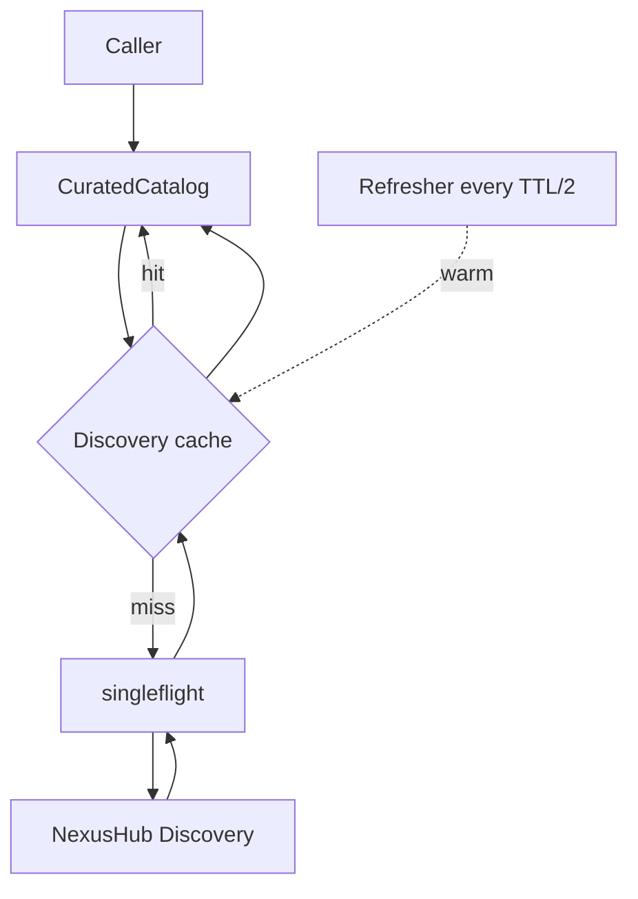

# NexusHub Discovery Migration + dconf Model Curation

> Date: 2026-05-12
> Owner: anycap-server
> Scope: server-only refactor; CLI behavior is unchanged.

## Goal

Switch the catalog data path from
`Postgres anycap_model_routes + NexusHub /v1/atomic_node` to
`dconf model_curation (with embedded fallback) + NexusHub Discovery /v1/atomic_nodes/discovery`.

Reasons:

- NexusHub published a new Discovery API that exposes a stable, externally-safe
  contract (`tool_definition[algo].schema`, pricing, descriptions, no upstream
  credentials).
- We never really used the `anycap_model_routes` write path beyond the initial
  CSV seed; the read path is the only consumer of that table.
- Operations want to curate the public model list from a single dconf JSON,
  changeable without redeploy.

## Non-Goals

- Do not delete the legacy `anycap_model_routes` table, the
  `internal/infrastructure/postgres/catalog_repo.go`, the
  `internal/infrastructure/nexushub/platform_client.go` legacy paths, or the
  `/v1/admin/model-routes` admin handlers. Leave them in place, unwired, to
  unblock revert. Plan to remove in a later cleanup.
- Do not change the CLI. Endpoints, response shapes, and `--param` keys stay
  identical.
- Do not introduce a feature_access entry per model. dconf `feature_access`
  remains the per-user / per-capability gate; `model_curation` only controls
  which models appear in `/v1/{cap}/models`.

## High-Level Flow

```mermaid
flowchart LR
  subgraph dconf
    F[feature_access]
    R[rate_limit]
    M[model_curation]
  end
  M --> CC[CuratedCatalog]
  D[NexusHub Discovery]:::ext --> DC[Discovery client + cache]
  DC --> CC
  CC --> CS[catalog.Service]
  CS --> H[/v1/{cap}/models, /schema/]
  F -.gate.-> H
  classDef ext fill:#fef
```

`CuratedCatalog` implements `port.CatalogRepository`. It joins the
curated list with Discovery `tool_definition` to build `ModelSpec`,
flattens schema for backward compatibility, and serves `ListModels` /
`GetModel`.

## Components

### 1. NexusHub Discovery client

Path: `internal/infrastructure/nexushub/discovery_client.go` (new)

Endpoints:

| Method | URL | Purpose |
|---|---|---|
| GET | `/v1/atomic_nodes/discovery?category=&algo_type=&page_size=200&refresh=` | List by capability |
| GET | `/v1/atomic_nodes/discovery/:ability_key?algo_type=&refresh=` | Single node, scoped to one algo |

DTO:

```go
type DiscoveryNode struct {
    AbilityKey     string                    `json:"ability_key"`
    Name           string                    `json:"name"`
    Description    string                    `json:"description"`
    Category       string                    `json:"category"`
    Provider       string                    `json:"provider"`
    State          string                    `json:"state"`
    PricingInfo    map[string]any            `json:"pricing_info"`
    UpdateTime     *time.Time                `json:"updated_at"`
    ToolDefinition map[string]ToolDefEntry   `json:"tool_definition"`
}

type ToolDefEntry struct {
    AlgoDescription struct {
        Name        string `json:"name"`
        Description string `json:"description"`
    } `json:"algo_description"`
    Schema     map[string]any `json:"schema"`
    Annotation map[string]any `json:"annotation"`
}
```

### 2. Discovery cache

Path: `internal/infrastructure/nexushub/discovery_cache.go` (new)

- Two-tier in-memory cache:
  - `node:{ability_key}:{algo_type}` -> `*DiscoveryNode`
  - `list:{category}` -> `[]DiscoveryNode`
- TTL: `ANYCAP_NEXUSHUB_DISCOVERY_TTL` (default `5m`).
- `golang.org/x/sync/singleflight` to coalesce concurrent misses.
- Stale-while-error: on upstream failure, return last good value if its age is
  within `2 * TTL`, log a warning, do not surface the error.
- Background refresher (registered on `serverRuntime`): every `TTL/2` walks the
  union of curated `(ability_key, algo_type)` pairs and warms the cache so
  user-facing latency is always cache-hit.

NexusHub also caches Discovery for 60s on its side, so worst-case data
freshness is ~6 minutes; acceptable for the model catalog.

### 3. CuratedCatalog

Path: `internal/infrastructure/curatedcatalog/catalog.go` (new)

Implements `port.CatalogRepository`:

- `ListModels(ctx, capability)` -> for every curation entry in that capability,
  builds a `ModelSpec` joined with Discovery (skips entries missing in
  Discovery, log WARN once per startup).
- `GetModel(ctx, capability, modelID)` -> same single-model build.

Per `(operation, mode)` curation row, we:

1. Fetch Discovery node + algo (cached).
2. Add a `RouteBinding{Direct, AbilityKey, AlgoType, Mode, Enabled=true,
   Priority=100, GenType=string(capability)}`.
3. Add a `ModeSpec{Mode, Description = curation.mode_description ||
   discovery.algo_description.description}`.
4. Flatten schema (see below) -> `OperationSpec.RequestHints` and
   `OperationSpec.ModeSchemas[mode]`.
5. Set `ModelSpec.DisplayName` from curation, `ModelDescription` from
   curation, `Status = "active"`.

### 4. Schema flatten

Discovery schema shape:

```json
{
  "type": "object",
  "required": ["gen_type", "prompt", "image_option"],
  "properties": {
    "gen_type": {"type": "string", "enum": ["image"]},
    "prompt":   {"type": "string", "description": "..."},
    "image_option": {
      "type": "object",
      "required": ["type"],
      "properties": {
        "type":       {"type": "string", "enum": ["txt_2_img"]},
        "ratio":      {"type": "string", "enum": [...], "description": "..."},
        "resolution": {"type": "string", "enum": [...], "description": "..."},
        "format":     {"type": "string", "enum": [...]}
      }
    }
  }
}
```

Flattened (legacy compatible) shape returned in `RequestHints`:

| Discovery path | Legacy key |
|---|---|
| `properties.prompt` | `prompt` (description preserved) |
| `properties.image_option.properties.ratio` | `aspect_ratio` (description, enum preserved) |
| `properties.image_option.properties.resolution` | `resolution` |
| `properties.image_option.properties.format` | `format` |
| `properties.video_option.properties.duration` | `duration` |
| `properties.video_option.properties.ratio` | `aspect_ratio` |
| `properties.video_option.properties.resolution` | `resolution` |
| `properties.music_option.properties.duration` | `duration` |
| `properties.gen_type`, `properties.*_option.properties.type`, `properties.resource_url`, `properties.resource_path` | dropped (server injects) |

Order rules:

- If a key already exists in the flatten output, do not overwrite.
- Preserve `description` and `enum` from Discovery on every flattened field.
- Required fields are merged (top-level required + nested option required,
  minus the dropped keys).

### 5. dconf provider

Path: `internal/config/model_curation_provider.go` (new)

Mirrors `RateLimitProvider` / `StorageQuotaProvider`:

- `ModelCurationDConfEnabled / Group / DataID` config fields.
- `loadModelCurationContainer` indirection for tests.
- `NewModelCurationProvider(cfg)` and
  `NewModelCurationProviderWithContainer(cfg, container)`.
- `Get() *CurationConfig` returning either dconf snapshot, env file path
  override (`ANYCAP_MODEL_CURATION_FILE`), or embedded defaults.

JSON shape:

```json
{
  "models": [
    {
      "model_id": "seedream-5",
      "capability": "image",
      "display_name": "Seedream 5",
      "model_description": "...",
      "operations": [
        {
          "operation": "generate",
          "mode": "text-to-image",
          "ability_key": "ark-doubao-seedream-5",
          "algo_type": "txt_2_img",
          "mode_description": "..."
        }
      ]
    }
  ]
}
```

Embedded default file: `internal/infrastructure/curatedcatalog/default_curation.json` (16 models, generated from current `anycap_model_routes.csv`).

### 6. Bootstrap wiring

Edit `internal/app/bootstrap.go::buildCatalogAndModelRouteRepos`:

```go
if cfg.ResolvedNexusHubPlatformBaseURL() != "" {
    discoveryClient := nexushub.NewDiscoveryClient(...)
    cache := nexushub.NewDiscoveryCache(discoveryClient, ttl)
    curation := config.NewModelCurationProvider(cfg)
    catalogRepo := curatedcatalog.New(cache, curation)
    refresher := curatedcatalog.NewRefresher(cache, curation, ttl/2)
    return catalogRepo, modelRouteRepo, refresher
}
// Legacy path retained for stub mode + when NexusHub Platform absent.
```

`hasCatalogProvider` -> renamed to consider only
`cfg.ResolvedNexusHubPlatformBaseURL() != ""` (Postgres no longer required).

`registerRuntimeTasks` registers the discovery refresher.

### 7. Feature gating

No change. dconf `feature_access` continues to gate
`image.generate`, `video.generate`, etc., per user.

`{cap}.models` features default-on whenever NexusHub Platform configured.

## Caching strategy summary



Steady-state QPS to NexusHub: at most `(N_categories + N_curated_abilities) /
TTL` ≈ `(3 + ~16) / 5min` < 0.1 RPS.

## Config additions

Add to `internal/config/config.go` and env examples:

| Env | Default | Notes |
|---|---|---|
| `ANYCAP_MODEL_CURATION_DCONF_ENABLED` | `false` | Switch to dconf source |
| `ANYCAP_MODEL_CURATION_DCONF_GROUP` | `anycap` | dconf group |
| `ANYCAP_MODEL_CURATION_DCONF_DATA_ID` | `model_curation` | dconf data id |
| `ANYCAP_MODEL_CURATION_FILE` | "" | Path override (dev/test); takes precedence over embedded defaults but yields to dconf |
| `ANYCAP_NEXUSHUB_DISCOVERY_TTL` | `5m` | Cache + refresh interval seed |

## Verification

### Local

1. `make infra-up && make dev` (no `ANYCAP_MODEL_CURATION_*` env set -> embedded defaults).
2. `go run ./cmd/anycap --endpoint http://127.0.0.1:8080 image models` -> 6 image models.
3. `go run ./cmd/anycap --endpoint http://127.0.0.1:8080 image models seedream-5 schema --mode text-to-image` -> flat schema with `prompt`, `aspect_ratio`, `resolution`, ... and rich descriptions.
4. Same for `video models`, `music models`.
5. `go test ./...`.
6. (Optional) hit `POST /v1/image/generate` against stub or real NexusHub.

### Dev environment

1. Merge to `deploy/server-dev`, deploy.
2. `curl -sS https://api-dev.../v1/image/models | jq '.models[].model'` matches local list.
3. `curl -sS https://api-dev.../v1/image/models/seedream-5/schema?operation=generate&mode=text-to-image | jq '.schemas[].schema | keys'` shows flattened keys.
4. Tail logs: confirm `discovery cache hit/miss` lines and absence of `failed
   to load NexusHub Discovery` warnings.
5. (Optional) push a dconf `model_curation` JSON adding a new model, verify it
   appears in `/v1/{cap}/models` within `~TTL/2 + dconf poll`.

### Prod environment

After dev passes, repeat with prod NexusHub + AnyCap server credentials.

## Rollback

Set `ANYCAP_NEXUSHUB_PLATFORM_BASE_URL=""` (forces stub mode) or revert the
bootstrap commit. The legacy Postgres + atomic_node path is still compiled in.

## Out-of-scope follow-ups

1. Drop the `anycap_model_routes` table, postgres CatalogRepo, ModelRoute
   admin endpoints, presenter, externalid prefix, idresolver methods.
2. Drop `internal/infrastructure/nexushub/platform_client.go` legacy methods
   (`fetchAtomicNodes`, `getAtomicNode`, `nodeToModelSpec`,
   `deriveOperationSpecs`).
3. Add a per-model dconf flag if we ever need to dark-launch a single model
   without changing the global curation file.
