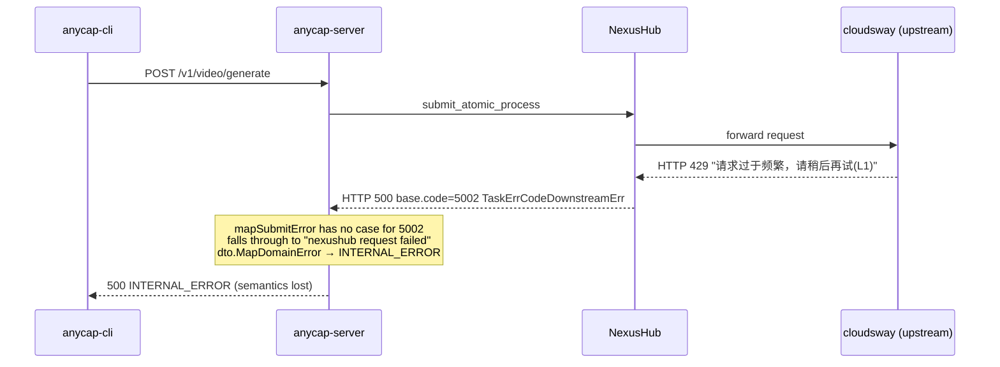

# NexusHub mapSubmitError Coverage Gap

> Date: 2026-05-18
> Status: pending, deferred by user
> Trigger: kling-3.0 text-to-video returned `INTERNAL_ERROR` even though
> the underlying cause was an upstream cloudsway HTTP 429 (rate limit).

## Symptom

```bash
POST /v1/video/generate
{"model":"kling-3.0","mode":"text-to-video","prompt":"a cat sitting",
 "duration":3,"resolution":"720p"}

→ 500 {"error":{"code":"INTERNAL_ERROR","message":"internal server error"}}
```

## Root cause



NexusHub `TaskErrCode` table (`external/nexushub/internal/constant/error.go`):

| Code | Constant | Semantic |
|---|---|---|
| 5000 | `TaskErrCodeUnknown` | Unknown error |
| 5001 | `TaskErrCodeReview` | Content moderation reject |
| 5002 | `TaskErrCodeDownstreamErr` | Upstream provider 5xx / network / quota |
| 5003 | `TaskErrCodeRateLimit` | NexusHub-side rate limit |
| 5004 | `TaskErrCodeTimeout` | Timeout (ctx cancel / network) |
| 5005 | `TaskErrCodeInvalidRequest` | Bad request params |
| 5006 | `TaskErrCodeUnauthorized` | 401 from upstream |
| 5007 | `TaskErrCodeForbidden` | 403 from upstream |
| 5008 | `TaskErrCodeNotFound` | Resource not found |

Current `mapSubmitError` only handles 5001 / 5003 / 5005. Everything else
collapses into `INTERNAL_ERROR`, swallowing the real upstream message.

## Fix outline (do not implement until ready)

`internal/infrastructure/nexushub/client.go::mapSubmitError`:

```go
case 5000:        // Unknown — keep generic upstream
    return fmt.Errorf("%w: %s", model.ErrInternal, message)
case 5002, 5004: // DownstreamErr / Timeout — retryable, upstream-side
    return fmt.Errorf("%w: %s", model.ErrUpstreamUnavailable, message)
case 5006, 5007: // Unauthorized / Forbidden — provider config issue
    return fmt.Errorf("%w: %s", model.ErrInternal, message)
case 5008:        // NotFound
    return fmt.Errorf("%w: %s", model.ErrInvalidParam, message)
```

Plus: ensure `dto.MapDomainError` preserves the upstream `message` (incl.
Chinese text) into the response `hint` / `message` so the agent can act
on it instead of just seeing "internal server error".

## Tests to add

- `TestMapSubmitError_DownstreamErr5002` → maps to `ErrUpstreamUnavailable`
- `TestMapSubmitError_Timeout5004` → same
- `TestMapSubmitError_Unauthorized5006` → `ErrInternal`
- `TestMapSubmitError_Forbidden5007` → `ErrInternal`
- `TestMapSubmitError_NotFound5008` → `ErrInvalidParam`
- End-to-end: hit a known-rate-limited model, assert response code is
  `UPSTREAM_UNAVAILABLE` (or whatever the dto mapping yields) and the
  upstream message is surfaced verbatim.

## Verification trace

`trace_id=bbd69c64-3af2-4dd2-bbd0-7d22f97dabc6` from the 2026-05-18
session log shows the exact code path; logs are in the dev server stdout
at the time but not committed.
