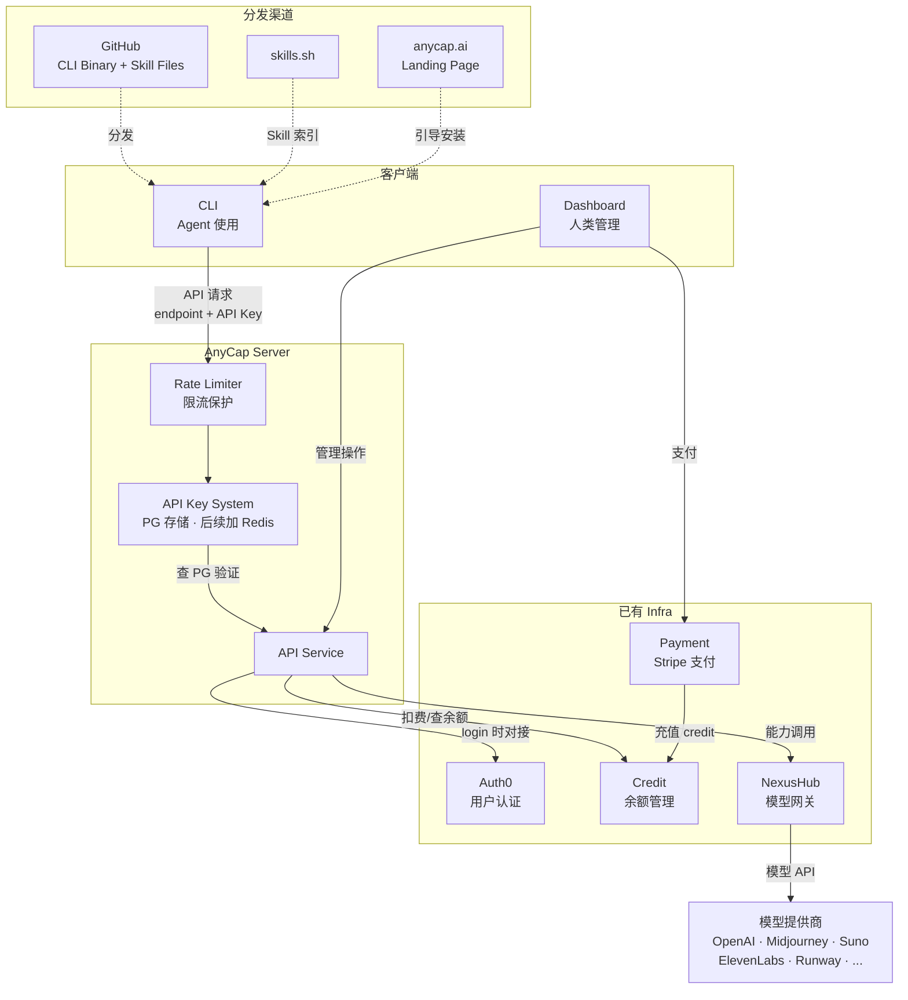
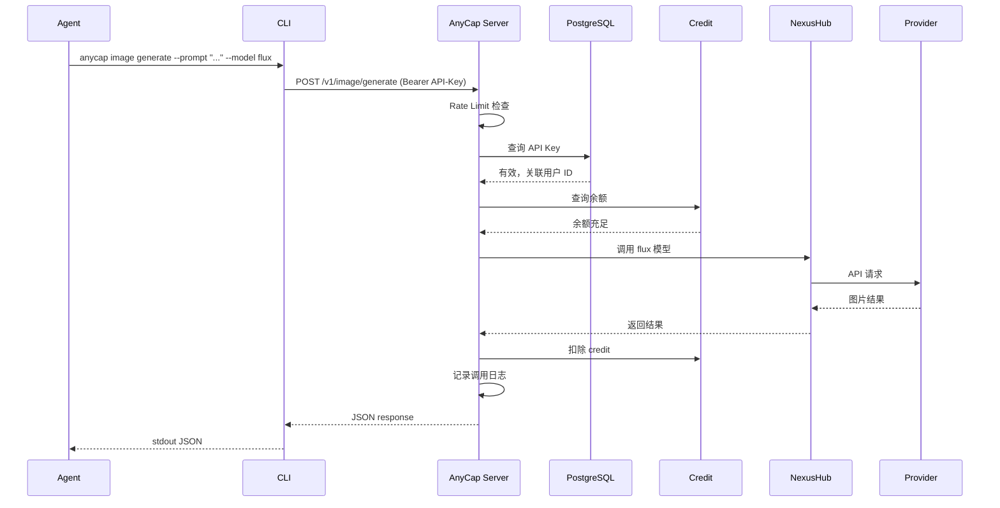
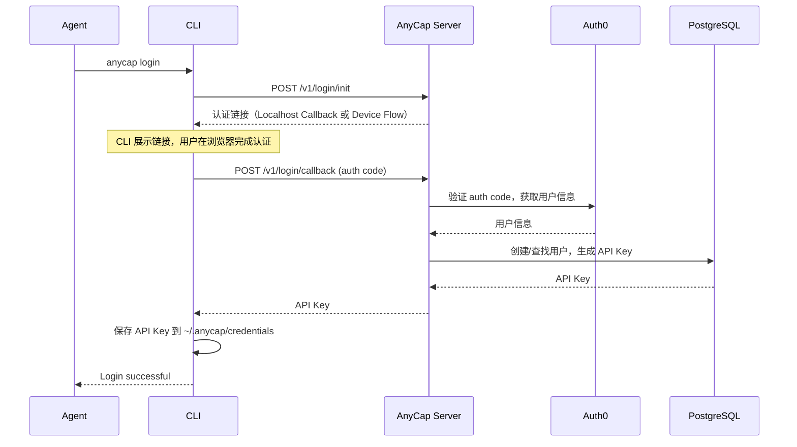
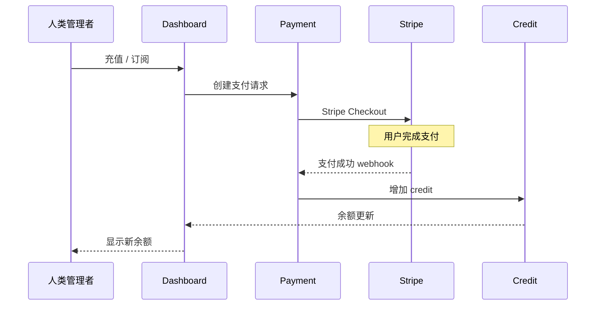
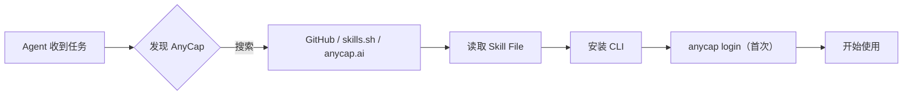
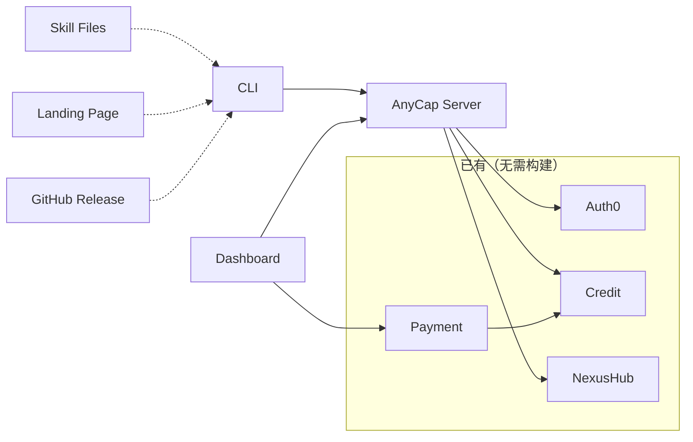

# AnyCap 系统架构与模块规划

## 1. 系统架构总览

**关键设计**：
- CLI 只与 Server 通信，Server 是唯一网关。CLI 不直接访问 Auth0 或任何 Infra 服务。
- CLI 通过可配置的 `endpoint` + API Key 发请求，不区分对端是 AnyCap API 还是企业 Proxy（详见 [cli-architecture.md](cli-architecture.md#企业-proxy-模式)）。
- 请求链路：Rate Limiter → API Key 验证（PG）→ 业务逻辑。

## 2. 模块职责

### 2.1 CLI & Skill

| 组件 | 技术 | 职责 |
|------|------|------|
| CLI Binary | Go + Cobra | Agent 交互界面，渐进式发现，JSON I/O |
| Skill Files | Anthropic Agent Skills 规范 | Agent 发现入口，能力索引 + best practice |

CLI 核心行为：读取 `config.json`（endpoint）+ `credentials`（API Key）→ 发请求 → 输出 JSON 到 stdout。CLI 只与 Server 通信，不直接访问任何 Infra 服务。

### 2.2 AnyCap Server

核心后端 API 服务（Go）。**CLI 的唯一通信对端**，所有客户端（CLI、Dashboard）都通过它访问能力和数据。

| 职责 | 说明 |
|------|------|
| API Key 系统 | Server 生成和管理 API Key，存储在 PG（后续可加 Redis 缓存）。CLI 每次请求携带 API Key，Server 从 PG 查询验证 |
| 限流 | Rate Limiter 保护 Server 不被 CLI 误用打爆，在 API Key 验证之前执行 |
| 登录 | 封装 Auth0 认证流程，CLI 调用 `POST /v1/login` → Server 对接 Auth0 → 返回 API Key 给 CLI |
| 计费 | 调用前检查余额，调用后扣除 credit |
| 路由 | 将能力请求路由到 NexusHub |
| 日志 | 记录每次调用（供 Dashboard 展示） |
| 反馈 | 收集 like/dislike 和 capability request |
| 动态数据 | models 列表、model schema、skill best practice |

### 2.3 Landing Page & Dashboard

| 组件 | 面向 | 职责 |
|------|------|------|
| Landing Page (anycap.ai) | 公开 | 产品介绍，LLM-readable 纯文本，引导安装 |
| Dashboard | 认证用户 | billing · usage · log · control |

### 2.4 分发渠道

| 渠道 | 分发内容 |
|------|---------|
| GitHub | CLI binary releases + Skill Files 源码 |
| skills.sh | Skill File 托管与索引 |
| anycap.ai | 公开网页，Agent 和人类均可读 |

### 2.5 已有 Infra 集成

| 服务 | 已有能力 | AnyCap 如何使用 |
|------|---------|----------------|
| NexusHub | 各种模型调用的网关 | Server 将所有 Cap 请求路由到 NexusHub |
| Auth0 | 用户认证系统 | Server login API 内部对接 Auth0，CLI 不直接访问 Auth0 |
| Payment | Stripe 订阅 + 充值 | Dashboard 调用，处理支付 |
| Credit | 用户 credit 余额管理 | Server 调用，查余额 + 扣费；Payment 充值后写入 |

## 3. 核心 Flow

### 3.1 能力调用（Cap Call）

Agent 发起一次能力调用的完整链路：

### 3.2 注册与认证

快捷方式：`anycap config set-key sk-xxx` 跳过整个流程（API Key 可在 Dashboard 中生成）。

### 3.3 付费与 Credit

### 3.4 Agent 发现与安装

## 4. 模块依赖关系

Server 是中心依赖。CLI、Dashboard 都通过 Server 与已有 Infra 交互。

## 5. 构建阶段

### Phase 1：MVP — 跑通一条链路

目标：Agent 能通过 CLI 成功生成一张图片。

- [ ] AnyCap Server 核心 API（API Key 系统、限流、计费、路由）
- [ ] Server API Key 系统（PG 存储，生成/验证/吊销）
- [ ] Server Rate Limiter（保护后端不被打爆）
- [ ] CLI 核心命令（login, config, image generate, image models, status）
- [ ] Auth0 集成（Server login API 封装 Auth0 流程）
- [ ] Credit 集成（查余额 + 扣费）
- [ ] NexusHub 对接（image 模型）
- [ ] Skill File 入口（anycap.skill）
- [ ] GitHub 发布 CLI binary

此阶段不需要：Dashboard、Payment、Landing Page。可手动分配 credit 给测试用户。

### Phase 2：能力扩展 + 分发

- [ ] 更多 Cap：video, music, tts, asr, search, crawl
- [ ] CLI 完整命令集（models --schema, feedback, skill show, run）
- [ ] Skill File 按能力分拆
- [ ] Landing Page（anycap.ai）
- [ ] skills.sh 上架
- [ ] GitHub Actions 自动发布

### Phase 3：商业化

- [ ] Dashboard（usage, log, control）
- [ ] Payment 集成（Stripe 订阅 + 充值）
- [ ] Free Tier 额度设计
- [ ] 计费定价策略

### Phase 4：企业 + 生态

- [ ] Enterprise Proxy Server（开源参考实现）
- [ ] Action（预编排 workflow）
- [ ] Infra 层（drive 先行）
- [ ] Skill Market
- [ ] 第三方 Agent 入驻
