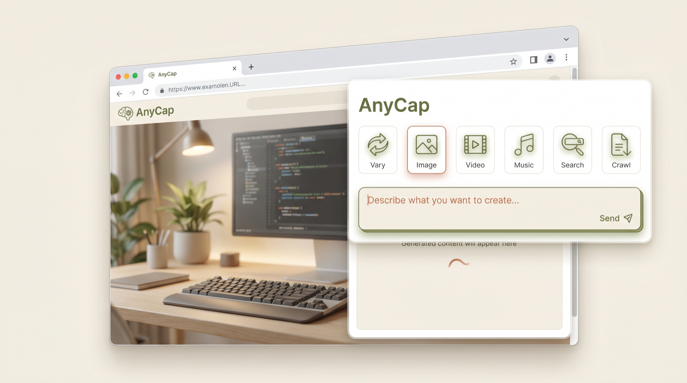
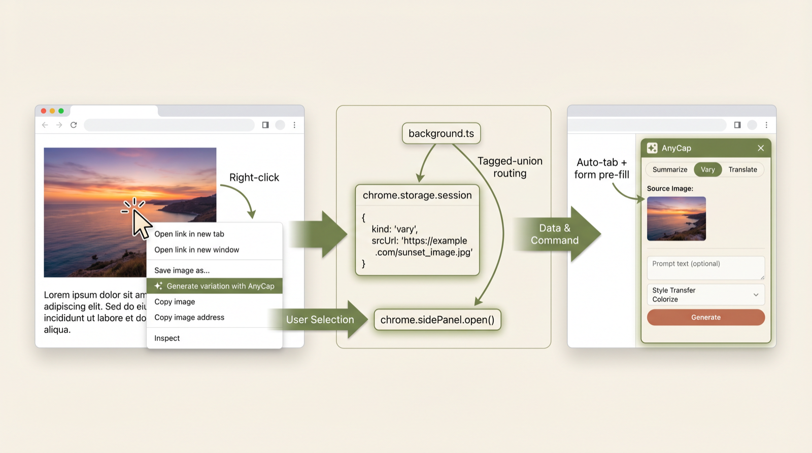
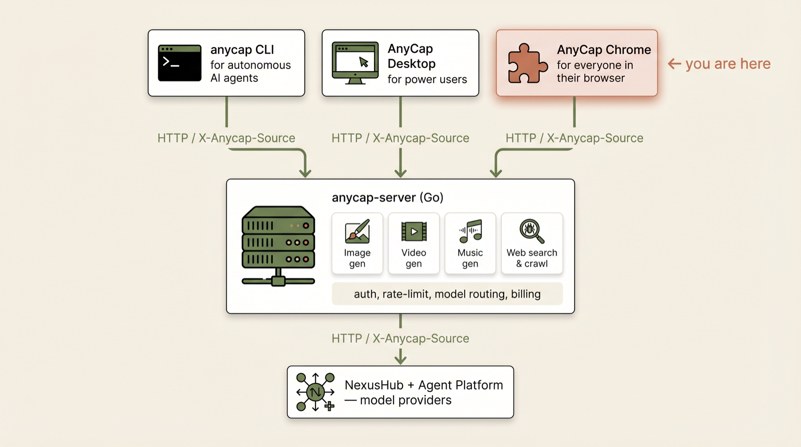

# AnyCap for Chrome

> **图片 · 视频 · 音乐 · 搜索 · 爬取，全部在浏览器里完成。**
> 在网页上右键任意元素，AnyCap 在右侧栏立刻接住你。



AnyCap 是一个 **AI 能力运行时（capability runtime）**。Chrome 扩展是三个客户端中的
一个（CLI · Desktop · **Chrome**），三者共用同一个 `anycap-server`。Agent 能做的事，
你也能做，无需离开当前页面。

| 能力 | 它做什么 |
|---|---|
| **Vary** | 右键任意图片 → 生成同款变体 |
| **Image** | 文生图，可选模型与画幅比例 |
| **Video** | 文生视频，侧栏内 `<video>` 直接预览 |
| **Music** | 文生音乐，侧栏内 `<audio>` 直接试听 |
| **Search** | 网页搜索，返回带引用源的卡片 |
| **Crawl** | 抓取页面 → 标题 + 摘要 + 干净的 Markdown |

---

## 安装

> **一句话总结 — 从 [Releases](https://gitlab.knoffice.tech/engineering/anycap_chrome/-/releases) 下载最新 `.zip`，解压，加载已解压的扩展程序。**
> 下面的安装和试用步骤会使用可见 Chrome UI。Agent 执行时不要在未获明确批准的情况下运行这些步骤。

### 方式 A — 使用预打包 zip（推荐给体验者）

1. 从 <https://gitlab.knoffice.tech/engineering/anycap_chrome/-/releases> 下载
   `anycap-extension-<version>-chrome.zip`。
2. 解压到任意目录，例如 `~/Downloads/anycap-extension`。
3. 浏览器打开 `chrome://extensions`，右上角开启 **开发者模式**。
4. 点击 **加载已解压的扩展程序**，选择刚才解压出来的目录。
5. 点击 AnyCap 工具栏图标 — 侧栏即弹出。或者直接在网页上右键任意图片。

发布 zip 是 CWS-ready 构建，默认请求 `https://api.anycap.ai`，且生产 host permissions
只包含 AnyCap 域名。需要完全离线演示时，用下面的 **方式 B** 跑 `pnpm demo` 构建 mock
版本。CWS-ready package 不等于 public-launch ready；生产提交仍需先部署包含双 bucket
匿名 abuse-control 的当前 server 变更、跑过 production smoke 和获批的 real E2E。

### 方式 B — 从源码构建

```bash
git clone https://gitlab.knoffice.tech/engineering/anycap_chrome.git
cd anycap_chrome
pnpm install

# 三选一：
pnpm demo           # WXT_MOCK=true — 离线演示构建，无需后端
pnpm build          # 真后端模式（需要可达的 anycap-server）
pnpm release        # WXT_RELEASE=true — 剥离 localhost host_permissions，输出 releases/ CWS-ready zip，并同步当前 zip SHA-256
```

构建产物落在 `.output/chrome-mv3/`，加载方式同方式 A。

---

## 工作原理

### 在网页上右键 → 侧栏直接接管



每种右键场景都会落到对应的 tab，并且表单已经预填好：

| 右键的目标 | 菜单项 | 落到哪个 tab |
|---|---|---|
| 图片 | ✨ Generate variation with AnyCap | **Vary** |
| 选中文字 | 🎨 Generate image from this text | **Image** |
| 选中文字 | 🎬 Generate video from this text | **Video** |
| 选中文字 | 🎵 Generate music from this text | **Music** |
| 选中文字 | 🔍 Search with AnyCap | **Search** |
| 页面空白处 | 📄 Crawl this page with AnyCap | **Crawl** |
| 链接 | 📄 Crawl link with AnyCap | **Crawl** |

底层实现：`entrypoints/background.ts` 把一个 tagged-union 的 `pendingRequest` 写入
`chrome.storage.session`，然后调用 `chrome.sidePanel.open({ windowId })`。侧栏监听
`chrome.storage.onChanged`，根据 `kind` 字段切换到对应 tab，再把表单预填好。

### 一套后端，三种皮肤



这个扩展 **不是** CLI 的封装。它直接打的是给 CLI 和桌面端供电的同一个 Go HTTP API —
认证、限流、模型路由、计费全在 server 一处。新增一个能力，只要加在 server 上，三个
客户端立刻全部点亮；客户端侧只需要一个 30 行的 tab 组件。

---

## 项目结构

```
entrypoints/
  background.ts            # MV3 service worker — 右键菜单、侧栏路由
  content.ts               # 捕获最近一次悬停的图片，pagehide 时清空
  sidepanel/
    App.tsx                # 7-tab 外壳（Vary / Image / Video / Music / Search / Crawl / Settings）
    tabs/                  # 每个能力一个文件，互相隔离
    components/            # AnycapMark / Spinner / ErrorBox / HistorySection / TemplateChips / OnboardingOverlay
    main.tsx, index.html, style.css
src/lib/
  api.ts                   # 打 anycap-server 的 HTTP 客户端（带 X-Anycap-Source: chrome-extension）
  api-mock.ts              # WXT_MOCK=true 时拦截每次调用 — picsum + 样本 MP4/OGG + 假搜索/抓取
  store.ts                 # Zustand 状态，tagged-union 的 PendingRequest
  history.ts               # 每能力 30 条历史，按 kind 过滤
  settings.ts              # 个人资料 / 默认模型 / 隐私偏好
  templates.ts             # 19 条 prompt 模板
  storage.ts, constants.ts, auth.ts, errors.ts
public/icons/              # 16 / 48 / 128
store-assets/
  composer/*.html          # CWS 截图的静态 HTML 编排器（1280×800 / 1400×560 / 440×280）
  cws/*.png                # 渲染好的 CWS 提审素材
tests/
  unit/                    # Vitest — 174 个用例
  e2e/                     # Playwright — prod / demo / CWS screenshot specs
wxt.config.ts              # Manifest，host_permissions（release 模式剥离 localhost）
docs/assets/               # README 用的图示
```

## 开发

```bash
pnpm dev                # WXT 开发服务，热重载
pnpm test               # Vitest 单元测试
pnpm preflight:local    # 纯终端本地生产预检：release + test + tsc + verify:release
ANYCAP_ALLOW_HEADED_E2E=1 pnpm e2e
                         # Playwright（生产模式构建）— 显式确认后才会打开 headed Chromium
ANYCAP_ALLOW_HEADED_E2E=1 pnpm e2e:demo
                         # Playwright（mock 模式）— 不需要后端，当前 9 个用例，显式确认后才会打开 headed Chromium
ANYCAP_ALLOW_HEADED_E2E=1 pnpm shots:feishu
                         # Playwright（mock 模式截图）— 显式确认后才会打开 headed Chromium
ANYCAP_ALLOW_HEADED_E2E=1 WXT_API_BASE=https://api-staging.anycap.ai pnpm e2e:real
                         # Playwright（真实后端冒烟：vary/image/crawl）— 显式确认后才会打开 headed Chromium
pnpm release            # WXT_RELEASE=true wxt build && wxt zip → releases/ CWS-ready zip，并同步当前 zip SHA-256
pnpm verify:release     # 纯终端校验 release zip manifest、图标、权限、CWS 素材、文案、当前 zip hash、提审/发布清单、launch dconf、dev 泄漏
pnpm render:cws         # 纯终端 headless 重渲染 CWS 截图和 promo assets，不弹浏览器窗口
pnpm render:demo        # 纯终端 headless 生成 store-assets/demo.mp4，不弹浏览器窗口
ANYCAP_API_BASE=https://api-staging.anycap.ai pnpm smoke:server
                         # 纯终端校验匿名 extension server/dconf 路径
ANYCAP_API_BASE=https://api-staging.anycap.ai pnpm launch:audit
                         # 纯终端汇总 release、server smoke、CWS/外部门禁 blockers
ANYCAP_API_BASE=https://api-staging.anycap.ai pnpm launch:audit -- --abuse-control-passed --real-e2e-passed
                         # 匿名 abuse-control 已上线、真实 E2E 已获批并跑绿后，作为 CWS 上传前的最终纯终端门禁
```

### 构建标志

| 环境变量 | 作用 |
|---|---|
| `WXT_MOCK=true` | 把 `api.ts` 的每次调用替换成确定性的 mock（picsum / archive.org / W3C OGG / 假搜索/抓取）。完全不联网。 |
| `WXT_RELEASE=true` | 剥离 `localhost` 与 `127.0.0.1` 的 host_permissions，把生产 `DefaultEndpoint` 烧进去，并通过 `wxt zip` 输出 CWS-ready 包。 |
| `WXT_API_BASE=...` | 在构建时覆盖 server 端点（dev 默认 `http://127.0.0.1:8080`，release 默认 `https://api.anycap.ai`）。非 release 构建会自动把该 origin 加入 `host_permissions`，便于 staging 冒烟；release 构建仍只保留生产 AnyCap 域名。 |
| `ANYCAP_ALLOW_HEADED_E2E=1` | 用于所有 headed Playwright scripts（`pnpm e2e`、`pnpm e2e:demo`、`pnpm shots:feishu`、`pnpm e2e:real`）。必须在明确批准打开 headed Chromium 后设置；未设置时脚本会在打开浏览器前退出。 |

### 测试要点

- E2E 用 Playwright `launchPersistentContext` — **MV3 扩展只能跑 headed 模式**，Chromium 的 headless 不支持。
- Mock 模式 E2E（`pnpm e2e:demo`）不需要后端，但会打开 headed Chromium；它需要 `ANYCAP_ALLOW_HEADED_E2E=1`。
- Mock 截图 E2E（`pnpm shots:feishu`）会打开 headed Chromium 生成 side-panel 截图；它需要 `ANYCAP_ALLOW_HEADED_E2E=1`。
- Real 模式 E2E（`pnpm e2e:real`）会命中 `WXT_API_BASE` 指定的真实 server，覆盖匿名 vary / image / crawl；它需要 `ANYCAP_ALLOW_HEADED_E2E=1`，未设置时会在打开 headed Chromium 前退出。
- Local preflight（`pnpm preflight:local`）不会打开浏览器；它串行运行 `pnpm release`、`pnpm test`、`npx tsc --noEmit` 和 `pnpm verify:release`，其中 `pnpm release` 会把当前 release zip SHA-256 同步到提审文档。
- Release verifier（`pnpm verify:release`）不会打开浏览器；它检查 CWS zip 的 Manifest V3、扩展图标尺寸、生产 host permissions、optional identity、side panel/background/content script 入口和引用文件、content script `file://` 排除、无 source maps / tests / localhost / staging 字符串泄漏、`.output` 与 `releases/` zip 同步、CWS 提交文档中的当前 zip SHA-256，以及提审素材是否齐全、尺寸正确、headless CWS renderer、listing / screenshot composer 文案、权限说明、CWS 提审清单、Chrome extension launch dconf 示例、生产发布 runbook、隐私 URL、server smoke、support scripts、local preflight、visible Chrome approval docs 和 real E2E 门禁。
- CWS asset renderer（`pnpm render:cws`）使用 headless Chromium 渲染 `store-assets/composer/*.html` 到 `store-assets/cws/*.png`，不会打开可见浏览器窗口。
- Demo video renderer（`pnpm render:demo`）使用 headless Chromium 生成 1280×720 frame，再用 ffmpeg 合成 `store-assets/demo.mp4`，不会打开可见浏览器窗口；YouTube 上传仍需单独审批。
- Server smoke（`pnpm smoke:server`）不会打开浏览器；默认带匿名 extension headers 检查 `/v1/features`、`/v1/extension/config`、`/v1/web/search`、`/v1/web/crawl`，要求 `image.generate`、`video.generate`、`music.generate`、`web.search`、`web.crawl` 已启用，并校验 extension config / search / crawl 的最小响应结构；可加 `--include-image` 额外检查 image generate。`--include-media` 会改为检查 image / video / music generate，跳过 search / crawl，以保持在 3 次匿名 trial 内。
- Launch audit（`pnpm launch:audit`）不会打开浏览器；它组合 release verifier、browser-free production smoke 和带一次重试的 live privacy policy GET 检查，并校验页面正文不是 Next.js 404 fallback、且包含 extension privacy 内容。它会输出仍阻塞 CWS 提交的 deploy / auth / dconf / privacy / abuse-control / real E2E blockers。生产已部署双 bucket 匿名 abuse-control 后加 `--abuse-control-passed`，真实 E2E 获批并跑绿后加 `--real-e2e-passed`；两个确认都存在时，它才能成为 CWS 上传前的绿色门禁。
- `pnpm render:cws` 会从 `store-assets/composer/*.html` 重新渲染全部 6 张 CWS 营销图，且不打开可见浏览器窗口。

## 权限审计

```
contextMenus    — 7 个右键菜单项
activeTab       — 用户触发"抓取当前页"时读 pageUrl
storage         — chrome.storage.session（跨上下文路由）+ .local（历史、缓存）
downloads       — 生成结果上的"保存到下载"动作
sidePanel       — 从 background 主动打开侧栏
optional: identity   — 仅在 OAuth 登录启用时使用（v0.2.0 暂时隐藏 UI）
```

生产 host permissions：仅 `https://api.anycap.ai/*`、`https://anycap.ai/*`。
Localhost / `127.0.0.1` 只在 dev/demo 构建里加回来（`WXT_RELEASE` 未设置时）。

## 历次发布

| 版本 | 日期 | 主要变化 |
|---|---|---|
| **v0.2.0** | 2026-04-27 / 2026-05-09 refresh | 首个侧栏版本。6 个能力、7 个右键菜单、19 条模板、mock 模式、CWS 提审素材；refresh 补齐 onboarding、真实模式错误提示、匿名 install-id 请求路径。 |
| v0.1.0 | 2026-04-22 | 仅弹窗的图片变体 MVP。 |

完整变更日志：[`CHANGELOG.md`](./CHANGELOG.md)。
预打包 zip 与签名后的发布说明：[Releases](https://gitlab.knoffice.tech/engineering/anycap_chrome/-/releases)。

## 文档索引

| 文件 | 用途 |
|---|---|
| [`CHANGELOG.md`](./CHANGELOG.md) | 各版本变更 |
| [`DEMO.md`](./DEMO.md) | 5 分钟演示脚本 + 截图 |
| [`LOAD_AND_USE.md`](./LOAD_AND_USE.md) | 首次安装指引与故障排查 |
| [`LAUNCH_CHECKLIST.md`](./LAUNCH_CHECKLIST.md) | 提交 Chrome 商店前还差什么 |
| [`docs/NEXT-STEPS.md`](./docs/NEXT-STEPS.md) | 让插件真正可用的工程路线图（A / B / C 三档） |
| [`docs/COMPLETION-AUDIT.md`](./docs/COMPLETION-AUDIT.md) | 交付目标逐项审计、当前证据和仍阻塞完整生产交付的门禁 |
| [`docs/PRODUCTION-LAUNCH-RUNBOOK.md`](./docs/PRODUCTION-LAUNCH-RUNBOOK.md) | 生产部署、dconf、浏览器-free smoke、E2E 确认、CWS 上传与回滚步骤 |
| [`store-assets/description.md`](./store-assets/description.md) | CWS-ready 的短/长描述、权限说明 |
| [`store-assets/permission-justifications.md`](./store-assets/permission-justifications.md) | CWS 权限说明，可直接粘贴到提审表单 |
| [`store-assets/cws-submission.md`](./store-assets/cws-submission.md) | CWS 提交表单字段、素材映射和上线前门禁 |
| [`store-assets/cws/README.md`](./store-assets/cws/README.md) | 营销素材与 CWS 提审表单的对应表（1280×800 × 4 + marquee + tile） |

## 许可

Internal — Knoffice / AnyCap。归仓库所有者所有。
