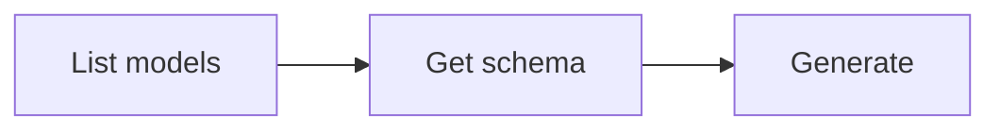

# Image Generation

Generate images from text prompts or transform existing images. The generated image is automatically downloaded to the current directory.

## Workflow



### Step 1: Discover models

```bash
anycap image models
```

Extract model IDs:

```bash
anycap image models | jq -r '.models[].model'
```

To inspect a specific model:

```bash
anycap image models <model-id>
```

Models support different **modes** -- each mode represents a distinct input/output modality:

| Mode | Description |
|------|-------------|
| `text-to-image` | Generate image from text prompt |
| `image-to-image` | Edit or transform a reference image |

List all modes for a model:

```bash
anycap image models <model-id> | jq -r '.model.operations[].modes[].mode'
```

### Step 2: Check parameter schema (important)

Each model and mode accepts different parameters. Always fetch the schema before generating to discover available parameters:

```bash
# All schemas for a model (all operations and modes)
anycap image models <model-id> schema

# Filter by mode
anycap image models <model-id> schema --mode text-to-image
anycap image models <model-id> schema --mode image-to-image

# Filter by operation and mode
anycap image models <model-id> schema --operation generate --mode text-to-image
```

The schema response returns an array of schemas, each tagged with its operation and mode:

```json
{
  "schemas": [
    {
      "operation": "generate",
      "mode": "text-to-image",
      "schema": {
        "model_params": {
          "prompt": {"type": "string", "required": true},
          "aspect_ratio": {"type": "string", "enum": ["1:1", "16:9", "9:16"]},
          "resolution": {"type": "string", "enum": ["2k", "4k"]}
        }
      }
    }
  ]
}
```

List parameter names and types for a specific mode:

```bash
anycap image models <model-id> schema --mode text-to-image \
  | jq -r '.schemas[0].schema.model_params | to_entries[] | "\(.key): \(.value.type)"'
```

### Step 3: Generate

The generated image is automatically saved to the current directory. Use `-o` to specify a custom path.

**Best practice:** Always use `-o` with a descriptive filename derived from the prompt context (e.g., `-o coffee-shop-logo.png`). Without `-o`, the file gets a generic timestamped name like `image_20260326_175540.png`.

Basic text-to-image generation (mode is inferred):

```bash
anycap image generate --prompt "a paper crane on a wooden table" --model <model-id>
```

With parameters discovered from the schema:

```bash
anycap image generate \
  --prompt "a mountain landscape at sunset" \
  --model <model-id> \
  --param aspect_ratio=16:9
```

Image-to-image with explicit mode:

```bash
anycap image generate \
  --prompt "make it look like a watercolor painting" \
  --model seedream-5 \
  --mode image-to-image \
  --param images='["https://example.com/photo.jpg"]'
```

Save to a specific path:

```bash
anycap image generate \
  --prompt "a logo for a coffee shop" \
  --model <model-id> \
  -o logo.png
```

### Flags

| Flag | Required | Description |
|------|----------|-------------|
| `--prompt` | yes | Text description of the image to generate |
| `--model` | yes | Model ID from `image models` |
| `--mode` | no | Generation mode (e.g. `text-to-image`, `image-to-image`). Inferred if omitted |
| `--param` | no | Parameter as `key=value` (repeatable); discover via `image models <model> schema` |
| `-o, --output` | no | Custom output path (default: current directory) |

### --param value types

Values are auto-parsed as JSON when possible:

| Example | Parsed as |
|---------|-----------|
| `--param aspect_ratio=16:9` | string `"16:9"` |
| `--param duration=5` | number `5` |
| `--param hd=true` | boolean `true` |
| `--param negative_prompt="blurry"` | string `"blurry"` |
| `--param images='["url1","url2"]'` | array `["url1","url2"]` |

### Output Format

The output is a flat JSON object optimized for agent consumption:

```json
{"status":"success","local_path":"/absolute/path/to/img.png","model":"nano-banana-2","credits_used":1,"request_id":"req_abc123"}
```

| Field | Description |
|-------|-------------|
| `status` | `"success"` or `"error"` |
| `local_path` | Absolute path to the downloaded image file |
| `model` | Model ID used for generation |
| `credits_used` | Number of credits consumed |
| `request_id` | Server request ID for debugging |

Extract the local file path:

```bash
anycap image generate --prompt "..." --model <model-id> | jq -r '.local_path'
```

## Complete Example

```bash
# Find a model
anycap image models

# Check what modes are available
anycap image models seedream-5 | jq '.model.operations[].modes[].mode'

# Check text-to-image parameters
anycap image models seedream-5 schema --mode text-to-image

# Generate text-to-image
anycap image generate \
  --prompt "a watercolor painting of a Japanese garden" \
  --model seedream-5 \
  --param aspect_ratio=16:9 \
  -o garden.png

# Check image-to-image parameters
anycap image models seedream-5 schema --mode image-to-image

# Generate image-to-image
anycap image generate \
  --prompt "colorize this sketch" \
  --model seedream-5 \
  --mode image-to-image \
  --param images='["https://example.com/sketch.png"]' \
  -o colorized.png
```
