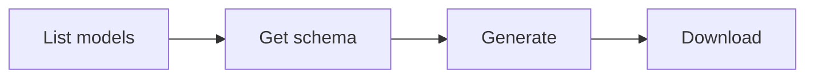

# Image Generation

Generate images from text prompts. This is a multi-step workflow: discover available models, check the model's parameter schema, generate, then download the result.

## Workflow



### Step 1: Discover models

```bash
anycap image models
```

Response includes a list of available models with their capabilities and supported operations.

To inspect a specific model:

```bash
anycap image models <model-id>
```

### Step 2: Check parameter schema

Each model accepts different parameters. Fetch the schema before generating:

```bash
anycap image models <model-id> schema
anycap image models <model-id> schema --operation edit
```

The schema response describes all accepted parameters (aspect ratio, style, seed, etc.) with their types, defaults, and allowed values. Use this to construct valid `--param` flags.

### Step 3: Generate

```bash
anycap image generate --prompt "a paper crane on a wooden table" --model <model-id>
```

With model-specific parameters discovered from the schema:

```bash
anycap image generate \
  --prompt "a mountain landscape at sunset" \
  --model <model-id> \
  --param aspect_ratio=16:9 \
  --param style=photographic
```

Save directly to a local file:

```bash
anycap image generate \
  --prompt "a logo for a coffee shop" \
  --model <model-id> \
  -o logo.png
```

Options:

| Flag | Required | Description |
|------|----------|-------------|
| `--prompt` | yes | Text description of the image to generate |
| `--model` | yes | Model ID from `image models` |
| `--param` | no | Model-specific parameter as `key=value` (repeatable) |
| `-o, --output` | no | Save generated image to this path |

Without `-o`, the response includes the image URL and a hint to download it.

### Step 4: Download (if no -o)

If you did not use `-o` during generation, download the result:

```bash
anycap download <url-from-generate-response> -o output.png
```

## Complete Example

```bash
# Find a model
anycap image models

# Check what parameters it accepts
anycap image models flux-schnell schema

# Generate with parameters and save locally
anycap image generate \
  --prompt "a watercolor painting of a Japanese garden" \
  --model flux-schnell \
  --param aspect_ratio=16:9 \
  -o garden.png
```
