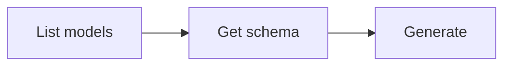

# Music Generation

Generate music and songs from text prompts or style tags. Generated audio clips are automatically downloaded to the current directory.

## Workflow



### Step 1: Discover models

```bash
anycap music models
```

Extract model IDs:

```bash
anycap music models | jq -r '.models[].model'
```

To inspect a specific model:

```bash
anycap music models <model-id>
```

### Step 2: Check parameter schema (important)

Each model accepts different parameters. Always fetch the schema before generating to discover available parameters:

```bash
anycap music models <model-id> schema
```

The schema response describes all accepted parameters (tags, lyrics, title, make_instrumental, vocal_gender, etc.) with their types, defaults, and allowed values. Use this to construct valid flags and `--param` values.

List all parameter names and their types:

```bash
anycap music models <model-id> schema | jq -r '.data.schema.model_params | to_entries[] | "\(.key): \(.value.type)"'
```

### Step 3: Generate

Generated audio is automatically saved to the current directory. Use `-o` to specify a custom path.

**Best practice:** Always use `-o` with a descriptive filename derived from the prompt context (e.g., `-o lofi-night-drive.mp3`). Without `-o`, the file gets a generic timestamped name like `music_20260330_150000.mp3`.

**Important:** Either `--prompt` or `--tags` is required. You can use both together.

Basic generation with a prompt:

```bash
anycap music generate --prompt "lofi night drive" --model <model-id> -o lofi-drive.mp3
```

Generation with style tags:

```bash
anycap music generate --tags "pop,upbeat,summer" --model <model-id> -o summer-pop.mp3
```

Instrumental only (no vocals):

```bash
anycap music generate --prompt "epic orchestral battle theme" --model <model-id> --instrumental -o epic-battle.mp3
```

Full song with title and lyrics:

```bash
anycap music generate \
  --prompt "indie folk love song" \
  --model <model-id> \
  --title "Morning Light" \
  --lyrics "Verse 1: The sun comes up..." \
  --tags "folk,acoustic,warm" \
  -o morning-light.mp3
```

With additional parameters from the schema:

```bash
anycap music generate \
  --prompt "dreamy synth pop" \
  --model <model-id> \
  --param vocal_gender=f \
  -o dreamy-synth.mp3
```

### Flags

| Flag | Required | Description |
|------|----------|-------------|
| `--prompt` | one of prompt/tags | Text description of the music to generate |
| `--tags` | one of prompt/tags | Comma-separated style tags (e.g. `"pop,upbeat,summer"`) |
| `--model` | yes | Model ID from `music models` |
| `--instrumental` | no | Generate instrumental only (no vocals) |
| `--title` | no | Song title |
| `--lyrics` | no | Song lyrics |
| `--param` | no | Parameter as `key=value` (repeatable); discover via `music models <model> schema` |
| `-o, --output` | no | Custom output path (default: current directory) |

### --param value types

Values are auto-parsed as JSON when possible:

| Example | Parsed as |
|---------|-----------|
| `--param vocal_gender=f` | string `"f"` |
| `--param make_instrumental=true` | boolean `true` |
| `--param tags="rock,blues"` | string `"rock,blues"` |

Note: `--instrumental`, `--tags`, `--title`, and `--lyrics` are convenience flags. The same values can be passed via `--param make_instrumental=true`, `--param tags=...`, etc.

### Output Format

Music generation can produce multiple audio clips. The output is a JSON object with an `outputs` array:

```json
{
  "status": "success",
  "model": "suno-v5",
  "credits_used": 5,
  "outputs": [
    {"local_path": "/absolute/path/to/lofi-drive.mp3", "url": "https://..."},
    {"local_path": "/absolute/path/to/lofi-drive_2.mp3", "url": "https://..."}
  ],
  "request_id": "req_abc123"
}
```

| Field | Description |
|-------|-------------|
| `status` | `"success"` or `"error"` |
| `model` | Model ID used for generation |
| `credits_used` | Number of credits consumed |
| `outputs` | Array of generated audio clips |
| `outputs[].local_path` | Absolute path to the downloaded audio file |
| `outputs[].url` | Remote URL of the generated audio |
| `request_id` | Server request ID for debugging |

When multiple clips are generated:
- With `-o chill.mp3` and 2 outputs: `chill.mp3`, `chill_2.mp3`
- Without `-o` and 2 outputs: `music_20260330_150000_1.mp3`, `music_20260330_150000_2.mp3`

Extract the first local file path:

```bash
anycap music generate --prompt "..." --model <model-id> | jq -r '.outputs[0].local_path'
```

Extract all local paths:

```bash
anycap music generate --prompt "..." --model <model-id> | jq -r '.outputs[].local_path'
```

## Complete Example

```bash
# Find a model
anycap music models

# Check what parameters it accepts
anycap music models suno-v5 schema

# Generate with a descriptive prompt and tags
anycap music generate \
  --prompt "chill lo-fi hip hop beat for studying" \
  --model suno-v5 \
  --tags "lofi,chill,study" \
  --instrumental \
  -o study-lofi.mp3

# Generate a full song with lyrics
anycap music generate \
  --prompt "upbeat pop song about summer" \
  --model suno-v5 \
  --title "Endless Summer" \
  --lyrics "Verse: Sun is shining, waves are calling..." \
  --tags "pop,summer,upbeat" \
  --param vocal_gender=f \
  -o endless-summer.mp3
```
