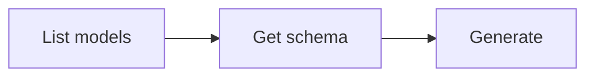

# Video Generation

Generate videos from text prompts. The generated video is automatically downloaded to the current directory.

## Workflow



### Step 1: Discover models

```bash
anycap video models
```

Response includes a list of available models with their capabilities and supported operations.

Extract model IDs:

```bash
anycap video models | jq -r '.models[].model'
```

To inspect a specific model:

```bash
anycap video models <model-id>
```

### Step 2: Check parameter schema

Each model accepts different parameters. Fetch the schema before generating:

```bash
anycap video models <model-id> schema
```

The schema response describes all accepted parameters (ratio, resolution, duration, etc.) with their types, defaults, and allowed values.

List all parameter names and their types:

```bash
anycap video models <model-id> schema | jq -r '.data.schema.model_params | to_entries[] | "\(.key): \(.value.type)"'
```

### Step 3: Generate

The generated video is automatically saved to the current directory. Use `-o` to specify a custom path.

**Best practice:** Always use `-o` with a descriptive filename derived from the prompt context (e.g., `-o ocean-waves.mp4`). Without `-o`, the file gets a generic timestamped name like `video_20260327_103000.mp4`.

```bash
anycap video generate --prompt "a cat walking on the beach at sunset" --model <model-id>
```

With dedicated video parameters:

```bash
anycap video generate \
  --prompt "ocean waves crashing on rocks" \
  --model <model-id> \
  --ratio 16:9 \
  --duration 5 \
  --resolution 1080p
```

With a negative prompt:

```bash
anycap video generate \
  --prompt "a peaceful garden" \
  --model <model-id> \
  --negative-prompt "blurry, low quality"
```

Image-to-video (animate a reference image):

```bash
anycap video generate \
  --prompt "animate this scene with gentle wind" \
  --model <model-id> \
  --reference-image https://example.com/photo.jpg
```

Save to a specific path:

```bash
anycap video generate \
  --prompt "a logo animation" \
  --model <model-id> \
  -o logo-animation.mp4
```

With additional model-specific parameters from the schema:

```bash
anycap video generate \
  --prompt "a timelapse of clouds" \
  --model <model-id> \
  --param seed=42 \
  --param style=cinematic
```

Options:

| Flag | Required | Description |
|------|----------|-------------|
| `--prompt` | yes | Text description of the video to generate |
| `--model` | yes | Model ID from `video models` |
| `--negative-prompt` | no | What to avoid in the generated video |
| `--ratio` | no | Aspect ratio (e.g. 16:9, 9:16, 1:1) |
| `--resolution` | no | Output resolution (e.g. 720p, 1080p) |
| `--duration` | no | Video duration in seconds |
| `--reference-image` | no | Reference image URL for image-to-video (repeatable) |
| `--param` | no | Model-specific parameter as `key=value` (repeatable) |
| `-o, --output` | no | Custom output path (default: current directory) |

### Output Format

The output is a flat JSON object optimized for agent consumption:

```json
{"status":"success","local_path":"/absolute/path/to/video.mp4","model":"wan-2.1","credits_used":5,"request_id":"req_abc123"}
```

| Field | Description |
|-------|-------------|
| `status` | `"success"` or `"error"` |
| `local_path` | Absolute path to the downloaded video file |
| `model` | Model ID used for generation |
| `credits_used` | Number of credits consumed |
| `request_id` | Server request ID for debugging |

Extract the local file path:

```bash
anycap video generate --prompt "..." --model <model-id> | jq -r '.local_path'
```

## Complete Example

```bash
# Find a model
anycap video models

# Check what parameters it accepts
anycap video models wan-2.1 schema

# Generate with parameters and save to a specific path
anycap video generate \
  --prompt "a watercolor animation of cherry blossoms falling" \
  --model wan-2.1 \
  --ratio 16:9 \
  --duration 5 \
  -o cherry-blossoms.mp4
```
