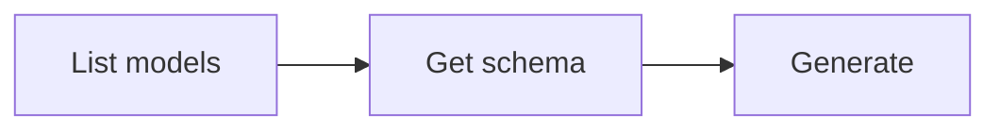

# Video Generation

Generate videos from text prompts or animate reference images. The generated video is automatically downloaded to the current directory.

## Workflow



### Step 1: Discover models

```bash
anycap video models
```

Extract model IDs:

```bash
anycap video models | jq -r '.models[].model'
```

To inspect a specific model:

```bash
anycap video models <model-id>
```

Models support different **modes** -- each mode represents a distinct input/output modality:

| Mode | Description |
|------|-------------|
| `text-to-video` | Generate video from text prompt |
| `image-to-video` | Animate a reference image into video |
| `multi-modal-reference` | Generate video from one or more image, video, or audio references with a guiding prompt |
| `edit-video` | Edit or refine an input video while preserving the original footage |

Not all models support all modes. List modes for a model:

```bash
anycap video models <model-id> | jq -r '.model.operations[].modes[].mode'
```

### Step 2: Check parameter schema (important)

Each model and mode accepts different parameters. Always fetch the schema before generating to discover available parameters:

```bash
# All schemas for a model (all operations and modes)
anycap video models <model-id> schema

# Filter by mode
anycap video models <model-id> schema --mode text-to-video
anycap video models <model-id> schema --mode image-to-video
anycap video models <model-id> schema --mode multi-modal-reference

# Filter by operation and mode
anycap video models <model-id> schema --operation generate --mode text-to-video
```

The schema response returns an array of schemas, each tagged with its operation and mode:

```json
{
  "schemas": [
    {
      "operation": "generate",
      "mode": "text-to-video",
      "schema": {
        "model_params": {
          "prompt": {"type": "string", "required": true},
          "aspect_ratio": {"type": "string", "enum": ["16:9", "9:16", "1:1"]},
          "duration": {"type": "integer", "enum": [4, 5, 6, 7, 8]},
          "resolution": {"type": "string", "enum": ["720p", "1080p"]}
        }
      }
    }
  ]
}
```

List parameter names and types for a specific mode:

```bash
anycap video models <model-id> schema --mode text-to-video \
  | jq -r '.schemas[0].schema.model_params | to_entries[] | "\(.key): \(.value.type)"'
```

### Step 3: Generate

The generated video is automatically saved to the current directory. Use `-o` to specify a custom path.

**Best practice:** Always use `-o` with a descriptive filename derived from the prompt context (e.g., `-o ocean-waves.mp4`). Without `-o`, the file gets a generic timestamped name like `video_20260327_103000.mp4`.

Basic text-to-video generation (mode is inferred):

```bash
anycap video generate --prompt "a cat walking on the beach at sunset" --model <model-id>
```

With parameters discovered from the schema:

```bash
anycap video generate \
  --prompt "ocean waves crashing on rocks" \
  --model <model-id> \
  --param aspect_ratio=16:9 \
  --param duration=5
```

Image-to-video with explicit mode (local file -- auto-uploaded):

```bash
anycap video generate \
  --prompt "animate this scene with gentle wind" \
  --model seedance-2-fast \
  --mode image-to-video \
  --param images=/path/to/photo.png
```

Image-to-video with a remote URL:

```bash
anycap video generate \
  --prompt "animate this scene with gentle wind" \
  --model seedance-2-fast \
  --mode image-to-video \
  --param images=https://example.com/photo.jpg
```

Multi-modal reference generation:

```bash
anycap video generate \
  --prompt "[Image1] controls product identity; [Video1] controls camera rhythm only; [Audio1] controls tempo only. Do not transfer people, logos, voices, songs, or rooms from the references." \
  --model seedance-2 \
  --mode multi-modal-reference \
  --param images='["./product.png"]' \
  --param videos='["./camera-motion.mp4"]' \
  --param audios='["./tempo.mp3"]' \
  --param duration=8 \
  --param aspect_ratio=16:9 \
  --param resolution=1080p \
  -o product-motion.mp4
```

Save to a specific path:

```bash
anycap video generate \
  --prompt "a logo animation" \
  --model <model-id> \
  -o logo-animation.mp4
```

### Flags

| Flag | Required | Description |
|------|----------|-------------|
| `--prompt` | yes | Text description of the video to generate |
| `--model` | yes | Model ID from `video models` |
| `--mode` | no | Generation mode (e.g. `text-to-video`, `image-to-video`). Inferred if omitted |
| `--param` | no | Parameter as `key=value` (repeatable); discover via `video models <model> schema` |
| `-o, --output` | no | Custom output path (default: current directory) |

### --param value types

Values are auto-parsed as JSON when possible:

| Example | Parsed as |
|---------|-----------|
| `--param aspect_ratio=16:9` | string `"16:9"` |
| `--param duration=5` | number `5` |
| `--param resolution=1080p` | string `"1080p"` |
| `--param images='["url1"]'` | array `["url1"]` |
| `--param images=/path/to/file.png` | local file (auto-uploaded, wrapped to array) |
| `--param videos='["./clip.mp4"]'` | array of local files or URLs |
| `--param audios='["./tempo.mp3"]'` | array of local files or URLs |

### Output Format

The output is a flat JSON object optimized for agent consumption:

```json
{"status":"success","local_path":"/absolute/path/to/video.mp4","model":"veo-3.1","credits_used":5,"request_id":"req_abc123"}
```

| Field | Description |
|-------|-------------|
| `status` | `"success"` or `"error"` |
| `local_path` | Absolute path to the downloaded video file |
| `model` | Model ID used for generation |
| `credits_used` | Number of credits consumed |
| `request_id` | Server request ID for debugging |

Extract the local file path:

```bash
anycap video generate --prompt "..." --model <model-id> | jq -r '.local_path'
```

## Complete Example

```bash
# Find available models
anycap video models

# Check what modes Seedance 2 supports
anycap video models seedance-2 | jq '.model.operations[].modes[].mode'
# -> "text-to-video", "image-to-video", "multi-modal-reference"

# Check text-to-video parameters
anycap video models seedance-2-fast schema --mode text-to-video

# Generate a fast text-to-video draft
anycap video generate \
  --prompt "A small ceramic espresso cup on a rain-speckled cafe table. Steam curls upward as neon reflections ripple across the window behind it. Camera: slow push-in. Light: cool blue window light with warm counter glow. A single droplet stays attached to the windowpane behind the cup and slides downward on the glass. Stop as the droplet reaches the lower edge of the window reflection." \
  --model seedance-2-fast \
  --mode text-to-video \
  --param aspect_ratio=16:9 \
  --param duration=4 \
  --param resolution=720p \
  --param generate_audio=false \
  -o espresso-window-draft.mp4

# Check image-to-video parameters
anycap video models seedance-2-fast schema --mode image-to-video

# Generate image-to-video (local file)
anycap video generate \
  --prompt "[Image1] preserved; the drawn steam becomes soft moving vapor while the cup, window, table, and composition stay fixed. Camera: slow push-in. A warm morning highlight crosses the cup. Stop on the brightest highlight. Do not add text." \
  --model seedance-2-fast \
  --mode image-to-video \
  --param images=./reference.png \
  --param duration=4 \
  --param aspect_ratio=16:9 \
  --param resolution=720p \
  -o reference-animated-draft.mp4
```

## Seedance 2 Production Notes

Use `seedance-2-fast` for quick drafts and `seedance-2` for final-quality takes. Current schemas expose `text-to-video`, `image-to-video`, and `multi-modal-reference` for both models; `seedance-2` supports higher resolutions than `seedance-2-fast`, but always check the live schema before generating.

For smooth Seedance work, keep prompts compact and role-based:

- Name one visible action and one endpoint.
- Use one motivated camera move.
- State one physical light source or light transition.
- Give every reference one primary role.
- Say what must not transfer from reference files.
- For continuations, attach the accepted previous clip as a video reference and describe only the next action, not the whole story again.
