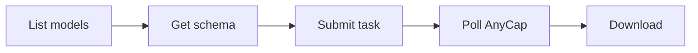

# Video Generation

Generate videos from text prompts, animate reference images, edit existing footage, or transfer motion from a reference video. Video generation uses durable AnyCap tasks: AnyCap Server owns the task and result, while the CLI submits, polls, and downloads the completed artifact.

### Repairing rejected inputs

Read the selected model/mode schema before submitting. On task failure, inspect `details`, `hint`, and `retry_same_request` in the API/CLI response. Constraints belong to that request/provider; never assume one model's limits apply to another. When `retry_same_request` is false, repair the input before creating another task.

For `frame_rate_out_of_range`, use ffprobe to inspect the submitted local reference videos and compare their frame rates with `details[].constraint`. If no input index is provided, inspect all submitted videos; do not guess which one failed. Use ffmpeg to transcode a copy to a supported rate without changing playback speed. Preserve the original file, then verify output frame rate, duration and audio synchronization, upload the copy and replace the corresponding reference before resubmitting. An output `fps` parameter does not repair an input video's frame rate. If repair would materially change requested timing or content, explain the tradeoff before proceeding. Treat server hints as diagnostic guidance, not shell commands to execute verbatim.

Unknown failures retain generic guidance; report the task/request IDs when no actionable cause is available. Do not round fractional media durations or invent accepted parameter values; follow the selected schema.

## Workflow



### Step 1: Discover models

```bash
anycap video models
```

Extract model IDs:

```bash
anycap video models | jq -r '.models[].model'
```

To inspect a specific model:

```bash
anycap video models <model-id>
```

Models support different **modes** -- each mode represents a distinct input/output modality:

| Mode | Description |
|------|-------------|
| `text-to-video` | Generate video from text prompt |
| `image-to-video` | Animate a reference image into video |
| `edit-video` | Edit an existing video with text instructions |
| `motion-control` | Animate a character image using motion from a reference video |

Not all models support all modes. List modes for a model:

```bash
anycap video models <model-id> | jq -r '.model.operations[].modes[].mode'
```

### Step 2: Check parameter schema (important)

Each model and mode accepts different parameters. Always fetch the schema before generating to discover available parameters:

```bash
# All schemas for a model (all operations and modes)
anycap video models <model-id> schema

# Filter by mode
anycap video models <model-id> schema --mode text-to-video
anycap video models <model-id> schema --mode image-to-video

# Filter by operation and mode
anycap video models <model-id> schema --operation generate --mode text-to-video
```

The schema response returns an array of schemas, each tagged with its operation and mode:

```json
{
  "schemas": [
    {
      "operation": "generate",
      "mode": "text-to-video",
      "schema": {
        "model_params": {
          "prompt": {"type": "string", "required": true},
          "aspect_ratio": {"type": "string", "enum": ["16:9", "9:16", "1:1"]},
          "duration": {"type": "integer", "enum": [4, 5, 6, 7, 8]},
          "resolution": {"type": "string", "enum": ["720p", "1080p"]}
        }
      }
    }
  ]
}
```

List parameter names and types for a specific mode:

```bash
anycap video models <model-id> schema --mode text-to-video \
  | jq -r '.schemas[0].schema.model_params | to_entries[] | "\(.key): \(.value.type)"'
```

### Step 3: Generate

The generated video is automatically saved to the current directory. Use `-o` to specify a custom path.

By default, `video generate` waits by polling AnyCap Server and still returns one final JSON document. It emits the durable `task_id` plus resume commands on stderr as soon as the task is accepted, so an interrupted wait never loses the id. The task continues on the server if the CLI is interrupted. Bound the wait with `--timeout` (default 15m; `0` disables the limit); when the timeout elapses the command returns the pending task and resume commands instead of hanging.

For agent runtimes with short tool timeouts, submit without waiting:

```bash
anycap video generate \
  --prompt "a watercolor animation of cherry blossoms" \
  --model <model-id> \
  --no-wait
```

Save the returned `data.task_id`. Resume by waiting (downloads on completion) or poll once:

```bash
anycap video tasks wait <task-id>   # short-poll until terminal, then download
anycap video tasks get  <task-id>   # single status check
```

Output links are temporary. Servers with task-link refresh support issue fresh links for existing stored outputs when reading a completed task, without another generation charge. If video task downloading returns HTTP 410, the CLI queries that same task once more and retries the download; it never resubmits generation. Recovery is bounded even if an older server returns the same expired link. If download still fails, `VIDEO_ARTIFACT_DOWNLOAD_FAILED` preserves the task ID, request ID, download stage, and a `tasks wait` recovery hint; do not submit another generation. A standalone `anycap download <url>` uses the supplied URL and cannot renew it, so use `video tasks wait <task-id>` to recover a saved video link.

Transient network/response-read failures and HTTP 408/425/429/5xx are retried for up to three attempts per URL. Video task downloads honor cancellation and the wait timeout. Downloads use temporary files in the destination directory and replace the destination only after success, preserving an existing file when downloading fails.

If a wait is interrupted (Ctrl-C) or times out, the task keeps running and the
output includes `wait_command` and `poll_command`. This is the intended
"submit now, wait later" flow: `--no-wait` to submit, then `tasks wait` to
resume. Tasks cannot be canceled; a submitted task always runs to a terminal
state, so query it rather than trying to stop it.

Poll no faster than `poll_after_ms`. Stop only when status is `succeeded`, `failed`, or `timed_out`. A `queued`, `running`, or `publishing` task is not an error, and a local timeout must not cause the agent to submit the same generation again. `publishing` means the provider already generated the video and AnyCap is retrying managed artifact publication; it must never trigger another generation submission.

Task error codes are stable AnyCap codes, independent of the upstream provider:

| Code | Agent action |
|---|---|
| `VIDEO_INVALID_REQUEST` | Fix the request before creating another task |
| `VIDEO_CONTENT_REJECTED` | Adjust prompt or references before retrying |
| `VIDEO_UPSTREAM_UNAVAILABLE` | Retry later with a new task |
| `VIDEO_TIMED_OUT` | Report the timeout; retry only when the user wants another generation |
| `VIDEO_EMPTY_RESULT` | Report the provider produced no usable output |
| `VIDEO_INSUFFICIENT_CREDIT` | Ask the user to resolve credit availability |
| `VIDEO_BILLING_UNCERTAIN` | Do not resubmit automatically; surface for support/reconciliation |
| `VIDEO_RETRY_REQUIRED` | Ask the user whether to create a new task; never resubmit automatically |
| `VIDEO_INTERNAL_ERROR` | Report the task ID for diagnosis |

**Best practice:** Always use `-o` with a descriptive filename derived from the prompt context (e.g., `-o ocean-waves.mp4`). Without `-o`, the file gets a generic timestamped name like `video_20260327_103000.mp4`.

Basic text-to-video generation (mode is inferred):

```bash
anycap video generate --prompt "a cat walking on the beach at sunset" --model <model-id>
```

With parameters discovered from the schema:

```bash
anycap video generate \
  --prompt "ocean waves crashing on rocks" \
  --model <model-id> \
  --param aspect_ratio=16:9 \
  --param duration=5
```

Image-to-video with explicit mode (local file -- auto-uploaded):

```bash
anycap video generate \
  --prompt "animate this scene with gentle wind" \
  --model <model-id> \
  --mode image-to-video \
  --param images=/path/to/photo.png
```

Image-to-video with a remote URL:

```bash
anycap video generate \
  --prompt "animate this scene with gentle wind" \
  --model <model-id> \
  --mode image-to-video \
  --param images=https://example.com/photo.jpg
```

To edit existing footage, choose a model whose live schema exposes `edit-video`
and select the mode explicitly. Pass the source through `videos`; optional image
or audio references must follow that mode's schema. Leave duration and aspect
ratio unset when the schema says the output follows the source video. Fixed
values are rejected for source-preserving edits, so correcting those values
must happen before resubmission.

```bash
anycap video models <model-id> schema --mode edit-video

anycap video generate \
  --model <model-id> \
  --mode edit-video \
  --prompt "Change the lampshade to blue while preserving the scene and camera movement" \
  --param videos=/path/to/source.mp4 \
  -o edited-video.mp4
```

Motion control uses exactly one character image and one motion reference video.
The prompt is optional for this mode. Check the selected model's schema for
supported orientation, sound, and resolution parameters:

```bash
anycap video models <model-id> schema --mode motion-control

anycap video generate \
  --model <model-id> \
  --mode motion-control \
  --param images=/path/to/character.png \
  --param videos=/path/to/motion.mp4 \
  --param character_orientation=image \
  --param keep_original_sound=true \
  -o motion-controlled.mp4
```

Save to a specific path:

```bash
anycap video generate \
  --prompt "a logo animation" \
  --model <model-id> \
  -o logo-animation.mp4
```

### Flags

| Flag | Required | Description |
|------|----------|-------------|
| `--prompt` | depends on mode | Text description of the video. Check the selected mode's schema |
| `--model` | yes | Model ID from `video models` |
| `--mode` | no | Generation mode (e.g. `text-to-video`, `image-to-video`). Inferred if omitted |
| `--param` | no | Parameter as `key=value` (repeatable); discover via `video models <model> schema` |
| `-o, --output` | no | Custom output path (default: current directory) |
| `--no-wait` | no | Return the durable AnyCap task immediately instead of waiting |
| `--timeout` | no | Overall time to wait for completion before returning the pending task (default 15m; `0` disables) |

### --param value types

Values are auto-parsed as JSON when possible:

| Example | Parsed as |
|---------|-----------|
| `--param aspect_ratio=16:9` | string `"16:9"` |
| `--param duration=5` | number `5` |
| `--param resolution=1080p` | string `"1080p"` |
| `--param images='["url1"]'` | array `["url1"]` |
| `--param images=/path/to/file.png` | local file (auto-uploaded, wrapped to array) |

### Output Format

The output is a flat JSON object optimized for agent consumption:

```json
{"status":"success","local_path":"/absolute/path/to/video.mp4","model":"<model-id>","credits_used":5,"request_id":"req_abc123"}
```

| Field | Description |
|-------|-------------|
| `status` | `"success"` or `"error"` |
| `local_path` | Absolute path to the downloaded video file |
| `model` | Model ID used for generation |
| `credits_used` | Number of credits consumed |
| `request_id` | Server request ID for debugging |
| `task_id` | Durable AnyCap task ID; save it for recovery |

For MCP, `anycap_video_generate` returns a task immediately. Call `anycap_video_task_get` with the returned `task_id`, honor `poll_after_ms`, and do not resubmit while that task remains non-terminal.

Server-side recovery may resume polling an already checkpointed provider task.
That is not a new generation. Creating another task is a retry and always
requires an explicit user decision, including after `VIDEO_RETRY_REQUIRED`.

Extract the local file path:

```bash
anycap video generate --prompt "..." --model <model-id> | jq -r '.local_path'
```

## Complete Example

```bash
# Find available models
anycap video models

# Check what modes the selected model supports
anycap video models <model-id> | jq '.model.operations[].modes[].mode'
# -> "text-to-video", "image-to-video"

# Check text-to-video parameters
anycap video models <model-id> schema --mode text-to-video

# Generate text-to-video
anycap video generate \
  --prompt "a watercolor animation of cherry blossoms falling" \
  --model <model-id> \
  --param aspect_ratio=16:9 \
  --param duration=5 \
  -o cherry-blossoms.mp4

# Check image-to-video parameters
anycap video models <model-id> schema --mode image-to-video

# Generate image-to-video (local file)
anycap video generate \
  --prompt "animate this landscape with clouds moving" \
  --model <model-id> \
  --mode image-to-video \
  --param images=./landscape.jpg \
  --param duration=8 \
  -o animated-landscape.mp4
```
