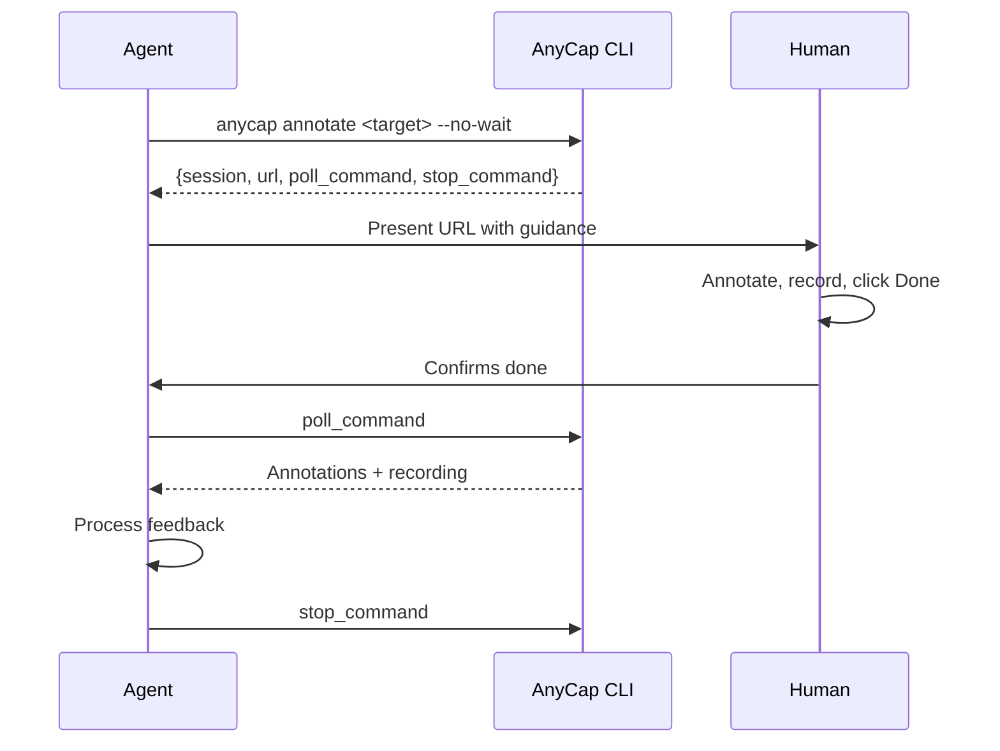
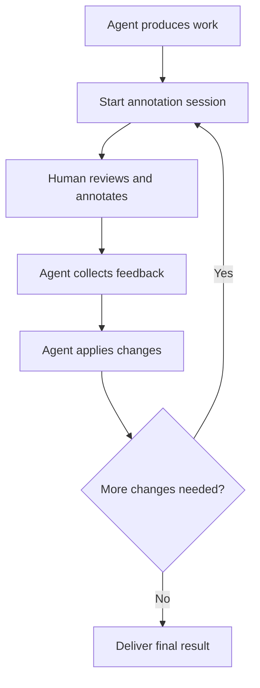

# AnyCap Human Interaction

Workflow guide for collecting structured visual feedback from humans using AnyCap's annotation tool. This skill teaches you **when and how** to involve humans in your workflow through visual annotation and screen recording.

For CLI command reference, read the `anycap-cli` skill. For media generation workflows, read the `anycap-media-production` skill.

## Prerequisites

AnyCap CLI must be installed and authenticated. Read the `anycap-cli` skill if setup is needed.

## Command Quick Reference

```bash
# Blocking -- opens browser, waits for Done click, outputs result
anycap annotate <target> [-o output.png]

# Non-blocking -- starts background server, returns session info
anycap annotate <target> --no-wait [-o output.png]

# Poll for result after human confirms done
anycap annotate poll --session <session_id>

# Stop background server
anycap annotate stop --session <session_id>
```

`<target>` is auto-detected by content: image file, URL (`http://` or `https://`), video file, or audio file.

### Key Flags

| Flag | Description |
|------|-------------|
| `--no-wait` | Non-blocking mode (recommended for agents) |
| `-o, --output` | Save annotated image to this path |
| `--port <port>` | Bind to a fixed port (default: random) |
| `--bind <addr>` | Bind address (default: `127.0.0.1`) |

### Headless / Remote Access

When running in a headless environment (SSH, container, cloud VM), the human cannot access `127.0.0.1` directly. Use `--bind` and `--port` to make the annotation server accessible:

```bash
# Bind to all interfaces on a fixed port
anycap annotate screenshot.png --no-wait --bind 0.0.0.0 --port 8888
```

The human can then access the annotation UI via:

- **Direct access:** `http://<server-ip>:8888` (if the port is exposed)
- **SSH port forward:** `ssh -L 8888:localhost:8888 user@host`, then open `http://localhost:8888`
- **Container port mapping:** `docker run -p 8888:8888 ...`, then open `http://localhost:8888`

Always use `--port` with a fixed number in headless environments so the URL is predictable and forwardable.

## When to Use Annotation

Use annotation when:

- You generated an image/video and need the human to point at what to change
- You built or modified a web page and need the human to review it visually
- You need spatially-grounded feedback ("move this here", "this area is wrong")
- Text-only feedback would be ambiguous about location or visual details
- You want the human to record a narrated walkthrough of their feedback

Do NOT use annotation when:

- You only need a yes/no approval (just ask in chat)
- The feedback is purely textual (e.g., "change the title text to X")

## Four Media Types

| Type | Best for | Annotated image? | Recording? |
|------|----------|-------------------|------------|
| **Image** | Generated images, screenshots, designs | Yes (full resolution) | Optional |
| **URL** | Web pages, local dev servers, live UIs | No (cross-origin) | Critical |
| **Video** | Generated videos, screen recordings | Yes (frame snapshot) | Optional |
| **Audio** | Music, speech, sound effects | Yes (canvas) | Optional |

Key insight: **URL mode has no annotated image output.** The recording is the primary feedback artifact. Always encourage recording for URL reviews.

## Interaction Pattern

All annotation workflows follow this pattern:



## Image Review

Use when you generated an image and need the human to mark desired changes. For the complete image-to-image refinement loop (generate -> annotate -> edit -> iterate), read the `anycap-media-production` skill.

### Start the Session

```bash
anycap annotate hero-banner.png --no-wait -o hero-banner-annotated.png
```

### Present to the Human

> "I generated the banner image. Please open this link to review it:
> {url}
>
> Draw rectangles, arrows, or points on areas you want changed, and type a description for each annotation. Click Done when finished."

### Collect and Use Feedback

```bash
# Poll for result
anycap annotate poll --session <session_id>

# Extract annotation labels for image-to-image prompt
anycap annotate poll --session <session_id> \
  | jq -r '[.annotations[] | select(.label != "") | "#\(.id): \(.label)"] | join(". ")'

# Apply changes via image-to-image
anycap image generate \
  --prompt "<annotations as prompt>. Keep all other elements unchanged." \
  --model nano-banana-2 \
  --mode image-to-image \
  --param images=./hero-banner-annotated.png \
  -o hero-banner-v2.png

# Clean up
anycap annotate stop --session <session_id>
```

## URL / Web Page Review

Use when you built or modified a web page, UI, or any browser-accessible content and need the human to review it visually.

**This is the most important mode to get right.** Unlike image mode, URL mode cannot export an annotated screenshot (cross-origin iframe restriction). The **screen recording with narration** is the primary feedback artifact.

### Start the Session

```bash
# Local dev server
anycap annotate http://localhost:3000 --no-wait

# Live URL
anycap annotate https://staging.example.com --no-wait
```

### Present to the Human -- Emphasize Recording

The annotation tool shows a tutorial overlay on first open for URL mode, but your message should reinforce it:

> "I updated the page. Please open this link to review it:
> {url}
>
> **How to review:**
> 1. Browse the page and use annotation tools (Rect, Arrow, Point) to mark issues
> 2. Click **Rec** to start recording your screen -- narrate what you see and what you want changed
> 3. Click **Done** when finished
>
> The recording helps me understand exactly what you see and what needs to change."

### Collect and Analyze Feedback

```bash
# Poll for result
anycap annotate poll --session <session_id>

# Check if recording exists
RECORDING=$(anycap annotate poll --session <session_id> | jq -r '.recording // empty')

# Analyze the recording with AI video understanding
if [ -n "$RECORDING" ]; then
  anycap actions video-read --file "$RECORDING" \
    --instruction "List all issues the user pointed out. For each issue, describe what they are looking at, what is wrong, and what they want changed. Include timestamps."
fi

# Also read text annotations
anycap annotate poll --session <session_id> \
  | jq -r '.annotations[] | "#\(.id) [\(.type)]: \(.label)"'

# Clean up
anycap annotate stop --session <session_id>
```

### Applying URL Feedback

URL review feedback typically maps to code changes, not image generation. After analyzing the recording and annotations:

1. Identify which files need changes based on the visual feedback
2. Make the code changes
3. Start a new annotation session for the human to verify

## Video Review

Use when you generated a video or need the human to review video content.

### Start the Session

```bash
anycap annotate output.mp4 --no-wait
```

### Present to the Human

> "I generated the video. Please open this link to review it:
> {url}
>
> Pause at key moments and draw annotations on the frame. If you have detailed feedback, click **Rec** to record your screen while narrating. Click **Done** when finished."

### Collect Feedback

```bash
anycap annotate poll --session <session_id>

# The annotated_image is a snapshot of the paused frame with annotations
# Use annotations + recording to understand time-specific feedback

# If recording exists, analyze it
RECORDING=$(anycap annotate poll --session <session_id> | jq -r '.recording // empty')
if [ -n "$RECORDING" ]; then
  anycap actions video-read --file "$RECORDING" \
    --instruction "What feedback did the user give about the video? Note timestamps."
fi

anycap annotate stop --session <session_id>
```

## Audio Review

Use when you generated music or audio and need the human to provide feedback.

### Start the Session

```bash
anycap annotate track.mp3 --no-wait
```

### Present to the Human

> "I generated the audio track. Please open this link to review it:
> {url}
>
> Play the audio and draw annotations on the canvas to mark time regions or sections. Add labels describing what you want changed. Click **Done** when finished."

Audio feedback typically results in re-generation with an adjusted prompt rather than spatial edits.

## Multi-User Collaboration

Multiple humans can open the same annotation URL simultaneously. All annotations and cursor positions sync in real-time. Each participant gets a random name and color.

Use this for:

- Team reviews where multiple stakeholders have input
- Design critiques with several reviewers
- Collaborative walkthroughs

Present the same URL to all participants and wait for all to finish before polling.

## Iterative Review Loop

For complex tasks, iterate:



Tips for iteration:

- Version your outputs (`v1`, `v2`, `v3`) so the human can compare
- Reference previous feedback in your changes ("Addressed #1 from previous review: ...")
- After 2-3 rounds, summarize all changes made to confirm nothing was missed

## Recording Analysis Patterns

The recording is a `.webm` video captured from the browser tab, including annotations being drawn and voice narration. Use `anycap actions video-read` to analyze it:

```bash
# General feedback extraction
anycap actions video-read --file <recording_path> \
  --instruction "List all issues and desired changes the user described"

# UI-specific review
anycap actions video-read --file <recording_path> \
  --instruction "For each UI element the user points at, describe the current state and the desired change"

# Prioritized feedback
anycap actions video-read --file <recording_path> \
  --instruction "Categorize the user's feedback by priority (critical, important, nice-to-have)"
```

## Choosing the Right Presentation

| Scenario | What to annotate | Key guidance to human |
|----------|------------------|----------------------|
| Generated image needs edits | The image file | Mark regions, describe changes |
| Web page needs review | The URL | Browse, annotate, and **record with narration** |
| Local dev server review | `http://localhost:PORT` | Browse, annotate, and **record with narration** |
| Video needs feedback | The video file | Pause at key moments, annotate frames |
| Music/audio needs feedback | The audio file | Play and annotate the canvas |
| Multiple reviewers needed | Any of the above | Share the same URL with all reviewers |
